# Inside Bottlify

Русская версия: [architecture.ru.md](architecture.ru.md).

Paths without a prefix are relative to [`modules/`](../modules/) in bottlify; paths starting with `ui/` are
relative to the root of bottlify-ui. Where a diagram and the code disagree, the code is right.

1. [What it is](#1-what-it-is)
2. [What it is made of](#2-what-it-is-made-of)
3. [Threads: who starts whom, and why](#3-threads-who-starts-whom-and-why)
4. [Startup: from createApp to the first instruction](#4-startup-from-createapp-to-the-first-instruction)
5. [cork, the execution core](#5-cork-the-execution-core)
6. [Win32 in JavaScript: how a DLL comes about](#6-win32-in-javascript-how-a-dll-comes-about)
7. [Graphics](#7-graphics)
8. [Sound](#8-sound)
9. [Networking](#9-networking)
10. [Storage](#10-storage)

## 1. What it is

What Bottlify is and why it exists is in the [README](../README.md). This document is how it works.
The table shows what in Bottlify gives a program what it needs from Windows and from the machine,
and which web API that runs on. The server plays no part in a frame: it only serves files and
forwards network traffic.

| What an application needs | What provides it | What it runs on |
| --- | --- | --- |
| An x86 processor | cork, translating x86 to wasm | WebAssembly |
| System DLLs | the `win32` layer: functions in JS that the program sees as real PE images | |
| DirectDraw, Direct3D 7–10, OpenGL, Vulkan, GDI | the `graphics` layer | WebGPU |
| DirectSound, waveOut, DirectMusic | the `audio` layer | AudioWorklet, SharedArrayBuffer where the page has it |
| Several processors | the `cpu` layer's executors, each a worker over the program's memory | Web Workers, SharedArrayBuffer |
| DirectInput, XInput, window messages | the `input` layer | keyboard and mouse events, Gamepad API |
| DirectShow cinematics | the `media` layer, FFmpeg in wasm | WebAssembly |
| A disk | a bundle read block by block, with a session on top | fetch with Range, OPFS |
| Winsock | `wsock32` and the relay | WebSocket |

### Why games

The idea behind Bottlify is a game in a bottle, so the engine is built first of all for games. For
a game, speed is part of being correct: a game that draws 10 frames a second instead of 60 does
not work, however right its arithmetic is.

A game is also the best test for a system like this:

- **A game exercises everything at once.** Integer code, x87 and SSE, Direct3D, sound, input, files,
  threads, sometimes the network: one run goes through nearly every layer of the engine.
- **A game measures itself.** Many games ship built-in benchmarks and timedemos: the same scene
  every time, and frames per second at the end. Two runs compare as numbers, so a regression shows at
  once rather than by eye.
- **Gaps show at once.** A missing function makes the program stop with `unimplemented import` and
  that function's name. An inexact one shows as a misplaced picture, a click in the sound or lost
  frames. Each such failure points at a specific place in the engine.
- **There are a great many games.** Thousands of programs from different years, engines and
  compilers make a huge ready-made test suite nobody has to write.

The engine is never bent to fit one game: when a game stumbles, the shared layer it stumbled on is
fixed, and the fix reaches every program that takes the same path. So although what games need is
the most developed part today (DirectX and OpenGL, sound, input, cinematics and networking), it
works for any application.

## 2. What it is made of

The repository has four `@bottlify/` packages:

| Package | What is inside |
| --- | --- |
| `@bottlify/core` | Our Windows environment: Win32 and DirectX, the loader, the scheduler, files, and `createApp`, which starts it all |
| `@bottlify/cork` | The x86 → wasm translator and its runtime. The engine does not import it; it loads it by URL |
| `@bottlify/networking` | The client and server of the relay that applications reach the network through |
| `@bottlify/installer` | Installing an application with its own installer, and packing bundles |

For debugging there is also **bottlify-ui**, a repository of its own: a React launcher and a local
server that serves the application, the engine, the bundles and the relay from one address.

The engine is split into layers, and any of them can be switched off without breaking the rest.
Each layer has its own interface, configuration and tests, and talks to other layers only through
what it declares in `requires`. A layer switched off that another needs is replaced by a stub:
with `graphics: null`, for instance, a game runs with no picture. The module contract and the
`npm run check:boundaries` check are in [`core/configuration.md`](core/configuration.md#the-module-contract).

| Layer | Responsible for | `requires` |
| --- | --- | --- |
| `log` | the journal, counters, phase profile | |
| `cpu` | running x86 code through cork, trapping calls into the bridge | `log` |
| `memory` | the program's address space: reservation, pages, protection | `cpu`, `log` |
| `kernel` | processes, threads, the scheduler, wait objects | `cpu`, `memory`, `log` |
| `loader` | loading PE images and building the system DLLs | `cpu`, `memory`, `log` |
| `bridge` | calling conventions, parking threads, callbacks, COM in the program's memory | `cpu`, `kernel`, `memory`, `log` |
| `filesystem` | the bundle, the block cache, the `C:` drive, the files the program writes | `log` |
| `win32` | kernel32, user32, gdi32, advapi32, ole32, msvcrt, winmm, wsock32 and some thirty more DLLs | `bridge`, `kernel`, `memory`, `loader`, `filesystem`, `media`, `log` |
| `graphics` | DirectDraw, Direct3D 7/8/9/10, OpenGL, Vulkan and the WebGPU backend under them | `win32`, `bridge`, `memory` |
| `audio` | DirectSound, DirectMusic, the mixer, MP3 for Miles | `win32`, `bridge`, `memory` |
| `input` | DirectInput, XInput, keyboard and mouse in the message queue | `win32`, `bridge`, `memory` |
| `media` | the video decoder (FFmpeg in wasm) and `ijl15.dll` | `log` |

## 3. Threads: who starts whom, and why

A tab runs nine kinds of thread, three of them several times over. The page starts three: the
engine thread, the log keeper and the AudioWorklet. The engine thread starts the graphics thread, a
process thread for each process where processes run at once, the run's pool of translation
threads, which it lends to the processes, and the writer of the translation store. The thread a
process runs on starts that process's executors: one worker for each processor core the program is
given past the first.

Nearly all the work happens on the thread the program runs on: the engine thread, or, where
processes run at once, the process's own thread. The others take from it what can run in parallel,
or what the browser only allows off the main thread.

How a run is laid out depends on whether the page is cross-origin isolated:

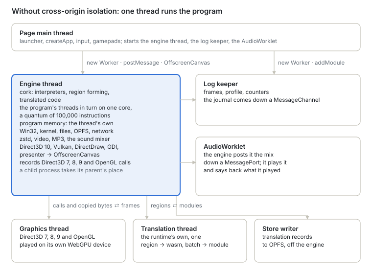

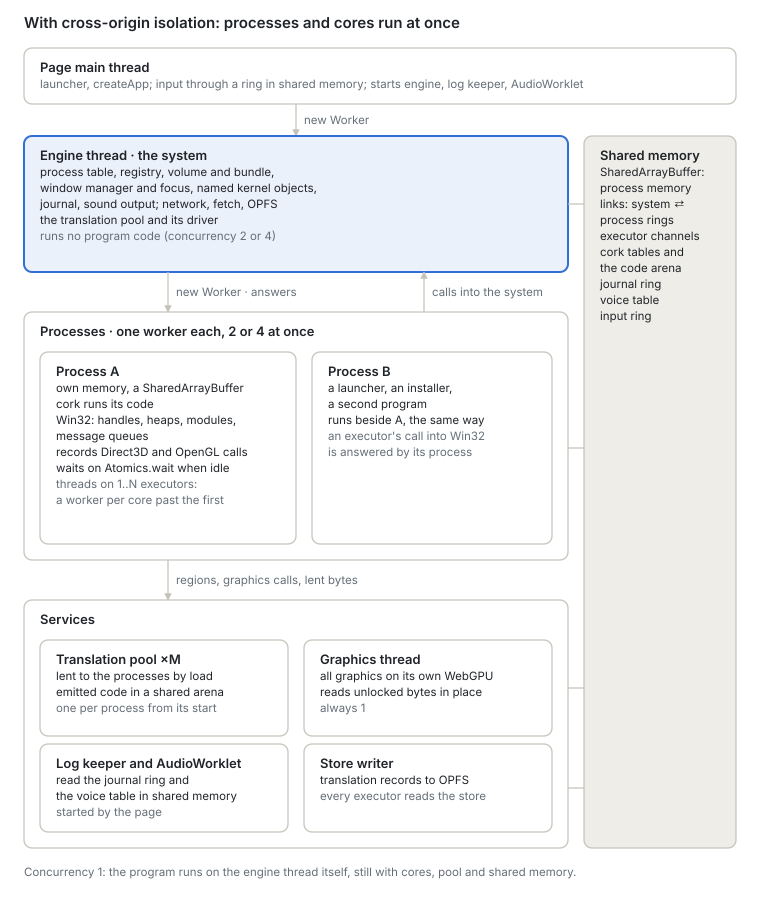

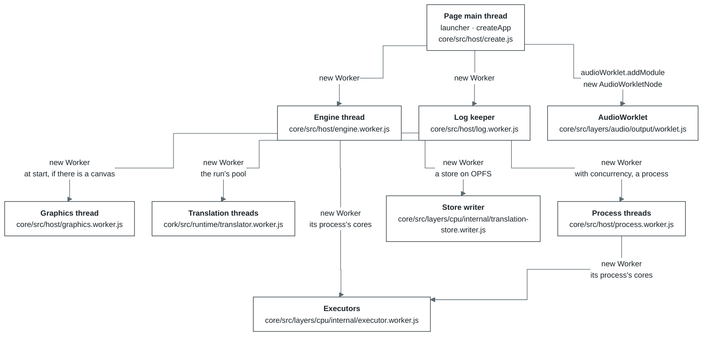

| Thread | Started by | When | Why a thread of its own |
| --- | --- | --- | --- |
| Page main thread | the browser | always | The launcher's interface, the `createApp` call and DOM events live here. Per frame it does one thing only: polls the gamepads (`requestAnimationFrame` → `input.poll`) |
| Engine thread | the page, [`core/src/host/create.js`](../modules/core/src/host/create.js) | always. With `?host=thread` the engine runs on the page's thread instead, over the same protocol | The program runs in long quanta. On the page's thread it would be interrupted by garbage collection and the interface's rendering, and a click would wait for the quantum to end. Synchronous OPFS access also exists only in a worker. A WebGPU device cannot move between threads, so the worker opens its own and gets the canvas as an `OffscreenCanvas` |
| Log keeper | the page, [`core/src/host/remote.js`](../modules/core/src/host/remote.js) | always. Without `Worker`, a `MessageChannel` on the page takes its place | The engine writes its journal, counters and tables into shared memory and answers no questions. The keeper drains the ring before it laps, keeps the history and works out frames, the profile and the per-module breakdown. Logging then costs neither the page nor the engine anything |
| Graphics thread | the engine thread, [`core/src/host/graphics-worker.js`](../modules/core/src/host/graphics-worker.js) (called from `serve.js`) | at start, if the engine has a canvas and `device.graphicsWorker: false` is not set (`?graphicsWorker=off` in the launcher). Survives a change of program. If it opens no device within 10 s, everything draws on the engine thread | Its job is to draw all the graphics, so the engine thread only keeps state and answers the program. Today Direct3D 7, 8, 9 and OpenGL are played here on a WebGPU device of its own; Direct3D 10 and Vulkan will move here too. In the `tools/graphics-bench --remote` bench the engine thread spends 0.69 ms a Direct3D frame instead of 2.95 |
| Translation threads | the run's pool, [`core/src/host/pool/pool.js`](../modules/core/src/host/pool/pool.js) (made in `app.js`) | when the engine is cork, the page can share memory and a translator would use a worker; elsewhere each process opens a translator of its own. Each process is lent one from its start to its exit, and the pool's driver adds more while its translation lags (section 5; `cork.pool` in [`core/configuration.md`](core/configuration.md#cpu)). The pool lends to the process's own thread; its other executors each open a translator of their own. Until the first answers `ready`, regions are translated on the process's own thread | Emits wasm for regions, builds a module and compiles it. The process's thread does not wait for it: it posts a batch and publishes the result between frames, whenever it arrives. A translation thread works for one process at a time, over a port of its own; one that works for none sleeps and holds nothing of any process |
| Executors | the thread a process runs on, [`core/src/layers/cpu/internal/executor.js`](../modules/core/src/layers/cpu/internal/executor.js) | under cork, on a page that can share memory, when the process has more than one core ([`cpu.cores`](core/configuration.md#cpu)): one for each core past the first, opened when a thread of the program wants one | Runs the program's threads at once with the process's own thread, over the process's memory itself. A call into Win32 or the kernel, and a fault, waits while the process's thread answers it over the executor's registers. Each opens a translator of its own and takes translations from the run's store through the process |
| Store writer | the engine thread, [`core/src/layers/cpu/internal/translation-store.js`](../modules/core/src/layers/cpu/internal/translation-store.js) | where the run's translation store is a directory on OPFS | Writes the store's records through a handle of its own: a write through the synchronous handle waits for the disk, which on the engine thread held a frame |
| AudioWorklet | the page, `ui/src/engine/session.js` | if sound is on | The Web Audio real-time thread. On a cross-origin isolated page it reads the voices from shared memory on its own clock, so sound does not break up even while the engine is busy; elsewhere the engine posts it the mix down a channel of their own and it says back what it played |
| Process thread | the engine thread, [`core/src/host/process-worker.js`](../modules/core/src/host/process-worker.js) (called from `app.js`) | with `concurrency` 2 or 4 under cork, once per process, the program the page started included, for as long as it runs | A process (the launcher, and the game it starts) runs on a thread of its own, beside its parent, with its own memory and translator. It blocks while it waits instead of taking turns with the engine's event loop, and the engine's thread runs no program at all |

How the threads exchange data. ⇄ means both ways; SAB is `SharedArrayBuffer`, that is, shared
memory.

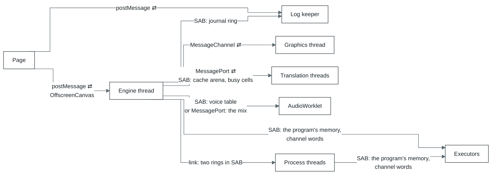

- **Page ⇄ engine.** Requests and input go by `postMessage`. Along with each message the page
  increments a signal word in shared memory, so the engine notices the message right away, between
  two turns of the scheduler, rather than at its next scheduled pause. Where processes run at once,
  input and visibility go through a ring in shared memory instead, read between two turns, and
  requests are still posted. The canvas is handed over once (`transferControlToOffscreen`), and
  from then on only the engine draws into it.
- **Engine → log keeper.** Shared memory only: the keeper looks into the ring every 200 ms. Without
  `SharedArrayBuffer` the page forwards the records to it as messages.
- **Engine ⇄ graphics.** Direct3D 7, 8, 9 and OpenGL each have a `MessageChannel` of their own. Calls go into one
  buffer per batch, and the buffer is transferred without a copy. Back come the frame as an
  `ImageBitmap` and the answers to calls only the renderer knows.
- **Engine ⇄ translation.** Regions missing from the store go one way; module bytes and an already
  compiled `WebAssembly.Module` come back.
- **Engine → AudioWorklet.** On a cross-origin isolated page, no messages at all. The voice table
  lives in shared memory: the page gets it in the answer to the start request and hands it to the
  `AudioWorkletNode`. Elsewhere the page gives the engine and the worklet the two ends of a
  `MessageChannel`, the engine posts the mix down it, and the worklet says back what it played.
- **A process ⇄ its executors.** The program's memory is shared with them as it is; a few words
  of shared memory per executor carry its turns. The process asks for a slice, and every call into
  Win32 or the kernel and every fault the slice reaches waits while the process's thread answers it
  with its own handlers, the executor's registers swapped into its state block for the answer
  (`executor.js`). How the executors share translations and the store is in section 5. Each
  executor also counts its runs of guest code in those words, which the graphics recorder's write
  watch reads (section 7).

**Processes.** How many processes run at once is `createApp({ concurrency })`; what 1, 2 and 4
give, and when a run falls back to `compatible`, is in
[`core/README.md`](core/README.md#which-mode). With 1, the default, the program runs on the engine
thread and a child process takes its parent's place there. With 2 or 4 every process has a thread
of its own, and one past that many takes turns with its parent on the parent's thread. The engine
thread then runs no program and is the system (what it builds before any process starts is in
section 4), and what the page asks of the program it asks the program's thread.

What the processes of a run share stays on the engine thread: the registry, the volume and the
sharing of its open files, the window directory, ids, named events, semaphores and mutexes, the
bundle, COM's class table ([`core/src/com-link.js`](../modules/core/src/com-link.js)), the translation store ([`core/src/layers/cpu/internal/store-link.js`](../modules/core/src/layers/cpu/internal/store-link.js)).
The engine thread answers a process thread across a link: two rings in shared memory, one each
way, with a doorbell word per side ([`core/src/system/link.js`](../modules/core/src/system/link.js), values encoded by `codec.js`). The
process thread blocks on its doorbell for each answer and answers what it is asked meanwhile (the
engine asks it about its windows); a message longer than a ring holds goes in parts. Each side
looks at its doorbell for a few microseconds before it sleeps on it, since a thread woken from
sleep costs far more than the answer.

A process thread seldom asks the volume: every change to a drive moves that drive's word in shared
memory (one word per drive letter), and the process thread keeps what it read of a drive (64 KB
pieces of files, sizes, entries, listings) until that word moves. The sharing every open is
settled against is a table in shared memory under a lock, and a process thread settles its own
opens against it ([`core/src/layers/filesystem/internal/volume-link.js`](../modules/core/src/layers/filesystem/internal/volume-link.js), `shared-sharing.js`).

A process's Direct3D devices draw on the graphics thread through a port of their own, its
DirectDraw and GDI pictures come to the engine as bytes, its sound is mixed on the run's voice
table in a span its parent lends it, and the page's input reaches it as the run's window manager
routes it (section 7). What it cannot have yet is in [`core/limits.md`](core/limits.md#processes).

**Modes.** `createApp({ mode })` says how much of this rides on shared memory. `isolated` (which
needs a cross-origin isolated page) puts the program's memory in a `SharedArrayBuffer`,
`compatible` leaves it the engine thread's own and copies whatever crosses to another thread, and
`auto` (the default) takes `isolated` where the page is isolated. Only in `isolated` does the
graphics thread read what the program wrote between `Lock` and `Unlock` straight out of its
memory and write read-backs into it in place, and only there do the program's threads run on
several cores; in `compatible` the program is told of one core. What each mode costs the page is
in [`core/README.md`](core/README.md#which-mode). The run's mode is in the `app` layer's
diagnostics ([`core/src/mode.js`](../modules/core/src/mode.js)); the launcher takes `auto` unless
`?mode=compatible` or `?mode=isolated` asks for another.

## 4. Startup: from createApp to the first instruction

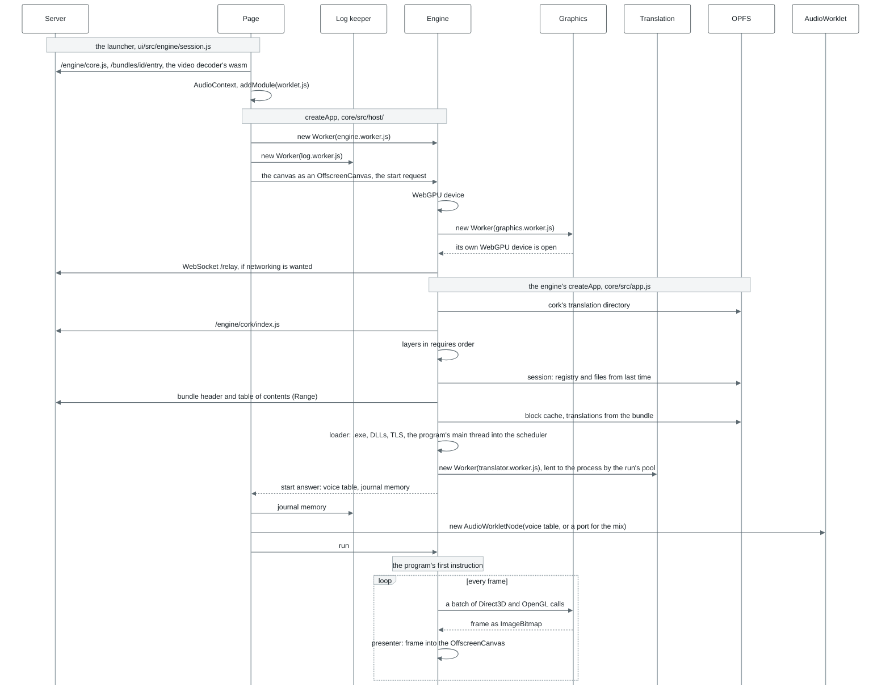

The order matters in three places.

- **The WebGPU device and the graphics thread open before the layers.** The engine's `createApp`
  receives the graphics thread in its device options (`device.worker`), so the `graphics` layer knows
  while it is being built where Direct3D and OpenGL will draw.
- **The session is applied before the program's first instruction,** so the program sees its saves
  and registry from the very start.
- **The program starts only on `run`,** once the page has attached the log, input and sound.
  Libraries' `DllMain` and TLS callbacks are the program's code too: a stub at the start of the main
  thread calls them, not the host. Every thread made later begins in a stub of its own that calls
  them with `DLL_THREAD_ATTACH` before its start routine, and with `DLL_THREAD_DETACH` when it
  ends, under the same loader lock (`kernel32/thread-calls.js`). The process's end and the last
  `FreeLibrary` tell each image's TLS callbacks `DLL_PROCESS_DETACH` before its `DllMain`
  (`kernel32/dllentry.js`).

With processes at once (`concurrency` 2 or 4), the engine thread builds the run's system instead:
it mounts the bundle, lays the session and the page's files on the volume, makes the registry and
opens the journal and the sound output (`buildSystemHost` in [`core/src/app.js`](../modules/core/src/app.js)). The steps from
the layers to the program's first instruction run in the program's process thread.

Where to look in the code: `ui/src/engine/session.js` (what the launcher passes),
[`core/src/host/create.js`](../modules/core/src/host/create.js) and `remote.js` (the page side), `serve.js` (the engine side),
[`core/src/app.js`](../modules/core/src/app.js) (`createApp`, `buildApp`, the loader).

## 5. cork, the execution core

cork, our x86-32 to WebAssembly translator with a runtime of its own (the [`cork/`](../modules/cork/) package), runs all
of the program's code. What it is, how it translates and runs code, what it supports and how fast it
is: [`modules/cork/README.md`](../modules/cork/README.md). This section is about how it sits in
Bottlify.

The engine does not import cork: the `cpu` layer loads it by URL (`/engine/cork/index.js`), and
`createEngine` implements the executor contract in
[`core/src/layers/cpu/engine.js`](../modules/core/src/layers/cpu/engine.js); `@bottlify/core` adds
Win32, threads and the scheduler on top. Only user-mode code runs: nothing reaches a Windows
kernel, and where a system call would be, a trap into the bridge fires instead (section 6).

| Where | What it does |
| --- | --- |
| Engine thread | The interpreters, region forming, store lookups, publishing and running translated code, traps into the bridge |
| Translation threads | The emitter and the encoder: a batch of regions becomes a wasm module, and the module a compiled `WebAssembly.Module`. Several may work for one process, each with a batch of its own |
| OPFS | The translation store, `cork/<id>.v3/` |
| Server | The code of cork and its worker (`/engine/cork/`). A bundle may bring translations ready-made |

**Memory.** All of the program's memory is one `WebAssembly.Memory` of fixed size, shared in the
`isolated` mode: 1 GiB for the program by default, plus cork's tables. The layout (program address
`a` at offset `0x10000 + a`, the state block with the registers, 512 bytes, in the first 64 KiB,
and after the program's memory cork's tables with one flag byte per 4 KiB page) is in
[cork's README](cork/README.md#how-it-works). With several executors, each further one
has a state page and tables of its own (`executorLayout`), while the program's memory is
everyone's. The page flags are `INACCESSIBLE`, `HAS_CODE`, `VOLATILE`, `CLOSED`, `NO_EXECUTE`, and
`WATCH` or `WRITTEN` on a page watched for writes (section 7).

### Translation in Bottlify

- **Several translation threads, one arena.** A process can have several translation threads, each
  with a batch of its own out. A relink, a merge, and a region formed again take over running
  regions, so they go out alone. The functions already emitted, which a relink or merge takes again
  rather than emitting them anew, belong to the process, not to a thread: they are kept in its
  arena, 48 MB of shared memory that every translation thread of the process reads and adds to
  under one lock, the oldest segment going first. Without it a relink emits again what was
  emitted: a translation thread was busy 23.3 s instead of 14.6 s while a game loaded.
- **The pool's driver.** Every 500 ms it reads from shared memory how long each translation thread
  worked and how many regions it emitted (the threads write it there). One more joins a process
  when the median load of those already working for it reaches 80 %, at most `hardwareConcurrency`
  for a process. Each join is a trial: unless the process's regions a second rise by half of what
  one more thread adds at best, the joined thread leaves and the process keeps that count as its
  ceiling. That is what happens on four cores, where one translation thread already leaves no core
  free while a game loads, and a second made loading slower ([`roadmap/negative-results.md`](../roadmap/negative-results.md), 2026-10-07).
  Joined threads leave at once when the process stops translating to wait, and after 3 s of a
  median under 40 % otherwise. Every decision is in the pool's journal (`translationPool()` on the
  run).
- **Regions do not repeat each other.** A candidate at a block of a region formed and not yet
  published (earlier in its batch, with a translator, or its module compiling) is not formed
  again beside it (for a region with x87 in it, at the top that region was formed for): it has an
  entry there once that region is published. A region may also stop at a block another region has
  an entry for and leave to it there (`regionStops`), so a function's code is translated once; that
  is off by default, because the hot code it cuts crosses between regions (`SETTINGS.md`). A small leaf callee
  is formed into each caller, for the call it saves.
- **The store.** A translation is keyed by the cache version, the browser's features, the memory
  layout, the bundle id, the entry address, the x87 stack top (any top for a region with no x87 in
  it) and the run's modes. Its record says what forming made of it: a 64-bit FNV hash of the
  region's bytes, the blocks it left to other regions, the callees formed into it, its x87
  precision. A run that forms the region otherwise (before its callees were known, or beside other
  regions) forms it again as the record says and takes it when the bytes hash the same. The store
  also keeps a map of where its regions have entries: a run that meets a block of a stored region
  before the region's entry forms that region rather than a new one
  ([cork's README](cork/README.md#how-it-works)). Every process of a run adds its
  regions to that map when it flushes, to the map as the store holds it then, and writes it back
  only when it adds a 64th of it: a tool a game starts many times a run would otherwise write the
  whole map each time. A bundle may bring translations along (`CORKSEED`); they are seeded before
  the first instruction.

### Execution in Bottlify

- **Counting instructions.** Each block subtracts its instruction count from a budget on the way
  out, and the budget is checked on backward jumps. Translated code is given its budget 10,000 at a
  time, so a thread can be preempted promptly. How long a turn is (the 100,000-instruction quantum,
  a quarter of a millisecond among ready threads, about 750,000 for fast translated code, and a
  solo turn of ten quanta) is in [`core/configuration.md`](core/configuration.md#kernel). While
  other executors run threads, a solo turn comes only where their calls interrupt the process's
  slice.
- **Two interpreters.** The first 8192 units of a process's work (instructions, plus 128 for each new
  jump target) run on the JS interpreter, the rest on the wasm interpreter.
- **Memory and self-modifying code.** Outside precise mode reads are not checked until the program
  first touches a page it cannot reach: the address simply wraps into the program's memory. From
  that fault on, every region tests the pages it reads, and the regions that wrapped are translated
  again. Every write checks the page's flag byte (the accesses a block makes off one register once
  for all of them, as one window). A store through `esp` alone goes unchecked while no translated
  code lies on a thread's stack (`looseStacks`); once code is translated there, every region checks
  those too.
  When the program writes where translated code lies on a page, the region exits. The first such
  write drops all of that page's translations. The regions formed there afterwards keep a copy of
  the bytes they were formed from, and a later write drops only those whose bytes it actually
  changed: a mixer that rewrites its voice patches with the bytes already there keeps its code,
  and the code it drops is queued for translation at once. A page keeps one range of the 32-byte
  granules its code covers, so data between two pieces of code is inside that range. A write there
  that touches no region's bytes is judged against a copy of the page. If it changed the value (a
  variable written every turn of a loop), the page loses its translations: kept as code, it would
  send every such write to the interpreter. If it wrote the bytes already there, the page stays.
  A page that loses its translations 8 times within 100 ms is marked volatile (`VOLATILE`) and
  interpreted for 2 s, twice as long each time it is marked again, then translated again. With
  several executors a page loses all its translations on every such write.
- **Several executors of a process.** How many a run gets, when they open, what the program is
  told of its processors and what an affinity mask means are in
  [`core/configuration.md`](core/configuration.md#cpu) (`cpu.cores`, `cpu.eager`).
  - **An executor of its own.** Each thread has an executor of its own, where its translations
    are: the process's first thread runs on the process's own, each later one on the other
    executor fewest live threads call theirs. A turn gives every free executor the next ready
    thread whose executor it is; a thread whose executor is busy goes to one left free (the
    process's own first) and has its code translated there too, rather than leave a processor
    idle. A thread is never started while another executor still runs it: one that waited there is
    made ready by its wake before that slice is taken, and the scheduler refuses the second start.
  - **Threads that belong on the process's executor.** Two kinds of thread run there only, where
    they may. One calls into the host more often than once in 30 000 instructions over its last
    million or so instructions, since from another executor every such call is a round trip. The
    instructions are counted however many slices cut them: a thread that wakes, runs a few dozen
    instructions and waits again weighs as little as those. The other is a thread whose runs on
    another executor have mostly ended with the process's executor left nothing to run and calling
    it back, the run having done less than half of what the process's executor did meanwhile. It
    takes turns with the process's threads rather than running beside them; the share halves every
    second, so it tries again. A thread called back after doing at least half as much ran at once
    with them, as a render thread its main thread waits on each frame, and stays on its own
    executor. A thread of either kind waiting for the process's executor takes it from one that
    computes, which goes to another executor in its place.
  - **Spread or concentrated.** All of the above is one way of placing threads, spread. The other,
    concentrated, keeps every thread on the process's own executor where its mask allows, taking
    turns there as on one processor (`cpu.placement`). Unless the run names one, the scheduler
    tries both: two windows of each in turn, concentrated first, each some hundreds of
    milliseconds after a short settling, and keeps the faster. Where the program presents frames,
    speed is frames presented a millisecond, since a game's thread spinning on its jobs retires
    instructions that are no progress; elsewhere it is instructions retired on every executor.
    Spreading must win by 5%. A trial runs the program the slower way for its windows, which a
    player sees as a second of slow frames, so the winner is kept until the program changes: it is
    tried again three seconds after the program begins or stops presenting frames (a game's load,
    then its play), or once the share of the work each thread does has moved by a quarter for ten
    seconds, and never sooner than 30 seconds after the last trial. A game whose threads hand work
    to each other every frame runs concentrated, near its speed on one core (the locked
    instructions stay atomic); a compressor's workers run spread.
  - **A pinned thread** (`cpu.playPinned`). A thread pinned to one processor whose calls into the
    host take the process's executor the most time may have that processor played by the
    process's own executor, where its calls are answered, the executor that played it taking the
    process's. For example, a game's render thread, its Present and Lock a few hundred
    microseconds each, is pinned to the last processor while its main thread is pinned to the
    first. The time is that of the calls themselves, wherever the thread runs, halved every
    second; a trade is weighed once it is 2% of the executor's time and twice what the calls of
    the thread pinned to the process's own processor take. A count of calls does not say it: a
    main thread's are many and cheap. Whether the program gains by it only its frames say, so the
    trade is weighed by the same trial as placement, never at once with it: windows of each way in
    turn, the trade kept where it wins by the margin, tried again when the program changes.
    GetCurrentProcessorNumber answers the processor played, so no thread is told of one its mask
    does not name.
  - **Answering calls.** The process's own thread runs its threads too, and answers the calls the
    others' threads make: at each of its own crossings into the host, between its turns, and inside
    them. An executor that needs its answer (a call, a fault, a slice's end) stores a word the
    process's translated code reads at every back edge as the floor of its budget, so its slice
    leaves there, the calls are answered and the slice goes on, each caller the current thread
    while it is answered. A back edge inside one of the host's unbroken routines puts the answer
    off to the next one past it: such a routine may hold a Direct3D device's lock, which the answer
    to another thread's call on that device takes.
  - **How long an executor keeps a thread.** While no ready thread waits for an executor and the
    process wants none back (suspended, ended by another), an executor keeps its thread slice after
    slice: its event loop turns in between, and the process hears of the thread at most every
    250 ms. While ready threads wait for an executor, it keeps its thread for a turn
    (`executorHoldMs`) and gives it up at the first slice's end past that, as a processor keeps a
    thread to its quantum's end. The process's thread with nothing of its own to run waits for the
    others until its soonest deadline, 4 ms at most. An executor keeping a thread the process's
    executor may run lets it go at its slice's end and the thread comes to the process's executor,
    so a program whose one working thread was started while its first still ran runs it there.
    While a call into the host is still to answer through the event loop (a graphics worker's
    answer, a fetched block), the turn does not wait: the run loop waits for that answer and the
    others' bell together. The process's executor's own turns are as long while other executors
    run threads as while none does; such a turn ends when a thread a free executor could take is
    made ready, whoever made it ready, or when another executor's slice ends.
  - **Workers and translations.** An executor past the first is a cork host in a worker of its own
    over the process's memory ([`core/src/layers/cpu/internal/executor.worker.js`](../modules/core/src/layers/cpu/internal/executor.worker.js)), with its own state
    page, entry hash and instances of translations. Their translations are shared: made for the
    process's shared layout (`sharedLayout`), which addresses the state block and the tables from
    two bases each instance is given, their bytes are the same on each of them, and one arena of
    emitted functions serves them all and their translators. The process's own executor translates
    for a layout of its own, the state and the tables at constant addresses, as with one executor:
    the shared layout's bases cost a sixth more machine code in a small function and 7 % of the
    benchmark, and the process's executor runs the first thread and any thread alone. So code run
    on both sides is translated twice, never once per executor. The process keeps the run's
    translation store, and the others' translators ask it through the process: a lookup is
    answered on its event loop and a record handed over unwaited, so a thread that ran on another
    executor in one run takes its regions from the store in the next.
  - **Writes into code, unfinished routines.** The page flags and the code bounds are the
    process's, so a write on any executor into code any of them translated is found: the finder
    drops its own translations and puts the range in a ring in shared memory, and every other
    executor drops its own at its next slice ([`cork/src/runtime/shared-code.js`](../modules/cork/src/runtime/shared-code.js)). A
    run that ends inside one of the host's routines no slice ends inside (a command record
    reserved and not yet finished) goes on to the routine's end first, on any executor
    (`unbroken.js`): taken off there, the thread would hold back every record after it until it
    ran again.
- **Memory order between executors.** x86 shows one thread's stores to another in the order they
  were made, and a program relies on it with plain `mov`s: data, then a flag another thread waits
  on. On arm64 another core may see the flag first, or read the data before the flag. So on such a
  host a process on several executors runs cork's ordered variant (the `ordered` setting,
  [cork's README](cork/README.md#what-it-runs)): an integer operand's load and store are
  wasm atomics, ordered with every other access around them. The exceptions are an access through
  esp (a thread's own stack), one at an address not a multiple of its width (a wasm atomic traps
  there), and the x87's, MMX's, SSE's and the string instructions' operands: the data around a
  flag, which the flag's access orders. Code the interpreters run is not ordered. On an x86 host,
  and on one executor, nothing changes. The cpu layer's `reordersPlainAccesses` recognises such a host
  (node's `process.arch`, a Chromium page's `userAgentData`, otherwise the user agent string; a Mac
  is taken to be arm64), `cork.config.ordered` overrides the choice, and the cpu layer's
  diagnostics say which was made (`ordered`). The engine's own routines lock and let go with
  locked instructions in either variant (`tools/check-lock-release.mjs`).
- **Exact exceptions.** A region exits right before the faulting instruction, with its EIP and
  registers. Division by zero gives #DE, an unknown instruction #UD, an access to a page the program cannot
  reach #PF with its address (translated code leaves, and the JavaScript interpreter runs the
  instruction once more to name the address), a jump below `0x10000` (a call through a null
  pointer, say) #PF. `int3` is finished by the
  interpreter. The exception then goes to the program's SEH, where #GP and #PF become
  `EXCEPTION_ACCESS_VIOLATION`.

Where to look in the code: [`cork/src/decode/`](../modules/cork/src/decode/), [`cork/src/region.js`](../modules/cork/src/region.js), [`cork/src/emit/`](../modules/cork/src/emit/),
[`cork/src/wasm/`](../modules/cork/src/wasm/), [`cork/src/runtime/`](../modules/cork/src/runtime/), [`cork/src/interp.js`](../modules/cork/src/interp.js), [`cork/src/interp-wasm.c`](../modules/cork/src/interp-wasm.c); the engine
glue is [`core/src/layers/cpu/internal/cork-host.js`](../modules/core/src/layers/cpu/internal/cork-host.js). Where cork goes next is
[`roadmap/x64.md`](../roadmap/x64.md).

## 6. Win32 in JavaScript: how a DLL comes about

Each system library is a set of tables in JS. For every function they record which handler runs it,
how many bytes of arguments to take off the stack, and its calling convention (stdcall unless
stated). For example, `AddAtomA: { argBytes: 4, handler: ([p]) => add(p) }` in
[`core/src/layers/win32/kernel32/atoms.js`](../modules/core/src/layers/win32/kernel32/atoms.js).

When a process starts, the loader builds real PE32 images of `kernel32.dll`, `d3d9.dll` and the rest
from these tables and places them in the program's memory. To the program they are ordinary DLLs,
with headers, an export table and code. So the address `GetProcAddress` returns is the one the import
was bound to.

| Where | What lives there |
| --- | --- |
| Engine thread (a process's own thread with `concurrency` above 1) | The function tables, image building, the bridge and the handlers |
| Program memory | The DLL images; the stub table from `0x100000` (16,384 slots of 16 bytes); COM objects and their method tables |

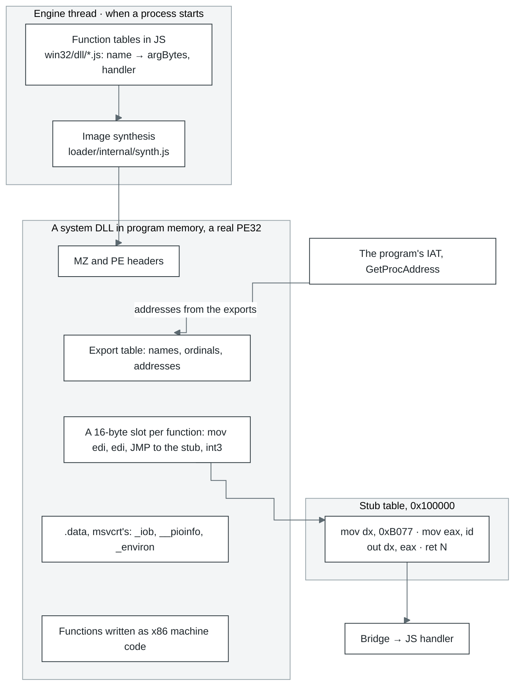

A stub is 16 bytes, one per function:

```
66 BA 77 B0      mov dx, 0xB077     ; the trap port
B8 xx xx xx xx   mov eax, id        ; the function's number in the bridge
EF               out dx, eax        ; cork calls the bridge
C2 nn nn         ret N              ; C3 for cdecl
CC ...           int3 up to 16 bytes
```

How many bytes `ret N` takes off, the bridge decides from the calling convention: stdcall takes all
of `argBytes`, cdecl none, and thiscall and fastcall leave out the arguments passed in registers.

### One call, from the program to JS and back


- **COM objects** (Direct3D, DirectSound, DirectInput) live in the program's memory too. The
  object's first word points at its method table, and each method there is a stub like any
  other, except those that run in the guest: IUnknown's `AddRef` and `Release` for an object
  whose count lives in guest memory, and the Direct3D 8 and 9 methods a program calls most
  (section 7). Methods are stdcall, with the interface pointer as the first argument on the
  stack.
- **Callbacks:** a window procedure, a COM callback, `DllMain`. The bridge stops the thread, builds a
  frame on the program's stack and runs the program's code until it returns into a sentinel trap.
  A host call that calls the program back many times in a row (a D3DX effect's pass setting each
  state through the program's own state manager) is written as steps (`bridge.drive`): a generator
  that yields each guest call. The bridge sends the thread into each routine in the slice the call
  came in and takes its answer at the sentinel there, with no park and no turn of the run loop
  between them. Through promises every guest call of a pass was a turn of the run loop of its own,
  and a frame of effect passes spent more time in turns than in the program. The steps are on by
  default (`driveGuestCalls`); off, the same calls run through promises, and
  `effect-steps.itest.js` holds the two to the same results. The bridge's `driveMs` and
  `driveCallMs` split the steps' time between the steps and the guest.
- **Some code runs in program memory directly.** Some exports and methods are x86 machine code
  the program runs itself, with no trap, at cork's speed; only what they cannot handle goes to the
  bridge. Some are written as x86: msvcrt's and kernel32's functions a program calls most, among
  them the interlocked calls, critical sections, slim reader/writer locks, one-time
  initialisation, SLists, the heap's small blocks (up to 1 KiB) and WaitForSingleObject's poll of
  an event that is not signalled. The poll reads a word the kernel keeps for each handle onto an
  event, so a thread on another executor polling for work never waits for the process's executor
  to answer. SetEvent of an event already signalled and ResetEvent of one already clear answer in
  the guest from the same word, since they change nothing. A mutex nobody else wants is taken and
  given back in the guest with `lock cmpxchg` on a word of the mutex's own, which the host takes
  over (one flag) as soon as anyone waits, the mutex is abandoned or the host otherwise touches
  it. Sleep(0) answers in the guest while no thread waits to run, read from a count the scheduler
  keeps. Others are written once in JavaScript, marked `@guestCode`, and compiled to i386 by the
  build ([`core/scripts/guest-code/`](../modules/core/scripts/guest-code/)): the compiled bytes sit beside the source as `*.x86.js`. The
  JavaScript stays the host's handler and the reference a test holds the x86 to, and
  `return host()` hands a rare case to that handler. D3DX's vector, matrix and quaternion math and
  its effect setters, msvcrt's string, float and math functions and GLU are written so.
- **When a function is missing.** Each name has a stub of its own. If it is known how many bytes of
  arguments to take off (an `@N` decoration, a C++ name, a cdecl library, or a library the program
  brought), it simply returns 0. Otherwise the program stops with `unimplemented import`, and the
  error names the function needed and its caller.

### Which DLL the program gets

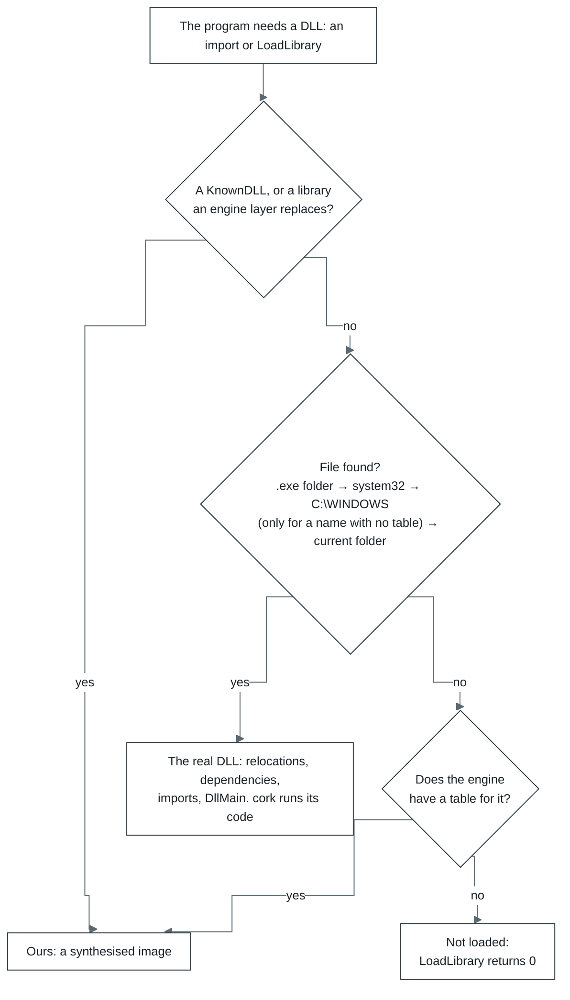

- **Always ours:** the KnownDLLs (`kernel32`, `user32`, `msvcrt`, `ole32` and others), the
  runtimes the engine stands in for whoever's copy it is (`DSETUP.dll`, `MSVCR80.dll`,
  `Mp3dec.asi` for sound and `ijl15.dll` for media), and the C runtime's API sets
  (`api-ms-win-crt-*`), which are `ucrtbase.dll` under the names they are imported by.
- **Where `LoadLibrary` looks:** the `.exe` folder, then `C:\WINDOWS\system32\`, `C:\WINDOWS\` and
  the current folder. Static imports are looked up the same way, without the current folder. For
  a name the engine has a table for, the system directories are skipped: a copy an installer put
  there would be a second library of the name in the process beside the engine's.
- **A real DLL** is parsed and relocated by the loader, its dependencies are loaded first, its
  imports (delayed ones included) are bound, and its `DllMain` is called through the bridge as
  program code. Every image's TLS is supported, a library's loaded at run time too: a slot, a
  copy of its block in every thread (those already running when it is loaded included), and TLS
  callbacks for every reason its `DllMain` hears, before it. `FreeLibrary` gives the slot and the
  copies back.
- **DirectX's redistributables** (`d3dx9_*` and the rest) are not part of the engine: a game brings
  them, through its installer's DirectX setup, which puts them in `C:\WINDOWS\system32\`, or as DLLs
  beside its `.exe`. A copy beside the `.exe` is loaded as the real DLL; for every other the
  engine's table answers `d3dx9_*`, the copy in `system32` included.

Where to look in the code: [`core/src/layers/loader/internal/synth.js`](../modules/core/src/layers/loader/internal/synth.js) (the image),
[`core/src/layers/cpu/internal/thunks.js`](../modules/core/src/layers/cpu/internal/thunks.js) (the stubs), [`core/src/layers/bridge/`](../modules/core/src/layers/bridge/) (the bridge), the
tables in `core/src/layers/win32/<dll>/`, the search order in [`core/src/app.js`](../modules/core/src/app.js)
(`libraryCandidates`, `answeredByEngine`).

## 7. Graphics

| Where | What it does |
| --- | --- |
| Page | Hands the `<canvas>` to the engine once (`transferControlToOffscreen`) and fits it into the window, keeping its proportions (`ui/src/components/PlayScreen.jsx`) |
| Engine thread | Every graphics API the program uses. The Direct3D 7, 8 and 9 devices and the OpenGL contexts keep the state and answer the program, but draw nothing themselves. Direct3D 10 and Vulkan still draw right here through the WebGPU backend. DirectDraw and GDI draw into software surfaces in the program's memory, which the presenter uploads. The presenter also puts the finished frame into the `OffscreenCanvas` |
| Graphics thread | The twins of the Direct3D 7, 8 and 9 devices and the OpenGL contexts play the same calls on the thread's own WebGPU device and return the frame as an `ImageBitmap` |
| OPFS | Not used. Pipeline and shader caches live in memory only |

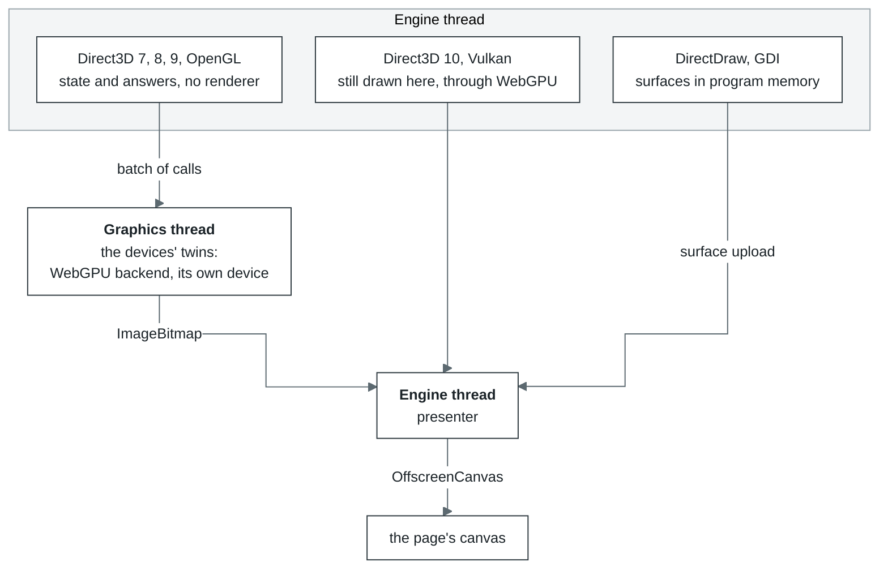

- **How calls travel.** Each call is written into a binary batch as it is made (`remote/wire.js`).
  A batch goes at most once a millisecond while no call waits on it (a timer sends what the
  turns left behind, and a long turn sends its own), and at once when a call waits for an
  answer. Resource bytes ride in the same batch. For a Direct3D buffer that is what the program
  wrote between `Lock` and `Unlock`; for a texture, everything written up to the next call that
  may read it. Where the program's memory is shared, what a Direct3D 8 or 9 texture's or
  surface's unlock let the program write is lent rather than copied: the batch says where the
  bytes lie, and the graphics thread copies them out of guest memory when it plays the record
  (`remote/lending.js`). A buffer's bytes are copied. OpenGL reads the program's memory at the call
  itself, so whatever a call read goes ahead of it. The DirectDraw surfaces Direct3D 7 draws into
  cross by number and are described again when they change. A renderer on the engine thread reads
  the bytes at those same moments, so the picture comes out the same wherever Direct3D draws.
- **The Direct3D 8 and 9 command ring.** A program sets states, transforms and textures hundreds
  of times a frame and locks a buffer around every draw. Those setters and draws, a buffer's
  `Lock` and `Unlock`, and the getters of render states, transforms, texture stage states and
  the viewport (and Direct3D 9's sampler states) run in the guest: a setter or a draw writes a
  record into a ring in the device's block in guest memory, a getter reads the value its setter
  wrote there. The host makes the ring's calls, in order, through the device's own methods on
  its way into any method of its own (`graphics/seam/shadow.js`, `d3d8/commands.js`).
  With several executors the routine and the host may run on different cores, and a host that
  reorders stores (arm64) may show one core's stores to another out of order. So a routine
  lets the device's lock go with a locked instruction and publishes a record's length, its last
  word, with `xchg`: the engine makes both atomic there. The host reads each length with an
  atomic load before the record, and lets the lock go with an atomic swap. What the routine
  wrote before, the vertices the program wrote before the call included, is then there too.
- **Dynamic buffers.** A program may write a dynamic buffer through the pointer a lock gave it,
  after the `Unlock`, and draw from it with no lock between, so a draw sends what changed in the
  range it reads since the buffer was last sent. Under the emulator every byte of the range is
  compared; under cork only the part of it on pages written since the last comparison. A store
  into a watched page marks it by the same page-flag test that finds translated code: the first
  store after the page is armed makes one compare-and-swap. The host's writes and a worker's
  writes in place mark it too. The cpu layer's write watch (`cpu/internal/write-clock.js`) gives
  each buffer its own view of the marks, since one look arms a page again for everyone, and takes
  a page armed while another executor was running guest code as written until that run has ended:
  a store tested before the arming may land after it unmarked. Any buffer an unlock has sent
  whole, dynamic or not, is watched the same way from then on, and its next unlock sends only the
  pages written since. A loop that streams stores into watched pages marks the pages its next
  turns may reach once, before them, and runs its stores untested.
- **A DISCARD in the guest.** A `DISCARD` of a dynamic buffer while the ring still holds draws
  the host has not made would write over what those draws read. Rather than leave it to the host,
  which would make the draws first, the first such `DISCARD` of a buffer gives it another storage
  of its length (`d3d8/storages.js`, two at most). From then on the guest's `Lock` moves the buffer onto
  a free one, writes the move into the ring (`Buffer.Rename`) and goes on writing there; the host
  makes the move in order with the draws, so each draw reads the storage it was made with, and
  frees the storage left. Each storage is sent whole once, then by the pages written since. A draw
  from a dynamic buffer reads its indices, as its vertices, out of guest memory at the draw. No
  move while a lock taken in place (with no draw in the ring) waits for the host to replay it
  before the ring's next run, nor for a lock the host would refuse. A dynamic buffer held locked
  under NOOVERWRITE is not replayed at the host's entries: its draws read it. The buffer's one
  copy on the GPU holds the storage left after a move, so the pages of the storage moved onto
  count stale: a draw uploads what it reaches of them, an unlock only what was written.
- **Who waits for whom.** `Present` waits for the graphics thread only when it is more than two frames
  behind. It does wait for the display, as a driver does: under every presentation interval but
  `IMMEDIATE` (windowed Direct3D 8 only under `COPY_VSYNC`) the calling thread stops until the next
  blank of the guest's raster, or as many blanks on as the interval says, at the rate of the mode
  the device asked for when the display lists it and 60 Hz otherwise; how often the page shows a
  frame does not pace the program. Only the calls whose result only the renderer knows wait for
  an answer. For Direct3D 8/9 those are `GetData` on a query other than an event or occlusion
  query, `GetRenderTargetData`, `GetFrontBuffer(Data)`, plus `LockRect` and `GetDC` on a render
  target, and `CopyRects` out of one something has drawn into since it was last read back. And
  what waits is the program's thread, not the engine's: the bridge parks it in the scheduler,
  and the program's other threads keep running. An event query answers on the program's side.
  An occlusion query's count is asked of the renderer once its end is issued, and the program's
  polls are answered `S_FALSE`, as a driver answers them, until the count comes back; each answer
  brings every other count the renderer already holds, each marked with the `Issue(END)` it
  belongs to.
- **Shaders.** Direct3D 8/9 shader bytecode is parsed and translated to WGSL
  (`graphics/d3d9/shader.js`, `wgsl.js`). For the fixed-function pipeline, WGSL is generated
  (`webgpu/internal/fixedfunction.js`).
- **Textures** of up to eight bits a channel go to the GPU as `bgra8unorm`, those of sixteen and
  thirty-two bits a channel as half floats (`rgba16float`, `rg16float`, `r16float`), the formats
  every WebGPU device filters and blends; DXT-compressed ones are decoded on the CPU by
  default (`graphics.compressedTextures` in [`core/configuration.md`](core/configuration.md#graphics)).
- **Windows on surfaces of their own.** Inside a process the screen is composed as Windows 7's
  desktop window manager composes it (`graphics/gdi/screen.js`): each top-level window draws on a
  surface of its own, unclipped by the other top-level windows, and the screen is the desktop's
  background with the shown windows copied over it, bottom to top. A window moved, raised, hidden
  or closed paints nothing; the screen is composed again.
- **Several processes, one screen.** Each process's user32 tells the run's window manager
  (`win32/user32/manager.js`, on the engine thread beside the window directory) what every window
  of its is (class, title, style, rectangle, visibility), and the manager holds the z-order of
  the run's top-level windows, the one keyboard focus (a window taking it brings its top-level
  window up and takes it from every other, whichever process each is) and the window that
  captured the mouse, for every process alike. Every frame says which process drew it; the presenter keeps each process's
  newest picture and, while windows of more than one process show, composes the screen from them
  by the manager's order, bottom to top (`webgpu/internal/compose.js`). The page's input goes
  where the manager says: a pointer to the process of the window holding the mouse or under it,
  the keyboard to the process of the window with the focus (`inputTarget`); with no such window,
  to no program. One process or four, on one thread or
  in workers, it is the same manager.
- **When something breaks.** If the graphics thread does not open, Direct3D and OpenGL draw on the
  engine thread and a warning goes to the console. A lost WebGPU device is not recovered
  ([`core/limits.md`](core/limits.md#graphics)).

Where to look in the code: [`core/src/layers/graphics/`](../modules/core/src/layers/graphics/) (`d3d7`, `d3d8`, `d3d9`, `d3d10`, `ddraw`,
`gdi`, `opengl`, `glu`, `vulkan`, `webgpu`, and `seam`: the interfaces and exports the program
calls, the routines that run in the guest, the command ring and the raster); the graphics thread
is `graphics/remote/` and [`core/src/host/graphics.worker.js`](../modules/core/src/host/graphics.worker.js).

## 8. Sound

| Where | What it does |
| --- | --- |
| Page | Before the start, creates the `AudioContext` and loads `worklet.js`; after the start, creates the `AudioWorkletNode` over the voice table the engine returned |
| Engine thread | DirectSound, waveOut, DirectMusic and MP3 for Miles. Every time before it yields to the browser, it writes into shared memory what the program has written since, carries over volume and pan, and sends notifications |
| AudioWorklet | Reads the 64 voice slots on its own clock, resamples linearly, applies volume and pan, and mixes it all |
| OPFS | Not used |

A DirectSound buffer behaves like a voice on a sound card: a copy of its data lives in shared memory,
and the AudioWorklet reads it from there by itself, like DMA. So the sound does not break up even
while the engine is busy loading or translating code, as long as the program's buffer holds enough
sound.

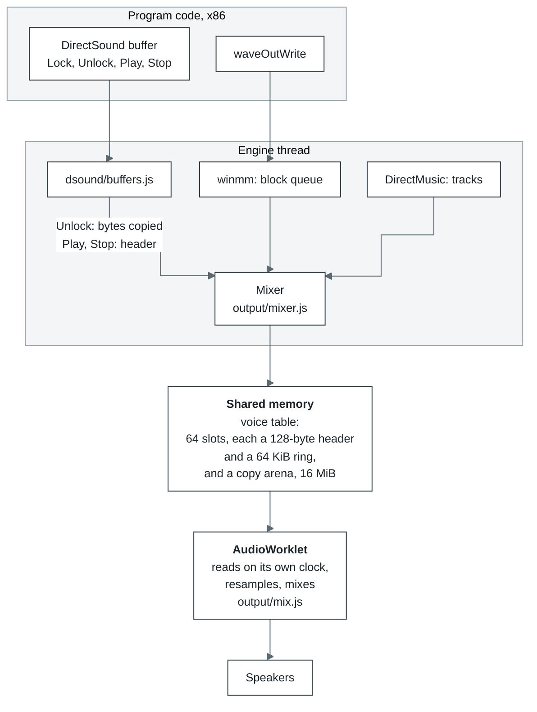

- **A voice** is a slot in the table: a header of 32 words (`RATE`, `CHANNELS`, `BITS`, `GAIN`, the
  left and right cut, `POSITION`, `LOOPING`, `PLAYING`, `LAPS` and others) plus a copy of the buffer
  in the arena. When the engine first sees a buffer playing, it copies it whole; after that, only
  what the program changed between `Lock` and `Unlock`. `Play` writes the position, `LOOPING` and
  `PLAYING`; `Stop` writes `PLAYING = 0`.
- **The play cursor** shows how far the AudioWorklet has read (`POSITION` and `LAPS`), and the write
  cursor runs 30 ms ahead. So `GetCurrentPosition` and position notifications match what is actually
  heard.
- **A streaming buffer** is one the program keeps writing as it plays, the way the Miles and FMOD
  mixers do. A voice does not play past what has been written: if the program is late, silence plays,
  not the previous lap again. If the wait lasts longer than max(250 ms, one lap of the buffer), the
  voice stops waiting and goes on round.
- **waveOut** is one track per device. `waveOutWrite` copies the block at once, and `WOM_DONE`
  arrives when the AudioWorklet has finished reading it.
- **MP3 for Miles.** In place of the program's own `Mp3dec.asi`, our provider runs, attached through
  `mss32.dll`'s `RIB` entry points. Decoding is minimp3 built to wasm (`audio/asi/`). There is also an
  MP3 codec for ACM.
- **Limits.** With no free slot, or no room for its copy in the arena, a buffer plays through a
  queue track, and its cursor follows the clock instead. The rest (3D sound, capture) is in
  [`core/limits.md`](core/limits.md#sound).
- **Without cross-origin isolation** (the COOP/COEP headers, which `ui/server.mjs` sets unless
  `ISOLATION=off`) there is no `SharedArrayBuffer`. The engine then mixes into a ring of its own,
  and `output/feed.js` posts the mix to the worklet over a `MessageChannel` the page made, in
  chunks no more than 160 ms ahead of what the worklet has played; the worklet reports how far it
  got every four blocks, and that report is what the ring counts as consumed. A DirectSound
  buffer's cursor follows the clock here.

Where to look in the code: [`core/src/layers/audio/`](../modules/core/src/layers/audio/): `output/mixer.js`, `output/mix.js`,
`output/worklet.js`, `dsound/buffers.js`, `asi/provider.js`; waveOut is
[`core/src/layers/win32/winmm/functions.js`](../modules/core/src/layers/win32/winmm/functions.js).

## 9. Networking

| Where | What it does |
| --- | --- |
| Page | Passes `createApp` the client module (`/networking/client/index.js`), the relay's address (`ws://` or `wss://` on the same host, path `/relay`) and the room, which is the bundle's id |
| Engine thread | `wsock32`, `ws2_32` and `mswsock`: the socket registry, the `127.0.0.0/8` loopback inside the tab, and the relay client. The WebSocket opens in the worker |
| Launcher server | The `/relay` relay runs in the same process and on the same port as HTTP |
| OPFS | Not used |

A browser does not let a tab open TCP or UDP, only WebSocket. So the program's sockets go through
the relay: it connects tabs in the same room and, when allowed, opens real connections to the outside
itself. The relay and the client as a library of their own are described in
[the networking README](../modules/networking/README.md).

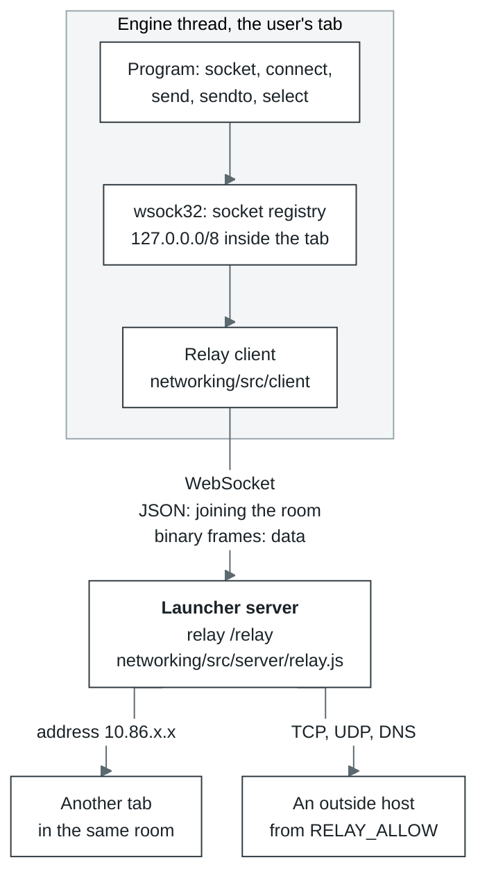

- **A room** is a small network of its own: tabs with the same bundle see each other as if on one
  LAN. Each tab gets the lowest free address in `10.86.0.0/16`, and a room holds up to 32 peers.
  Broadcasts reach only the peers in the room listening on that UDP port.
- **The outside is closed by default.** Unconfigured, the relay is a LAN, not an open proxy. Which
  hosts are allowed is set when the relay starts: `--allow` for the relay run on its own
  ([the networking README](networking/README.md#run-a-relay)), the comma-separated
  `RELAY_ALLOW` for the launcher's; `*` alone allows every host. The relay resolves host names
  itself and remembers them, so the policy judges the name, not just the address. With an empty
  list, DNS answers nothing at all.
- **Frames.** Joining a room is JSON: `hello`, answered by `welcome` with the address and the list of
  peers. Data travels in binary frames: a 20-byte header and up to 64 KiB of payload. One `send()` is
  one frame, so UDP datagram boundaries are kept. A TCP `send()` over 64 KiB, however, is not yet split
  into frames and fails.

| Offset | Type | Field |
| --- | --- | --- |
| 0 | u8 | op: `DIAL`, `OPENED`, `STREAM`, `HANGUP`, `DATAGRAM`, `LISTEN`, `UNLISTEN`, `ACCEPTED`, `RESOLVE`, `RESOLVED` |
| 1 | u8 | flags: `REJECT`, `HALF`, `STREAM` |
| 2 | u16 | reserved |
| 4 | u32 | tag: the TCP stream or DNS query number |
| 8 | u32 | sender IP |
| 12 | u32 | receiver IP |
| 16 | u16 | sender port |
| 18 | u16 | receiver port |

TCP goes like this: `DIAL`, answered by `OPENED` (or `HANGUP` with `REJECT`), then data in `STREAM`.
`shutdown(SD_SEND)` is `HANGUP` with the `HALF` flag. All fields are little-endian.

Where to look in the code: [`core/src/layers/win32/wsock32/`](../modules/core/src/layers/win32/wsock32/) (sockets and transport),
[`networking/src/`](../modules/networking/src/) (the client, `protocol.js`, the server); the wiring is in `ui/server.mjs` and
`ui/src/engine/session.js`.

## 10. Storage

OPFS is the browser's file system, and each origin (scheme, host, port) has its own. So the launcher
should always be opened at the same address: at another address there is another OPFS, with other
saves. The default is `http://127.0.0.1:5180`. With `TLS_DIR` the server listens for https on every
address: from another machine, without a secure context, there is neither OPFS nor
`SharedArrayBuffer`.

| Store | Where | What it holds | How it works |
| --- | --- | --- | --- |
| Block cache | OPFS: `<id>.blocks`, `<id>.present`, `<id>.order` | bundle blocks already fetched from the server | Block N sits at offset N × the block size (taken from the bundle's header, 256 KiB by default). `.present` is a bitmap of the fetched blocks, `.order` the order they were first asked for in (up to 4096). Access goes through synchronous handles: at most 16 are open, and the one unused the longest closes first |
| cork translations | OPFS: `cork/<id>.v3/` | translated regions, each keyed by its entry, the x87 stack top it was made for (any, for a region with no x87 in it) and the run's modes; the modules their code is in; and a map from every stored block to the region holding it, so a run that meets a block first in another order takes that region | `records` holds the records one after another, `index` a log of where each one is. The index is read once, a miss touches no disk, a hit is one read at an offset. New records are appended in batches. A worker of the store's own writes them, where the browser lets two handles stand on one file, so the engine thread never waits for the disk. A region's record names the batch module its code is in, and the module lives as long as a region naming it. On opening, the last run's records stay whole; older ones stay while they fit under 1 GiB with them, the most recently used first, a region and its module together, and a record no run has used in the last four is dead. The file is copied, live records only, when half of it is dead and it is past 64 MiB, or when the index has grown past 4 MiB and four times the lines its live records need. A relinked module is stored too, and the regions it holds name it from then on: a later run takes them as they are and relinks only what it adds |
| Session | OPFS: `<id>.files/` | the files the program wrote, and its registry | One entry per file, named by a hash of its path, which it holds inside; the registry is an entry of its own. Applied before the first instruction; 250 ms after the program stops writing, only the files it changed are written or removed. An older `<id>.session` (one deflate-raw stream) is read once and replaced. The bundle itself never changes |
| Settings | localStorage | the launcher's settings, time to first frame | |

How the program reads a file:

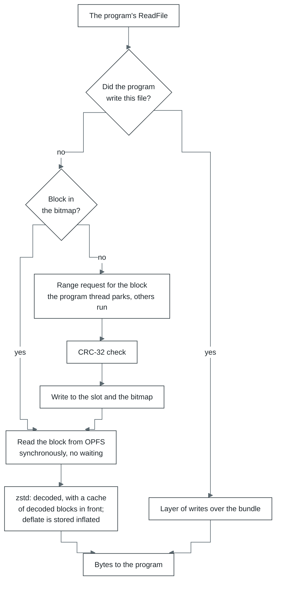

- **The block cache does not keep the bundle in memory:** a program can be larger than a gigabyte.
  If the bitmap's size does not match the bundle, the bitmap is reset and the blocks are fetched
  again.
- **Synchronous handles** (`createSyncAccessHandle`) exist only in a worker. In return, a read from
  OPFS waits for nothing, and `ReadFile` on a block already fetched answers at once.
- **The session** is read and written asynchronously (`getFile`, `createWritable`).

Where to look in the code: [`core/src/layers/filesystem/internal/bundle/cache.js`](../modules/core/src/layers/filesystem/internal/bundle/cache.js) (blocks),
[`core/src/layers/filesystem/internal/opfs-store.js`](../modules/core/src/layers/filesystem/internal/opfs-store.js) (handles),
[`core/src/layers/cpu/internal/translation-store.js`](../modules/core/src/layers/cpu/internal/translation-store.js) (translations), [`core/src/storage.js`](../modules/core/src/storage.js)
(sessions).
