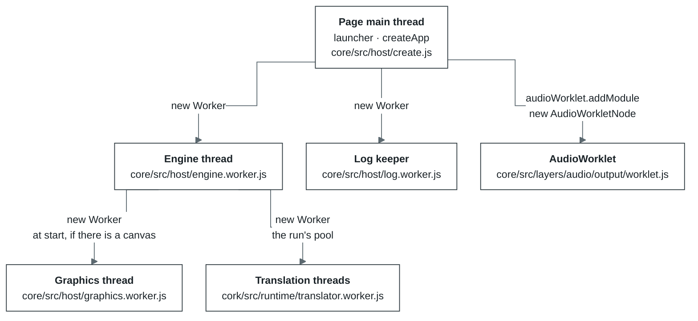
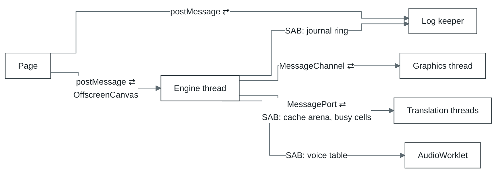
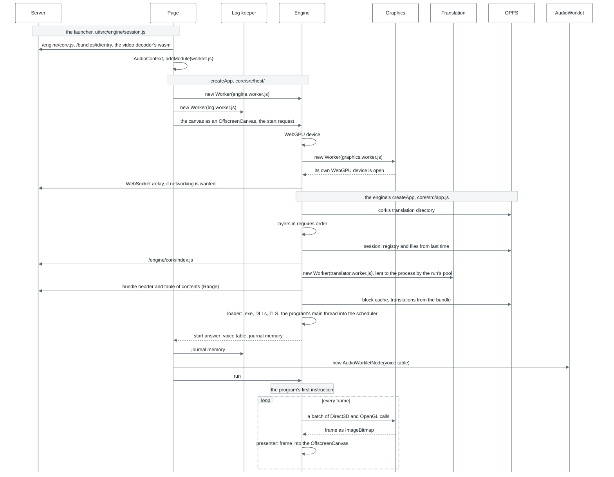
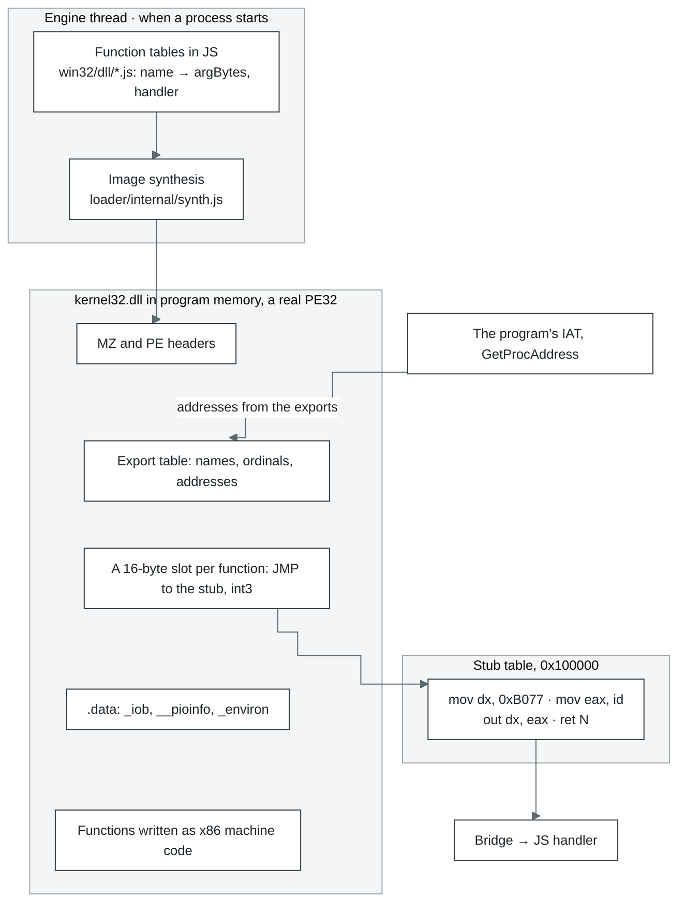
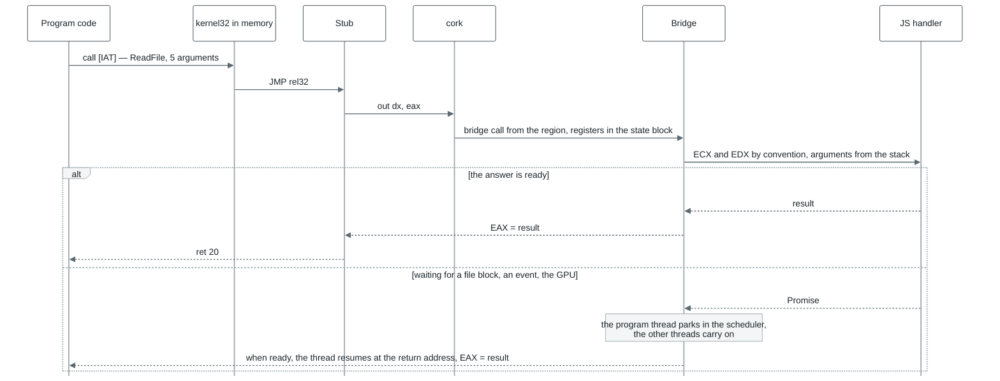
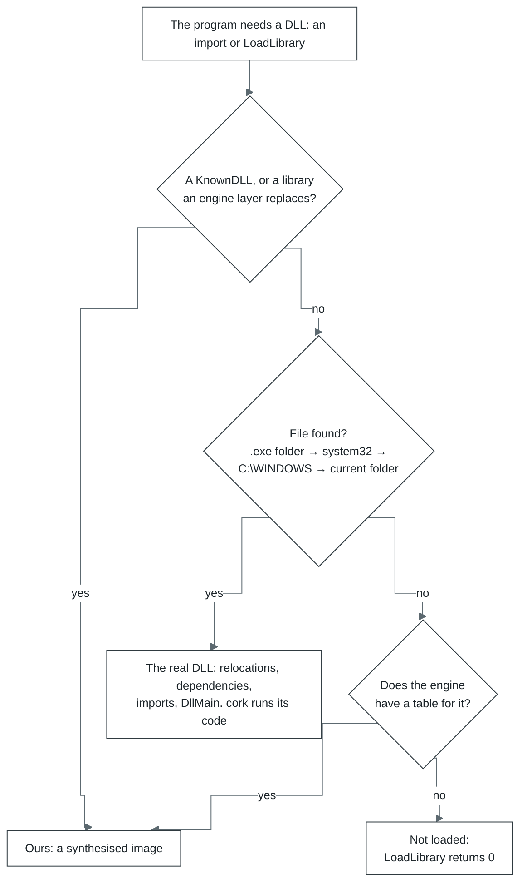
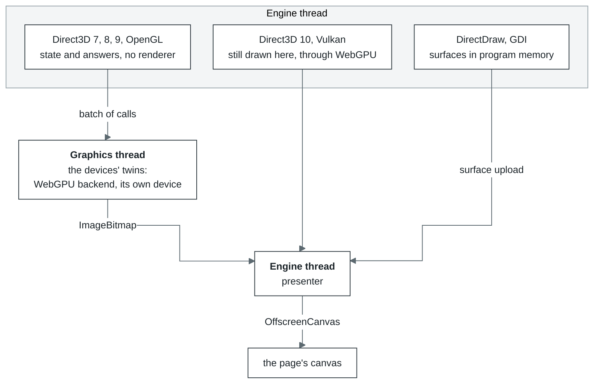
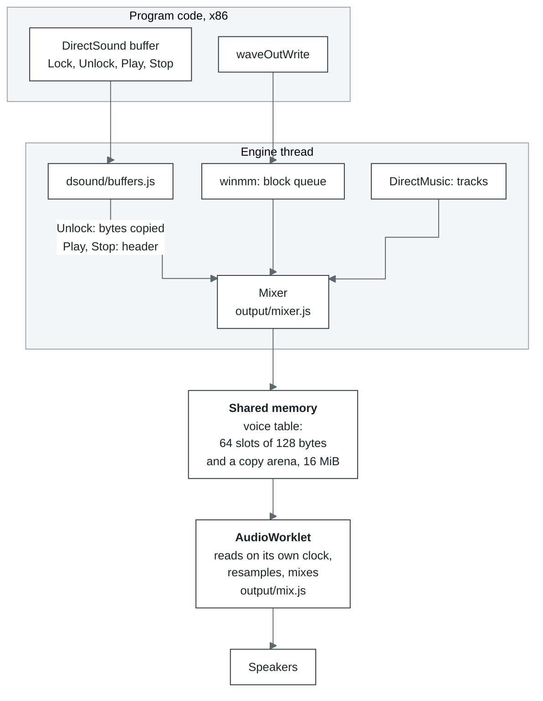
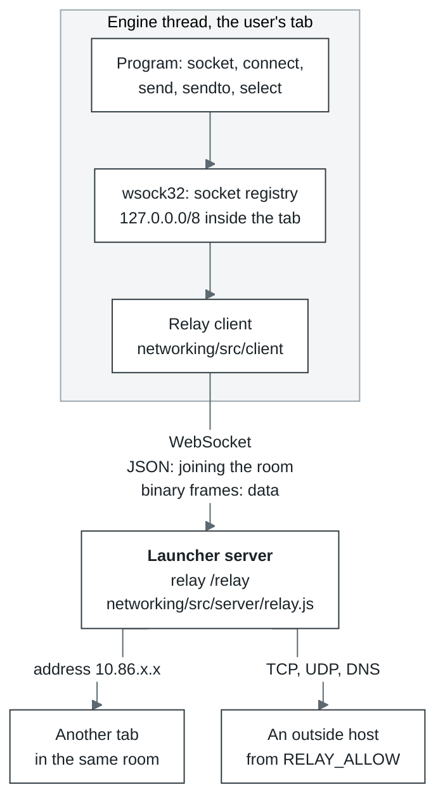
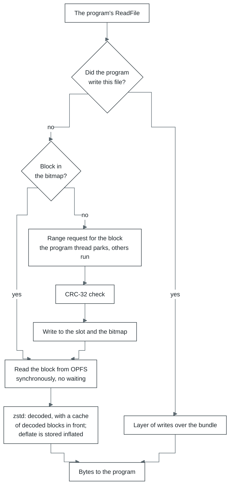

# Inside Bottlify

Русская версия: [architecture.ru.md](architecture.ru.md).

Paths without a prefix are relative to `modules/` in bottlify; paths starting with `ui/` are
relative to the root of bottlify-ui. Where a diagram and the code disagree, the code is right.

1. [What it is](#1-what-it-is)
2. [What it is made of](#2-what-it-is-made-of)
3. [Threads: who starts whom, and why](#3-threads-who-starts-whom-and-why)
4. [Startup: from createApp to the first instruction](#4-startup-from-createapp-to-the-first-instruction)
5. [cork, the execution core](#5-cork-the-execution-core)
6. [Win32 in JavaScript: how a DLL comes about](#6-win32-in-javascript-how-a-dll-comes-about)
7. [Graphics](#7-graphics)
8. [Sound](#8-sound)
9. [Networking](#9-networking)
10. [Storage](#10-storage)

## 1. What it is

Bottlify runs 32-bit Windows applications right in a browser tab, with no Windows and nothing to
install. It has two halves; together they do what Rosetta 2 and Wine do, rebuilt for the browser:

- **cork, the translator.** A browser has no x86 processor, so cork translates the program's
  machine code into WebAssembly, and the browser then compiles that for the device's own processor.
  The same translation runs on x86 and on ARM alike. How cork works is in
  [section 5](#5-cork-the-execution-core).
- **core, our Windows environment.** Its job is to convince the program that it is running on real
  Windows. There is no Windows anywhere underneath: `kernel32`, `user32`, `gdi32`, DirectX, Winsock
  and the other system libraries are rewritten from scratch in JavaScript on top of web APIs. The
  program sees them as ordinary DLLs, it has a `C:` drive, a registry, windows and messages, and its
  calls get the same answers and error codes Windows would give. How that is done is in
  [section 6](#6-win32-in-javascript-how-a-dll-comes-about).

The aim is for the very same `.exe` to run in Chrome, Safari and Firefox on anything from a phone
to a desktop. There is nothing to install, and the server plays no part in a frame: it only serves
files and forwards network traffic.

| What an application needs | What provides it | What it runs on |
| --- | --- | --- |
| An x86 processor | cork, translating x86 to wasm | WebAssembly |
| System DLLs | the `win32` layer: functions in JS that the program sees as real PE images | — |
| DirectDraw, Direct3D 7–10, OpenGL, Vulkan, GDI | the `graphics` layer | WebGPU |
| DirectSound, waveOut, DirectMusic | the `audio` layer | AudioWorklet, SharedArrayBuffer |
| DirectInput, XInput, window messages | the `input` layer | keyboard and mouse events, Gamepad API |
| DirectShow cinematics | the `media` layer, FFmpeg in wasm | WebAssembly |
| A disk | a bundle read block by block, with a session on top | fetch with Range, OPFS |
| Winsock | `wsock32` and the relay | WebSocket |

### Why games

The idea behind Bottlify is a game in a bottle. So although cork is a general-purpose translator,
it is designed first of all for fast rendering: every frame has to arrive on time. For a game,
speed is part of being correct. A game that draws 10 frames a second instead of 60 does not work,
however right its arithmetic is.

Our aim is ambitious, perhaps never fully reachable: one way for people on any device to run any
game. And what does everyone have, from a phone to a desktop? A browser. So why shouldn't the browser
become the platform for applications?

It has been tried. Flash, Silverlight, Java applets and Unity Web Player each turned the browser
into a platform for programs and games. But all of them were plugins: installed separately, each
owned by one vendor, and each needing programs written for it. When browsers dropped plugins, those
platforms went away, and the games written for them stopped running. By the early 2020s none was
left.

Bottlify works the other way round. It needs no plugin: it uses only standards every modern browser
already has — WebAssembly, WebGPU, Web Audio, OPFS. And it needs no programs written for it: it runs
the ones that already exist, ordinary Windows `.exe` files, unchanged.

There is a practical reason as well: a game is the best test for a system like this.

- **A game exercises everything at once.** Integer code, x87 and SSE, Direct3D, sound, input, files,
  threads, sometimes the network — one run goes through nearly every layer of the engine.
- **A game measures itself.** Many games ship built-in benchmarks and timedemos: the same scene
  every time, and frames per second at the end. Two runs compare as numbers, so a regression shows at
  once rather than by eye.
- **Gaps show at once.** A missing function makes the program stop with `unimplemented import` and
  that function's name. An inexact one shows as a misplaced picture, a click in the sound or lost
  frames. Each such failure points at a specific place in the engine.
- **There are a great many games.** Thousands of programs from different years, engines and
  compilers make a huge ready-made test suite nobody has to write.

The engine is never bent to fit one game. When a game stumbles, the shared layer it stumbled on is
fixed, and the fix reaches every program that takes the same path. That is why what games need is
the most developed part today — DirectX and OpenGL, sound, input, cinematics and networking — and
it works the same for any application.

## 2. What it is made of

The repository's packages are under `@bottlify/`:

| Package | What is inside |
| --- | --- |
| `@bottlify/core` | Our Windows environment: Win32 and DirectX, the loader, the scheduler, files, and `createApp`, which starts it all |
| `@bottlify/cork` | The x86 → wasm translator and its runtime. The engine does not import it; it loads it by URL |
| `@bottlify/networking` | The client and server of the relay that applications reach the network through |
| `@bottlify/installer` | Installing an application with its own installer, and packing bundles |

An additional package for debugging is **bottlify-ui**, a repository of its own: a React launcher and
a local server that serves the application, the engine, the bundles and the relay from one address.

The engine is split into layers. Each layer has its own interface, configuration and tests, and
talks to other layers only through what it declares in `requires`. This is more than a convention:
`npm run check:boundaries` checks it against the code. Any layer can be switched off and a stub takes
its place; with `graphics: null`, for instance, a game runs with no picture.

| Layer | Responsible for | `requires` |
| --- | --- | --- |
| `log` | the journal, counters, phase profile | — |
| `cpu` | running x86 code through cork, trapping calls into the bridge | `log` |
| `memory` | the program's address space: reservation, pages, protection | `cpu`, `log` |
| `kernel` | processes, threads, the scheduler, wait objects | `cpu`, `memory`, `log` |
| `loader` | loading PE images and building the system DLLs | `cpu`, `memory`, `log` |
| `bridge` | calling conventions, parking threads, callbacks, COM in the program's memory | `cpu`, `kernel`, `memory`, `log` |
| `filesystem` | the bundle, the block cache, the `C:` drive, the files the program writes | `log` |
| `win32` | kernel32, user32, gdi32, advapi32, ole32, msvcrt, winmm, wsock32 and some thirty more DLLs | `bridge`, `kernel`, `memory`, `loader`, `filesystem`, `log` |
| `graphics` | DirectDraw, Direct3D 7/8/9/10, OpenGL, Vulkan and the WebGPU backend under them | `win32`, `bridge`, `memory` |
| `audio` | DirectSound, DirectMusic, the mixer, MP3 for Miles | `win32`, `bridge`, `memory` |
| `input` | DirectInput, XInput, keyboard and mouse in the message queue | `win32`, `bridge`, `memory` |
| `media` | the video decoder (FFmpeg in wasm) and `ijl15.dll` | `log` |

## 3. Threads: who starts whom, and why

A tab runs seven kinds of thread, two of them several times over. The page starts three: the engine
thread, the log keeper and the AudioWorklet. The engine thread starts the graphics thread, a process
thread for each process where processes run at once, and the run's pool of translation threads,
which it lends to the processes.

Nearly all the work happens on the engine thread. The others take from it what can run in
parallel, or what the browser only allows off the main thread.



| Thread | Started by | When | Why a thread of its own |
| --- | --- | --- | --- |
| Page main thread | the browser | always | The launcher's interface, the `createApp` call and DOM events live here. Per frame it does one thing only: polls the gamepads (`requestAnimationFrame` → `input.poll`) |
| Engine thread | the page, `core/src/host/create.js` | always. With `?host=thread` the engine runs on the page's thread instead, over the same protocol | The program runs in long quanta. On the page's thread it would be interrupted by garbage collection and the interface's rendering, and a click would wait for the quantum to end. Synchronous OPFS access also exists only in a worker. A WebGPU device cannot move between threads, so the worker opens its own and gets the canvas as an `OffscreenCanvas` |
| Log keeper | the page, `core/src/host/remote.js` | always. Without `Worker`, a `MessageChannel` on the page takes its place | The engine writes its journal, counters and tables into shared memory and answers no questions. The keeper drains the ring before it laps, keeps the history and works out frames, the profile and the per-module breakdown. Logging then costs neither the page nor the engine anything |
| Graphics thread | the engine thread, `core/src/host/graphics-worker.js` (called from `serve.js`) | at start, if the engine has a canvas and `device.graphicsWorker: false` is not set (`?graphicsWorker=off` in the launcher). Survives a change of program. If it opens no device within 10 s, everything draws on the engine thread | Its job is to draw all the graphics, so the engine thread only keeps state and answers the program. Today Direct3D 7, 8, 9 and OpenGL are played here on a WebGPU device of its own; Direct3D 10 and Vulkan will move here too. It arrived in cork 1.3. In the `tools/graphics-bench --remote` bench the engine thread spends 0.69 ms a Direct3D frame instead of 2.95 |
| Translation threads | the run's pool, `core/src/host/pool/pool.js` (made in `app.js`) | when the engine is cork and a translator would use a worker. Each process is lent one from its start to its exit, and more join it while its translation lags, as the pool's driver decides (`driver.js`). Until the first answers `ready`, regions are translated on the process's own thread | Emits wasm for regions, builds a module and compiles it. The process's thread does not wait for it: it posts a batch and publishes the result between frames, whenever it arrives. A translation thread works for one process at a time, over a port of its own; one that works for none sleeps and holds nothing of any process |
| AudioWorklet | the page, `ui/src/engine/session.js` | if the page is cross-origin isolated (`crossOriginIsolated`) and sound is on | The Web Audio real-time thread. It reads the voices from shared memory on its own clock, so sound does not break up even while the engine is busy |
| Process thread | the engine thread, `core/src/host/process-worker.js` (called from `app.js`) | with `concurrency` 2 or 4, once per process, the program the page started included, for as long as it runs | A process -- the launcher, and the game it starts -- runs on a thread of its own, beside its parent, with its own memory and translator. It blocks while it waits instead of taking turns with the engine's event loop, and the engine's thread runs no program at all |

How the threads exchange data. ⇄ means both ways; SAB is `SharedArrayBuffer`, that is, shared
memory.



- **Page ⇄ engine.** Requests and input go by `postMessage`. Along with each message the page
  increments a signal word in shared memory, so the engine notices the message right away, between
  two turns of the scheduler, rather than at its next scheduled pause. The canvas is handed over
  once (`transferControlToOffscreen`), and from then on only the engine draws into it.
- **Engine → log keeper.** Shared memory only: the keeper looks into the ring every 200 ms. Without
  `SharedArrayBuffer` the page forwards the records to it as messages.
- **Engine ⇄ graphics.** Direct3D 7, 8, 9 and OpenGL each have a `MessageChannel` of their own. Calls go into one
  buffer per batch, and the buffer is transferred without a copy. Back come the frame as an
  `ImageBitmap` and the answers to calls only the renderer knows.
- **Engine ⇄ translation.** Regions missing from the store go one way; module bytes and an already
  compiled `WebAssembly.Module` come back.
- **Engine → AudioWorklet.** No messages at all. The voice table lives in shared memory: the page
  gets it in the answer to the start request and hands it to the `AudioWorkletNode`.

**Processes.** With `concurrency` 1, the default, the program runs on the engine thread and a
child process takes its parent's place there until it exits. With 2 or 4
(`createApp({ concurrency: 2 })`) every process runs on a process thread of its own, the program the
page started too, and a child starts at `CreateProcess` and runs beside its parent, up to that many
processes at once; one more runs beside its parent taking turns with it on the parent's thread. The
engine thread is then the system alone: before any process starts it mounts the bundle, lays the
session and the page's files on the volume, makes the registry and opens the journal and the sound
output (`buildSystemHost` in `core/src/app.js`), and what the page asks of the program it asks the
program's thread. It
needs shared memory: asked for where there is none, the run falls back to `compatible` with one
process at a time and raises a `fallback` event. What the processes of a run share -- the
registry, the volume and the sharing of its open files, the window directory, ids, named events,
semaphores and mutexes, the bundle, COM's class table (`core/src/com-link.js`), the translation store (`core/src/layers/cpu/internal/store-link.js`) -- stays on the engine thread, which answers a process thread
across a link: two rings in shared memory, one each way, with a doorbell word per side
(`core/src/system/link.js`, values encoded by `codec.js`). The process thread blocks on its doorbell
for each answer and answers what it is asked meanwhile (the engine asks it about its windows); a
message longer than a ring holds goes in parts. Each side looks at its doorbell for a few
microseconds before it sleeps on it, since a thread woken from sleep costs far more than the answer.
The volume is mostly not asked: every change to a drive raises a word per drive letter in shared
memory, and a process thread keeps what it read of a drive -- 64 KB pieces of files, sizes, entries,
listings -- until that word moves; and the sharing every open is settled against is a table in
shared memory under a lock, which a process thread settles its own opens in
(`core/src/layers/filesystem/internal/volume-link.js`, `shared-sharing.js`). Its Direct3D devices draw on the graphics thread
through a port of their own, its DirectDraw and GDI pictures come to the engine as bytes, its sound
is mixed on the run's voice table in a span its parent lends it, and the page's input reaches it
as the run's window manager routes it (section 7). What it cannot have yet is in [`core/limits.md`](core/limits.md).

**Modes.** `createApp({ mode })` says how much of this rides on shared memory, and the run's mode is
in the `app` layer's diagnostics (`core/src/mode.js`):

| Mode | Needs | What it does |
| --- | --- | --- |
| `isolated` | a cross-origin isolated page | The program's memory is a `SharedArrayBuffer`. The graphics thread reads the bytes an unlock let the program write straight out of it, and writes read-backs into it in place. Refused at `createApp` on a page that cannot share memory |
| `compatible` | nothing | The program's memory is the engine thread's own, and whatever crosses to another thread is copied. Runs on any page |
| `auto` (the default) | — | `isolated` where the page is cross-origin isolated, `compatible` elsewhere |

The launcher takes `auto` unless `?mode=compatible` or `?mode=isolated` asks for one.
Which to choose, and what each costs the page, is in
[`core/README.md`](core/README.md#which-mode-and-why).

## 4. Startup: from createApp to the first instruction



The order matters in three places.

- **The WebGPU device and the graphics thread open before the layers.** The engine's `createApp`
  receives the graphics thread in its device options (`device.worker`), so the `graphics` layer knows
  while it is being built where Direct3D and OpenGL will draw.
- **The session is applied before the program's first instruction,** so the program sees its saves
  and registry from the very start.
- **The program starts only on `run`,** once the page has attached the log, input and sound.
  Libraries' `DllMain` and TLS callbacks are the program's code too: a stub at the start of the main
  thread calls them, not the host.

Where to look in the code: `ui/src/engine/session.js` (what the launcher passes),
`core/src/host/create.js` and `remote.js` (the page side), `serve.js` (the engine side),
`core/src/app.js` (`createApp`, `buildApp`, the loader).

## 5. cork, the execution core

cork, our x86-32 to WebAssembly translator with a runtime of its own (the `cork/` package), runs all
of the program's code. What it is, how it translates and runs code, what it supports and how fast it
is: [`modules/cork/README.md`](../modules/cork/README.md). This section is about how it sits in
Bottlify.

The engine does not import cork; the `cpu` layer loads it by URL (`/engine/cork/index.js`). Only
user-mode code runs. Nothing reaches a Windows kernel: where a system call would be, a trap into the
bridge fires instead (section 6).

| Where | What it does |
| --- | --- |
| Engine thread | The interpreters, region forming, store lookups, publishing and running translated code, traps into the bridge |
| Translation threads | The emitter and the encoder: a batch of regions becomes a wasm module, and the module a compiled `WebAssembly.Module`. Several may work for one process, each with a batch of its own |
| OPFS | The translation store, `cork/<id>.v3/` |
| Server | The code of cork and its worker (`/engine/cork/`). A bundle may bring translations ready-made |

**Memory.** All of the program's memory is one `WebAssembly.Memory` of fixed size, shared in the
`isolated` mode: 1 GiB for the program by default, plus cork's tables. Program address `a` sits at `0x10000 + a`, so an ordinary
x86 read or write becomes an equally ordinary `i32.load` or `i32.store` with an offset. The first
64 KiB hold the state block with the registers (512 bytes) and the wasm interpreter's data and
stack, and cork's tables follow right after the program's memory. A memory made for more than one
executor of a process has, past these, a 64 KiB state page and tables for each further executor
(`executorLayout`): its translations carry its own addresses, the program's memory is everyone's.
There are no page tables: each 4 KiB page has one byte of flags — `INACCESSIBLE`,
`HAS_CODE`, `VOLATILE`, `CLOSED`, `NO_EXECUTE`.

### Translation in Bottlify

- **Several translation threads, one arena.** A process can have several translation threads, each
  with a batch of its own out. A relink, a merge, and a region formed again take over running
  regions, so they still go out alone. The functions already emitted, which a relink or merge takes
  again rather than emitting them anew, belong to the process, not to a thread. They are kept in its
  arena: 48 MB of shared memory that every translation thread of the process reads and adds to,
  under one lock, the oldest segment going first. Without it a relink emits again what was emitted:
  Doom 3's translation thread was busy 23.3 s instead of 14.6 s while it loaded.
- **The pool's driver.** Every 500 ms it reads how long each translation thread worked and how many
  regions it emitted (shared memory the threads write to). One more joins a process when the median
  load of those already working for it reaches 80 %, at most `hardwareConcurrency` for a process.
  Each join is a trial: unless the process's regions a second rise by half of what one more thread
  adds at best, the joined thread leaves and the process keeps that count as its ceiling. On four
  cores one translation thread already leaves no core free while a game loads, and a second made
  Doom 3 and Tron load slower (`roadmap/negative-results.md`, 2026-10-07). There a joined thread
  leaves after its trial. Joined threads leave at once when the process stops translating to wait,
  and after 3 s of a median under 40 % otherwise. Every decision is in the pool's journal
  (`translationPool()` on the run).
- **The store.** A translation's key is made of the cache version, the browser's features, the
  memory layout, the bundle id, the entry address, a 64-bit FNV hash of the region's bytes and the
  x87 stack top. A second run takes from the store everything the first one translated. A bundle may
  bring translations along (`CORKSEED`); they are seeded before the first instruction.

### Execution in Bottlify

- **Counting instructions.** Each block subtracts its instruction count from a budget on the way
  out, and the budget is checked on backward jumps. The scheduler's quantum is 100,000 instructions;
  among ready threads on one executor a turn is as many as a quarter of a millisecond takes at the
  rate the executor runs, when that is more (fast translated code: about 750,000), and never more
  than a solo turn, with no deadline within a millisecond. Translated code is given its budget
  10,000 at a time, so a thread can be preempted promptly.
- **Two interpreters.** The first 8192 units of a process's work (instructions, plus 128 for each new
  jump target) run on the JS interpreter, the rest on the wasm interpreter.
- **Memory and self-modifying code.** Outside precise mode reads are not checked: the address simply
  wraps into the program's memory. Every write checks the page's flag byte. When the program writes
  where translated code lies on a page, the region exits. The first such write drops all of that
  page's translations; the regions formed there afterwards keep a copy of every byte they were
  formed from, and a later write drops only those whose bytes it actually changed -- a mixer that
  rewrites its voice patches with the bytes already there keeps its code, and the code it drops is
  asked for again at once. A page keeps one range of the 32-byte granules its code covers, so
  data between two pieces of code is inside it. A write there that touches no region's bytes is
  judged against a copy of the page: if it changed what was there -- a variable written every
  turn of a loop -- the page loses its translations as before, since kept as code it would send
  every such write to the interpreter; if it wrote the bytes already there, the page stays. A page that loses its translations 8 times within
  100 ms is marked volatile (`VOLATILE`) and interpreted for 2 s, twice as long each time it is
  marked again, then translated again. With several executors a page still loses all its
  translations on every such write.
- **Several executors of a process** (stage 3 of `roadmap/v2/`, `createApp`'s `executors`). Each
  thread has an executor of its own, where its translations are: the process's first thread runs on
  the process's own, each later one on the other executor fewest live threads call theirs. A turn
  gives every free executor the next ready thread whose executor it is; a thread whose executor is
  busy then goes to one left free -- the process's own first -- and has its code translated there
  too, rather than leave a processor idle. A thread is never started while another executor still
  runs it: one that waited there is made ready by its wake before that slice is taken, and the
  scheduler refuses the second start. Only the executors in a thread's affinity mask are its to
  run on: the program is told it has one processor for each executor -- by GetSystemInfo, the
  process block, `cpuid` and the rest -- and `cpuid` answers each executor's number as its APIC
  id, so a thread pinned to a processor reads that processor's. The process's own thread runs its threads
  too, and answers the calls the others' threads make -- at each of its own crossings into the host
  and between its turns, each caller the current thread while it is answered. An executor keeps its
  thread slice after slice while no ready thread waits for one and the process wants none back
  (suspended, ended by another): its event loop turns in between, and the process hears of the
  thread at most every 250 ms. The process's thread with nothing of its own to run waits for the
  others until its soonest deadline, 4 ms at most; past 2 ms of that, an executor keeping a thread
  the process's executor may run lets it go at its slice's end and the thread comes to the
  process's executor, so a program whose one working thread was started while its first still ran
  runs it there. Its own turns are long while no other executor runs a thread, and a thread made
  ready that a free executor could take ends such a turn. An executor past the first is a cork host
  in a worker of its own over the process's memory, opened when a ready thread wants one (a thread
  more than the open executors run, or one whose affinity mask names it): a program of one thread
  opens none
  (`core/src/layers/cpu/internal/executor.worker.js`), with its own state page, entry hash and
  instances of translations. The translations of the executors past the first are theirs together:
  made for the process's shared layout (`sharedLayout`), which addresses the state block and the
  tables from two bases each instance is given, their bytes are the same on each of them, and one
  arena of emitted functions serves them all and their translators -- a region one of them emitted,
  the others take from it. The process's own executor translates for a layout of its own, the state
  and the tables at constant addresses, as with one executor: the shared layout's bases cost a
  sixth more machine code in a small function and 7 % of the benchmark, and the process's executor
  runs the first thread and any thread alone. Code run on both sides is translated twice, never
  once per executor. The page flags and the code bounds are the process's: a write on any executor into
  code any of them translated is found, the finder drops its own translations and puts the range in
  a ring in shared memory, and every other executor drops its own at its next slice
  (`cork/src/runtime/shared-code.js`). A trap or a fault on such an executor waits for the process's
  thread, which answers it with its own handlers over the executor's registers, swapped into its
  state block for the call (`executor.js`).
- **Exact exceptions.** A region exits right before the faulting instruction, with its EIP and
  registers. Division by zero gives #DE, an unknown instruction #UD, a write to a closed page #GP, a
  jump below `0x10000` (a call through a null pointer, say) #PF. `int3` is finished by the
  interpreter. The exception then goes to the program's SEH, where #GP and #PF become
  `EXCEPTION_ACCESS_VIOLATION`.

Where to look in the code: `cork/src/decode/`, `cork/src/region.js`, `cork/src/emit/`,
`cork/src/wasm/`, `cork/src/runtime/`, `cork/src/interp.js`, `cork/src/interp-wasm.c`; the engine
glue is `core/src/layers/cpu/internal/cork-host.js`. Where cork goes next is
`roadmap/v2/`.

## 6. Win32 in JavaScript: how a DLL comes about

Each system library is a set of tables in JS. For every function they record which handler runs it,
how many bytes of arguments to take off the stack, and its calling convention (stdcall unless
stated). For example, `AddAtomA: { argBytes: 4, handler: ([p]) => add(p) }` in
`core/src/layers/win32/kernel32/atoms.js`.

When a process starts, the loader builds real PE32 images of `kernel32.dll`, `d3d9.dll` and the rest
from these tables and places them in the program's memory. To the program they are ordinary DLLs,
with headers, an export table and code. So the address `GetProcAddress` returns is the one the import
was bound to.

| Where | What lives there |
| --- | --- |
| Engine thread | The function tables, image building, the bridge and the handlers |
| Program memory | The DLL images; the stub table from `0x100000` (16,384 slots of 16 bytes); COM objects and their method tables |



A stub is 16 bytes, one per function:

```
66 BA 77 B0      mov dx, 0xB077     ; the trap port
B8 xx xx xx xx   mov eax, id        ; the function's number in the bridge
EF               out dx, eax        ; cork calls the bridge
C2 nn nn         ret N              ; C3 for cdecl
CC ...           int3 up to 16 bytes
```

How many bytes `ret N` takes off, the bridge decides from the calling convention: stdcall takes all
of `argBytes`, cdecl none, and thiscall and fastcall leave out the arguments passed in registers.

### One call, from the program to JS and back



- **COM objects** — Direct3D, DirectSound, DirectInput — live in the program's memory too. The
  object's first word points at its method table, and each method there is a stub like any other.
  Methods are stdcall, with the interface pointer as the first argument on the stack.
- **Callbacks** — a window procedure, a COM callback, `DllMain`. The bridge stops the thread, builds a
  frame on the program's stack and runs the program's code until it returns into a sentinel trap.
  A host call that calls the program back many times in a row -- a D3DX effect's pass setting each
  state through the program's own state manager -- is written as steps (`bridge.drive`): a generator
  that yields each guest call. The bridge then sends the thread into each routine in the slice the
  call came in and takes its answer at the sentinel there, with no park and no turn of the run loop
  between them. It is off by default (`driveGuestCalls`): in a game's frame a committed pass cost
  several times what it costs through promises, for a reason not yet found, and the bridge's
  `driveMs` and `driveCallMs` split that time between the steps and the guest. Off, the same steps
  run through promises; `effect-steps.itest.js` holds the two to the same results.
- **Some code lives in program memory directly.** Some exports are ready x86 machine code: msvcrt and
  kernel32 functions, and handing out small heap blocks (up to 1 KiB). They run with no trap, at
  cork's speed, and only what they cannot handle themselves goes to the bridge.
- **When a function is missing.** Each name has a stub of its own. If it is known how many bytes of
  arguments to take off (an `@N` decoration, a C++ name, a cdecl library, or a library the program
  brought), it simply returns 0. Otherwise the program stops with `unimplemented import`, and the
  error names the function needed and its caller.

### Which DLL the program gets



- **Always ours:** the KnownDLLs (`kernel32`, `user32`, `msvcrt`, `ole32` and others) and the
  libraries an engine layer replaces: `Mp3dec.asi` (sound) and `ijl15.dll` (media).
- **Where `LoadLibrary` looks:** the `.exe` folder, then `C:\WINDOWS\system32\`, `C:\WINDOWS\` and
  the current folder. Static imports are looked up the same way, without the current folder.
- **A real DLL** is parsed and relocated by the loader, its dependencies are loaded first, its
  imports (delayed ones included) are bound, and its `DllMain` is called through the bridge as
  program code. TLS is supported for the main image and for statically loaded libraries.
- **DirectX's redistributables** (`d3dx9_*` and the rest) are not part of the engine: a game brings
  them, through its installer's DirectX setup, which puts them in `C:\WINDOWS\system32\`, or as DLLs
  beside its `.exe`. Without them, the engine's table answers for `d3dx9_*`.

Where to look in the code: `core/src/layers/loader/internal/synth.js` (the image),
`core/src/layers/cpu/internal/thunks.js` (the stubs), `core/src/layers/bridge/` (the bridge), the
tables in `core/src/layers/win32/<dll>/`, the search order in `core/src/app.js`
(`libraryCandidates`, `answeredByEngine`).

## 7. Graphics

The graphics thread is there to draw all of the program's graphics. The engine thread keeps only
the devices' state and answers the program, while their twins draw on the graphics thread, on a
WebGPU device of its own. The graphics thread arrived in cork 1.3, for Direct3D 8 and 9 at first;
OpenGL and Direct3D 7 moved there in cork 1.6. Direct3D 10 and Vulkan still draw on the engine
thread and will move to the graphics thread next.

| Where | What it does |
| --- | --- |
| Page | Hands the `<canvas>` to the engine once (`transferControlToOffscreen`) and fits it into the window, keeping its proportions (`ui/src/components/PlayScreen.jsx`) |
| Engine thread | Every graphics API the program uses. The Direct3D 7, 8 and 9 devices and the OpenGL contexts keep the state and answer the program, but draw nothing themselves. Direct3D 10 and Vulkan still draw right here through the WebGPU backend. DirectDraw and GDI draw into software surfaces in the program's memory, which the presenter uploads. The presenter also puts the finished frame into the `OffscreenCanvas` |
| Graphics thread | The twins of the Direct3D 7, 8 and 9 devices and the OpenGL contexts play the same calls on the thread's own WebGPU device and return the frame as an `ImageBitmap` |
| OPFS | Not used. Pipeline and shader caches live in memory only |



- **How calls travel.** Each call is written into a binary batch as it is made (`remote/wire.js`).
  The batch goes at the end of the turn (`queueMicrotask`), or at once if a call waits for an answer.
  Resource bytes ride in the same batch. For a Direct3D buffer that is what the program wrote between
  `Lock` and `Unlock`; for a texture, everything written up to the next call that may read it.
  OpenGL reads the program's memory at the call itself, so whatever a call read goes ahead of it.
  The DirectDraw surfaces Direct3D 7 draws into cross by number and are described again when they
  change. A renderer on the engine thread reads the bytes at those same moments, so the picture comes out the
  same wherever Direct3D draws.
- **Who waits for whom.** `Present` waits for the graphics thread only when it is more than two frames
  behind. Only the calls whose result only the renderer knows wait for an answer. For Direct3D 8/9 those are
  `GetData` (occlusion queries included), `GetRenderTargetData`, `GetFrontBuffer(Data)`, plus `LockRect`,
  `GetDC` and `CopyRects` on a render target. And what waits is the program's thread, not the
  engine's: the bridge parks it in the scheduler, and the program's other threads keep running.
  An occlusion query's answer brings with it every other count the renderer already holds, each
  marked with the `Issue(END)` it belongs to. A program that waits on its queries one after another
  pays one round trip for all the counts one GPU read brought back, not one per query.
- **Shaders.** Direct3D 8/9 shader bytecode is parsed and translated to WGSL
  (`graphics/d3d9/shader.js`, `wgsl.js`). For the fixed-function pipeline, WGSL is generated
  (`webgpu/internal/fixedfunction.js`).
- **Textures** go to the GPU as `bgra8unorm`, and DXT-compressed ones are decoded on the CPU by
  default. They reach the GPU in their BC format only with the `graphics.compressedTextures` flag,
  and only on a device with `texture-compression-bc`.
- **Several processes, one screen.** Each process's user32 tells the run's window manager
  (`win32/user32/manager.js`, on the engine thread beside the window directory) what every window
  of its is -- class, title, style, rectangle, visibility -- and the manager holds the z-order of
  the run's top-level windows, the one keyboard focus (a window taking it brings its top-level
  window up and takes it from every other, whichever process each is) and the window that
  captured the mouse, for every process alike. Every frame says which process drew it; the presenter keeps each process's
  newest picture and, while windows of more than one process show, composes the screen from them
  by the manager's order, bottom to top (`webgpu/internal/compose.js`). The page's input goes
  where the manager says: a pointer to the process of the window holding the mouse or under it,
  the keyboard to the process of the window with the focus (`inputTarget`); with no such window,
  to no program. One process or four, on one thread or
  in workers, it is the same manager.
- **When something breaks.** If the graphics thread does not open, Direct3D and OpenGL draw on the
  engine thread and a warning goes to the console. If the WebGPU device is lost, `Present` and `Reset` return
  `D3DERR_DEVICELOST` (`D3DERR_DEVICEREMOVED` on 9Ex). There is no recovery: new frames simply stop
  arriving.

Where to look in the code: `core/src/layers/graphics/` (`d3d7`, `d3d8`, `d3d9`, `d3d10`, `ddraw`,
`gdi`, `opengl`, `vulkan`, `webgpu`); the graphics thread is `graphics/remote/` and
`core/src/host/graphics.worker.js`.

## 8. Sound

| Where | What it does |
| --- | --- |
| Page | Before the start, creates the `AudioContext` and loads `worklet.js`; after the start, creates the `AudioWorkletNode` over the voice table the engine returned |
| Engine thread | DirectSound, waveOut, DirectMusic and MP3 for Miles. Every time before it yields to the browser, it writes into shared memory what the program has written since, carries over volume and pan, and sends notifications |
| AudioWorklet | Reads the 64 voice slots on its own clock, resamples linearly, applies volume and pan, and mixes it all |
| OPFS | Not used |

A DirectSound buffer behaves like a voice on a sound card: a copy of its data lives in shared memory,
and the AudioWorklet reads it from there by itself, like DMA. So the sound does not break up even
while the engine is busy loading or translating code, as long as the program's buffer holds enough
sound.



- **A voice** is a slot in the table: a header of 32 words (`RATE`, `CHANNELS`, `BITS`, `GAIN`, the
  left and right cut, `POSITION`, `LOOPING`, `PLAYING`, `LAPS` and others) plus a copy of the buffer
  in the arena. When the engine first sees a buffer playing, it copies it whole; after that, only
  what the program changed between `Lock` and `Unlock`. `Play` writes the position, `LOOPING` and
  `PLAYING`; `Stop` writes `PLAYING = 0`.
- **The play cursor** shows how far the AudioWorklet has read (`POSITION` and `LAPS`), and the write
  cursor runs 30 ms ahead. So `GetCurrentPosition` and position notifications match what is actually
  heard.
- **A streaming buffer** is one the program keeps writing as it plays, the way the Miles and FMOD
  mixers do. A voice does not play past what has been written: if the program is late, silence plays,
  not the previous lap again. If the wait lasts longer than max(250 ms, one lap of the buffer), the
  voice stops waiting and goes on round.
- **waveOut** is one track per device. `waveOutWrite` copies the block at once, and `WOM_DONE`
  arrives when the AudioWorklet has finished reading it.
- **MP3 for Miles.** In place of the program's own `Mp3dec.asi`, our provider runs, attached through
  `mss32.dll`'s `RIB` entry points. Decoding is minimp3 built to wasm (`audio/asi/`). There is also an
  MP3 codec for ACM.
- **Limits.** With no free slot, a buffer plays through a queue track, and its cursor follows the
  clock instead. The DirectSound 3D interfaces exist and keep their parameters, but they do not change
  the sound. Capture returns `DSERR_NODRIVER`.
- **Without cross-origin isolation** (the COOP/COEP headers, which `ui/server.mjs` sets unless
  `ISOLATION=off`) there is no `SharedArrayBuffer`. The engine then mixes into a ring of its own,
  and `output/feed.js` posts the mix to the worklet over a `MessageChannel` the page made, in
  chunks no more than 160 ms ahead of what the worklet has played; the worklet reports how far it
  got every four blocks, and that report is what the ring counts as consumed. A DirectSound
  buffer's cursor follows the clock here.

Where to look in the code: `core/src/layers/audio/` — `output/mixer.js`, `output/mix.js`,
`output/worklet.js`, `dsound/buffers.js`, `asi/provider.js`; waveOut is
`core/src/layers/win32/winmm/functions.js`.

## 9. Networking

| Where | What it does |
| --- | --- |
| Page | Passes `createApp` the client module (`/networking/client/index.js`), the relay's address (`ws://` or `wss://` on the same host, path `/relay`) and the room, which is the bundle's id |
| Engine thread | `wsock32`, `ws2_32` and `mswsock`: the socket registry, the `127.0.0.0/8` loopback inside the tab, and the relay client. The WebSocket opens in the worker |
| Launcher server | The `/relay` relay runs in the same process and on the same port as HTTP |
| OPFS | Not used |

A browser does not let a tab open TCP or UDP, only WebSocket. So the program's sockets go through
the relay: it connects tabs in the same room and, when allowed, opens real connections to the outside
itself.



- **A room** is a small network of its own: tabs with the same bundle see each other as if on one
  LAN. Each tab gets the lowest free address in `10.86.0.0/16`, and a room holds up to 32 peers.
  Broadcasts reach only the peers in the room listening on that UDP port.
- **The outside is closed by default.** Unconfigured, the relay is a LAN, not an open proxy. Which
  hosts are allowed is set by `RELAY_ALLOW` when the server starts: a comma-separated list, where
  `*.` means a suffix. The relay resolves host names itself and remembers them, so the policy judges
  the name, not just the address. With an empty list, DNS answers nothing at all.
- **Frames.** Joining a room is JSON: `hello`, answered by `welcome` with the address and the list of
  peers. Data travels in binary frames: a 20-byte header and up to 64 KiB of payload. One `send()` is
  one frame, so UDP datagram boundaries are kept. A TCP `send()` over 64 KiB, however, is not yet split
  into frames and fails.

| Offset | Type | Field |
| --- | --- | --- |
| 0 | u8 | op: `DIAL`, `OPENED`, `STREAM`, `HANGUP`, `DATAGRAM`, `LISTEN`, `UNLISTEN`, `ACCEPTED`, `RESOLVE`, `RESOLVED` |
| 1 | u8 | flags: `REJECT`, `HALF`, `STREAM` |
| 2 | u16 | reserved |
| 4 | u32 | tag: the TCP stream or DNS query number |
| 8 | u32 | sender IP |
| 12 | u32 | receiver IP |
| 16 | u16 | sender port |
| 18 | u16 | receiver port |

TCP goes like this: `DIAL`, answered by `OPENED` (or `HANGUP` with `REJECT`), then data in `STREAM`.
`shutdown(SD_SEND)` is `HANGUP` with the `HALF` flag. All fields are little-endian.

Where to look in the code: `core/src/layers/win32/wsock32/` (sockets and transport),
`networking/src/` (the client, `protocol.js`, the server); the wiring is in `ui/server.mjs` and
`ui/src/engine/session.js`.

## 10. Storage

OPFS is the browser's file system, and each origin (scheme, host, port) has its own. So the launcher
should always be opened at the same address: at another address there is another OPFS, with other
saves. The default is `http://127.0.0.1:5180`. With `TLS_DIR` the server listens for https on every
address: from another machine, without a secure context, there is neither OPFS nor
`SharedArrayBuffer`.

| Store | Where | What it holds | How it works |
| --- | --- | --- | --- |
| Block cache | OPFS: `<id>.blocks`, `<id>.present`, `<id>.order` | bundle blocks already fetched from the server | Block N sits at offset N × the block size (taken from the bundle's header, 256 KiB by default). `.present` is a bitmap of the fetched blocks, `.order` the order they were first asked for in (up to 4096). Access goes through synchronous handles: at most 16 are open, and the one unused the longest closes first |
| cork translations | OPFS: `cork/<id>.v3/` | translated regions | `records` holds the records one after another, `index` a log of where each one is. The index is read once, a miss touches no disk, a hit is one read at an offset. New records are appended in batches; the file is compacted, with a 1 GiB cap |
| Session | OPFS: `<id>.files/` | the files the program wrote, and its registry | One entry per file, named by a hash of its path, which it holds inside; the registry is an entry of its own. Applied before the first instruction; 250 ms after the program stops writing, only the files it changed are written or removed. An older `<id>.session` (one deflate-raw stream) is read once and replaced. The bundle itself never changes |
| Settings | localStorage | the launcher's settings, time to first frame | — |

How the program reads a file:



- **The block cache does not keep the bundle in memory:** a program can be larger than a gigabyte.
  If the bitmap's size does not match the bundle, the bitmap is reset and the blocks are fetched
  again.
- **Synchronous handles** (`createSyncAccessHandle`) exist only in a worker. In return, a read from
  OPFS waits for nothing, and `ReadFile` on a block already fetched answers at once.
- **The session** is read and written asynchronously (`getFile`, `createWritable`).

Where to look in the code: `core/src/layers/filesystem/internal/bundle/cache.js` (blocks),
`core/src/layers/filesystem/internal/opfs-store.js` (handles),
`core/src/layers/cpu/internal/translation-store.js` (translations), `core/src/storage.js`
(sessions).
