# Bottlify изнутри

По коду `bottlify` d066d2b и `bottlify-ui` bea9c9b на 2 октября 2026. Пути без префикса — от
`modules/` в репозитории bottlify, с префиксом `ui/` — от корня bottlify-ui. Если код и схема
расходятся, прав код.

1. [Что это](#1-что-это)
2. [Из чего состоит](#2-из-чего-состоит)
3. [Потоки: кто кого запускает и зачем](#3-потоки-кто-кого-запускает-и-зачем)
4. [Запуск: от createApp до первой инструкции](#4-запуск-от-createapp-до-первой-инструкции)
5. [cork — ядро исполнения](#5-cork--ядро-исполнения)
6. [Win32 на JavaScript: как получается DLL](#6-win32-на-javascript-как-получается-dll)
7. [Графика](#7-графика)
8. [Звук](#8-звук)
9. [Сеть](#9-сеть)
10. [Хранилища](#10-хранилища)

## 1. Что это

Bottlify — прототип, который запускает программы для Windows x86 прямо во вкладке браузера. Он
соединяет два известных подхода:

- **Двоичная трансляция, как в Rosetta 2.** Машинный код x86 переводится в другой набор команд —
  здесь в WebAssembly. В команды настоящего процессора его компилирует уже браузер, поэтому один и
  тот же перевод работает и на x86, и на ARM.
- **Свой Windows API, как в Wine.** Windows не эмулируется: её системные библиотеки (`kernel32`,
  `user32`, `gdi32`, DirectX, Winsock…) написаны заново — на JavaScript, поверх веб-API.

Цель — запускать исходный `.exe` в Chrome, Safari и Firefox на любом устройстве, от телефона до
настольного компьютера: без установки, плагинов и сервера на пути кадра. Сервер только отдаёт
файлы и ретранслирует сеть.

Основное направление сейчас — игры. Поэтому глубже всего проработано то, чем они пользуются:
DirectX, OpenGL, звук, ввод, видеоролики и сокеты.

| Что нужно программе Windows | Что даёт Bottlify | На чём в браузере |
| --- | --- | --- |
| Процессор x86 | cork — перевод x86 в wasm | WebAssembly |
| Системные DLL | слой `win32`: функции на JS, показанные игре настоящими PE-образами | — |
| DirectDraw, Direct3D 7–10, OpenGL, Vulkan, GDI | слой `graphics` | WebGPU |
| DirectSound, waveOut, DirectMusic | слой `audio` | AudioWorklet, SharedArrayBuffer |
| DirectInput, XInput, сообщения окна | слой `input` | события клавиатуры и мыши, Gamepad API |
| Видеоролики DirectShow | слой `media`, FFmpeg в wasm | WebAssembly |
| Диск | бандл, читаемый блоками, и сессия поверх него | fetch с Range, OPFS |
| Winsock | `wsock32` и ретранслятор | WebSocket |

## 2. Из чего состоит

| Пакет | Что внутри |
| --- | --- |
| `core` (`@bottlify/core`) | Движок: слои Win32 и DirectX, загрузчик, планировщик, файлы, хост `createApp`. Эмулятор v86 — подмодуль `core/vendor/v86` |
| `cork` (`@bottlify/cork`) | Транслятор x86 → wasm и его рантайм. Ядро его не импортирует, а загружает по URL |
| `networking` | Клиент и сервер ретранслятора сокетов |
| `installer` | Добавление программы запуском её установщика, упаковка бандлов |
| bottlify-ui | Лаунчер на React и локальный сервер: приложение, движок, бандлы и ретранслятор на одном адресе |

Движок собран из слоёв. Каждый слой — модуль со своим интерфейсом, конфигурацией и тестами. Другие
слои он видит только через объявленные `requires`, и `npm run check:boundaries` проверяет это по
коду. Отключённый слой заменяется заглушкой: с `graphics: null` игра идёт без картинки.

| Слой | Отвечает за | `requires` |
| --- | --- | --- |
| `log` | журнал, счётчики, профиль фаз | — |
| `cpu` | исполнение x86: cork (по умолчанию) или эмулятор v86; ловушки системных вызовов | `log` |
| `memory` | адресное пространство игры: резервирование, страницы, защита | `cpu`, `log` |
| `kernel` | процессы, потоки, планировщик, объекты ожидания | `cpu`, `memory`, `log` |
| `loader` | PE-загрузчик и синтез системных DLL | `cpu`, `memory`, `log` |
| `bridge` | соглашения вызова, парковка потока, обратные вызовы, COM в памяти игры | `cpu`, `kernel`, `memory`, `log` |
| `filesystem` | бандл, кэш блоков, том `C:`, записи игры | `log` |
| `win32` | kernel32, user32, gdi32, advapi32, ole32, msvcrt, winmm, wsock32 и ещё три десятка DLL | `bridge`, `kernel`, `memory`, `loader`, `filesystem`, `log` |
| `graphics` | DirectDraw, Direct3D 7/8/9/10, OpenGL, Vulkan, бэкенд WebGPU | `win32`, `bridge`, `memory` |
| `audio` | DirectSound, DirectMusic, микшер, MP3 для Miles | `win32`, `bridge`, `memory` |
| `input` | DirectInput, XInput, клавиатура и мышь в очередь сообщений | `win32`, `bridge`, `memory` |
| `media` | декодер видео (FFmpeg в wasm), `ijl15.dll` | `log` |

## 3. Потоки: кто кого запускает и зачем

Вкладка — это до шести потоков. Три создаёт страница, один — поток движка, ещё один — рантайм cork
внутри потока движка. Почти вся работа идёт в потоке движка. Остальные снимают с него то, что можно
делать параллельно, или то, что браузер разрешает только в отдельном потоке.

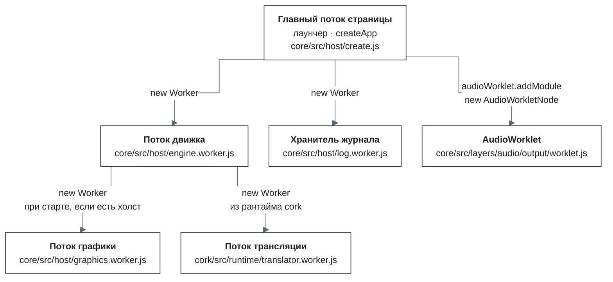

| Поток | Кто и где создаёт | Когда | Зачем он отдельный |
| --- | --- | --- | --- |
| Главный поток страницы | браузер | всегда | Интерфейс лаунчера, вызов `createApp`, события DOM. Каждый кадр только опрашивает геймпады (`requestAnimationFrame` → `input.poll`) |
| Поток движка | страница, `core/src/host/create.js` | всегда. С `?host=thread` движок работает на потоке страницы за тем же протоколом | Гость исполняется длинными квантами. На потоке страницы его останавливали бы сборка мусора и компоновка, а клик ждал бы конца кванта. Синхронные дескрипторы OPFS есть только в воркере. Устройство WebGPU нельзя передать между потоками, поэтому воркер открывает его сам, а холст получает как `OffscreenCanvas` |
| Хранитель журнала | страница, `core/src/host/remote.js` | всегда. Без `Worker` — `MessageChannel` на странице | Движок пишет журнал, счётчики и таблицы в общую память и никому не отвечает. Хранитель вычитывает кольцо раньше, чем оно перезапишется, хранит историю и считает кадры, профиль и разбивку по модулям. Ни страница, ни движок за журнал не платят |
| Поток графики | поток движка, `core/src/host/graphics-worker.js` (вызов в `serve.js`) | при старте, если у движка есть холст и не задано `device.graphicsWorker: false`. Живёт между программами. Не открыл устройство за 10 с — Direct3D рисует в потоке движка | Проигрывает вызовы Direct3D 8 и 9 на своём устройстве WebGPU. В бенче `tools/graphics-bench --remote` поток движка тратит на кадр 0,69 мс вместо 2,95 |
| Поток трансляции | рантайм cork в потоке движка, `cork/src/runtime/translator.js` | если движок — cork. Пока поток не ответил `ready`, регионы переводятся в потоке движка | Генерирует и кодирует wasm для регионов и компилирует модуль. Поток движка не ждёт: отправил пакет, готовое публикует между кадрами |
| AudioWorklet | страница, `ui/src/engine/session.js` | если страница `crossOriginIsolated` и звук включён | Поток реального времени Web Audio. Сам читает голоса из общей памяти по своим часам, поэтому звук не рвётся, пока движок занят |

Как потоки обмениваются данными (⇄ — в обе стороны, SAB — `SharedArrayBuffer`, общая память):

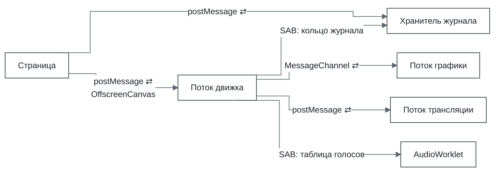

- **Страница ⇄ движок.** Запросы и события ввода — `postMessage`. Вместе с каждым сообщением
  страница увеличивает слово-сигнал в общей памяти, и движок видит сообщение между двумя ходами
  планировщика, а не на следующей плановой уступке. Холст передаётся один раз
  (`transferControlToOffscreen`), дальше кадры в него пишет только движок.
- **Движок → хранитель журнала.** Только общая память: хранитель опрашивает кольцо раз в 200 мс.
  Без `SharedArrayBuffer` страница пересылает ему записи сообщениями.
- **Движок ⇄ графика.** У каждого устройства Direct3D свой `MessageChannel`. Вызовы пишутся в один
  буфер на пакет, буфер передаётся без копирования. Обратно идут кадр `ImageBitmap` и ответы на
  вызовы, которые знает только рендерер.
- **Движок ⇄ трансляция.** Туда — регионы, которых нет в хранилище; обратно — байты модуля и уже
  скомпилированный `WebAssembly.Module`.
- **Движок → AudioWorklet.** Сообщений нет: таблица голосов лежит в общей памяти. Страница
  получает её в ответе на запуск и передаёт в `AudioWorkletNode`.

## 4. Запуск: от createApp до первой инструкции

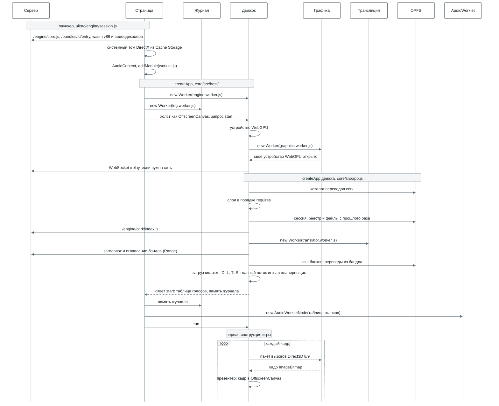

Три места, где порядок важен:

- **Устройство WebGPU и поток графики открываются до слоёв.** `createApp` движка получает поток
  графики в настройках устройства (`device.worker`): слой `graphics` при сборке уже знает, где
  рисует Direct3D 8/9.
- **Сессия накладывается до первой инструкции игры.** Игра сразу видит свои сейвы и реестр.
- **Код игры начинает исполняться только на `run`,** когда страница уже подключила журнал, ввод и
  звук. `DllMain` библиотек и TLS-колбэки — тоже код игры: их вызывает синтезированная заглушка в
  начале главного потока, а не хост.

Где в коде: `ui/src/engine/session.js` (что передаёт лаунчер), `core/src/host/create.js` и
`remote.js` (страница), `serve.js` (движок), `core/src/app.js` (`createApp`, `buildApp`,
загрузчик).

## 5. cork — ядро исполнения

cork — транслятор x86-32 в WebAssembly со своим рантаймом, пакет `cork/`. Ядро его не импортирует:
слой `cpu` загружает его по URL (`/engine/cork/index.js`), а без него запуск идёт на эмуляторе v86.
cork исполняет только пользовательский режим: системных вызовов ядра Windows нет, их место занимает
ловушка в мост (раздел 6).

| Где | Что делает |
| --- | --- |
| Поток движка | Интерпретаторы, формирование регионов, поиск в хранилище, публикация и исполнение переведённого кода, ловушки в мост |
| Поток трансляции | Эмиттер и кодировщик: пакет регионов → модуль wasm → скомпилированный `WebAssembly.Module` |
| OPFS | Хранилище переводов `cork/<id>.v3/` |
| Сервер | Код cork и воркера (`/engine/cork/`). Бандл может принести готовые переводы |

**Память.** Вся память игры — одна `WebAssembly.Memory` фиксированного размера (по умолчанию 1 ГиБ
под игру и таблицы cork рядом). Адрес игры `a` — это `0x10000 + a`, поэтому чтение и запись x86 становятся обычными
`i32.load` и `i32.store` со смещением. В первых 64 КиБ лежит блок состояния (регистры, 512 байт),
после памяти игры — таблицы cork. Таблиц страниц нет: на каждую страницу 4 КиБ один байт флагов —
`INACCESSIBLE`, `HAS_CODE`, `VOLATILE`, `CLOSED`, `NO_EXECUTE`.

### Слои cork

| Слой | Файлы | Вход → выход | Что важно |
| --- | --- | --- | --- |
| Декодер | `decode/decoder.js`, `decode/table.js` | байты по адресу → `Instruction` | Таблицы опкодов написаны вручную. Запись знает операнды, длину, какие флаги инструкция читает и пишет и как может упасть. Неизвестный опкод — отказ с его названием |
| Формирователь регионов | `region.js`, `helpers.js` | адрес входа → `Region` | Блоки по прямым переходам до косвенного перехода, `ret`, `call`, ловушки, `hlt`, отказа или предела 128 блоков / 8192 байт. Короткие листовые функции (до 16 блоков / 512 байт) встраиваются. `helpers.js` узнаёт помощников компилятора (`_ftol2` MSVC) по отпечатку байтов |
| Эмиттер | `emit/` | `Region` → одна wasm-функция | Цикл диспетчеризации `br_table` со структурными циклами. `integer.js` — целочисленные, `flags.js` — ленивые флаги, `memory.js` — доступ к памяти и проверки страниц, `x87.js` — FPU, `simd.js` — MMX и SSE, `helpers.js` — общий модуль помощников |
| Кодировщик и пакеты | `wasm/encoder.js`, `wasm/features.js`, `runtime/emit-built.js`, `runtime/translator.worker.js` | пакет регионов → один модуль | Чистая функция: работает в потоке трансляции, а пока он не готов — в потоке движка. `features.js` проверяет, умеет ли браузер SIMD и хвостовые вызовы |
| Рантайм | `runtime/runtime.js`, `entries.js`, `pages.js`, `layout.js`, `cache.js` | EIP → переведённая функция | Очередь кандидатов по горячести, пакеты, публикация, хэш входов на 262 144 слота, флаги страниц, сброс переводов при записи в код, перелинковка модулей |
| Интерпретаторы | `interp.js` с `fast.js`, `interp-wasm.c` | исполняют то, что ещё не переведено | Сначала JS-интерпретатор, затем wasm-интерпретатор, собранный clang из C. MMX и редкие формы wasm-интерпретатор отдаёт JS |
| Модель инструкций | `ir.js`, `ir-x87.js`, `ir-simd.js` | — | Намеренно медленная и очевидная семантика x86. По ней работает JS-интерпретатор, с ней сверяются тесты эмиттера |
| Связка с движком | `core/src/layers/cpu/internal/cork-host.js`, `translation-store.js`, `thunks.js` | — | Память, цикл квантов, переключение уровней, хранилище переводов в OPFS, заглушки ловушек |

Отдельного промежуточного представления нет: эмиттер работает прямо с декодированными
инструкциями.

### Перевод: от горячего адреса до функции

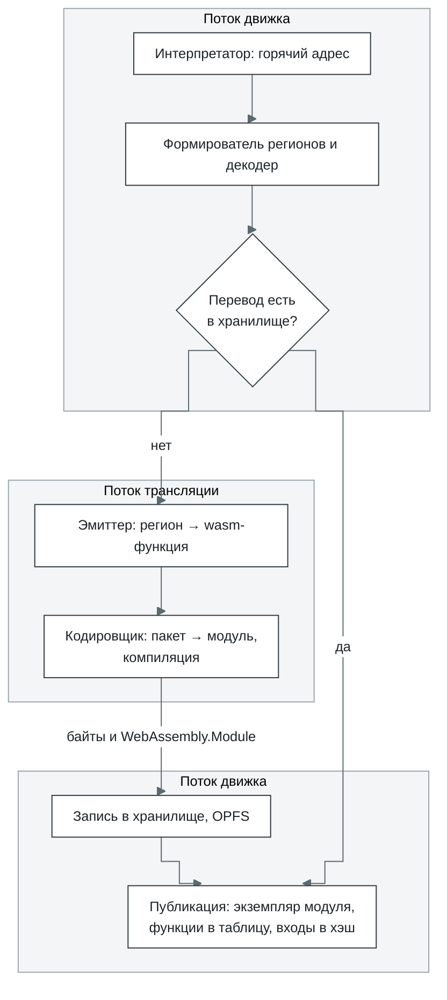

- **Горячий адрес.** Интерпретаторы считают посещения целей переходов. Цель становится кандидатом
  на втором посещении, затем на каждой степени двойки. Ещё кандидат — адрес, в который переведённый
  код 64 раза вышел без перевода.
- **Пакет.** Регионы переводятся пачками по 32, при длинной очереди — до 256. Один пакет — один
  модуль wasm. Функции, которые регион вызывает напрямую, переводятся в том же пакете. Позже модули
  перелинковываются в модули по 512 регионов.
- **Хранилище.** Ключ — версия кэша, возможности браузера, раскладка памяти, id бандла, адрес входа,
  64-битный хэш FNV байтов региона и вершина стека x87. Второй запуск берёт из хранилища всё, что
  перевёл первый. Бандл может принести переводы с собой (`CORKSEED`), их засевают до первой
  инструкции.

### Исполнение: чем кончается регион

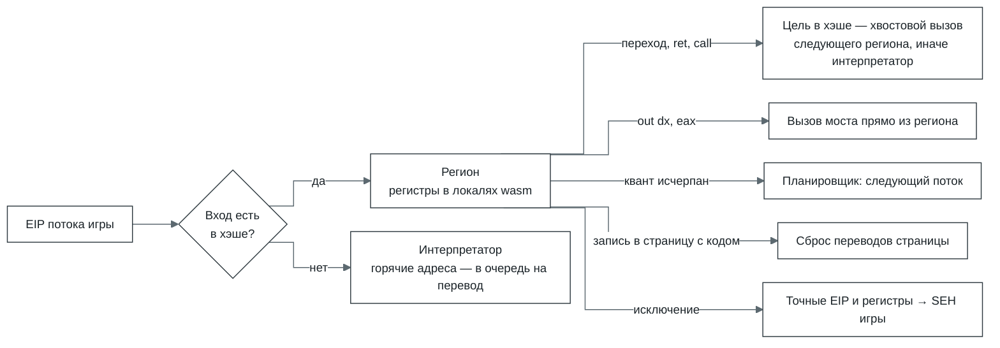

- **Переход между регионами** — хвостовой вызов (`return_call_indirect`) через общую таблицу
  функций, без выхода в хост, если браузер умеет хвостовые вызовы wasm. `switch` через таблицу
  переходов остаётся внутри региона: цель сверяется с таблицей при исполнении.
- **Счёт инструкций.** Каждый блок на выходе списывает своё число инструкций из бюджета, бюджет
  проверяется на обратных переходах. Квант планировщика — 100 000 инструкций. Переведённому коду
  бюджет выдаётся по 10 000, чтобы поток можно было вытеснить.
- **Уровни интерпретатора.** Первые 8192 единицы работы процесса (инструкции плюс 128 за каждую
  новую цель перехода) исполняет JS-интерпретатор, дальше — wasm-интерпретатор.
- **Ленивые флаги.** Арифметика запоминает вид операции, ширину, результат и операнды. Флаг
  вычисляется там, где его читают, поэтому `cmp` + `jl` — одно знаковое сравнение wasm. Отдельный
  проход убирает флаги, которых никто не читает.
- **x87** — восемь локалей f64. Регион компилируется под вершину стека на входе (её хранит слот
  хэша) и проверяет форму стека один раз, поэтому `fld`, `fmul`, `fstp` идут прямо по локалям.
  Режим точности FPU соблюдается.
- **SSE** — регистры XMM в локалях `v128` (wasm SIMD), MMX — локали `i64` поверх регистров x87.
- **Память и самоизменяющийся код.** Вне точного режима чтение памяти не проверяется: адрес заворачивается
  в пределы памяти игры. Запись проверяет байт флагов страницы. Запись туда, где на странице лежит
  переведённый код, выходит из региона и сбрасывает все переводы страницы. Границы кода хранятся с
  точностью до 32 байт, чтобы запись в данные рядом с кодом не считалась записью в код. Страница,
  которая так потеряла переводы 8 раз, становится летучей (`VOLATILE`): её код дальше только
  интерпретируется.
- **Исключения точные:** регион выходит перед упавшей инструкцией, с её EIP и регистрами. Деление на
  ноль — #DE, неизвестная инструкция — #UD, запись в закрытую страницу — #GP, переход ниже `0x10000`
  (вызов по нулевому указателю) — #PF. `int3` доигрывает интерпретатор. Дальше исключение идёт в
  SEH игры: #GP и #PF становятся `EXCEPTION_ACCESS_VIOLATION`.

Где в коде: `cork/src/decode/`, `cork/src/region.js`, `cork/src/emit/`, `cork/src/wasm/`,
`cork/src/runtime/`, `cork/src/interp.js`, `cork/src/interp-wasm.c`; связка с движком —
`core/src/layers/cpu/internal/cork-host.js`. Подробный дизайн — `roadmap/cork-x86-translator.md`.

## 6. Win32 на JavaScript: как получается DLL

Каждая системная библиотека — набор таблиц на JS: имя функции → обработчик, сколько байт
аргументов снять со стека и соглашение вызова (по умолчанию stdcall). Например,
`AddAtomA: { argBytes: 4, handler: ([p]) => add(p) }` в `core/src/layers/win32/kernel32/atoms.js`.
При старте процесса загрузчик собирает по этим таблицам настоящие PE32-образы `kernel32.dll`,
`d3d9.dll` и остальных и кладёт их в память игры. Игра видит обычную DLL: заголовки, таблицу
экспорта, байты кода. Поэтому адрес из `GetProcAddress` совпадает с тем, к которому привязан импорт.

| Где | Что лежит |
| --- | --- |
| Поток движка | Таблицы функций, синтез образов, мост и обработчики |
| Память игры | Образы DLL; таблица заглушек с адреса `0x100000` (16 384 слота по 16 байт); COM-объекты и таблицы их методов |

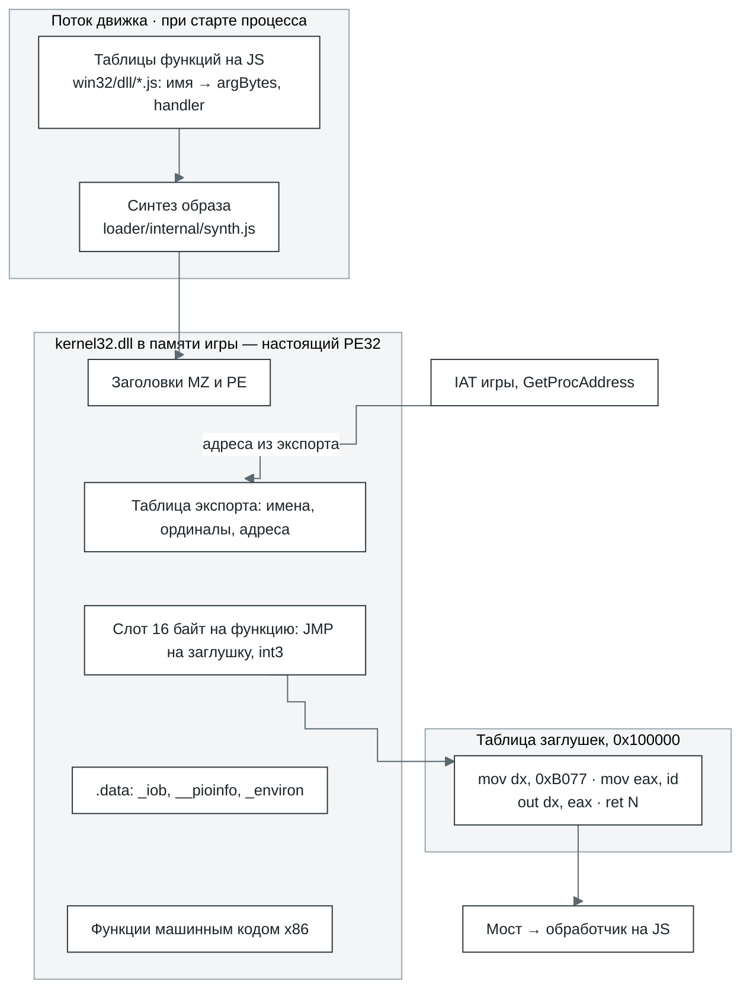

Заглушка — 16 байт, одна на функцию:

```
66 BA 77 B0      mov dx, 0xB077     ; порт ловушек
B8 xx xx xx xx   mov eax, id        ; номер функции в мосте
EF               out dx, eax        ; cork вызывает мост
C2 nn nn         ret N              ; C3 для cdecl
CC ...           int3 до 16 байт
```

`N` считает мост по соглашению: stdcall снимает все `argBytes`, cdecl — ничего, thiscall и
fastcall не считают аргументы в регистрах.

### Один вызов, от игры до JS и обратно

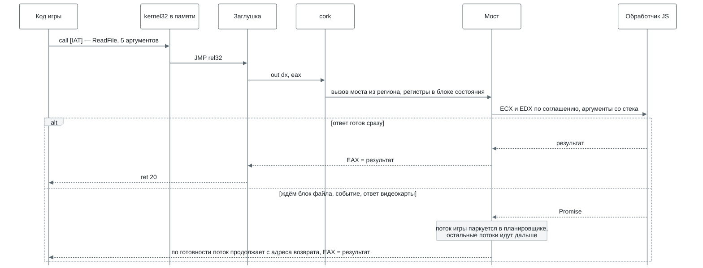

- **COM-объекты** — Direct3D, DirectSound, DirectInput — тоже лежат в памяти игры. Первое слово
  объекта указывает на таблицу методов, каждый слот — такая же заглушка. Метод — stdcall, указатель
  на интерфейс — первый аргумент на стеке.
- **Обратные вызовы** — оконная процедура, колбэк COM, `DllMain`: мост останавливает поток, строит
  кадр на стеке игры и запускает её код до возврата в служебную ловушку.
- **Код прямо в памяти игры.** Часть экспортов — сразу машинный код x86: функции msvcrt и
  kernel32, выдача мелких блоков кучи (до 1 КиБ). Они работают без ловушки, на скорости cork, а в
  мост уходит только то, что они не решают сами.
- **Вызов, которого нет.** У каждого имени своя заглушка. Если известно, сколько байт аргументов
  снять (декорация `@N`, имя C++, cdecl-библиотека, библиотека самой программы), она возвращает 0.
  Иначе игра падает с ошибкой `unimplemented import`, где названы функция и вызывающий.

### Какая DLL достаётся игре

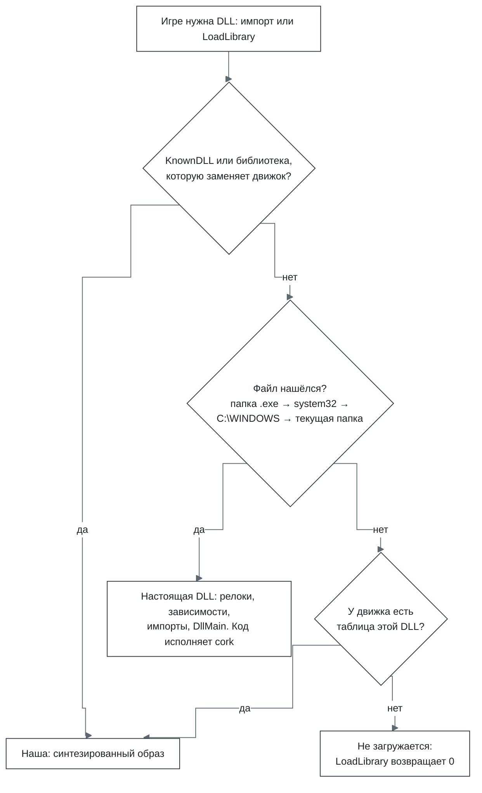

- **Всегда наши** — KnownDLLs (`kernel32`, `user32`, `msvcrt`, `ole32`…) и библиотеки, которые
  заменяет слой движка: `Mp3dec.asi` (звук) и `ijl15.dll` (media).
- **Порядок поиска** у `LoadLibrary`: папка `.exe`, `C:\WINDOWS\system32\`, `C:\WINDOWS\`, текущая
  папка. Статические импорты ищутся так же, но без текущей папки.
- **Настоящая DLL** разбирается и перемещается загрузчиком, её зависимости грузятся раньше неё,
  импорты (и отложенные) привязываются, `DllMain` вызывается через мост как код игры. TLS
  поддерживается у главного образа и статически загруженных библиотек.
- **Системный том** — DirectX runtime (`d3dx9_*` и другие распространяемые библиотеки Microsoft).
  Лаунчер монтирует его только для чтения в `C:\WINDOWS\system32\`. Если тома нет, на `d3dx9_*`
  отвечает таблица движка.

Где в коде: `core/src/layers/loader/internal/synth.js` (образ), `core/src/layers/cpu/internal/thunks.js`
(заглушки), `core/src/layers/bridge/` (мост), таблицы — `core/src/layers/win32/<dll>/`, порядок
поиска — `core/src/app.js` (`libraryCandidates`, `answeredByEngine`).

## 7. Графика

| Где | Что делает |
| --- | --- |
| Страница | Один раз отдаёт `<canvas>` движку (`transferControlToOffscreen`) и вписывает элемент в окно с сохранением пропорций (`ui/src/components/PlayScreen.jsx`) |
| Поток движка | Все графические API игры. Устройство Direct3D 8/9 хранит состояние и отвечает игре, но не рисует. Direct3D 7, Direct3D 10, OpenGL и Vulkan рисуют здесь через бэкенд WebGPU. DirectDraw и GDI — программные поверхности в памяти игры, их выгружает презентер. Презентер кладёт кадр в `OffscreenCanvas` |
| Поток графики | Двойник устройства Direct3D 8/9 проигрывает вызовы на своём устройстве WebGPU и возвращает кадр как `ImageBitmap` |
| OPFS | Не используется. Кэши пайплайнов и шейдеров живут только в памяти |

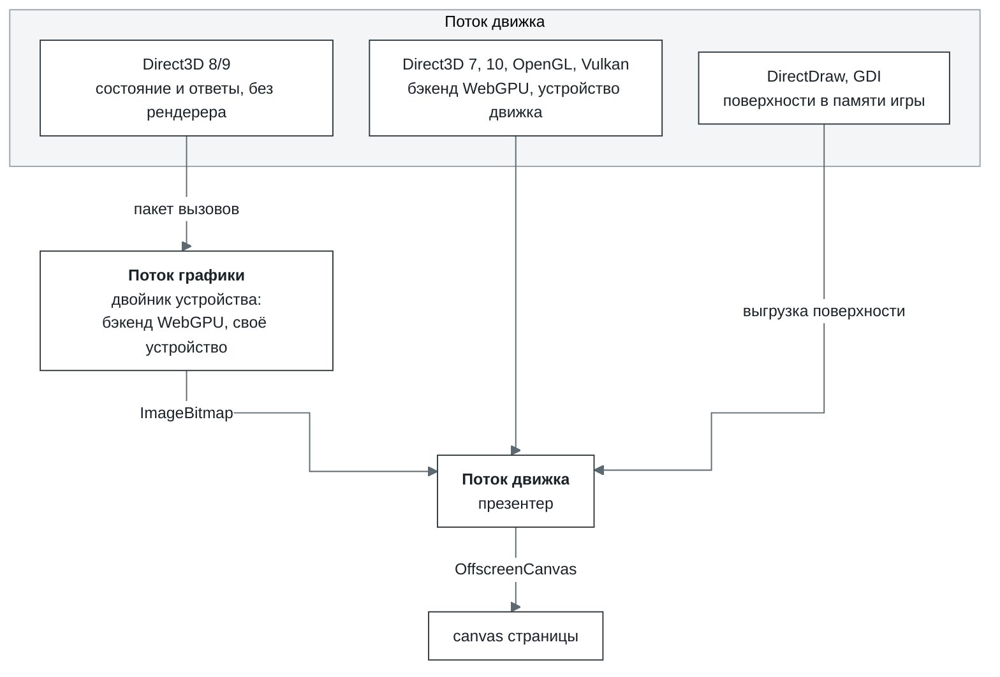

- **Вызовы.** Каждый вызов Direct3D 8/9 сразу пишется в двоичный пакет (`remote/wire.js`). Пакет
  уходит в конце хода (`queueMicrotask`) или сразу, если вызову нужен ответ. Байты ресурсов едут в
  том же пакете: для буфера — то, что игра записала через `Lock` к `Unlock`, для текстуры — к
  следующему вызову, который может её прочесть. Рендерер в потоке движка читает их в тот же момент,
  поэтому картинка одна и та же, где бы ни рисовал Direct3D.
- **Ожидание.** `Present` ждёт поток графики, только если тот отстал больше чем на два кадра.
  Ответа ждут вызовы, результат которых знает только рендерер: `GetData` (в том числе occlusion
  query), `GetRenderTargetData`, `GetFrontBuffer(Data)`, `LockRect`, `GetDC` и `CopyRects` на
  рендертаргете. Ждёт не поток движка, а поток игры: мост паркует его в планировщике, остальные
  потоки игры идут дальше.
- **Шейдеры.** Байткод шейдеров Direct3D 8/9 разбирается и переводится в WGSL
  (`graphics/d3d9/shader.js`, `wgsl.js`). Для фиксированного конвейера WGSL генерируется
  (`webgpu/internal/fixedfunction.js`).
- **Текстуры** загружаются на GPU как `bgra8unorm`, сжатые DXT по умолчанию распаковываются на CPU.
  Как BC-форматы они уходят на GPU только с `graphics.compressedTextures` и на устройстве с
  `texture-compression-bc`.
- **Отказы.** Поток графики не открылся — Direct3D рисует в потоке движка, в консоли
  предупреждение. Потеряно устройство WebGPU — `Present` и `Reset` отвечают `D3DERR_DEVICELOST`
  (у 9Ex — `D3DERR_DEVICEREMOVED`). Восстановления нет, новые кадры не приходят.

Где в коде: `core/src/layers/graphics/` (`d3d7`, `d3d8`, `d3d9`, `d3d10`, `ddraw`, `gdi`,
`opengl`, `vulkan`, `webgpu`), поток графики — `graphics/remote/` и
`core/src/host/graphics.worker.js`.

## 8. Звук

| Где | Что делает |
| --- | --- |
| Страница | До старта создаёт `AudioContext` и загружает `worklet.js`. После старта создаёт `AudioWorkletNode` над таблицей голосов из ответа движка |
| Поток движка | DirectSound, waveOut, DirectMusic и MP3 для Miles. Перед каждой уступкой браузеру дописывает в общую память то, что записала игра, переносит громкость и панораму, сигналит уведомления |
| AudioWorklet | Читает 64 слота голосов по своим часам, линейно пересэмплирует, применяет громкость и панораму, сводит |
| OPFS | Не используется |

Буфер DirectSound устроен как голос звуковой карты: копия его байтов лежит в общей памяти, и
AudioWorklet читает её сам, как DMA. Поэтому звук не рвётся, когда движок занят загрузкой или
переводом кода, — пока в буфере игры хватает звука.

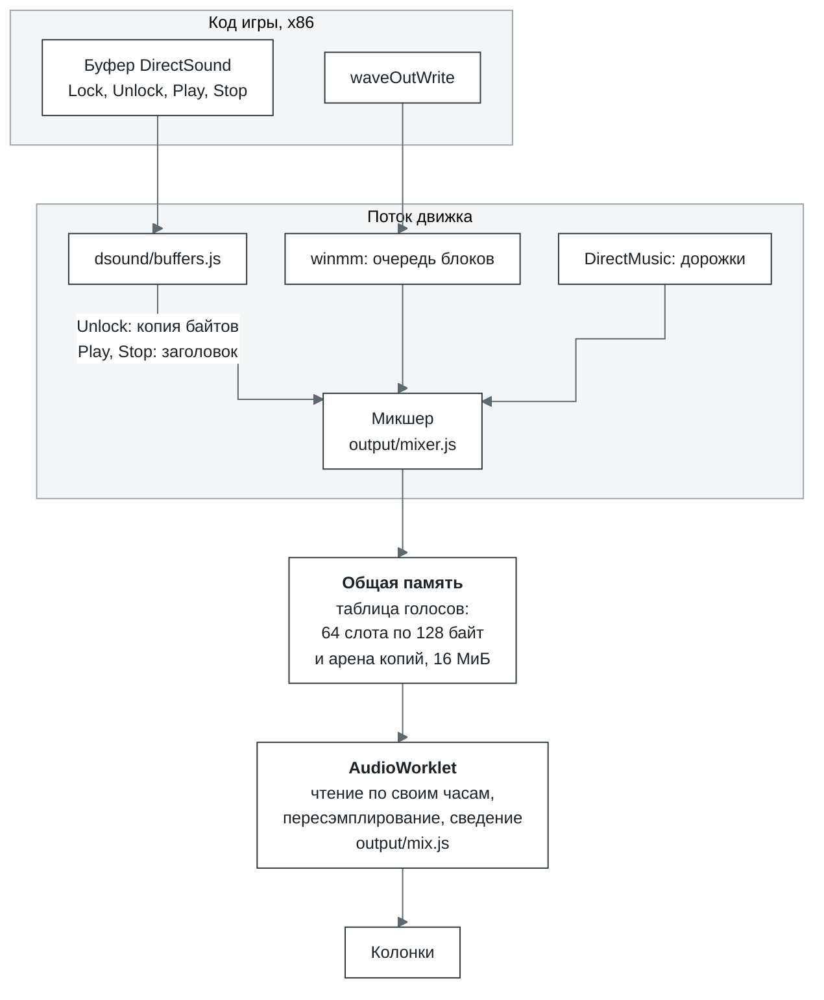

- **Голос** — слот в таблице: заголовок из 32 слов (`RATE`, `CHANNELS`, `BITS`, `GAIN`, срез
  левого и правого канала, `POSITION`, `LOOPING`, `PLAYING`, `LAPS`…) и копия буфера в арене. Весь
  буфер копируется, когда движок впервые видит его играющим, дальше — только диапазоны каждого
  `Unlock`. `Play` пишет позицию, `LOOPING` и `PLAYING`, `Stop` — `PLAYING = 0`.
- **Курсор воспроизведения** — сколько прочёл AudioWorklet (`POSITION` и `LAPS`), курсор записи —
  на 30 мс впереди. Поэтому `GetCurrentPosition` и уведомления по позициям совпадают с тем, что
  реально звучит.
- **Потоковый буфер** — тот, что игра дописывает по ходу, как микшеры Miles и FMOD. Голос не играет
  дальше дописанного: при задержке звучит тишина, а не повтор старого круга. Через
  max(250 мс, один круг) голос перестаёт ждать и идёт по кругу дальше.
- **waveOut** — дорожка на устройство. `waveOutWrite` сразу копирует блок, а `WOM_DONE` приходит,
  когда AudioWorklet его прочёл.
- **MP3 для Miles.** Вместо гостевого `Mp3dec.asi` работает свой провайдер через `RIB`-вход
  `mss32.dll`, декодер — minimp3 в wasm (`audio/asi/`). Есть и MP3-кодек для ACM.
- **Ограничения.** Свободных слотов нет — буфер играет через дорожку-очередь, курсор идёт по часам.
  3D-интерфейсы DirectSound отдаются, параметры хранятся, но не слышны. Захват звука —
  `DSERR_NODRIVER`.
- **Без изоляции вкладки** (COOP/COEP, их ставит `ui/server.mjs`) нет `SharedArrayBuffer`. Тогда
  звука нет совсем: лаунчер так и пишет, движок ничего не сводит, курсоры идут по часам.

Где в коде: `core/src/layers/audio/` — `output/mixer.js`, `output/mix.js`, `output/worklet.js`,
`dsound/buffers.js`, `asi/provider.js`; waveOut — `core/src/layers/win32/winmm/functions.js`.

## 9. Сеть

| Где | Что делает |
| --- | --- |
| Страница | Передаёт в `createApp` модуль клиента (`/networking/client/index.js`), адрес ретранслятора (`ws://` или `wss://` того же хоста, `/relay`) и комнату — id бандла |
| Поток движка | `wsock32`, `ws2_32`, `mswsock`: реестр сокетов, петля `127.0.0.0/8` внутри вкладки, клиент ретранслятора. WebSocket открывается в воркере |
| Сервер лаунчера | Ретранслятор `/relay` в том же процессе и на том же порту, что и HTTP |
| OPFS | Не используется |

Вкладка не умеет открывать TCP и UDP — только WebSocket. Поэтому сокеты игры идут через
ретранслятор: он соединяет вкладки одной комнаты и, если разрешено, открывает настоящие соединения
наружу.

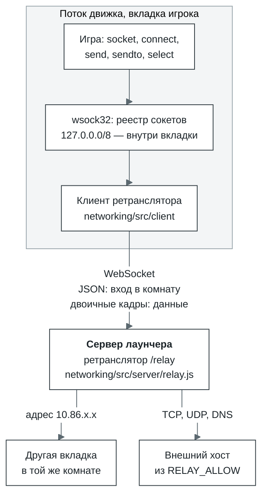

- **Комната** — частная сеть: вкладки с одним бандлом видят друг друга, как в одной LAN. Каждая
  получает наименьший свободный адрес из `10.86.0.0/16`, в комнате до 32 участников.
  Широковещание доходит только до участников комнаты, слушающих этот UDP-порт.
- **Наружу закрыто по умолчанию.** Ретранслятор без настройки — LAN, а не открытый прокси. Хосты
  разрешает `RELAY_ALLOW` при запуске сервера: список через запятую, `*.` — суффикс. Имена
  разрешает ретранслятор и запоминает их, поэтому политика проверяет имя, а не только адрес. С
  пустым списком DNS не отвечает ничего.
- **Кадр.** Вход в комнату — JSON (`hello` → `welcome` с адресом и списком участников). Данные —
  двоичный кадр: 20 байт заголовка и до 64 КиБ данных. Один `send()` — один кадр, поэтому границы
  UDP-датаграмм сохраняются. TCP-`send()` больше 64 КиБ пока на кадры не делится и падает.

| Смещение | Тип | Поле |
| --- | --- | --- |
| 0 | u8 | op: `DIAL`, `OPENED`, `STREAM`, `HANGUP`, `DATAGRAM`, `LISTEN`, `UNLISTEN`, `ACCEPTED`, `RESOLVE`, `RESOLVED` |
| 1 | u8 | флаги: `REJECT`, `HALF`, `STREAM` |
| 2 | u16 | резерв |
| 4 | u32 | tag — номер потока TCP или запроса DNS |
| 8 | u32 | IP отправителя |
| 12 | u32 | IP получателя |
| 16 | u16 | порт отправителя |
| 18 | u16 | порт получателя |

TCP — это `DIAL` → `OPENED` (или `HANGUP` с `REJECT`), затем `STREAM`. `shutdown(SD_SEND)` —
`HANGUP` с `HALF`. Все поля little-endian.

Где в коде: `core/src/layers/win32/wsock32/` (сокеты и транспорт), `networking/src/` (клиент,
`protocol.js`, сервер), подключение — `ui/server.mjs` и `ui/src/engine/session.js`.

## 10. Хранилища

OPFS — файловая система браузера, своя у каждого origin (схема, хост, порт). Поэтому лаунчер
открывают всегда по одному адресу: на другом — другой OPFS и другие сейвы. По умолчанию это
`http://127.0.0.1:5180`. С `TLS_DIR` сервер слушает https на всех адресах: с другой машины без
защищённого контекста не будет ни OPFS, ни `SharedArrayBuffer`.

| Хранилище | Где | Что лежит | Как устроено |
| --- | --- | --- | --- |
| Кэш блоков | OPFS: `<id>.blocks`, `<id>.present`, `<id>.order` | блоки бандла, уже полученные с сервера | Блок N лежит со смещения N × размер блока (из заголовка бандла, по умолчанию 256 КиБ). `.present` — битовая карта полученных блоков, `.order` — порядок первых обращений (до 4096). Синхронные дескрипторы, пул на 16, первым закрывается тот, что дольше не нужен |
| Переводы cork | OPFS: `cork/<id>.v3/` | переведённые регионы | `records` — записи подряд, `index` — журнал, где какая лежит. Индекс читается один раз, промах не трогает диск, попадание — одно чтение по смещению. Новое дописывается пакетами; уплотнение, предел 1 ГиБ |
| Сессия | OPFS: `<id>.session` | файлы, которые записала игра, и реестр | Один поток deflate-raw. Накладывается до первой инструкции, сохраняется через 250 мс после того, как записи игры улеглись. Бандл не меняется никогда |
| Системный том | Cache Storage: `bottlify-system-volume` | DirectX runtime: `d3dx9_*` и другие распространяемые библиотеки | Страница качает его один раз и монтирует только для чтения в `C:\WINDOWS\system32\` |
| Настройки | localStorage | настройки лаунчера, время первого кадра | — |

Чтение файла игры:


- **Кэш блоков не держит бандл в памяти:** игра может весить больше гигабайта. Если размер битовой
  карты не сходится с бандлом, карта сбрасывается, и блоки скачиваются заново.
- **Синхронные дескрипторы** (`createSyncAccessHandle`) есть только в воркере. Зато чтение из OPFS
  не ждёт событий, и `ReadFile` по уже скачанному блоку отвечает сразу.
- **Сессия** читается и пишется асинхронно (`getFile`, `createWritable`).

Где в коде: `core/src/layers/filesystem/internal/bundle/cache.js` (блоки),
`core/src/layers/filesystem/internal/opfs-store.js` (дескрипторы),
`core/src/layers/cpu/internal/translation-store.js` (переводы), `core/src/storage.js` (сессии),
`ui/src/engine/session.js` (системный том).
