# Bottlify изнутри

English version: [architecture.md](architecture.md).

Пути без префикса указаны от [`modules/`](../modules/) в bottlify, пути с `ui/` указаны от корня bottlify-ui. Если
схема расходится с кодом, прав код.

1. [Что это](#1-что-это)
2. [Из чего состоит](#2-из-чего-состоит)
3. [Потоки: кто кого запускает и зачем](#3-потоки-кто-кого-запускает-и-зачем)
4. [Запуск: от createApp до первой инструкции](#4-запуск-от-createapp-до-первой-инструкции)
5. [cork, ядро исполнения](#5-cork-ядро-исполнения)
6. [Win32 на JavaScript: как получается DLL](#6-win32-на-javascript-как-получается-dll)
7. [Графика](#7-графика)
8. [Звук](#8-звук)
9. [Сеть](#9-сеть)
10. [Хранилища](#10-хранилища)

## 1. Что это

Что такое Bottlify и зачем он нужен, рассказано в [README](../README.ru.md). Здесь описано, как он
устроен. Таблица показывает, кто в Bottlify даёт программе то, что ей нужно от Windows и от
компьютера, и на каком веб-API это работает. Сервер на кадр не влияет: он только раздаёт файлы и
пересылает сетевой трафик.

| Что нужно приложению | Кто это даёт | На чём работает |
| --- | --- | --- |
| Процессор x86 | cork переводит x86 в wasm | WebAssembly |
| Системные DLL | слой `win32`: функции на JS, которые программа видит как настоящие PE-образы | |
| DirectDraw, Direct3D 7–10, OpenGL, Vulkan, GDI | слой `graphics` | WebGPU |
| DirectSound, waveOut, DirectMusic | слой `audio` | AudioWorklet, SharedArrayBuffer там, где он есть у страницы |
| Несколько процессоров | исполнители слоя `cpu`, каждый в своём воркере над памятью программы | Web Workers, SharedArrayBuffer |
| DirectInput, XInput, сообщения окна | слой `input` | события клавиатуры и мыши, Gamepad API |
| Видеоролики DirectShow | слой `media`, FFmpeg в wasm | WebAssembly |
| Диск | бандл, который читается блоками, и сессия поверх него | fetch с Range, OPFS |
| Winsock | `wsock32` и ретранслятор | WebSocket |

### Почему игры

Bottlify задуман как «игра в бутылке», поэтому движок делается прежде всего под игры. Для игры
скорость входит в корректность: игра, которая выдаёт 10 кадров вместо 60, не работает, даже если
всё считает верно.

Кроме того, лучше игры такую систему ничто не проверит:

- **Игра нагружает всё сразу.** Целочисленный код, x87 и SSE, Direct3D, звук, ввод, файлы, потоки,
  иногда сеть: один запуск проходит почти через все слои движка.
- **Игра сама себя меряет.** У многих игр есть встроенные бенчмарки и timedemo: каждый раз одна и та
  же сцена, а на выходе получаются кадры в секунду. Два запуска сравниваются числом, и регрессия
  видна сразу, а не «на глаз».
- **Пропуски видно сразу.** Если не хватает функции, программа падает с `unimplemented import` и
  именем этой функции. Если функция работает неточно, картинка съезжает, звук щёлкает или проседают
  кадры. Каждый такой сбой указывает на конкретное место в движке.
- **Игр очень много.** Тысячи программ разных лет, движков и компиляторов дают огромный готовый
  набор тестов, который не нужно писать самим.

Под одну игру движок не подгоняют: если игра споткнулась, чинят общий слой, на котором это
случилось, и исправление достаётся всем программам, которые идут тем же путём. Поэтому, хотя
глубже всего сейчас проработано то, что нужно играм (DirectX и OpenGL, звук, ввод, видеоролики и
сеть), работает это для любого приложения.

## 2. Из чего состоит

В репозитории четыре пакета `@bottlify/`:

| Пакет | Что внутри |
| --- | --- |
| `@bottlify/core` | Наше окружение Windows: Win32 и DirectX, загрузчик, планировщик, файлы и `createApp`, через который всё запускается |
| `@bottlify/cork` | Транслятор x86 → wasm со своим рантаймом. Движок не импортирует его напрямую, а грузит по URL |
| `@bottlify/networking` | Клиент и сервер ретранслятора, через который приложения выходят в сеть |
| `@bottlify/installer` | Установка приложения его собственным установщиком и упаковка бандлов |

Для отладки есть ещё **bottlify-ui**, отдельный репозиторий: лаунчер на React и локальный сервер,
который на одном адресе отдаёт приложение, движок, бандлы и ретранслятор.

Движок разбит на слои, и любой из них можно выключить, не сломав остальные. У каждого слоя свой
интерфейс, настройки и тесты, а с другими слоями он общается только через то, что объявил в
`requires`. Выключенный слой, который нужен другому, заменяет заглушка: например, с
`graphics: null` игра работает, просто без картинки. Контракт модуля и проверка
`npm run check:boundaries` описаны в [`core/configuration.md`](core/configuration.md#the-module-contract).

| Слой | Отвечает за | `requires` |
| --- | --- | --- |
| `log` | журнал, счётчики, профиль фаз | |
| `cpu` | выполнение кода x86 через cork, ловушки вызовов в мост | `log` |
| `memory` | адресное пространство игры: резервирование, страницы, защита | `cpu`, `log` |
| `kernel` | процессы, потоки, планировщик, объекты ожидания | `cpu`, `memory`, `log` |
| `loader` | загрузка PE и сборка системных DLL | `cpu`, `memory`, `log` |
| `bridge` | соглашения вызова, парковка потоков, обратные вызовы, COM в памяти игры | `cpu`, `kernel`, `memory`, `log` |
| `filesystem` | бандл, кэш блоков, диск `C:`, файлы, которые пишет игра | `log` |
| `win32` | kernel32, user32, gdi32, advapi32, ole32, msvcrt, winmm, wsock32 и ещё три десятка DLL | `bridge`, `kernel`, `memory`, `loader`, `filesystem`, `media`, `log` |
| `graphics` | DirectDraw, Direct3D 7/8/9/10, OpenGL, Vulkan и бэкенд WebGPU под ними | `win32`, `bridge`, `memory` |
| `audio` | DirectSound, DirectMusic, микшер, MP3 для Miles | `win32`, `bridge`, `memory` |
| `input` | DirectInput, XInput, клавиатура и мышь в очереди сообщений | `win32`, `bridge`, `memory` |
| `media` | декодер видео (FFmpeg в wasm) и `ijl15.dll` | `log` |

## 3. Потоки: кто кого запускает и зачем

Во вкладке работают потоки девяти видов, три из них в нескольких экземплярах.
Страница запускает три: поток движка, хранитель журнала и AudioWorklet. Поток движка запускает поток
графики, писатель хранилища переводов, общий для всего запуска пул потоков трансляции, которые он
одалживает процессам, а там, где процессы идут одновременно, ещё и по потоку на каждый процесс.
Поток процесса запускает его исполнители: по воркеру на каждое ядро, которое получает программа,
кроме первого.

Почти вся работа идёт там, где работает программа: в потоке движка или, если процессы идут
одновременно, в потоке самого процесса. Остальные потоки забирают у него то, что можно делать
параллельно, и то, что браузер разрешает только вне главного потока.

Схема запуска зависит от того, включена ли на странице cross-origin isolation:

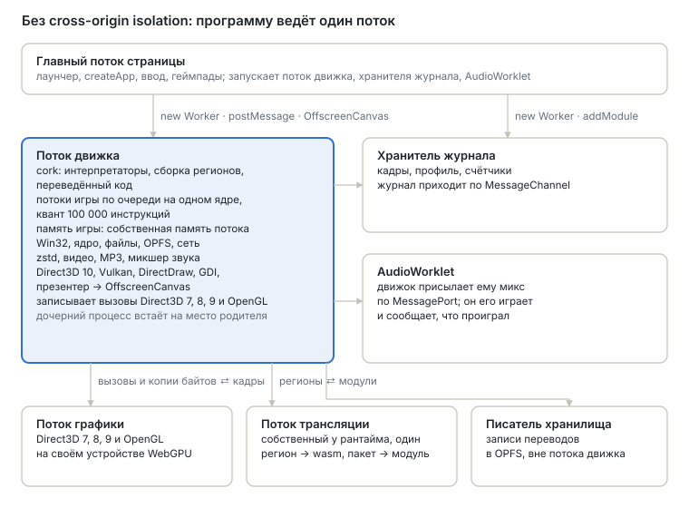

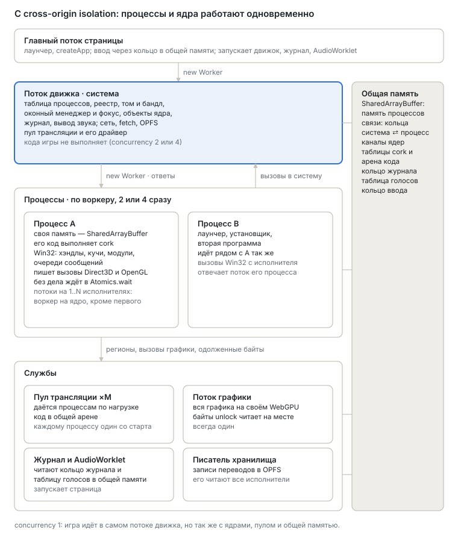

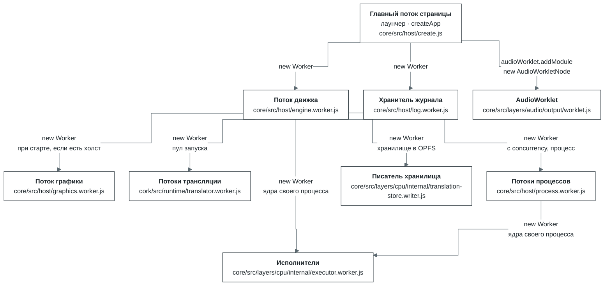

| Поток | Кто запускает | Когда | Зачем отдельный поток |
| --- | --- | --- | --- |
| Главный поток страницы | браузер | всегда | Здесь живут интерфейс лаунчера, вызов `createApp` и события DOM. Каждый кадр он только опрашивает геймпады (`requestAnimationFrame` → `input.poll`) |
| Поток движка | страница, [`core/src/host/create.js`](../modules/core/src/host/create.js) | всегда. С `?host=thread` движок можно запустить прямо в потоке страницы, протокол тот же | Игра выполняется длинными квантами. В потоке страницы её прерывали бы сборка мусора и отрисовка интерфейса, а клик ждал бы конца кванта. К тому же синхронный доступ к OPFS есть только в воркере. Устройство WebGPU между потоками не передаётся, поэтому воркер открывает его сам, а холст получает как `OffscreenCanvas` |
| Хранитель журнала | страница, [`core/src/host/remote.js`](../modules/core/src/host/remote.js) | всегда. Если `Worker` недоступен, его заменяет `MessageChannel` на странице | Движок пишет журнал, счётчики и таблицы в общую память и ни на какие вопросы не отвечает. Хранитель успевает вычитать кольцо, пока оно не перезаписалось, хранит историю, считает кадры, профиль и разбивку по модулям. Так журнал ничего не стоит ни странице, ни движку |
| Поток графики | поток движка, [`core/src/host/graphics-worker.js`](../modules/core/src/host/graphics-worker.js) (вызывается из `serve.js`) | при старте, если у движка есть холст и не выставлено `device.graphicsWorker: false` (в лаунчере `?graphicsWorker=off`). Переживает смену программы. Если за 10 с устройство не открылось, всё рисуется в потоке движка | Рисует всю графику, чтобы поток движка только хранил состояние и отвечал программе. Сейчас здесь на отдельном устройстве WebGPU проигрываются Direct3D 7, 8, 9 и OpenGL; Direct3D 10 и Vulkan переедут сюда же. В бенче `tools/graphics-bench --remote` поток движка тратит на кадр Direct3D 0,69 мс вместо 2,95 |
| Потоки трансляции | пул запуска, [`core/src/host/pool/pool.js`](../modules/core/src/host/pool/pool.js) (создаётся в `app.js`) | если движок cork, страница может делить память, а транслятор и так открыл бы свой воркер; иначе каждый процесс открывает собственный транслятор. Каждому процессу один поток одалживается от запуска до завершения, а пока трансляция отстаёт, драйвер пула подключает ещё (раздел 5; `cork.pool` в [`core/configuration.md`](core/configuration.md#cpu)). Пул одалживает их потоку самого процесса, а каждый из остальных исполнителей открывает собственный транслятор. Пока первый поток пула не ответил `ready`, регионы переводятся в потоке процесса | Генерирует wasm для регионов, собирает модуль и компилирует его. Поток процесса его не ждёт: отправляет пакет и публикует результат между кадрами, когда тот придёт. Поток трансляции работает на один процесс за раз, через собственный порт, а свободный поток спит и ничего от процессов не держит |
| Исполнители | поток, в котором работает процесс, [`core/src/layers/cpu/internal/executor.js`](../modules/core/src/layers/cpu/internal/executor.js) | под cork, на странице с общей памятью, когда у процесса больше одного ядра ([`cpu.cores`](core/configuration.md#cpu)): по одному на каждое ядро, кроме первого; каждый открывается, когда понадобится потоку программы | Выполняют потоки программы одновременно с потоком самого процесса, прямо над памятью процесса. Вызов Win32 или ядра, как и исключение, ждёт, пока поток процесса ответит на него над регистрами исполнителя. Каждый открывает собственный транслятор и берёт переводы из хранилища запуска через процесс |
| Писатель хранилища | поток движка, [`core/src/layers/cpu/internal/translation-store.js`](../modules/core/src/layers/cpu/internal/translation-store.js) | когда хранилище переводов запуска лежит каталогом в OPFS | Пишет записи хранилища через собственный дескриптор: запись через синхронный дескриптор ждёт диска, и в потоке движка она задерживала кадр |
| AudioWorklet | страница, `ui/src/engine/session.js` | если звук включён | Это поток реального времени Web Audio. На изолированной странице он сам читает голоса из общей памяти по своим часам, поэтому звук не рвётся, даже когда движок занят; на остальных движок присылает ему готовый микс по отдельному каналу, а он сообщает обратно, что проиграл |
| Поток процесса | поток движка, [`core/src/host/process-worker.js`](../modules/core/src/host/process-worker.js) (вызывается из `app.js`) | с `concurrency` 2 или 4 под cork, по одному на каждый процесс, включая программу, которую запустила страница, пока он работает | Каждый процесс (и лаунчер, и игра, которую он запускает) работает в своём потоке рядом с родителем, со своей памятью и своим транслятором. Ожидая, он блокируется и не делит очередь с циклом событий движка, а поток движка не исполняет ни одной программы |

Как потоки обмениваются данными (⇄ значит «в обе стороны», SAB означает `SharedArrayBuffer`, то
есть общую память):

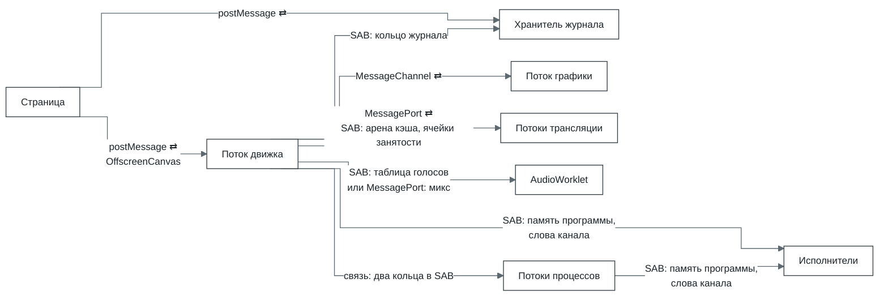

- **Страница ⇄ движок.** Запросы и ввод идут через `postMessage`. Отправив сообщение, страница ещё и
  увеличивает слово-сигнал в общей памяти. Так движок замечает сообщение сразу, между ходами
  планировщика, а не ждёт очередной плановой паузы. Там, где процессы идут одновременно, ввод и
  видимость передаются через кольцо в общей памяти, которое читается между ходами, а запросы
  по-прежнему отправляются сообщениями. Холст передаётся один раз
  (`transferControlToOffscreen`), и дальше кадры в него пишет только движок.
- **Движок → хранитель журнала.** Только через общую память: хранитель заглядывает в кольцо раз в
  200 мс. Если `SharedArrayBuffer` нет, записи ему пересылает страница.
- **Движок ⇄ графика.** У Direct3D 7, 8, 9 и OpenGL по своему `MessageChannel`. Вызовы складываются в
  один буфер на пакет, и буфер передаётся без копирования. Обратно приходят кадр `ImageBitmap` и
  ответы на вызовы, результат которых знает только рендерер.
- **Движок ⇄ трансляция.** Туда уходят регионы, которых нет в хранилище, обратно приходят байты
  модуля и уже скомпилированный `WebAssembly.Module`.
- **Движок → AudioWorklet.** На изолированной странице сообщений тут нет вообще. Таблица голосов
  лежит в общей памяти: страница получает её в ответе на запуск и отдаёт `AudioWorkletNode`. На
  остальных страница отдаёт движку и ворклету два конца `MessageChannel`, движок присылает по нему
  микс, а ворклет сообщает обратно, что проиграл.
- **Процесс ⇄ его исполнители.** Память программы у них общая, без копий; ходы каждого исполнителя
  передаются через несколько слов общей памяти. Процесс просит срез, и каждый вызов Win32 или ядра
  и каждое исключение в этом срезе ждёт, пока поток процесса ответит на него своими обработчиками,
  на время ответа подставив регистры исполнителя в свой блок состояния (`executor.js`). Переводы и
  хранилище исполнители делят так, как сказано в разделе 5. Там же, в словах канала, каждый
  исполнитель считает свои прогоны гостевого кода, а их читает наблюдение за записью в рекордере
  графики (раздел 7).

**Процессы.** Сколько процессов идёт одновременно, задаёт `createApp({ concurrency })`; что дают
значения 1, 2 и 4 и когда прогон откатывается на `compatible`, описано в
[`core/README.md`](core/README.md#which-mode). При 1 (по умолчанию) программа работает в
потоке движка, а дочерний процесс встаёт там на место родителя. При 2 или 4 у каждого процесса свой
поток, а процесс сверх этого числа идёт по очереди с родителем в его потоке. Поток движка тогда не
выполняет программ и служит системой (что он собирает до запуска первого процесса, сказано в
разделе 4), а вопросы страницы к программе передаёт потоку программы.

Общее для процессов прогона остаётся в потоке движка: реестр, том и разделение его открытых файлов,
каталог окон, идентификаторы, именованные события, семафоры и мьютексы, бандл, таблица классов COM
([`core/src/com-link.js`](../modules/core/src/com-link.js)), хранилище переводов ([`core/src/layers/cpu/internal/store-link.js`](../modules/core/src/layers/cpu/internal/store-link.js)).
Потоку процесса движок отвечает через связь: два кольца в общей памяти, по одному в каждую сторону,
и по слову-звонку на каждую сторону ([`core/src/system/link.js`](../modules/core/src/system/link.js), значения кодирует `codec.js`).
Поток процесса ждёт каждого ответа, заблокировавшись на своём звонке, и тем временем отвечает на
вопросы к себе (движок спрашивает его об окнах). Сообщение, которое не помещается в кольцо, уходит
частями. Каждая сторона несколько микросекунд смотрит на свой звонок, прежде чем уснуть на нём:
разбудить уснувший поток стоит куда дороже самого ответа.

К тому поток процесса почти не обращается: каждое изменение диска сдвигает слово этого диска в
общей памяти (по слову на букву), а поток процесса хранит прочитанное с диска (куски файлов по
64 КБ, размеры, записи, списки), пока это слово не сдвинется. Разделение, с которым сверяется
каждое открытие файла, лежит таблицей в общей памяти под замком, и поток процесса сверяет с ней
свои открытия сам ([`core/src/layers/filesystem/internal/volume-link.js`](../modules/core/src/layers/filesystem/internal/volume-link.js), `shared-sharing.js`).

Устройства Direct3D процесса рисуют в потоке графики через собственный порт, картинки DirectDraw и
GDI приходят в движок байтами, звук сводится в таблице голосов прогона, в участке, который
одалживает родитель, а ввод страницы доходит до процесса так, как его направит оконный менеджер
запуска (раздел 7). Чего процессу пока не хватает, сказано в [`core/limits.md`](core/limits.md#processes).

**Режимы.** `createApp({ mode })` задаёт, сколько из этого держится на общей памяти. `isolated`
(нужна cross-origin isolation) кладёт память игры в `SharedArrayBuffer`, `compatible` оставляет её
потоку движка и копирует всё, что уходит в другой поток, а `auto` (по умолчанию) выбирает
`isolated` там, где страница изолирована. Только в `isolated` поток графики читает то, что игра
записала между `Lock` и `Unlock`, прямо из её памяти и пишет считанное обратно на место, и только
там потоки игры работают на нескольких ядрах; в `compatible` игре сообщают об одном ядре. Чего
каждый режим стоит странице, написано в [`core/README.md`](core/README.md#which-mode).
Режим прогона виден в диагностике слоя `app` ([`core/src/mode.js`](../modules/core/src/mode.js));
лаунчер берёт `auto`, если `?mode=compatible` или `?mode=isolated` не просят другого.

## 4. Запуск: от createApp до первой инструкции

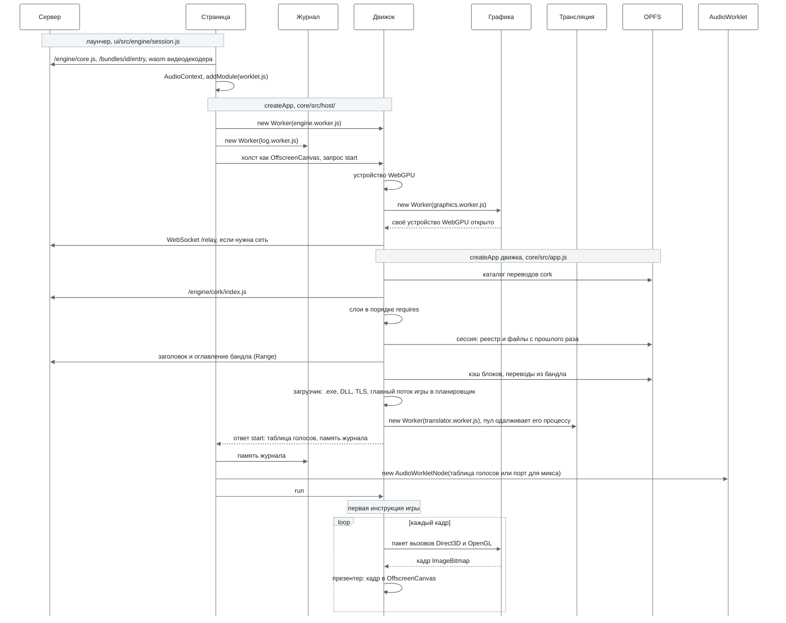

Порядок важен в трёх местах.

- **Устройство WebGPU и поток графики открываются раньше слоёв.** `createApp` движка получает поток
  графики в настройках устройства (`device.worker`), и слой `graphics` уже при сборке знает, где
  будут рисовать Direct3D и OpenGL.
- **Сессия накладывается до первой инструкции игры,** поэтому игра с самого начала видит свои сейвы
  и реестр.
- **Игра начинает работать только по команде `run`,** когда страница уже подключила журнал, ввод и
  звук. `DllMain` библиотек и TLS-колбэки тоже относятся к коду игры: их вызывает специальная
  заглушка в начале главного потока, а не хост. Каждый поток, созданный позже, начинается в своей
  заглушке: она вызывает их с `DLL_THREAD_ATTACH` до его стартовой функции и с
  `DLL_THREAD_DETACH`, когда он завершается, под той же блокировкой загрузчика
  (`kernel32/thread-calls.js`). Конец процесса и последний `FreeLibrary` сообщают
  `DLL_PROCESS_DETACH` TLS-колбэкам каждого образа раньше, чем его `DllMain`
  (`kernel32/dllentry.js`).

Когда процессы идут одновременно (`concurrency` 2 или 4), поток движка вместо этого собирает
систему запуска: монтирует бандл, кладёт на том сессию и файлы страницы, создаёт реестр, открывает
журнал и звуковой выход (`buildSystemHost` в [`core/src/app.js`](../modules/core/src/app.js)). Шаги от слоёв до первой
инструкции игры выполняются в потоке её процесса.

Где смотреть в коде: `ui/src/engine/session.js` (что передаёт лаунчер), [`core/src/host/create.js`](../modules/core/src/host/create.js)
и `remote.js` (страница), `serve.js` (движок), [`core/src/app.js`](../modules/core/src/app.js) (`createApp`, `buildApp`,
загрузчик).

## 5. cork, ядро исполнения

cork, наш транслятор x86-32 в WebAssembly со своим рантаймом (пакет [`cork/`](../modules/cork/)), выполняет весь код
игры. Что он такое, как переводит и выполняет код, что поддерживает и насколько быстр, описано в
[`modules/cork/README.ru.md`](../modules/cork/README.ru.md). Здесь речь только о том, как он
встроен в Bottlify.

Движок не импортирует cork напрямую: слой `cpu` загружает его по URL (`/engine/cork/index.js`), а
`createEngine` выполняет контракт исполнителя из
[`core/src/layers/cpu/engine.js`](../modules/core/src/layers/cpu/engine.js), а Win32, потоки и
планировщик добавляет поверх него `@bottlify/core`. Выполняется только пользовательский код: до ядра
Windows дело не доходит, вместо системного вызова срабатывает ловушка в мост (раздел 6).

| Где | Что делает |
| --- | --- |
| Поток движка | Интерпретаторы, сборка регионов, поиск в хранилище, публикация и выполнение переведённого кода, ловушки в мост |
| Потоки трансляции | Эмиттер и кодировщик: пакет регионов становится модулем wasm, а тот компилируется в `WebAssembly.Module`. На один процесс может работать несколько потоков, у каждого свой пакет |
| OPFS | Хранилище переводов `cork/<id>.v3/` |
| Сервер | Код cork и его воркера (`/engine/cork/`). Бандл может привезти готовые переводы |

**Память.** Вся память игры лежит в одной `WebAssembly.Memory` фиксированного размера (в режиме
`isolated` общей): по умолчанию 1 ГиБ под игру плюс таблицы cork. Раскладка (адрес игры `a` по
смещению `0x10000 + a`, блок состояния с регистрами, 512 байт, в первых 64 КиБ, а за памятью игры
таблицы cork с байтом флагов на каждую страницу в 4 КиБ) описана в
[README cork](cork/README.ru.md#как-устроен). Если исполнителей несколько, у каждого
следующего своя страница состояния и свои таблицы (`executorLayout`), а память игры у всех общая.
Флаги страниц: `INACCESSIBLE`, `HAS_CODE`, `VOLATILE`, `CLOSED`, `NO_EXECUTE`, а у страницы, за
записью в которую наблюдают, ещё `WATCH` или `WRITTEN` (раздел 7).

### Перевод в Bottlify

- **Несколько потоков трансляции, одна арена.** У процесса может быть несколько потоков трансляции,
  у каждого свой пакет в полёте. Перелинковка, слияние и регион, сформированный заново, забирают
  работающие регионы, поэтому уходят в одиночку. Уже сгенерированные функции, которые перелинковка
  или слияние берут снова, а не генерируют заново, принадлежат процессу, а не потоку: они лежат в
  его арене, 48 МБ общей памяти, которую каждый поток трансляции процесса читает и пополняет под
  одной блокировкой; первым вытесняется самый старый сегмент. Без арены перелинковка заново
  генерирует уже сгенерированное: на загрузке игры поток трансляции был занят 23,3 с вместо 14,6 с.
- **Драйвер пула.** Каждые 500 мс он читает из общей памяти, сколько работал каждый поток
  трансляции и сколько регионов выдал (туда пишут сами потоки). К процессу подключается ещё один
  поток, когда медианная загрузка уже работающих на него доходит до 80 %, но не больше
  `hardwareConcurrency` на процесс. Каждое подключение считается пробой: если число регионов
  процесса в секунду не выросло хотя бы на половину того, что в лучшем случае даёт ещё один поток,
  подключённый уходит, а процесс запоминает это число как свой потолок. Так бывает на четырёх
  ядрах: один поток трансляции там уже не оставляет игре свободного ядра на загрузке, и второй
  загрузку замедлял ([`roadmap/negative-results.md`](../roadmap/negative-results.md), 7 октября 2026). Подключённые потоки уходят
  сразу, когда процесс перестаёт транслировать и ждёт, а в остальных случаях через 3 с медианы ниже
  40 %. Каждое решение записывается в журнал пула (`translationPool()` у запуска).
- **Регионы не повторяют друг друга.** Если блок уже входит в регион, который сформирован, но ещё
  не опубликован (раньше в том же пакете, у транслятора или пока компилируется его модуль), кандидат
  на этом блоке рядом заново не формируется (для региона с x87 это касается той вершины стека, для
  которой сформирован тот регион): когда тот регион опубликуют, здесь будет его вход. Регион может
  и останавливаться на блоке, для которого вход есть у другого региона, и уходить туда
  (`regionStops`), чтобы код функции переводился один раз. По умолчанию это выключено: горячий код,
  который такая остановка режет, начинает переходить между регионами (`SETTINGS.md`). Маленькую
  листовую функцию встраивают в каждого вызывающего, чтобы сэкономить вызов.
- **Хранилище.** Ключ перевода: версия кэша, возможности браузера, раскладка памяти, id бандла,
  адрес входа, вершина стека x87 (у региона без x87 любая) и режимы запуска. Запись хранит, что
  получилось при формировании: 64-битный хэш FNV от байтов региона, блоки, оставленные другим
  регионам, встроенные вызываемые функции, точность x87. Если у запуска регион сложился иначе
  (вызываемые функции ещё не известны, рядом другие регионы), он формирует его заново так, как
  сказано в записи, и берёт перевод, если хэш байтов совпал. Хранилище помнит и карту входов своих
  регионов: запуск, попавший в блок сохранённого региона раньше его входа, формирует этот регион, а
  не новый ([README cork](cork/README.ru.md#как-устроен)). Каждый процесс запуска при
  сбросе добавляет свои регионы в эту карту (в том виде, в каком её в этот момент держит хранилище)
  и записывает её обратно, только если добавил не меньше 1/64 её: иначе инструмент, который игра
  запускает много раз за прогон, каждый раз переписывал бы карту целиком. Бандл может привезти
  переводы с собой (`CORKSEED`), их засевают ещё до первой инструкции.

### Выполнение в Bottlify

- **Счёт инструкций.** Каждый блок на выходе вычитает своё число инструкций из бюджета, а
  проверяется бюджет на обратных переходах. Переведённому коду бюджет выдают по 10 000 инструкций,
  чтобы поток можно было вовремя вытеснить. Длина хода (квант в 100 000 инструкций, ход в четверть
  миллисекунды среди готовых потоков, у быстрого переведённого кода около 750 000, и сольный ход в
  десять квантов) описана в [`core/configuration.md`](core/configuration.md#kernel). Пока другие
  исполнители выполняют потоки, сольный ход бывает только там, где их вызовы прерывают срез
  процесса.
- **Два интерпретатора.** Первые 8192 единицы работы процесса (инструкции плюс 128 за каждую новую
  цель перехода) выполняет JS-интерпретатор, а дальше работает wasm-интерпретатор.
- **Память и самоизменяющийся код.** Вне точного режима чтения не проверяются, пока игра впервые
  не коснётся недоступной ей страницы: адрес просто заворачивается в пределы памяти игры. После
  этого исключения каждый регион проверяет страницы, которые читает, а регионы, заворачивавшие
  чтения, переводятся заново. Каждая запись проверяет байт флагов страницы (обращения блока от
  одного регистра проверяются один раз, как одно окно). Запись только через `esp` не проверяется,
  пока на стеке потока нет переведённого кода (`looseStacks`); когда он там появляется, такие записи
  проверяет каждый регион.
  Если игра пишет туда, где на странице лежит переведённый код, регион выходит. Первая такая запись
  сбрасывает все переводы страницы. Регионы, сформированные там после неё, хранят копию байтов, из
  которых сформированы, и следующая запись сбрасывает только те, чьи байты она действительно
  изменила: микшер, который переписывает патчи голосов теми же байтами, сохраняет свой код, а
  сброшенный код сразу встаёт в очередь на перевод. Страница хранит один диапазон 32-байтных гранул,
  занятых её кодом, поэтому данные между двумя кусками кода попадают в этот диапазон. Запись туда,
  не задевшая байтов ни одного региона, сверяется с копией страницы. Если она изменила значение
  (переменная, которую цикл пишет на каждом витке), страница теряет переводы: останься страница
  кодом, каждая такая запись уходила бы в интерпретатор. Если запись повторила те же байты,
  страница остаётся.
  Страница, которая потеряла переводы 8 раз за 100 мс, считается летучей (`VOLATILE`) и 2 с
  интерпретируется, при каждом повторе вдвое дольше, а потом переводится снова. При нескольких
  исполнителях страница теряет все переводы при каждой такой записи.
- **Несколько исполнителей процесса.** Сколько их получает запуск, когда они открываются, что
  программе сообщают о процессорах и что значит маска привязки, описано в
  [`core/configuration.md`](core/configuration.md#cpu) (`cpu.cores`, `cpu.eager`).
  - **Свой исполнитель.** У каждого потока свой исполнитель, там лежат его переводы. Первый поток
    процесса работает на собственном исполнителе процесса, каждый следующий на том из остальных,
    который своим считает меньше всего живых потоков. Ход отдаёт каждому свободному исполнителю
    следующий готовый поток, для которого этот исполнитель свой. Поток, чей исполнитель занят, идёт
    на оставшийся свободным (в первую очередь на собственный исполнитель процесса), и его код
    переводится и там, чтобы процессор не простаивал. Поток никогда не запускается, пока его ещё
    выполняет другой исполнитель: поток, который ждал там, становится готовым по пробуждению
    раньше, чем тот срез забран, и второй запуск планировщик отвергает.
  - **Потоки, которым место на исполнителе процесса.** Два вида потоков работают только там, если
    им туда можно. Первый вид: поток, который за последний миллион с небольшим инструкций вызывает
    хост чаще раза на 30 000 инструкций, потому что с другого исполнителя каждый такой вызов
    означает путь туда и обратно. Инструкции считаются независимо от того, сколько срезов их
    разрезало: поток, который проснулся, выполнил несколько десятков инструкций и снова ждёт, весит
    не больше них. Второй вид: поток, чьи запуски на другом исполнителе по большей части кончались
    тем, что исполнителю процесса нечего было выполнять и он забирал поток к себе, а поток за это
    время успевал меньше половины того, что сделал исполнитель процесса. Такой поток чередуется с
    потоками процесса, а не работает рядом с ними; эта доля вдвое убывает каждую секунду, так что
    поток пробует снова. Поток, сделавший хотя бы половину, работал одновременно с ними (как поток
    отрисовки, которого главный поток ждёт каждый кадр) и остаётся на своём исполнителе. Поток
    любого из этих видов, ждущий исполнителя процесса, забирает его у считающего потока, и тот
    уходит на другой исполнитель.
  - **Врозь, вместе или по выигрышу.** Всё сказанное выше относится к способу раскладки «врозь».
    Способ «вместе» держит все потоки на исполнителе процесса, где им позволяет маска, и они
    чередуются там, как на одном процессоре (`cpu.placement`). Если запуск не назвал способ
    (`auto`), на работающей программе ничего не пробуется: каждые четверть секунды планировщик
    считает по тому, что сделал каждый поток (собственная работа по скорости исполнителя процесса,
    ожидание его ответов на другом исполнителе, ожидание очереди, вызовы хоста), что дал бы его
    перенос: внутрь, если у исполнителя процесса есть место для его работы и поток перестанет ждать
    ответов; наружу, если поток ждал здесь очереди, которую ему дал бы другой исполнитель. Выигрыши
    копятся с утечкой (полураспад две секунды), и перенос делается, когда сумма доходит до 300 мс:
    по одному потоку, с проверкой в следующие полторы секунды по показанным кадрам (или по
    исполненным инструкциям, если кадров нет); если программа стала на 10% медленнее, перенос
    откатывается, а его порог растёт вчетверо и за минуту возвращается. Игра, чьи потоки каждый
    кадр передают работу друг другу, переходит сюда поток за потоком; потоки архиватора остаются
    врозь.
  - **Привязанный поток** (`cpu.playPinned`). Если поток привязан к одному процессору и его вызовы
    хоста занимают у исполнителя процесса больше всего времени, этот процессор может играть
    собственный исполнитель процесса, где его вызовам и отвечают, а исполнитель, игравший его, берёт
    процессор процесса. Пример: поток рендера игры, у которого Present и Lock стоят по несколько
    сотен микросекунд, привязан к последнему процессору, а главный к первому. Меряется время самих
    вызовов, где бы поток ни работал, и оно убывает вдвое каждую секунду. Обмен рассматривается,
    когда на вызовы потока уходит 2% времени исполнителя и вдвое больше, чем на вызовы потока,
    привязанного к собственному процессору процесса. Число вызовов тут не годится: у главного потока
    их много, но они дешёвые. Обмен считается как любой перенос: ожидания, которые перестанут
    делать вызовы привязанного потока, против тех, что начнут делать вызовы потока, привязанного к
    процессору процесса, если у исполнителя процесса есть место; проверяется и откатывается так же.
    GetCurrentProcessorNumber отвечает играемым процессором, так что ни одному потоку не называют
    процессор вне его маски.
  - **Ответы на вызовы.** Поток процесса сам выполняет свои потоки и отвечает на вызовы потоков
    остальных: на каждом своём входе в хост, между своими ходами и внутри них. Исполнитель, которому
    нужен ответ (вызов, исключение, конец среза), записывает слово, которое переведённый код
    процесса читает на каждом обратном ребре как нижнюю границу бюджета. Срез выходит там, на
    вызовы отвечают, и срез продолжается; пока идёт ответ, вызывающий поток считается текущим. Если
    обратное ребро внутри неразрывной подпрограммы хоста, ответ откладывается до первого ребра после
    неё: такая подпрограмма может держать замок устройства Direct3D, а ответ на вызов другого потока
    к этому устройству берёт тот же замок.
  - **Сколько исполнитель держит поток.** Пока ни один готовый поток не ждёт исполнителя и процессу
    не нужен ни один из выполняемых (приостановлен, завершён другим потоком), исполнитель держит
    свой поток срез за срезом; между срезами проворачивается его цикл событий, а процесс узнаёт о
    потоке не реже раза в 250 мс. Если готовые потоки ждут исполнителя, он держит свой поток один
    ход (`executorHoldMs`) и отдаёт его в конце первого среза после этого, как процессор держит
    поток до конца кванта. Поток процесса, которому самому нечего выполнять, ждёт остальных до
    ближайшего срока, но не дольше 4 мс. Исполнитель, держащий поток, которому можно на исполнитель
    процесса, отпускает его в конце среза, и поток переходит туда: так программа, чей единственный
    рабочий поток создан, пока первый ещё работал, выполняет его на исполнителе процесса. Пока вызов
    хоста ждёт ответа через цикл событий (ответа графического воркера, подкачанного блока), ход не
    ждёт: цикл выполнения ждёт этот ответ и колокол остальных вместе. Собственные ходы исполнителя
    процесса одинаково длинны, заняты другие исполнители или нет. Такой ход заканчивается, когда
    поток стал готовым при свободном исполнителе (кто бы его ни сделал готовым) или когда кончился
    срез другого исполнителя.
  - **Воркеры и переводы.** Исполнители после первого работают как хосты cork, каждый в своём
    воркере над памятью процесса ([`core/src/layers/cpu/internal/executor.worker.js`](../modules/core/src/layers/cpu/internal/executor.worker.js)), со своей
    страницей состояния, хэшем входов и экземплярами переводов. Переводы у них общие: они делаются
    для общей раскладки процесса (`sharedLayout`), где блок состояния и таблицы адресуются от двух
    баз, которые получает каждый экземпляр, поэтому байты перевода у всех одинаковы, и одна арена
    эмитированных функций служит им всем и их трансляторам. Исполнитель процесса переводит для
    собственной раскладки, где состояние и таблицы лежат по постоянным адресам, как при одном
    исполнителе: базы общей раскладки стоят на шестую часть больше машинного кода в маленькой
    функции и 7 % бенчмарка, а исполнитель процесса выполняет первый поток и любой поток, оставшийся
    один. Поэтому код, который выполняется по обе стороны, переводится дважды, но не по разу на
    исполнитель. Хранилище переводов прогона держит процесс, и трансляторы остальных исполнителей
    обращаются к нему через процесс: на поиск он отвечает на своём цикле событий, запись принимает
    без ожидания. Поэтому поток, работавший на другом исполнителе в одном прогоне, в следующем берёт
    свои регионы из хранилища.
  - **Запись в код и незаконченные подпрограммы.** Флаги страниц и границы кода общие на процесс,
    поэтому запись на любом исполнителе в код, переведённый любым из них, обнаруживается.
    Исполнитель, который её нашёл, выбрасывает свои переводы и кладёт диапазон в кольцо в общей
    памяти, а каждый другой исполнитель выбрасывает свои в начале следующего среза
    ([`cork/src/runtime/shared-code.js`](../modules/cork/src/runtime/shared-code.js)). Если прогон кончился внутри подпрограммы хоста, где срез
    не кончается (команда записана наполовину), он сначала доводится до её конца на любом
    исполнителе (`unbroken.js`): снятый там поток задержал бы все записи после своей, пока снова не
    запустится.
- **Порядок памяти между исполнителями.** На x86 записи одного потока видны другому в том
  порядке, в каком сделаны, и программа на это полагается, обходясь обычными `mov`: сначала
  данные, потом флаг, которого ждёт другой поток. На arm64 другое ядро может увидеть флаг раньше
  данных или прочитать данные раньше флага. Поэтому на таком хосте процесс на нескольких
  исполнителях работает в упорядоченном варианте cork (настройка `ordered`,
  [README cork](cork/README.ru.md#что-умеет)): загрузка и запись целочисленного операнда
  становятся атомарными операциями wasm, упорядоченными со всеми обращениями вокруг. Исключения:
  обращения через esp (собственный стек потока), по адресу, не кратному ширине (там атомарная
  операция wasm падает), и операнды x87, MMX, SSE и строковых инструкций, то есть данные вокруг
  флага, которые упорядочивает обращение к самому флагу. Код, который выполняют интерпретаторы, не
  упорядочивается. На x86 и на одном исполнителе ничего не меняется. Такой хост
  распознаёт `reordersPlainAccesses` в слое cpu (`process.arch` в node, `userAgentData` в Chromium, иначе
  строка user agent; Mac считается arm64), `cork.config.ordered` переопределяет выбор, а
  диагностика слоя cpu показывает, какой сделан (`ordered`). Собственные процедуры движка берут и
  отпускают блокировки атомарными инструкциями в любом варианте (`tools/check-lock-release.mjs`).
- **Точные исключения.** Регион выходит прямо перед упавшей инструкцией, с её EIP и регистрами.
  При делении на ноль возникает #DE, на неизвестной инструкции #UD, при обращении к недоступной
  игре странице #PF с её адресом (переведённый код выходит, а JS-интерпретатор выполняет инструкцию
  ещё раз, чтобы назвать адрес), при переходе ниже `0x10000` (например, при вызове по нулевому
  указателю) тоже #PF. `int3` доигрывает интерпретатор. Дальше исключение уходит в SEH игры, где
  #GP и #PF превращаются в `EXCEPTION_ACCESS_VIOLATION`.

Где смотреть в коде: [`cork/src/decode/`](../modules/cork/src/decode/), [`cork/src/region.js`](../modules/cork/src/region.js), [`cork/src/emit/`](../modules/cork/src/emit/), [`cork/src/wasm/`](../modules/cork/src/wasm/),
[`cork/src/runtime/`](../modules/cork/src/runtime/), [`cork/src/interp.js`](../modules/cork/src/interp.js), [`cork/src/interp-wasm.c`](../modules/cork/src/interp-wasm.c); связка с движком лежит в
[`core/src/layers/cpu/internal/cork-host.js`](../modules/core/src/layers/cpu/internal/cork-host.js). Планы на cork описаны в [`roadmap/x64.ru.md`](../roadmap/x64.ru.md).

## 6. Win32 на JavaScript: как получается DLL

Каждая системная библиотека у нас описана таблицами на JS. Для каждой функции в них записано, какой
обработчик её выполняет, сколько байт аргументов снять со стека и какое у неё соглашение вызова (по
умолчанию stdcall). Например, `AddAtomA: { argBytes: 4, handler: ([p]) => add(p) }` из
[`core/src/layers/win32/kernel32/atoms.js`](../modules/core/src/layers/win32/kernel32/atoms.js).

При старте процесса загрузчик собирает по этим таблицам настоящие PE32-образы `kernel32.dll`,
`d3d9.dll` и остальных и кладёт их в память игры. Для игры это обычные DLL с заголовками, таблицей
экспорта и кодом. Поэтому адрес, который вернёт `GetProcAddress`, совпадает с тем, к которому
привязан импорт.

| Где | Что лежит |
| --- | --- |
| Поток движка, а при `concurrency` больше 1 собственный поток процесса | Таблицы функций, сборка образов, мост и обработчики |
| Память игры | Образы DLL; таблица заглушек с адреса `0x100000` (16 384 слота по 16 байт); COM-объекты и таблицы их методов |

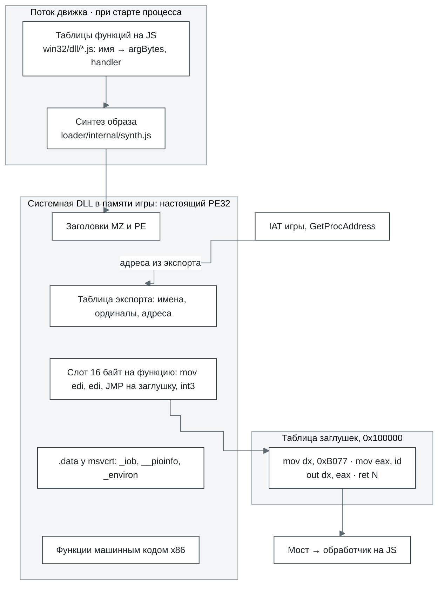

Заглушка занимает 16 байт, у каждой функции своя:

```
66 BA 77 B0      mov dx, 0xB077     ; порт ловушек
B8 xx xx xx xx   mov eax, id        ; номер функции в мосте
EF               out dx, eax        ; cork вызывает мост
C2 nn nn         ret N              ; C3 для cdecl
CC ...           int3 до 16 байт
```

Сколько байт снимает `ret N`, мост решает по соглашению вызова: stdcall снимает все `argBytes`,
cdecl не снимает ничего, а thiscall и fastcall не учитывают аргументы, переданные в регистрах.

### Один вызов: от игры до JS и обратно

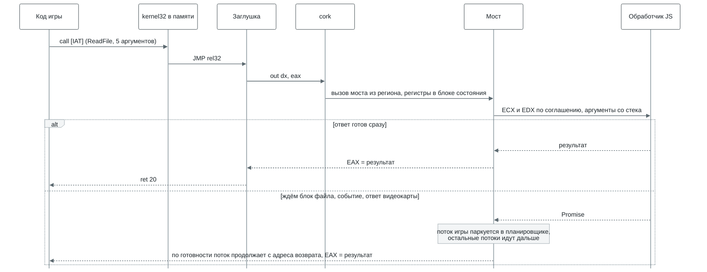

- **COM-объекты** (Direct3D, DirectSound, DirectInput) тоже лежат в памяти игры. Первое слово
  объекта указывает на таблицу методов. Каждый метод в ней тоже заглушка, кроме тех, что
  выполняются в госте: `AddRef` и `Release` из IUnknown у объектов, чей счётчик лежит в памяти
  игры, и самые частые методы Direct3D 8 и 9 (раздел 7). Методы вызываются как stdcall, указатель
  на интерфейс передаётся первым аргументом на стеке.
- **Обратные вызовы:** оконная процедура, колбэк COM, `DllMain`. Мост останавливает поток, строит
  кадр на стеке игры и запускает её код, пока тот не вернётся в служебную ловушку. Вызов хоста,
  который много раз подряд обращается к коду игры (например, проход эффекта D3DX задаёт каждое
  состояние через менеджер состояний игры), записан шагами (`bridge.drive`): это генератор, который
  отдаёт каждый гостевой вызов. Мост отправляет поток в каждую процедуру в том же срезе, где пришёл
  вызов, и там же забирает её ответ в служебной ловушке, без парковки и без витка цикла между ними.
  Через промисы каждый гостевой вызов прохода занимал отдельный виток цикла, и кадр с проходами
  эффектов тратил на витки больше времени, чем на саму игру. Шаги включены по умолчанию
  (`driveGuestCalls`); если их выключить, те же вызовы идут через промисы, и
  `effect-steps.itest.js` проверяет, что результаты совпадают. Счётчики моста `driveMs` и
  `driveCallMs` делят время шагов между самими шагами и гостевым кодом.
- **Часть кода выполняется прямо в памяти игры.** Некоторые экспорты и методы лежат там машинным
  кодом x86: игра выполняет их сама, без ловушки, на скорости cork, а в мост уходит только то, с
  чем они не справились. Часть из них написана прямо на x86: самые частые функции msvcrt и
  kernel32, в том числе interlocked-вызовы, критические секции, тонкие блокировки чтения-записи
  (SRW), однократная инициализация, SList, мелкие блоки кучи (до 1 КиБ) и опрос WaitForSingleObject
  невыставленного события. Опрос читает слово, которое ядро держит для каждого хендла события,
  поэтому поток на другом исполнителе, ждущий работы, не ждёт ответа исполнителя процесса. По тому
  же слову в госте отвечают SetEvent уже выставленного события и ResetEvent уже сброшенного: они
  ничего не меняют. Мьютекс, который больше никому не нужен, берётся и отдаётся в госте через
  `lock cmpxchg` по собственному слову мьютекса; хост забирает это слово себе (одним флагом), как
  только кто-то ждёт, мьютекс брошен или хост его иначе трогает. Sleep(0) отвечает в госте, пока ни
  один поток не ждёт запуска: это видно по счётчику, который ведёт планировщик. Остальные написаны
  один раз на JavaScript с пометкой `@guestCode`, и сборка компилирует их в i386
  ([`core/scripts/guest-code/`](../modules/core/scripts/guest-code/)); готовые байты лежат рядом с исходником в `*.x86.js`. JavaScript
  остаётся обработчиком хоста и эталоном, с которым тест сверяет x86, а `return host()` отдаёт
  этому обработчику редкий случай. Так написаны векторная, матричная и кватернионная математика
  D3DX и её сеттеры эффектов, строковые, float- и math-функции msvcrt и GLU.
- **Если функции нет.** У каждого имени своя заглушка. Если известно, сколько байт аргументов снять
  (декорация `@N`, имя C++, cdecl-библиотека или библиотека самой программы), она просто возвращает
  0. Иначе игра падает с `unimplemented import`, и в ошибке видно, какая функция нужна и кто её
  вызвал.

### Какую DLL получит игра

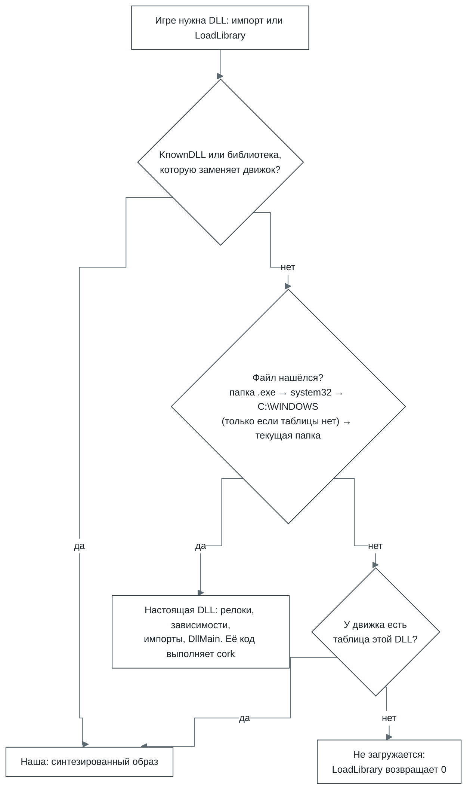

- **Всегда наши:** KnownDLLs (`kernel32`, `user32`, `msvcrt`, `ole32` и другие), наборы API
  библиотеки C (`api-ms-win-crt-*`, то есть `ucrtbase.dll` под теми именами, под которыми их
  импортируют) и среды выполнения, которые движок подменяет, чья бы копия ни нашлась:
  `DSETUP.dll`, `MSVCR80.dll`, `Mp3dec.asi` (звук) и `ijl15.dll` (media).
- **Где ищет `LoadLibrary`:** в папке `.exe`, потом в `C:\WINDOWS\system32\`, в `C:\WINDOWS\` и в
  текущей папке. Статические импорты ищутся так же, только без текущей папки. Если у движка есть
  таблица этой библиотеки, системные папки пропускаются: копия, которую туда положил установщик,
  стала бы в процессе второй библиотекой того же имени рядом с движковой.
- **Настоящую DLL** загрузчик разбирает и применяет к ней релокации, загружает её зависимости,
  привязывает импорты (в том числе отложенные) и вызывает `DllMain` через мост, как код игры. TLS
  поддерживается у каждого образа, в том числе у библиотеки, загруженной во время работы: слот,
  копия её блока в каждом потоке (и в тех, что уже работали, когда её загрузили) и TLS-колбэки
  по каждой причине, которую слышит её `DllMain`, раньше него. `FreeLibrary` возвращает слот и
  копии.
- **Распространяемые библиотеки DirectX** (`d3dx9_*` и другие) в движок не входят, их приносит
  сама игра. Либо их ставит DirectX setup из её установщика в `C:\WINDOWS\system32\`, либо они
  лежат рядом с её `.exe`. Копия рядом с `.exe` загружается как настоящая DLL. Во всех остальных
  случаях, в том числе для копии в `system32`, на `d3dx9_*` отвечает таблица движка.

Где смотреть в коде: образ в [`core/src/layers/loader/internal/synth.js`](../modules/core/src/layers/loader/internal/synth.js), заглушки в
[`core/src/layers/cpu/internal/thunks.js`](../modules/core/src/layers/cpu/internal/thunks.js), мост в [`core/src/layers/bridge/`](../modules/core/src/layers/bridge/), таблицы в
`core/src/layers/win32/<dll>/`, порядок поиска в [`core/src/app.js`](../modules/core/src/app.js) (`libraryCandidates`,
`answeredByEngine`).

## 7. Графика

| Где | Что делает |
| --- | --- |
| Страница | Один раз отдаёт `<canvas>` движку (`transferControlToOffscreen`) и вписывает его в окно с сохранением пропорций (`ui/src/components/PlayScreen.jsx`) |
| Поток движка | Здесь работают все графические API игры. Устройства Direct3D 7, 8, 9 и контексты OpenGL хранят состояние и отвечают игре, но сами не рисуют. Direct3D 10 и Vulkan пока рисуют прямо здесь через бэкенд WebGPU. DirectDraw и GDI рисуют в программные поверхности в памяти игры, а на экран их выгружает презентер. Он же кладёт готовый кадр в `OffscreenCanvas` |
| Поток графики | Двойники устройств Direct3D 7, 8, 9 и контекстов OpenGL проигрывают те же вызовы на своём устройстве WebGPU и возвращают кадр как `ImageBitmap` |
| OPFS | Не используется. Кэши пайплайнов и шейдеров живут только в памяти |

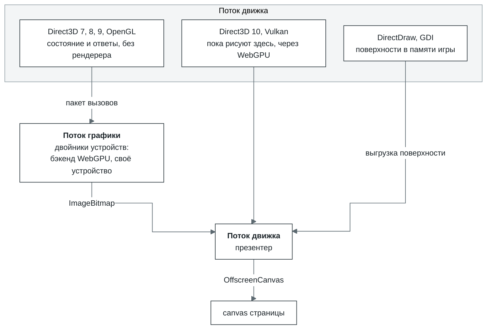

- **Как идут вызовы.** Каждый вызов сразу пишется в двоичный пакет (`remote/wire.js`). Если вызов
  ждёт ответа, пакет уходит сразу. Иначе он уходит не чаще раза в миллисекунду: остаток отправляет
  таймер, а долгий ход отправляет свой пакет сам. Данные ресурсов едут в том же пакете. У буфера
  Direct3D это то, что игра записала между `Lock` и `Unlock`, у текстуры всё, что записано до
  следующего вызова, который может её прочитать. Если память игры общая, записанное до `Unlock`
  текстуры или поверхности Direct3D 8 или 9 не копируется, а одалживается: пакет указывает, где
  лежат байты, и поток графики сам копирует их из памяти игры, когда проигрывает запись
  (`remote/lending.js`). Байты буфера копируются. OpenGL читает память программы прямо в момент
  вызова, поэтому всё, что вызов прочитал, уходит в пакет перед ним. Поверхности DirectDraw, в
  которые рисует Direct3D 7, передаются по номеру и описываются заново, когда меняются. Рендерер в
  потоке движка читает данные в те же моменты, так что картинка получается одинаковой, где бы ни
  рисовал Direct3D.
- **Кольцо команд Direct3D 8 и 9.** Игра сотни раз за кадр задаёт состояния, матрицы и текстуры и
  блокирует буфер вокруг каждой отрисовки. Эти сеттеры и отрисовки, `Lock` и `Unlock` буфера, а
  ещё геттеры состояний рендера, матриц, состояний стадий текстур и вьюпорта (и состояний сэмплера
  в Direct3D 9) выполняются в госте. Сеттер или отрисовка пишет запись в кольцо в блоке устройства
  в памяти игры, геттер читает значение, которое туда записал его сеттер. Перед любым своим методом
  хост по порядку выполняет вызовы из кольца собственными методами устройства
  (`graphics/seam/shadow.js`, `d3d8/commands.js`). При нескольких исполнителях процедура и хост
  могут работать на разных ядрах, а процессор, меняющий порядок записей (arm64), может показать
  записи одного ядра другому не в том порядке. Поэтому процедура отпускает блокировку устройства
  инструкцией с `lock`, а длину записи, её последнее слово, публикует через `xchg`: движок делает
  обе атомарными. Хост читает каждую длину атомарно до самой записи и отпускает блокировку
  атомарной заменой. Тогда всё, что процедура записала раньше, вместе с вершинами, которые игра
  записала до вызова, ему уже видно.
- **Динамические буферы.** Программа может писать в динамический буфер по указателю из `Lock` уже
  после `Unlock` и рисовать из него без новой блокировки. Поэтому отрисовка отправляет то, что
  изменилось в её диапазоне с последней отправки буфера. Под эмулятором сравнивается каждый байт
  диапазона, а под cork только та его часть, что лежит на страницах, в которые писали с прошлого
  сравнения. Запись в наблюдаемую страницу отмечается той же проверкой флагов страницы, что находит
  транслированный код: первая запись после взвода страницы делает одно compare-and-swap. Записи
  хоста и записи воркеров на месте тоже отмечают страницу. Наблюдение за записью в слое cpu
  (`cpu/internal/write-clock.js`) ведёт отметки для каждого буфера отдельно, потому что проверка
  одного буфера снова взводит страницу для всех. Страницу, которую взвели, пока другой исполнитель
  выполнял гостевой код, оно считает записанной, пока этот прогон не кончится: запись, проверившая
  страницу до взвода, может лечь уже после него и без отметки. За любым буфером, который `Unlock`
  хоть раз отправил целиком, динамическим или нет, дальше следят так же, и следующий `Unlock`
  отправляет только страницы, записанные с тех пор. Цикл, который потоком пишет в наблюдаемые
  страницы, один раз заранее отмечает записанными страницы, до которых дойдут его ближайшие витки,
  и пишет в них без проверок.
- **DISCARD в госте.** `DISCARD` динамического буфера, пока в кольце лежат ещё не выполненные
  отрисовки, затёр бы то, что они читают. Чтобы не отдавать его хосту (тот сначала выполнил бы
  отрисовки), первый такой `DISCARD` даёт буферу ещё одно хранилище того же размера
  (`d3d8/storages.js`, не больше двух). Дальше гостевой `Lock` переносит буфер на свободное
  хранилище, пишет перенос в кольцо (`Buffer.Rename`) и продолжает писать туда. Хост выполняет
  перенос по порядку с отрисовками, поэтому каждая отрисовка читает то хранилище, с которым её
  сделали, а оставленное хранилище освобождается. Каждое хранилище отправляется целиком один раз,
  дальше только записанные с тех пор страницы. Отрисовка из динамического буфера читает индексы,
  как и вершины, из памяти гостя в момент отрисовки. Переноса нет, пока лок, взятый на месте (когда
  в кольце не было отрисовок), ждёт, что хост повторит его до следующего прогона кольца, и нет для
  лока, который хост отклонит. Динамический буфер, который держат залоченным под NOOVERWRITE, при
  входах в хост не повторяется: его читают сами отрисовки. Копия буфера на GPU одна, и после
  переноса в ней лежит оставленное хранилище, поэтому страницы нового хранилища считаются
  несвежими: отрисовка заливает те из них, до которых достаёт, а Unlock только записанное.
- **Кто кого ждёт.** `Present` ждёт поток графики, только если тот отстал больше чем на два кадра.
  А дисплей он ждёт так же, как драйвер: при любом интервале показа, кроме `IMMEDIATE` (у оконного
  Direct3D 8 только при `COPY_VSYNC`), вызвавший поток стоит до следующего гашения растра гостя или
  до того гашения, которое задаёт интервал. Гашения идут с частотой режима, который запросило
  устройство, если дисплей этот режим знает, иначе 60 Гц. Как часто страница показывает кадры, на
  темп программы не влияет. Ответа ждут только вызовы, результат которых знает лишь рендерер. У
  Direct3D 8/9 это `GetData` для запросов, кроме event и occlusion, `GetRenderTargetData`,
  `GetFrontBuffer(Data)`, а ещё `LockRect` и `GetDC` на рендертаргете и `CopyRects` из
  рендертаргета, в который что-то рисовали после последнего чтения. Ждёт при этом не поток движка,
  а поток игры: мост паркует его в планировщике, и остальные потоки игры продолжают работать.
  Запрос event отвечает на стороне программы. Счёт occlusion query запрашивается у рендерера, как
  только выдан его конец; пока счёт не вернулся, опросы программы получают `S_FALSE`, как от
  драйвера. Каждый ответ заодно привозит все остальные счёты, которые у рендерера уже есть, и у
  каждого помечено, к какому `Issue(END)` он относится.
- **Шейдеры.** Байткод шейдеров Direct3D 8/9 разбирается и переводится в WGSL
  (`graphics/d3d9/shader.js`, `wgsl.js`). Для фиксированного конвейера WGSL генерируется
  (`webgpu/internal/fixedfunction.js`).
- **Текстуры** до восьми бит на канал уходят на GPU в формате `bgra8unorm`, а с шестнадцатью и
  тридцатью двумя битами на канал идут как половинные float (`rgba16float`, `rg16float`,
  `r16float`): эти форматы фильтрует и смешивает любое устройство WebGPU. Сжатые DXT по умолчанию
  распаковываются на CPU (`graphics.compressedTextures` в
  [`core/configuration.md`](core/configuration.md#graphics)).
- **У каждого окна своя поверхность.** Внутри процесса экран собирается так, как его собирает
  оконный менеджер Windows 7 (`graphics/gdi/screen.js`): каждое окно верхнего уровня рисует на
  своей поверхности, другие окна верхнего уровня его не обрезают, а экран складывается из фона
  рабочего стола и видимых окон поверх него, снизу вверх. Сдвинутое, поднятое, скрытое или закрытое
  окно ничего не перерисовывает: экран просто собирается заново.
- **Несколько процессов, один экран.** user32 каждого процесса сообщает оконному менеджеру
  запуска (`win32/user32/manager.js`, в потоке движка рядом с каталогом окон) всё о своих окнах:
  класс, заголовок, стиль, прямоугольник, видимость. Менеджер держит общие для всех процессов
  z-порядок окон верхнего уровня, единственный фокус клавиатуры и окно, захватившее мышь. Окно,
  взявшее фокус, поднимает своё окно верхнего уровня и забирает фокус у всех остальных, чьи бы они
  ни были. Каждый кадр помечен процессом, который его нарисовал. Презентер хранит последнюю
  картинку каждого процесса и, пока видны окна больше чем одного процесса, собирает из них экран в
  порядке менеджера, снизу вверх (`webgpu/internal/compose.js`). Ввод страницы идёт туда, куда
  укажет менеджер: указатель получает процесс окна, захватившего мышь или стоящего под указателем,
  клавиатуру получает процесс окна с фокусом (`inputTarget`). Если такого окна нет, ввод не
  получает никто. Менеджер один и тот же, сколько бы ни было процессов (один или четыре) и где бы
  они ни шли (в одном потоке или в воркерах).
- **Если что-то сломалось.** Если поток графики не открылся, Direct3D и OpenGL рисуют в потоке
  движка, а в консоли появляется предупреждение. Потерянное устройство WebGPU не восстанавливается
  ([`core/limits.md`](core/limits.md#graphics)).

Где смотреть в коде: [`core/src/layers/graphics/`](../modules/core/src/layers/graphics/) (`d3d7`, `d3d8`, `d3d9`, `d3d10`, `ddraw`, `gdi`,
`opengl`, `glu`, `vulkan`, `webgpu` и `seam`: интерфейсы и экспорты, которые вызывает игра,
процедуры в госте, кольцо команд и растр); поток графики в `graphics/remote/` и
[`core/src/host/graphics.worker.js`](../modules/core/src/host/graphics.worker.js).

## 8. Звук

| Где | Что делает |
| --- | --- |
| Страница | До старта создаёт `AudioContext` и загружает `worklet.js`, после старта создаёт `AudioWorkletNode` поверх таблицы голосов, которую вернул движок |
| Поток движка | DirectSound, waveOut, DirectMusic и MP3 для Miles. Каждый раз перед тем, как отдать управление браузеру, дописывает в общую память то, что успела записать игра, переносит громкость и панораму и отправляет уведомления |
| AudioWorklet | Читает 64 слота голосов по своим часам, линейно пересэмплирует, применяет громкость и панораму и сводит всё вместе |
| OPFS | Не используется |

Буфер DirectSound ведёт себя как голос звуковой карты: копия его данных лежит в общей памяти, и
AudioWorklet сам читает её оттуда, как DMA. Поэтому звук не прерывается, даже когда движок занят
загрузкой или переводом кода, если у игры в буфере хватает данных.

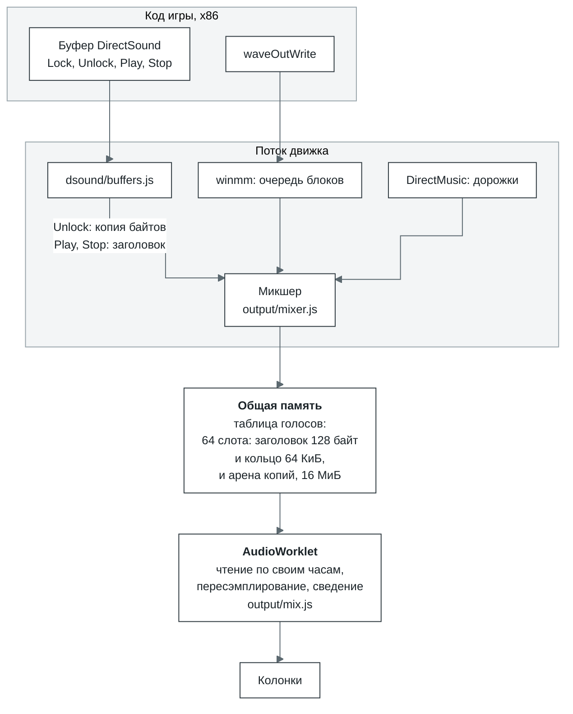

- **Голос.** Это слот в таблице: заголовок из 32 слов (`RATE`, `CHANNELS`, `BITS`, `GAIN`,
  приглушение левого и правого канала, `POSITION`, `LOOPING`, `PLAYING`, `LAPS` и другие) и копия
  буфера в арене. Когда буфер впервые начинает играть, движок копирует его целиком, а потом только
  то, что игра изменила между `Lock` и `Unlock`. `Play` записывает позицию, `LOOPING` и `PLAYING`,
  а `Stop` записывает `PLAYING = 0`.
- **Курсор воспроизведения** показывает, сколько успел прочитать AudioWorklet (`POSITION` и `LAPS`),
  а курсор записи идёт на 30 мс впереди. Поэтому `GetCurrentPosition` и уведомления о позиции
  совпадают с тем, что действительно звучит.
- **Потоковый буфер** игра дописывает на ходу, так работают микшеры Miles и FMOD. Голос не играет
  дальше уже записанного: если игра опоздала, звучит тишина, а не старый кусок по второму кругу.
  Если ждать приходится дольше max(250 мс, один круг буфера), голос перестаёт ждать и идёт по кругу
  дальше.
- **waveOut.** На каждое устройство своя дорожка. `waveOutWrite` сразу копирует блок, а `WOM_DONE`
  приходит, когда AudioWorklet дочитал его.
- **MP3 для Miles.** Вместо `Mp3dec.asi` из игры работает наш провайдер, подключённый через вход
  `RIB` в `mss32.dll`. Декодирует minimp3, собранный в wasm (`audio/asi/`). Есть и MP3-кодек для ACM.
- **Ограничения.** Если свободных слотов нет или в арене нет места для копии, буфер играет через
  дорожку-очередь, и курсор идёт уже по часам. Остальное (3D-звук, захват) перечислено в
  [`core/limits.md`](core/limits.md#sound).
- **Без изоляции вкладки** нет `SharedArrayBuffer`. Изоляцию дают заголовки COOP/COEP, их ставит
  `ui/server.mjs`, если не задан `ISOLATION=off`. Без неё движок сводит звук в своё кольцо, а
  `output/feed.js` отправляет смесь в worklet через `MessageChannel`, созданный страницей. Куски
  уходят не дальше чем на 160 мс вперёд от того, что worklet уже проиграл. Worklet каждые четыре
  блока сообщает, докуда дошёл, и только это кольцо считает потреблённым. Курсор буфера DirectSound
  в этом режиме идёт по часам.

Где смотреть в коде: [`core/src/layers/audio/`](../modules/core/src/layers/audio/) (`output/mixer.js`, `output/mix.js`,
`output/worklet.js`, `dsound/buffers.js`, `asi/provider.js`), waveOut в
[`core/src/layers/win32/winmm/functions.js`](../modules/core/src/layers/win32/winmm/functions.js).

## 9. Сеть

| Где | Что делает |
| --- | --- |
| Страница | Передаёт в `createApp` модуль клиента (`/networking/client/index.js`), адрес ретранслятора (`ws://` или `wss://` того же хоста, путь `/relay`) и комнату (id бандла) |
| Поток движка | `wsock32`, `ws2_32` и `mswsock`: реестр сокетов, петля `127.0.0.0/8` прямо во вкладке и клиент ретранслятора. WebSocket открывается в воркере |
| Сервер лаунчера | Ретранслятор `/relay` работает в том же процессе и на том же порту, что и HTTP |
| OPFS | Не используется |

Браузер не даёт вкладке открыть TCP или UDP, только WebSocket. Поэтому сокеты игры идут через
ретранслятор: он соединяет вкладки из одной комнаты и, если разрешено, сам открывает настоящие
соединения наружу. Ретранслятор и клиент как отдельная библиотека описаны в
[README networking](../modules/networking/README.md).

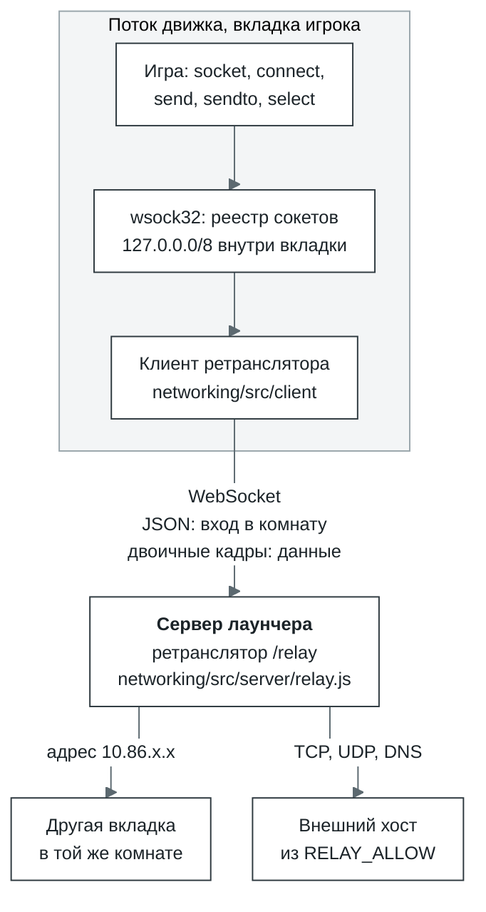

- **Комната.** Это маленькая отдельная сеть: вкладки с одним и тем же бандлом видят друг друга, как
  в одной локалке. Каждая вкладка получает наименьший свободный адрес из `10.86.0.0/16`, в комнате
  может быть до 32 участников. Широковещательные пакеты доходят только до тех участников, кто
  слушает этот UDP-порт.
- **Наружу по умолчанию закрыто.** Без настройки ретранслятор работает как локалка, а не как
  открытый прокси. Разрешённые хосты задаются при его запуске: у отдельного ретранслятора это
  `--allow` ([README networking](networking/README.md#run-a-relay)), у лаунчера список
  через запятую в `RELAY_ALLOW`; одна `*` разрешает все хосты. Имена хостов ретранслятор разрешает
  сам и запоминает, поэтому политика проверяет имя, а не только адрес. Если список пуст, DNS не
  отвечает вообще.
- **Кадры.** Вход в комнату идёт в JSON: `hello`, в ответ `welcome` с адресом и списком участников.
  Данные идут двоичными кадрами: заголовок 20 байт и до 64 КиБ полезной нагрузки. Каждый `send()`
  даёт ровно один кадр, поэтому границы UDP-датаграмм сохраняются. А вот TCP-`send()` больше 64 КиБ
  пока не режется на кадры и падает.

| Смещение | Тип | Поле |
| --- | --- | --- |
| 0 | u8 | op: `DIAL`, `OPENED`, `STREAM`, `HANGUP`, `DATAGRAM`, `LISTEN`, `UNLISTEN`, `ACCEPTED`, `RESOLVE`, `RESOLVED` |
| 1 | u8 | флаги: `REJECT`, `HALF`, `STREAM` |
| 2 | u16 | резерв |
| 4 | u32 | tag: номер потока TCP или запроса DNS |
| 8 | u32 | IP отправителя |
| 12 | u32 | IP получателя |
| 16 | u16 | порт отправителя |
| 18 | u16 | порт получателя |

TCP устроен так: `DIAL`, в ответ `OPENED` (или `HANGUP` с `REJECT`), дальше данные в `STREAM`.
`shutdown(SD_SEND)` превращается в `HANGUP` с флагом `HALF`. Все поля little-endian.

Где смотреть в коде: [`core/src/layers/win32/wsock32/`](../modules/core/src/layers/win32/wsock32/) (сокеты и транспорт), [`networking/src/`](../modules/networking/src/)
(клиент, `protocol.js`, сервер), подключение в `ui/server.mjs` и `ui/src/engine/session.js`.

## 10. Хранилища

OPFS, файловая система браузера, у каждого origin (схема, хост, порт) своя. Поэтому лаунчер надо
всегда открывать по одному и тому же адресу: на другом адресе будет другой OPFS и другие сейвы.
По умолчанию это `http://127.0.0.1:5180`. С `TLS_DIR` сервер слушает https на всех адресах: с
другой машины без защищённого контекста не будет ни OPFS, ни `SharedArrayBuffer`.

| Хранилище | Где | Что лежит | Как устроено |
| --- | --- | --- | --- |
| Кэш блоков | OPFS: `<id>.blocks`, `<id>.present`, `<id>.order` | блоки бандла, уже скачанные с сервера | Блок N лежит по смещению N × размер блока (размер берётся из заголовка бандла, по умолчанию 256 КиБ). В `.present` битовая карта скачанных блоков, в `.order` порядок, в котором к ним обращались впервые (до 4096). Доступ через синхронные дескрипторы: открыто не больше 16, и первым закрывается тот, что дольше всех не нужен |
| Переводы cork | OPFS: `cork/<id>.v3/` | переведённые регионы с ключом из входа, вершины стека x87, под которую регион сделан (любой, если x87 в нём нет), и режимов прогона; модули с их кодом; карта от каждого сохранённого блока к региону, который его содержит, чтобы прогон, дошедший до блока в другом порядке, взял этот регион | Записи лежат подряд в `records`, а журнал `index` помнит, где какая. Индекс читается один раз: промах не трогает диск, попадание стоит одного чтения по смещению. Новое дописывается пачками. Если браузер разрешает два дескриптора на один файл, пишет отдельный воркер хранилища, и поток движка диска не ждёт. Запись региона ссылается на модуль пакета с его кодом, и модуль живёт, пока на него ссылается хоть один регион. При открытии записи последнего прогона остаются целиком, а более старые остаются, пока все вместе помещаются в 1 ГиБ: сначала недавно использованные, регион вместе со своим модулем. Запись, которой не пользовался ни один из последних четырёх прогонов, мертва. Живые записи копируются в новый файл, когда мёртвого в старом больше половины и сам он больше 64 МиБ, или когда индекс перерос 4 МиБ и строк в нём вчетверо больше, чем нужно живым записям. Перелинкованный модуль тоже сохраняется, и его регионы дальше ссылаются на него: следующий прогон берёт их как есть и перелинковывает только добавленное |
| Сессия | OPFS: `<id>.files/` | файлы, которые записала игра, и её реестр | Одна запись на файл: имя записи из хеша пути, сам путь внутри; реестр в отдельной записи. Сессия накладывается до первой инструкции. Через 250 мс после того, как игра перестала писать, сохраняются или удаляются только изменённые файлы. Старый `<id>.session` (один поток deflate-raw) читается один раз и заменяется. Сам бандл не меняется никогда |
| Настройки | localStorage | настройки лаунчера, время до первого кадра | |

Как игра читает файл:

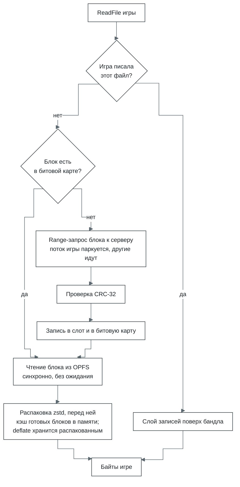

- **Кэш блоков не держит бандл в памяти**: игра может весить больше гигабайта. Если размер битовой
  карты не совпадает с бандлом, карта сбрасывается и блоки скачиваются заново.
- **Синхронные дескрипторы** (`createSyncAccessHandle`) есть только в воркере. Зато чтение из OPFS
  ничего не ждёт, и `ReadFile` по уже скачанному блоку отвечает сразу.
- **Сессия** читается и пишется асинхронно (`getFile`, `createWritable`).

Где смотреть в коде: [`core/src/layers/filesystem/internal/bundle/cache.js`](../modules/core/src/layers/filesystem/internal/bundle/cache.js) (блоки),
[`core/src/layers/filesystem/internal/opfs-store.js`](../modules/core/src/layers/filesystem/internal/opfs-store.js) (дескрипторы),
[`core/src/layers/cpu/internal/translation-store.js`](../modules/core/src/layers/cpu/internal/translation-store.js) (переводы), [`core/src/storage.js`](../modules/core/src/storage.js) (сессии).
