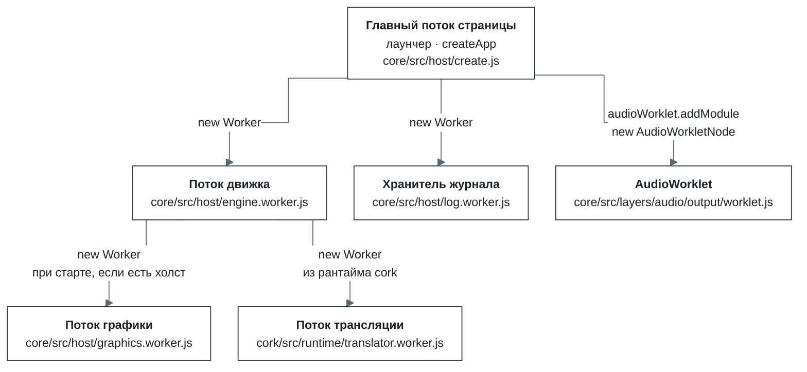
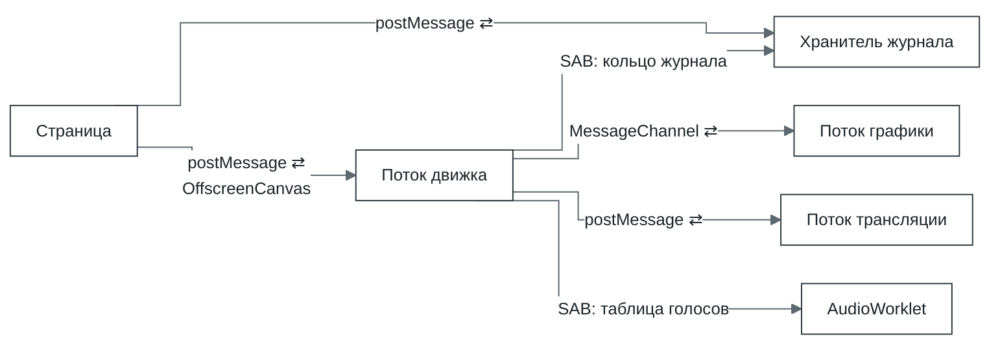
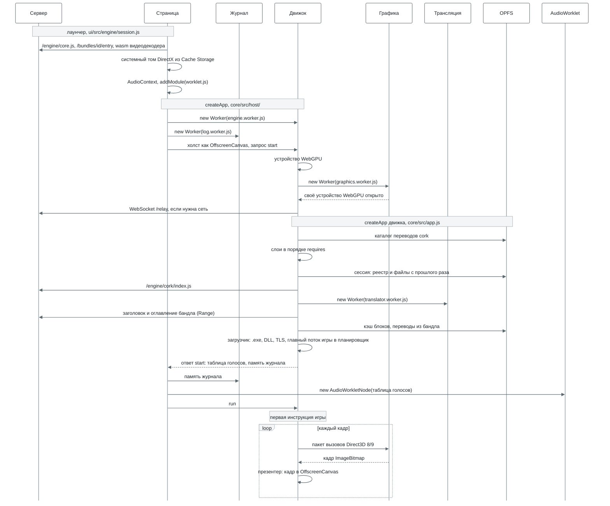
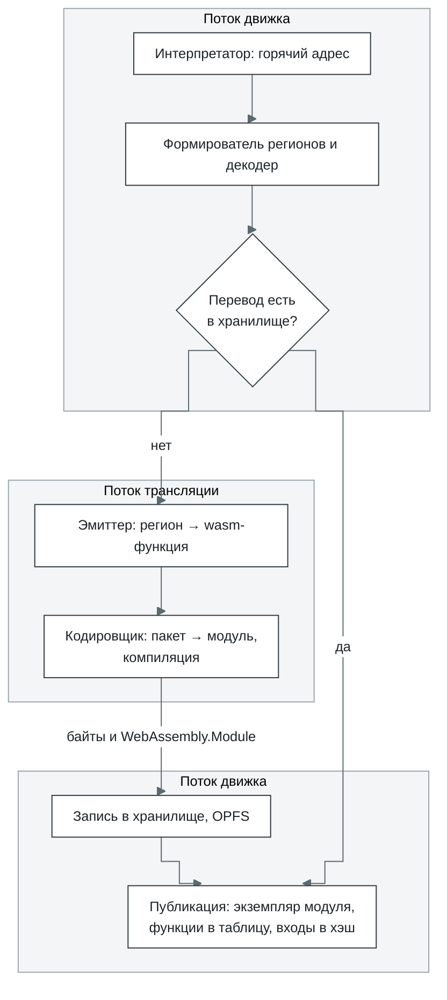
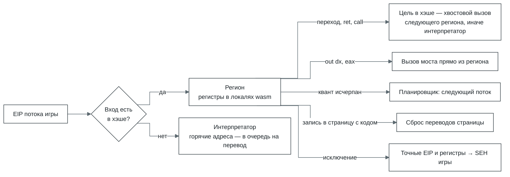
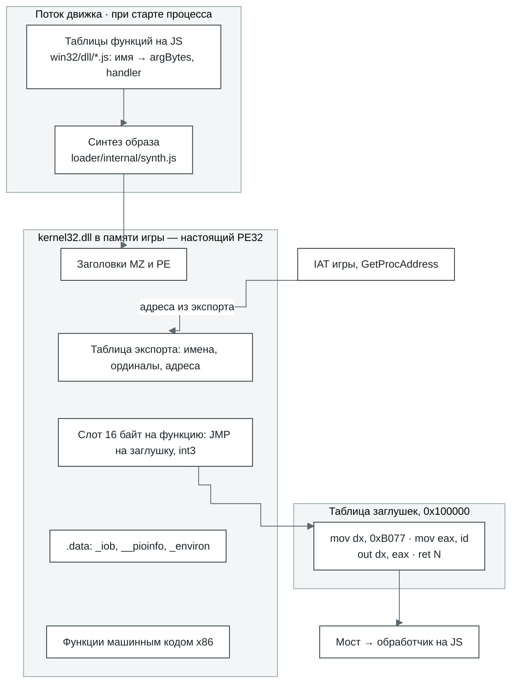
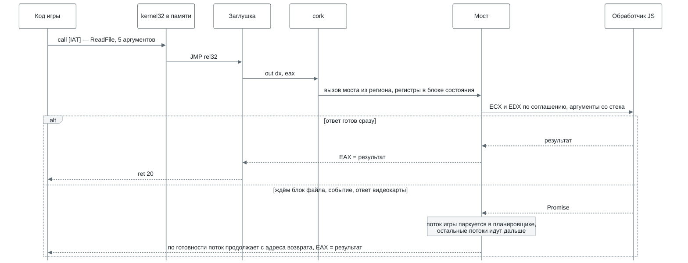
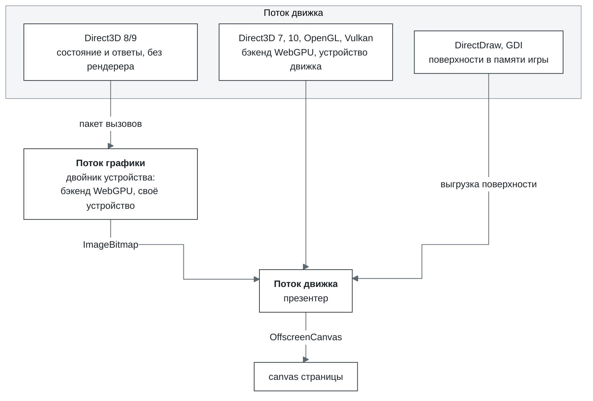
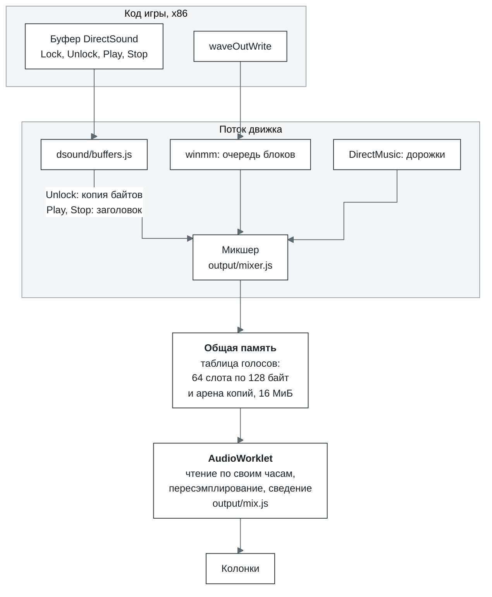
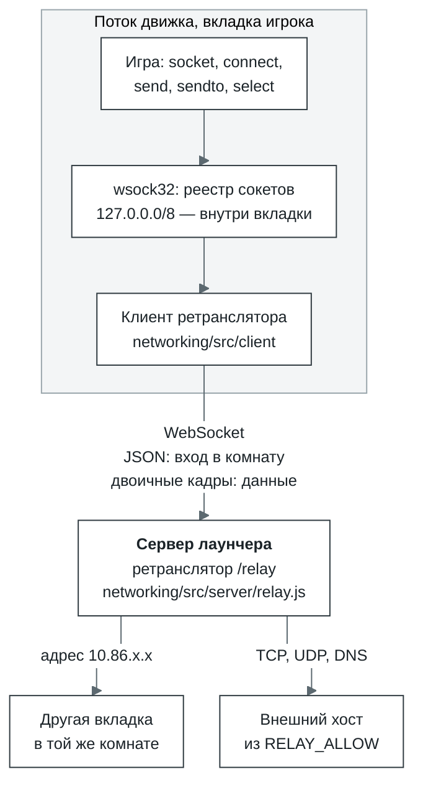

# Bottlify изнутри

По коду `bottlify` d066d2b и `bottlify-ui` bea9c9b, 2 октября 2026. Пути без префикса считаются от
`modules/` в bottlify, пути с `ui/` — от корня bottlify-ui. Если схема разошлась с кодом, прав код.

1. [Что это](#1-что-это)
2. [Из чего состоит](#2-из-чего-состоит)
3. [Потоки: кто кого запускает и зачем](#3-потоки-кто-кого-запускает-и-зачем)
4. [Запуск: от createApp до первой инструкции](#4-запуск-от-createapp-до-первой-инструкции)
5. [cork — ядро исполнения](#5-cork--ядро-исполнения)
6. [Win32 на JavaScript: как получается DLL](#6-win32-на-javascript-как-получается-dll)
7. [Графика](#7-графика)
8. [Звук](#8-звук)
9. [Сеть](#9-сеть)
10. [Хранилища](#10-хранилища)

## 1. Что это

Bottlify запускает 32-битные приложения для Windows прямо во вкладке браузера — без Windows и без
установки. Внутри две части; по сути это то, что делают Rosetta 2 и Wine, собранное заново для
браузера:

- **cork — транслятор.** Процессора x86 в браузере нет, поэтому cork переводит машинный
  код программы в WebAssembly, а дальше браузер сам компилирует его под процессор устройства. Так
  один и тот же перевод работает и на x86, и на ARM. Как устроен cork — в
  [разделе 5](#5-cork--ядро-исполнения).
- **core — наше окружение Windows.** Его задача — убедить программу, что она работает в настоящей
  Windows. Самой Windows при этом нигде нет: `kernel32`, `user32`, `gdi32`, DirectX, Winsock и
  остальные системные библиотеки переписаны с нуля на JavaScript поверх веб-API. Программа видит
  их как обычные DLL, у неё есть диск `C:`, реестр, окна и сообщения, а на свои вызовы она получает
  те же ответы и коды ошибок, что дала бы Windows. Как это сделано — в
  [разделе 6](#6-win32-на-javascript-как-получается-dll).

Цель — чтобы тот же самый `.exe` запускался в Chrome, Safari и Firefox на чём угодно, от телефона до
десктопа. Ставить ничего не нужно, а сервер на кадр не влияет: он только раздаёт файлы и пересылает
сетевой трафик.

| Что нужно приложению | Кто это даёт | На чём работает |
| --- | --- | --- |
| Процессор x86 | cork переводит x86 в wasm | WebAssembly |
| Системные DLL | слой `win32`: функции на JS, которые игра видит как настоящие PE-образы | — |
| DirectDraw, Direct3D 7–10, OpenGL, Vulkan, GDI | слой `graphics` | WebGPU |
| DirectSound, waveOut, DirectMusic | слой `audio` | AudioWorklet, SharedArrayBuffer |
| DirectInput, XInput, сообщения окна | слой `input` | события клавиатуры и мыши, Gamepad API |
| Видеоролики DirectShow | слой `media`, FFmpeg в wasm | WebAssembly |
| Диск | бандл, который читается блоками, и сессия поверх него | fetch с Range, OPFS |
| Winsock | `wsock32` и ретранслятор | WebSocket |

### Почему игры

Концепция Bottlify — «игра в бутылке». Поэтому cork, хоть он и универсальный транслятор, в первую
очередь проектируется под быстрый рендер: кадр должен успевать вовремя. Для игры скорость — часть
корректности. Игра, которая выдаёт 10 кадров вместо 60, не работает, даже если всё считает верно.

Цель у нас амбициозная и, возможно, недостижимая до конца: дать людям на любых устройствах одно
решение, которое запускает любые игры. А что есть у каждого — от телефона до компьютера? Браузер.
Так почему бы браузеру не стать платформой для приложений?

Попытки уже были. Flash, Silverlight, Java-апплеты, Unity Web Player превращали браузер в платформу
для программ и игр. Но все они были плагинами: их ставили отдельно, у каждого был один владелец, а
программы писали специально под каждый. Когда браузеры отказались от плагинов, эти платформы
ушли, и написанные под них игры перестали запускаться. К началу 2020-х не осталось ни одной.

Bottlify устроен наоборот. Плагин ему не нужен: он работает только на стандартах, которые уже есть в
каждом современном браузере, — WebAssembly, WebGPU, Web Audio, OPFS. И программы, написанные
специально под него, тоже не нужны: он запускает те, что уже есть, — обычные `.exe` для Windows, без
изменений.

Есть и практическая причина: игра — лучший тест для такой системы.

- **Игра нагружает всё сразу.** Целочисленный код, x87 и SSE, Direct3D, звук, ввод, файлы, потоки,
  иногда сеть — один запуск проходит почти через все слои движка.
- **Игра сама себя меряет.** У многих игр есть встроенные бенчмарки и timedemo: каждый раз одна и та
  же сцена, а на выходе — кадры в секунду. Два запуска сравниваются числом, и регрессия видна сразу,
  а не «на глаз».
- **Пропуски видно сразу.** Не хватает функции — программа падает с `unimplemented import` и
  именем этой функции. Функция работает неточно — картинка съезжает, звук щёлкает или проседают
  кадры. Каждый такой сбой указывает на конкретное место в движке.
- **Игр очень много.** Тысячи программ разных лет, движков и компиляторов — огромный готовый набор
  тестов, который не нужно писать самим.

Под одну игру движок при этом не подгоняют. Если игра споткнулась, чинят общий слой, на котором это
случилось, и исправление достаётся всем программам, которые идут тем же путём. Поэтому глубже всего
сейчас проработано то, что нужно играм, — DirectX и OpenGL, звук, ввод, видеоролики и сеть, — но
работает это для любого приложения.

## 2. Из чего состоит

Пакеты репозитория — `@bottlify/`:

| Пакет | Что внутри |
| --- | --- |
| `@bottlify/core` | Наше окружение Windows: Win32 и DirectX, загрузчик, планировщик, файлы и `createApp`, через который всё запускается |
| `@bottlify/cork` | Транслятор x86 → wasm со своим рантаймом. Движок не импортирует его напрямую, а грузит по URL |
| `@bottlify/networking` | Клиент и сервер ретранслятора, через который приложения выходят в сеть |
| `@bottlify/installer` | Установка приложения его собственным установщиком и упаковка бандлов |

Дополнительный пакет для отладки — **bottlify-ui**, отдельный репозиторий: лаунчер на React и
локальный сервер, который на одном адресе отдаёт приложение, движок, бандлы и ретранслятор.

Движок разбит на слои. У каждого слоя свой интерфейс, настройки и тесты, а с другими слоями он
общается только через то, что объявил в `requires`. Это не просто договорённость:
`npm run check:boundaries` проверяет её по коду. Любой слой можно выключить, и на его место встанет
заглушка. Например, с `graphics: null` игра работает, просто без картинки.

| Слой | Отвечает за | `requires` |
| --- | --- | --- |
| `log` | журнал, счётчики, профиль фаз | — |
| `cpu` | выполнение кода x86 через cork, ловушки вызовов в мост | `log` |
| `memory` | адресное пространство игры: резервирование, страницы, защита | `cpu`, `log` |
| `kernel` | процессы, потоки, планировщик, объекты ожидания | `cpu`, `memory`, `log` |
| `loader` | загрузка PE и сборка системных DLL | `cpu`, `memory`, `log` |
| `bridge` | соглашения вызова, парковка потоков, обратные вызовы, COM в памяти игры | `cpu`, `kernel`, `memory`, `log` |
| `filesystem` | бандл, кэш блоков, диск `C:`, файлы, которые пишет игра | `log` |
| `win32` | kernel32, user32, gdi32, advapi32, ole32, msvcrt, winmm, wsock32 и ещё три десятка DLL | `bridge`, `kernel`, `memory`, `loader`, `filesystem`, `log` |
| `graphics` | DirectDraw, Direct3D 7/8/9/10, OpenGL, Vulkan и бэкенд WebGPU под ними | `win32`, `bridge`, `memory` |
| `audio` | DirectSound, DirectMusic, микшер, MP3 для Miles | `win32`, `bridge`, `memory` |
| `input` | DirectInput, XInput, клавиатура и мышь в очереди сообщений | `win32`, `bridge`, `memory` |
| `media` | декодер видео (FFmpeg в wasm) и `ijl15.dll` | `log` |

## 3. Потоки: кто кого запускает и зачем

Во вкладке работает до шести потоков. Страница запускает три: поток движка, хранитель журнала и
AudioWorklet. Поток движка запускает поток графики, а cork внутри движка — поток трансляции.

Почти вся работа идёт в потоке движка. Остальные забирают у него то, что можно делать параллельно,
или то, что браузер разрешает только вне главного потока.



| Поток | Кто запускает | Когда | Зачем отдельный поток |
| --- | --- | --- | --- |
| Главный поток страницы | браузер | всегда | Здесь живут интерфейс лаунчера, вызов `createApp` и события DOM. Каждый кадр он делает только одно — опрашивает геймпады (`requestAnimationFrame` → `input.poll`) |
| Поток движка | страница, `core/src/host/create.js` | всегда. С `?host=thread` движок можно запустить прямо в потоке страницы, протокол тот же | Игра выполняется длинными квантами. В потоке страницы её прерывали бы сборка мусора и отрисовка интерфейса, а клик ждал бы конца кванта. К тому же синхронный доступ к OPFS есть только в воркере. Устройство WebGPU между потоками не передаётся, поэтому воркер открывает его сам, а холст получает как `OffscreenCanvas` |
| Хранитель журнала | страница, `core/src/host/remote.js` | всегда. Если `Worker` недоступен, его заменяет `MessageChannel` на странице | Движок пишет журнал, счётчики и таблицы в общую память и ни на какие вопросы не отвечает. Хранитель успевает вычитать кольцо, пока оно не перезаписалось, хранит историю, считает кадры, профиль и разбивку по модулям. В итоге журнал ничего не стоит ни странице, ни движку |
| Поток графики | поток движка, `core/src/host/graphics-worker.js` (вызывается из `serve.js`) | при старте, если у движка есть холст и не выставлено `device.graphicsWorker: false`. Переживает смену программы. Если за 10 с устройство не открылось, Direct3D рисует в потоке движка | Здесь вызовы Direct3D 8 и 9 проигрываются на отдельном устройстве WebGPU. В бенче `tools/graphics-bench --remote` поток движка тратит на кадр 0,69 мс вместо 2,95 |
| Поток трансляции | рантайм cork внутри потока движка, `cork/src/runtime/translator.js` | если движок — cork. Пока поток не ответил `ready`, регионы переводятся прямо в потоке движка | Генерирует wasm для регионов, собирает модуль и компилирует его. Поток движка его не ждёт: отправляет пакет и публикует результат между кадрами, когда тот придёт |
| AudioWorklet | страница, `ui/src/engine/session.js` | если страница изолирована (`crossOriginIsolated`) и звук включён | Это поток реального времени Web Audio. Он сам читает голоса из общей памяти по своим часам, поэтому звук не рвётся, даже когда движок занят |

Как потоки обмениваются данными. ⇄ значит «в обе стороны», SAB — `SharedArrayBuffer`, то есть
общая память.



- **Страница ⇄ движок.** Запросы и ввод идут через `postMessage`. Отправив сообщение, страница ещё и
  увеличивает слово-сигнал в общей памяти. Так движок замечает сообщение сразу, между ходами
  планировщика, а не ждёт очередной плановой паузы. Холст передаётся один раз
  (`transferControlToOffscreen`), и дальше кадры в него пишет только движок.
- **Движок → хранитель журнала.** Только через общую память: хранитель заглядывает в кольцо раз в
  200 мс. Если `SharedArrayBuffer` нет, записи ему пересылает страница.
- **Движок ⇄ графика.** У каждого устройства Direct3D свой `MessageChannel`. Вызовы складываются в
  один буфер на пакет, и буфер передаётся без копирования. Обратно приходят кадр `ImageBitmap` и
  ответы на вызовы, результат которых знает только рендерер.
- **Движок ⇄ трансляция.** Туда уходят регионы, которых нет в хранилище, обратно приходят байты
  модуля и уже скомпилированный `WebAssembly.Module`.
- **Движок → AudioWorklet.** Сообщений тут нет вообще. Таблица голосов лежит в общей памяти:
  страница получает её в ответе на запуск и отдаёт `AudioWorkletNode`.

## 4. Запуск: от createApp до первой инструкции



Порядок важен в трёх местах.

- **Устройство WebGPU и поток графики открываются раньше слоёв.** `createApp` движка получает поток
  графики в настройках устройства (`device.worker`), и слой `graphics` уже при сборке знает, где
  будет рисовать Direct3D 8/9.
- **Сессия накладывается до первой инструкции игры,** поэтому игра с самого начала видит свои сейвы
  и реестр.
- **Игра начинает работать только по команде `run`,** когда страница уже подключила журнал, ввод и
  звук. `DllMain` библиотек и TLS-колбэки — тоже код игры: их вызывает специальная заглушка в начале
  главного потока, а не хост.

Где смотреть в коде: `ui/src/engine/session.js` (что передаёт лаунчер), `core/src/host/create.js`
и `remote.js` (страница), `serve.js` (движок), `core/src/app.js` (`createApp`, `buildApp`,
загрузчик).

## 5. cork — ядро исполнения

cork — наш транслятор x86-32 в WebAssembly со своим рантаймом, пакет `cork/`. Весь код игры
выполняет он. Движок не импортирует cork напрямую: слой `cpu` загружает его по URL
(`/engine/cork/index.js`).

Выполняется только пользовательский код. До ядра Windows дело не доходит: вместо системного вызова
срабатывает ловушка в мост (раздел 6).

| Где | Что делает |
| --- | --- |
| Поток движка | Интерпретаторы, сборка регионов, поиск в хранилище, публикация и выполнение переведённого кода, ловушки в мост |
| Поток трансляции | Эмиттер и кодировщик: пакет регионов превращается в модуль wasm, а модуль — в скомпилированный `WebAssembly.Module` |
| OPFS | Хранилище переводов `cork/<id>.v3/` |
| Сервер | Код cork и его воркера (`/engine/cork/`). Бандл может привезти готовые переводы |

**Память.** Вся память игры — одна `WebAssembly.Memory` фиксированного размера: по умолчанию 1 ГиБ
под игру плюс таблицы cork. Адрес игры `a` лежит в ней по адресу `0x10000 + a`, поэтому обычные
чтение и запись x86 превращаются в такие же обычные `i32.load` и `i32.store` со смещением. В первых
64 КиБ — блок состояния с регистрами (512 байт), а таблицы cork идут сразу за памятью игры. Таблиц
страниц нет: на каждую страницу в 4 КиБ приходится один байт флагов — `INACCESSIBLE`, `HAS_CODE`,
`VOLATILE`, `CLOSED`, `NO_EXECUTE`.

### Из каких слоёв состоит cork

| Слой | Файлы | Что получает и что отдаёт | Главное |
| --- | --- | --- | --- |
| Декодер | `decode/decoder.js`, `decode/table.js` | байты по адресу → `Instruction` | Таблицы опкодов написаны вручную. Про каждую инструкцию декодер знает операнды, длину, какие флаги она читает и пишет и как может упасть. На неизвестном опкоде он отказывает и называет его |
| Формирователь регионов | `region.js`, `helpers.js` | адрес входа → `Region` | Собирает блоки по прямым переходам и останавливается на косвенном переходе, `ret`, `call`, ловушке, `hlt`, отказе декодера или на пределе в 128 блоков / 8192 байта. Короткие листовые функции (до 16 блоков / 512 байт) встраивает в регион. Помощников компилятора вроде `_ftol2` из MSVC узнаёт по отпечатку байтов |
| Эмиттер | `emit/` | `Region` → одна wasm-функция | Строит цикл диспетчеризации на `br_table` со структурными циклами. Целочисленные инструкции — `integer.js`, ленивые флаги — `flags.js`, память и проверки страниц — `memory.js`, FPU — `x87.js`, MMX и SSE — `simd.js`, общие помощники — `helpers.js` |
| Кодировщик и пакеты | `wasm/encoder.js`, `wasm/features.js`, `runtime/emit-built.js`, `runtime/translator.worker.js` | пакет регионов → один модуль | Это чистая функция, поэтому её можно гонять в потоке трансляции, а пока он не готов — в потоке движка. `features.js` выясняет, умеет ли браузер SIMD и хвостовые вызовы |
| Рантайм | `runtime/runtime.js`, `entries.js`, `pages.js`, `layout.js`, `cache.js` | EIP → переведённая функция | Очередь кандидатов по горячести, пакеты, публикация, хэш входов на 262 144 слота, флаги страниц, сброс переводов при записи в код, перелинковка модулей |
| Интерпретаторы | `interp.js` с `fast.js`, `interp-wasm.c` | выполняют то, что ещё не переведено | Сначала работает JS-интерпретатор, потом wasm-интерпретатор, собранный clang из C. MMX и редкие формы инструкций он отдаёт обратно JS |
| Модель инструкций | `ir.js`, `ir-x87.js`, `ir-simd.js` | — | Нарочно медленное и очевидное описание того, что делает каждая инструкция x86. На нём работает JS-интерпретатор, и с ним сверяются тесты эмиттера |
| Связка с движком | `core/src/layers/cpu/internal/cork-host.js`, `translation-store.js`, `thunks.js` | — | Память, цикл квантов, переключение между интерпретаторами, хранилище переводов в OPFS, заглушки ловушек |

Промежуточного представления у cork нет: эмиттер работает прямо с декодированными инструкциями.

### Перевод: от горячего адреса до готовой функции



- **Горячий адрес.** Интерпретаторы считают, сколько раз переходили на каждую цель. Цель попадает в
  кандидаты на втором переходе, потом снова на каждой степени двойки. Кандидатом становится и адрес,
  куда переведённый код 64 раза выходил, не найдя перевода.
- **Пакеты.** Регионы переводятся пачками по 32, а при длинной очереди — до 256 за раз. Каждая
  пачка — один модуль wasm. Функции, которые регион вызывает напрямую, едут в той же пачке. Позже
  модули перелинковываются в более крупные, по 512 регионов.
- **Хранилище.** Ключ перевода складывается из версии кэша, возможностей браузера, раскладки памяти,
  id бандла, адреса входа, 64-битного хэша FNV от байтов региона и вершины стека x87. Второй запуск
  берёт из хранилища всё, что перевёл первый. Бандл может привезти переводы с собой (`CORKSEED`) —
  их засевают ещё до первой инструкции.

### Выполнение: чем заканчивается регион



- **Переход между регионами** — это хвостовой вызов (`return_call_indirect`) через общую таблицу
  функций, без выхода в хост, если браузер умеет хвостовые вызовы wasm. `switch` по таблице
  переходов остаётся внутри региона: цель сверяется с таблицей прямо во время выполнения.
- **Счёт инструкций.** Каждый блок на выходе вычитает своё число инструкций из бюджета, а
  проверяется бюджет на обратных переходах. Квант планировщика — 100 000 инструкций, но
  переведённому коду бюджет выдают по 10 000, чтобы поток можно было вовремя вытеснить.
- **Два интерпретатора.** Первые 8192 единицы работы процесса (инструкции плюс 128 за каждую новую
  цель перехода) выполняет JS-интерпретатор, дальше — wasm-интерпретатор.
- **Ленивые флаги.** Арифметика запоминает, какая была операция, её ширину, результат и операнды, а
  сам флаг вычисляется только там, где его читают. Поэтому `cmp` + `jl` становится одним знаковым
  сравнением в wasm. Флаги, которые никто не читает, выкидывает отдельный проход.
- **x87** — это восемь локальных переменных f64. Регион компилируется под конкретную вершину стека
  на входе (её хранит слот хэша) и проверяет форму стека один раз, поэтому `fld`, `fmul` и `fstp`
  работают прямо с локалями. Режим точности FPU соблюдается.
- **SSE.** Регистры XMM — локали `v128` (wasm SIMD), регистры MMX — локали `i64` поверх регистров
  x87.
- **Память и самоизменяющийся код.** Вне точного режима чтения не проверяются: адрес просто
  заворачивается в пределы памяти игры. А каждая запись проверяет байт флагов страницы. Если игра
  пишет туда, где на странице лежит переведённый код, регион выходит, и все переводы этой страницы
  сбрасываются. Границы кода хранятся с точностью до 32 байт, чтобы запись в данные по соседству не
  считалась записью в код. Страница, которая потеряла переводы 8 раз, считается летучей
  (`VOLATILE`), и её код дальше только интерпретируется.
- **Точные исключения.** Регион выходит прямо перед упавшей инструкцией, с её EIP и регистрами.
  Деление на ноль даёт #DE, неизвестная инструкция — #UD, запись в закрытую страницу — #GP, переход
  ниже `0x10000` (например, вызов по нулевому указателю) — #PF. `int3` доигрывает интерпретатор.
  Дальше исключение уходит в SEH игры, где #GP и #PF превращаются в `EXCEPTION_ACCESS_VIOLATION`.

Где смотреть в коде: `cork/src/decode/`, `cork/src/region.js`, `cork/src/emit/`, `cork/src/wasm/`,
`cork/src/runtime/`, `cork/src/interp.js`, `cork/src/interp-wasm.c`; связка с движком —
`core/src/layers/cpu/internal/cork-host.js`. Подробный дизайн — в `roadmap/cork-x86-translator.md`.

## 6. Win32 на JavaScript: как получается DLL

Каждая системная библиотека у нас — это таблицы на JS. Для каждой функции в них записано, какой
обработчик её выполняет, сколько байт аргументов снять со стека и какое у неё соглашение вызова (по
умолчанию stdcall). Например, `AddAtomA: { argBytes: 4, handler: ([p]) => add(p) }` из
`core/src/layers/win32/kernel32/atoms.js`.

При старте процесса загрузчик собирает по этим таблицам настоящие PE32-образы `kernel32.dll`,
`d3d9.dll` и остальных и кладёт их в память игры. Для игры это обычные DLL — с заголовками, таблицей
экспорта и кодом. Поэтому адрес, который вернёт `GetProcAddress`, совпадает с тем, к которому
привязан импорт.

| Где | Что лежит |
| --- | --- |
| Поток движка | Таблицы функций, сборка образов, мост и обработчики |
| Память игры | Образы DLL; таблица заглушек с адреса `0x100000` (16 384 слота по 16 байт); COM-объекты и таблицы их методов |



Заглушка занимает 16 байт, на каждую функцию своя:

```
66 BA 77 B0      mov dx, 0xB077     ; порт ловушек
B8 xx xx xx xx   mov eax, id        ; номер функции в мосте
EF               out dx, eax        ; cork вызывает мост
C2 nn nn         ret N              ; C3 для cdecl
CC ...           int3 до 16 байт
```

Сколько байт снимает `ret N`, мост решает по соглашению вызова: stdcall снимает все `argBytes`,
cdecl — ничего, thiscall и fastcall не считают аргументы, переданные в регистрах.

### Один вызов: от игры до JS и обратно



- **COM-объекты** — Direct3D, DirectSound, DirectInput — тоже лежат в памяти игры. Первое слово
  объекта указывает на таблицу методов, и каждый метод в ней — такая же заглушка. Методы — stdcall,
  указатель на интерфейс передаётся первым аргументом на стеке.
- **Обратные вызовы** — оконная процедура, колбэк COM, `DllMain`. Мост останавливает поток, строит
  кадр на стеке игры и запускает её код, пока тот не вернётся в служебную ловушку.
- **Часть кода сразу в памяти игры.** Некоторые экспорты — готовый машинный код x86: функции msvcrt
  и kernel32, выдача мелких блоков кучи (до 1 КиБ). Они работают без ловушки, на скорости cork, а в
  мост уходит только то, с чем они сами не справились.
- **Если функции нет.** У каждого имени своя заглушка. Если известно, сколько байт аргументов снять
  (декорация `@N`, имя C++, cdecl-библиотека или библиотека самой программы), она просто возвращает
  0. Иначе игра падает с `unimplemented import`, и в ошибке видно, какая функция нужна и кто её
  вызвал.

### Какую DLL получит игра


- **Всегда наши** — KnownDLLs (`kernel32`, `user32`, `msvcrt`, `ole32` и другие) и библиотеки,
  которые заменяет слой движка: `Mp3dec.asi` (звук) и `ijl15.dll` (media).
- **Где ищет `LoadLibrary`:** в папке `.exe`, потом в `C:\WINDOWS\system32\`, в `C:\WINDOWS\` и в
  текущей папке. Статические импорты ищутся так же, только без текущей папки.
- **Настоящую DLL** загрузчик разбирает и перемещает, сначала грузит её зависимости, привязывает
  импорты (в том числе отложенные), а `DllMain` вызывает через мост как код игры. TLS поддерживается
  у главного образа и у библиотек, загруженных статически.
- **Системный том** — это DirectX runtime (`d3dx9_*` и другие распространяемые библиотеки
  Microsoft). Лаунчер монтирует его только для чтения в `C:\WINDOWS\system32\`. Если тома нет, на
  `d3dx9_*` отвечает таблица движка.

Где смотреть в коде: `core/src/layers/loader/internal/synth.js` (образ),
`core/src/layers/cpu/internal/thunks.js` (заглушки), `core/src/layers/bridge/` (мост), таблицы —
`core/src/layers/win32/<dll>/`, порядок поиска — `core/src/app.js` (`libraryCandidates`,
`answeredByEngine`).

## 7. Графика

| Где | Что делает |
| --- | --- |
| Страница | Один раз отдаёт `<canvas>` движку (`transferControlToOffscreen`) и вписывает его в окно с сохранением пропорций (`ui/src/components/PlayScreen.jsx`) |
| Поток движка | Здесь все графические API игры. Устройство Direct3D 8/9 хранит состояние и отвечает игре, но само не рисует. Direct3D 7, Direct3D 10, OpenGL и Vulkan рисуют прямо здесь через бэкенд WebGPU. DirectDraw и GDI рисуют в программные поверхности в памяти игры, а на экран их выгружает презентер. Он же кладёт готовый кадр в `OffscreenCanvas` |
| Поток графики | Двойник устройства Direct3D 8/9 проигрывает те же вызовы на своём устройстве WebGPU и возвращает кадр как `ImageBitmap` |
| OPFS | Не используется. Кэши пайплайнов и шейдеров живут только в памяти |



- **Как идут вызовы.** Каждый вызов Direct3D 8/9 сразу записывается в двоичный пакет
  (`remote/wire.js`). Пакет уходит в конце хода (`queueMicrotask`) или немедленно, если вызов ждёт
  ответа. Данные ресурсов едут в том же пакете: у буфера — то, что игра записала между `Lock` и
  `Unlock`, у текстуры — всё, что записано до следующего вызова, который может её прочитать.
  Рендерер в потоке движка читает данные в те же моменты, так что картинка получается одинаковой,
  где бы ни рисовал Direct3D.
- **Кто кого ждёт.** `Present` ждёт поток графики, только если тот отстал больше чем на два кадра.
  Ответа ждут лишь вызовы, результат которых знает только рендерер: `GetData` (в том числе occlusion
  query), `GetRenderTargetData`, `GetFrontBuffer(Data)`, а ещё `LockRect`, `GetDC` и `CopyRects` на
  рендертаргете. Ждёт при этом не поток движка, а поток игры: мост паркует его в планировщике, и
  остальные потоки игры продолжают работать.
- **Шейдеры.** Байткод шейдеров Direct3D 8/9 разбирается и переводится в WGSL
  (`graphics/d3d9/shader.js`, `wgsl.js`). Для фиксированного конвейера WGSL генерируется
  (`webgpu/internal/fixedfunction.js`).
- **Текстуры** уходят на GPU в формате `bgra8unorm`, а сжатые DXT по умолчанию распаковываются на
  CPU. В исходном BC-формате они попадают на GPU только с флагом `graphics.compressedTextures` и
  только если устройство поддерживает `texture-compression-bc`.
- **Если что-то сломалось.** Не открылся поток графики — Direct3D рисует в потоке движка, а в
  консоли появляется предупреждение. Потерялось устройство WebGPU — `Present` и `Reset` возвращают
  `D3DERR_DEVICELOST` (у 9Ex — `D3DERR_DEVICEREMOVED`). Восстановления нет: новые кадры просто
  перестают приходить.

Где смотреть в коде: `core/src/layers/graphics/` (`d3d7`, `d3d8`, `d3d9`, `d3d10`, `ddraw`, `gdi`,
`opengl`, `vulkan`, `webgpu`), поток графики — `graphics/remote/` и
`core/src/host/graphics.worker.js`.

## 8. Звук

| Где | Что делает |
| --- | --- |
| Страница | До старта создаёт `AudioContext` и загружает `worklet.js`, после старта создаёт `AudioWorkletNode` поверх таблицы голосов, которую вернул движок |
| Поток движка | DirectSound, waveOut, DirectMusic и MP3 для Miles. Каждый раз перед тем, как отдать управление браузеру, дописывает в общую память то, что успела записать игра, переносит громкость и панораму и отправляет уведомления |
| AudioWorklet | Читает 64 слота голосов по своим часам, линейно пересэмплирует, применяет громкость и панораму и сводит всё вместе |
| OPFS | Не используется |

Буфер DirectSound у нас ведёт себя как голос звуковой карты: копия его данных лежит в общей памяти,
и AudioWorklet сам читает её оттуда, как DMA. Поэтому звук не прерывается, даже когда движок занят
загрузкой или переводом кода, — лишь бы у игры в буфере хватало звука.



- **Голос** — это слот в таблице: заголовок из 32 слов (`RATE`, `CHANNELS`, `BITS`, `GAIN`,
  приглушение левого и правого канала, `POSITION`, `LOOPING`, `PLAYING`, `LAPS` и другие) плюс копия
  буфера в арене. Когда движок впервые видит буфер играющим, он копирует его целиком, а дальше —
  только то, что игра изменила между `Lock` и `Unlock`. `Play` записывает позицию, `LOOPING` и
  `PLAYING`, `Stop` — `PLAYING = 0`.
- **Курсор воспроизведения** показывает, сколько успел прочитать AudioWorklet (`POSITION` и `LAPS`),
  а курсор записи идёт на 30 мс впереди. Поэтому `GetCurrentPosition` и уведомления о позиции
  совпадают с тем, что действительно звучит.
- **Потоковый буфер** игра дописывает на ходу — так делают микшеры Miles и FMOD. Голос не играет
  дальше того, что уже записано: если игра опоздала, звучит тишина, а не старый кусок по второму
  кругу. Если ждать приходится дольше max(250 мс, один круг буфера), голос перестаёт ждать и идёт по
  кругу дальше.
- **waveOut** — это дорожка на каждое устройство. `waveOutWrite` сразу копирует блок, а `WOM_DONE`
  приходит, когда AudioWorklet его дочитал.
- **MP3 для Miles.** Вместо `Mp3dec.asi` из игры работает наш провайдер, подключённый через вход
  `RIB` в `mss32.dll`. Декодирует minimp3, собранный в wasm (`audio/asi/`). Есть и MP3-кодек для ACM.
- **Ограничения.** Если свободных слотов нет, буфер играет через дорожку-очередь, и курсор идёт уже
  по часам. 3D-интерфейсы DirectSound есть, параметры сохраняются, но на звук не влияют. Захват звука
  возвращает `DSERR_NODRIVER`.
- **Без изоляции вкладки** (заголовков COOP/COEP, их выставляет `ui/server.mjs`) нет
  `SharedArrayBuffer`, и тогда звука нет совсем. Лаунчер прямо об этом пишет, движок ничего не
  сводит, курсоры идут по часам.

Где смотреть в коде: `core/src/layers/audio/` — `output/mixer.js`, `output/mix.js`,
`output/worklet.js`, `dsound/buffers.js`, `asi/provider.js`; waveOut —
`core/src/layers/win32/winmm/functions.js`.

## 9. Сеть

| Где | Что делает |
| --- | --- |
| Страница | Передаёт в `createApp` модуль клиента (`/networking/client/index.js`), адрес ретранслятора (`ws://` или `wss://` того же хоста, путь `/relay`) и комнату — id бандла |
| Поток движка | `wsock32`, `ws2_32` и `mswsock`: реестр сокетов, петля `127.0.0.0/8` прямо во вкладке и клиент ретранслятора. WebSocket открывается в воркере |
| Сервер лаунчера | Ретранслятор `/relay` работает в том же процессе и на том же порту, что и HTTP |
| OPFS | Не используется |

Браузер не даёт вкладке открыть TCP или UDP, только WebSocket. Поэтому сокеты игры идут через
ретранслятор: он соединяет вкладки из одной комнаты и, если разрешено, сам открывает настоящие
соединения наружу.



- **Комната** — это своя маленькая сеть: вкладки с одним и тем же бандлом видят друг друга, как в
  одной локалке. Каждая вкладка получает наименьший свободный адрес из `10.86.0.0/16`, в комнате
  может быть до 32 участников. Широковещательные пакеты доходят только до тех участников комнаты,
  кто слушает этот UDP-порт.
- **Наружу по умолчанию закрыто.** Без настройки ретранслятор — это локалка, а не открытый прокси.
  Какие хосты разрешены, задаёт `RELAY_ALLOW` при запуске сервера: список через запятую, `*.`
  означает суффикс. Имена хостов разрешает сам ретранслятор и запоминает их, так что политика
  проверяет имя, а не только адрес. С пустым списком DNS не отвечает вообще.
- **Кадры.** Вход в комнату — это JSON: `hello`, в ответ `welcome` с адресом и списком участников.
  Данные идут двоичными кадрами: 20 байт заголовка и до 64 КиБ полезной нагрузки. Один `send()` —
  один кадр, поэтому границы UDP-датаграмм сохраняются. А вот TCP-`send()` больше 64 КиБ пока не
  режется на кадры и падает.

| Смещение | Тип | Поле |
| --- | --- | --- |
| 0 | u8 | op: `DIAL`, `OPENED`, `STREAM`, `HANGUP`, `DATAGRAM`, `LISTEN`, `UNLISTEN`, `ACCEPTED`, `RESOLVE`, `RESOLVED` |
| 1 | u8 | флаги: `REJECT`, `HALF`, `STREAM` |
| 2 | u16 | резерв |
| 4 | u32 | tag — номер потока TCP или запроса DNS |
| 8 | u32 | IP отправителя |
| 12 | u32 | IP получателя |
| 16 | u16 | порт отправителя |
| 18 | u16 | порт получателя |

TCP устроен так: `DIAL`, в ответ `OPENED` (или `HANGUP` с `REJECT`), дальше данные в `STREAM`.
`shutdown(SD_SEND)` — это `HANGUP` с флагом `HALF`. Все поля little-endian.

Где смотреть в коде: `core/src/layers/win32/wsock32/` (сокеты и транспорт), `networking/src/`
(клиент, `protocol.js`, сервер), подключение — `ui/server.mjs` и `ui/src/engine/session.js`.

## 10. Хранилища

OPFS — файловая система браузера, и у каждого origin (схема, хост, порт) она своя. Поэтому лаунчер
надо всегда открывать по одному и тому же адресу: на другом адресе будет другой OPFS и другие сейвы.
По умолчанию это `http://127.0.0.1:5180`. С `TLS_DIR` сервер слушает https на всех адресах: с
другой машины без защищённого контекста не будет ни OPFS, ни `SharedArrayBuffer`.

| Хранилище | Где | Что лежит | Как устроено |
| --- | --- | --- | --- |
| Кэш блоков | OPFS: `<id>.blocks`, `<id>.present`, `<id>.order` | блоки бандла, уже скачанные с сервера | Блок N лежит со смещения N × размер блока (размер берётся из заголовка бандла, по умолчанию 256 КиБ). `.present` — битовая карта скачанных блоков, `.order` — порядок, в котором к ним обращались впервые (до 4096). Доступ через синхронные дескрипторы: их открыто не больше 16, и первым закрывается тот, что дольше всех не нужен |
| Переводы cork | OPFS: `cork/<id>.v3/` | переведённые регионы | В `records` записи лежат подряд, `index` — журнал того, где какая. Индекс читается один раз, промах не трогает диск, попадание — одно чтение по смещению. Новое дописывается пачками; файл уплотняется, предел — 1 ГиБ |
| Сессия | OPFS: `<id>.session` | файлы, которые записала игра, и её реестр | Всё одним потоком deflate-raw. Накладывается до первой инструкции, сохраняется через 250 мс после того, как игра перестала писать. Сам бандл не меняется никогда |
| Системный том | Cache Storage: `bottlify-system-volume` | DirectX runtime: `d3dx9_*` и другие распространяемые библиотеки | Страница скачивает его один раз и монтирует только для чтения в `C:\WINDOWS\system32\` |
| Настройки | localStorage | настройки лаунчера, время до первого кадра | — |

Как игра читает файл:


- **Кэш блоков не держит бандл в памяти** — игра может весить больше гигабайта. Если размер битовой
  карты не совпадает с бандлом, карта сбрасывается, и блоки скачиваются заново.
- **Синхронные дескрипторы** (`createSyncAccessHandle`) есть только в воркере. Зато чтение из OPFS
  ничего не ждёт, и `ReadFile` по уже скачанному блоку отвечает сразу.
- **Сессия** читается и пишется асинхронно (`getFile`, `createWritable`).

Где смотреть в коде: `core/src/layers/filesystem/internal/bundle/cache.js` (блоки),
`core/src/layers/filesystem/internal/opfs-store.js` (дескрипторы),
`core/src/layers/cpu/internal/translation-store.js` (переводы), `core/src/storage.js` (сессии),
`ui/src/engine/session.js` (системный том).
