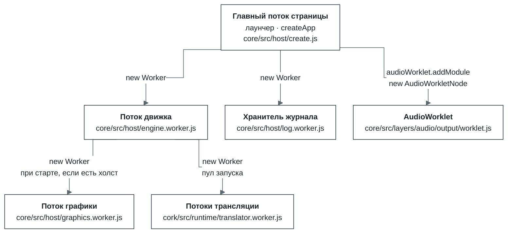
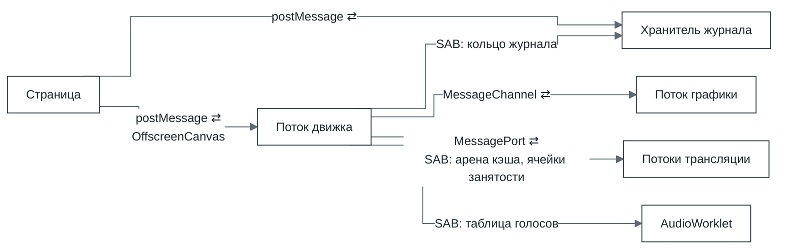
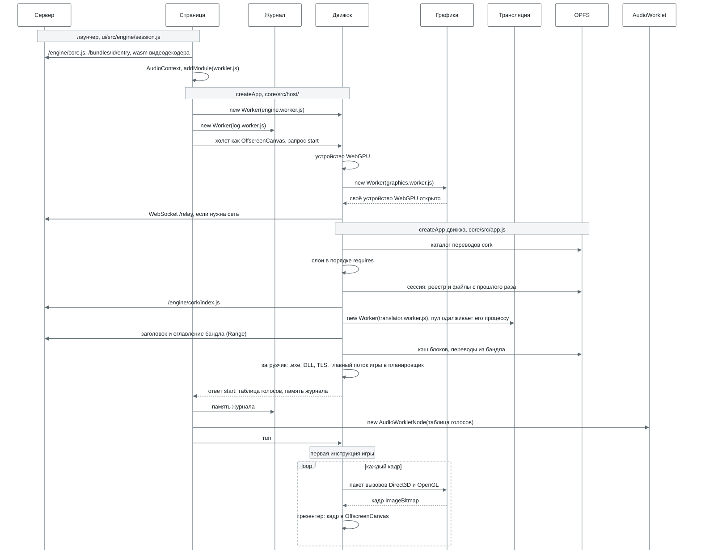
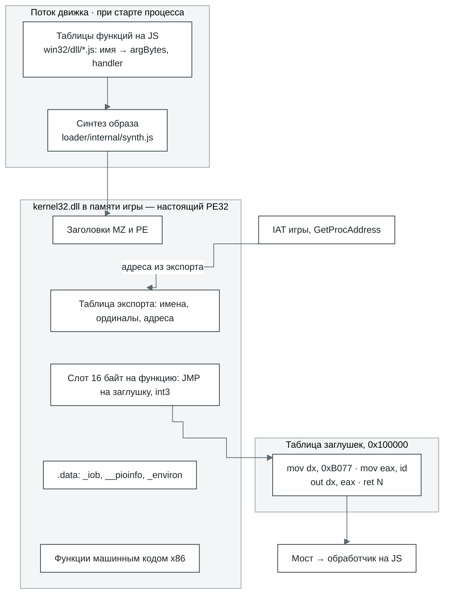
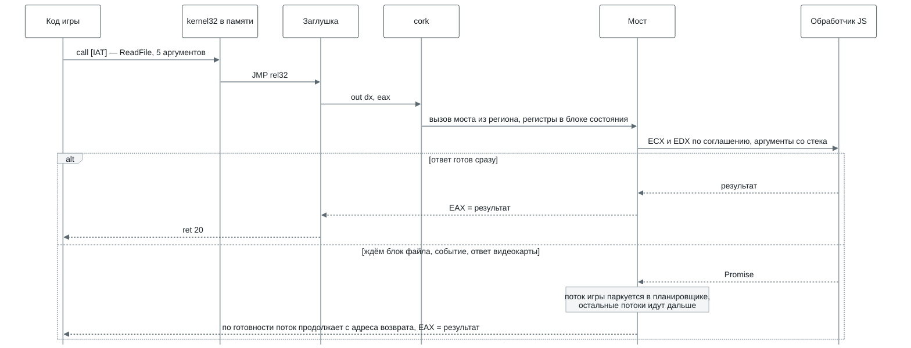
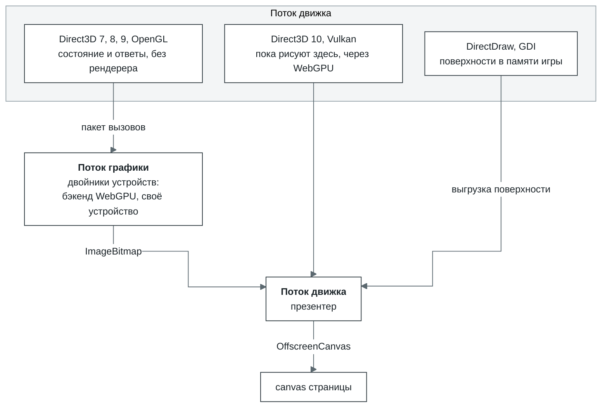
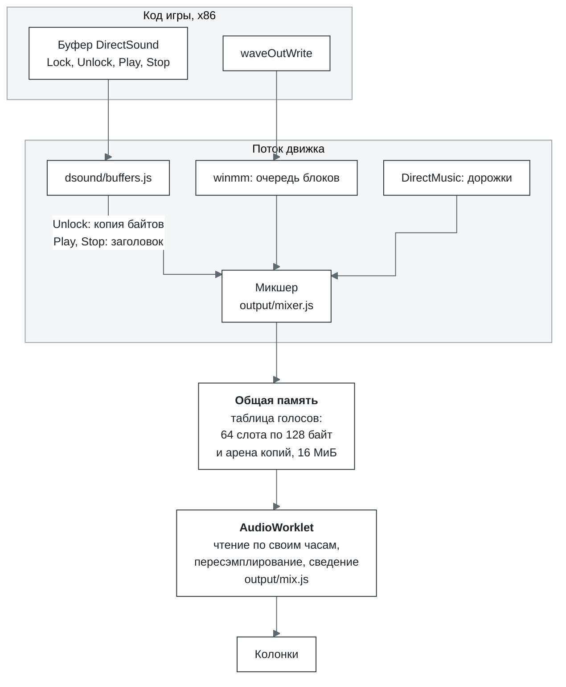
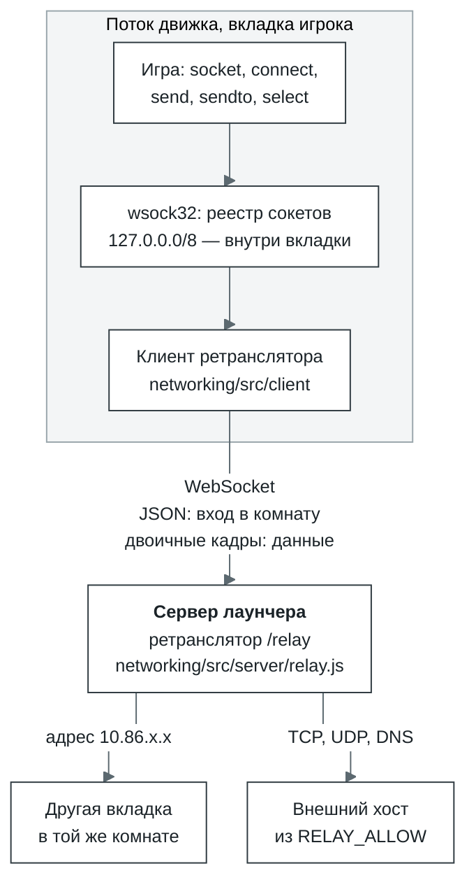

# Bottlify изнутри

English version: [architecture.md](architecture.md).

Пути без префикса считаются от `modules/` в bottlify, пути с `ui/` — от корня bottlify-ui. Если
схема разошлась с кодом, прав код.

1. [Что это](#1-что-это)
2. [Из чего состоит](#2-из-чего-состоит)
3. [Потоки: кто кого запускает и зачем](#3-потоки-кто-кого-запускает-и-зачем)
4. [Запуск: от createApp до первой инструкции](#4-запуск-от-createapp-до-первой-инструкции)
5. [cork, ядро исполнения](#5-cork-ядро-исполнения)
6. [Win32 на JavaScript: как получается DLL](#6-win32-на-javascript-как-получается-dll)
7. [Графика](#7-графика)
8. [Звук](#8-звук)
9. [Сеть](#9-сеть)
10. [Хранилища](#10-хранилища)

## 1. Что это

Bottlify запускает 32-битные приложения для Windows прямо во вкладке браузера — без Windows и без
установки. Внутри две части; по сути это то, что делают Rosetta 2 и Wine, собранное заново для
браузера:

- **cork — транслятор.** Процессора x86 в браузере нет, поэтому cork переводит машинный
  код программы в WebAssembly, а дальше браузер сам компилирует его под процессор устройства. Так
  один и тот же перевод работает и на x86, и на ARM. Как устроен cork — в
  [разделе 5](#5-cork-ядро-исполнения).
- **core — наше окружение Windows.** Его задача — убедить программу, что она работает в настоящей
  Windows. Самой Windows при этом нигде нет: `kernel32`, `user32`, `gdi32`, DirectX, Winsock и
  остальные системные библиотеки переписаны с нуля на JavaScript поверх веб-API. Программа видит
  их как обычные DLL, у неё есть диск `C:`, реестр, окна и сообщения, а на свои вызовы она получает
  те же ответы и коды ошибок, что дала бы Windows. Как это сделано — в
  [разделе 6](#6-win32-на-javascript-как-получается-dll).

Цель — чтобы тот же самый `.exe` запускался в Chrome, Safari и Firefox на чём угодно, от телефона до
десктопа. Ставить ничего не нужно, а сервер на кадр не влияет: он только раздаёт файлы и пересылает
сетевой трафик.

| Что нужно приложению | Кто это даёт | На чём работает |
| --- | --- | --- |
| Процессор x86 | cork переводит x86 в wasm | WebAssembly |
| Системные DLL | слой `win32`: функции на JS, которые программа видит как настоящие PE-образы | — |
| DirectDraw, Direct3D 7–10, OpenGL, Vulkan, GDI | слой `graphics` | WebGPU |
| DirectSound, waveOut, DirectMusic | слой `audio` | AudioWorklet, SharedArrayBuffer |
| DirectInput, XInput, сообщения окна | слой `input` | события клавиатуры и мыши, Gamepad API |
| Видеоролики DirectShow | слой `media`, FFmpeg в wasm | WebAssembly |
| Диск | бандл, который читается блоками, и сессия поверх него | fetch с Range, OPFS |
| Winsock | `wsock32` и ретранслятор | WebSocket |

### Почему игры

Концепция Bottlify — «игра в бутылке». Поэтому cork, хоть он и универсальный транслятор, в первую
очередь проектируется под быстрый рендер: кадр должен успевать вовремя. Для игры скорость — часть
корректности. Игра, которая выдаёт 10 кадров вместо 60, не работает, даже если всё считает верно.

Цель у нас амбициозная и, возможно, недостижимая до конца: дать людям на любых устройствах одно
решение, которое запускает любые игры. А что есть у каждого — от телефона до компьютера? Браузер.
Так почему бы браузеру не стать платформой для приложений?

Попытки уже были. Flash, Silverlight, Java-апплеты, Unity Web Player превращали браузер в платформу
для программ и игр. Но все они были плагинами: их ставили отдельно, у каждого был один владелец, а
программы писали специально под каждый. Когда браузеры отказались от плагинов, эти платформы
ушли, и написанные под них игры перестали запускаться. К началу 2020-х не осталось ни одной.

Bottlify устроен наоборот. Плагин ему не нужен: он работает только на стандартах, которые уже есть в
каждом современном браузере, — WebAssembly, WebGPU, Web Audio, OPFS. И программы, написанные
специально под него, тоже не нужны: он запускает те, что уже есть, — обычные `.exe` для Windows, без
изменений.

Есть и практическая причина: игра — лучший тест для такой системы.

- **Игра нагружает всё сразу.** Целочисленный код, x87 и SSE, Direct3D, звук, ввод, файлы, потоки,
  иногда сеть — один запуск проходит почти через все слои движка.
- **Игра сама себя меряет.** У многих игр есть встроенные бенчмарки и timedemo: каждый раз одна и та
  же сцена, а на выходе — кадры в секунду. Два запуска сравниваются числом, и регрессия видна сразу,
  а не «на глаз».
- **Пропуски видно сразу.** Не хватает функции — программа падает с `unimplemented import` и
  именем этой функции. Функция работает неточно — картинка съезжает, звук щёлкает или проседают
  кадры. Каждый такой сбой указывает на конкретное место в движке.
- **Игр очень много.** Тысячи программ разных лет, движков и компиляторов — огромный готовый набор
  тестов, который не нужно писать самим.

Под одну игру движок при этом не подгоняют. Если игра споткнулась, чинят общий слой, на котором это
случилось, и исправление достаётся всем программам, которые идут тем же путём. Поэтому глубже всего
сейчас проработано то, что нужно играм, — DirectX и OpenGL, звук, ввод, видеоролики и сеть, — но
работает это для любого приложения.

## 2. Из чего состоит

Пакеты репозитория — `@bottlify/`:

| Пакет | Что внутри |
| --- | --- |
| `@bottlify/core` | Наше окружение Windows: Win32 и DirectX, загрузчик, планировщик, файлы и `createApp`, через который всё запускается |
| `@bottlify/cork` | Транслятор x86 → wasm со своим рантаймом. Движок не импортирует его напрямую, а грузит по URL |
| `@bottlify/networking` | Клиент и сервер ретранслятора, через который приложения выходят в сеть |
| `@bottlify/installer` | Установка приложения его собственным установщиком и упаковка бандлов |

Дополнительный пакет для отладки — **bottlify-ui**, отдельный репозиторий: лаунчер на React и
локальный сервер, который на одном адресе отдаёт приложение, движок, бандлы и ретранслятор.

Движок разбит на слои. У каждого слоя свой интерфейс, настройки и тесты, а с другими слоями он
общается только через то, что объявил в `requires`. Это не просто договорённость:
`npm run check:boundaries` проверяет её по коду. Любой слой можно выключить, и на его место встанет
заглушка. Например, с `graphics: null` игра работает, просто без картинки.

| Слой | Отвечает за | `requires` |
| --- | --- | --- |
| `log` | журнал, счётчики, профиль фаз | — |
| `cpu` | выполнение кода x86 через cork, ловушки вызовов в мост | `log` |
| `memory` | адресное пространство игры: резервирование, страницы, защита | `cpu`, `log` |
| `kernel` | процессы, потоки, планировщик, объекты ожидания | `cpu`, `memory`, `log` |
| `loader` | загрузка PE и сборка системных DLL | `cpu`, `memory`, `log` |
| `bridge` | соглашения вызова, парковка потоков, обратные вызовы, COM в памяти игры | `cpu`, `kernel`, `memory`, `log` |
| `filesystem` | бандл, кэш блоков, диск `C:`, файлы, которые пишет игра | `log` |
| `win32` | kernel32, user32, gdi32, advapi32, ole32, msvcrt, winmm, wsock32 и ещё три десятка DLL | `bridge`, `kernel`, `memory`, `loader`, `filesystem`, `log` |
| `graphics` | DirectDraw, Direct3D 7/8/9/10, OpenGL, Vulkan и бэкенд WebGPU под ними | `win32`, `bridge`, `memory` |
| `audio` | DirectSound, DirectMusic, микшер, MP3 для Miles | `win32`, `bridge`, `memory` |
| `input` | DirectInput, XInput, клавиатура и мышь в очереди сообщений | `win32`, `bridge`, `memory` |
| `media` | декодер видео (FFmpeg в wasm) и `ijl15.dll` | `log` |

## 3. Потоки: кто кого запускает и зачем

Во вкладке работает семь видов потоков, два из них — в нескольких экземплярах. Страница запускает
три: поток движка, хранитель журнала и AudioWorklet. Поток движка запускает поток графики, поток на
каждый процесс там, где процессы идут одновременно, и пул потоков трансляции всего запуска, которые
он одалживает процессам.

Почти вся работа идёт в потоке движка. Остальные забирают у него то, что можно делать параллельно,
или то, что браузер разрешает только вне главного потока.



| Поток | Кто запускает | Когда | Зачем отдельный поток |
| --- | --- | --- | --- |
| Главный поток страницы | браузер | всегда | Здесь живут интерфейс лаунчера, вызов `createApp` и события DOM. Каждый кадр он делает только одно — опрашивает геймпады (`requestAnimationFrame` → `input.poll`) |
| Поток движка | страница, `core/src/host/create.js` | всегда. С `?host=thread` движок можно запустить прямо в потоке страницы, протокол тот же | Игра выполняется длинными квантами. В потоке страницы её прерывали бы сборка мусора и отрисовка интерфейса, а клик ждал бы конца кванта. К тому же синхронный доступ к OPFS есть только в воркере. Устройство WebGPU между потоками не передаётся, поэтому воркер открывает его сам, а холст получает как `OffscreenCanvas` |
| Хранитель журнала | страница, `core/src/host/remote.js` | всегда. Если `Worker` недоступен, его заменяет `MessageChannel` на странице | Движок пишет журнал, счётчики и таблицы в общую память и ни на какие вопросы не отвечает. Хранитель успевает вычитать кольцо, пока оно не перезаписалось, хранит историю, считает кадры, профиль и разбивку по модулям. В итоге журнал ничего не стоит ни странице, ни движку |
| Поток графики | поток движка, `core/src/host/graphics-worker.js` (вызывается из `serve.js`) | при старте, если у движка есть холст и не выставлено `device.graphicsWorker: false` (в лаунчере — `?graphicsWorker=off`). Переживает смену программы. Если за 10 с устройство не открылось, всё рисуется в потоке движка | Его задача — рисовать всю графику, чтобы поток движка только хранил состояние и отвечал программе. Сейчас здесь на отдельном устройстве WebGPU проигрываются Direct3D 7, 8, 9 и OpenGL; Direct3D 10 и Vulkan переедут сюда же. Появился в cork 1.3. В бенче `tools/graphics-bench --remote` поток движка тратит на кадр Direct3D 0,69 мс вместо 2,95 |
| Потоки трансляции | пул запуска, `core/src/host/pool/pool.js` (создаётся в `app.js`) | если движок — cork и транслятор работал бы с воркером. Каждому процессу один одалживается от запуска до завершения, а пока его трансляция отстаёт, подключаются ещё — как решит драйвер пула (`driver.js`). Пока первый не ответил `ready`, регионы переводятся в потоке самого процесса | Генерирует wasm для регионов, собирает модуль и компилирует его. Поток процесса его не ждёт: отправляет пакет и публикует результат между кадрами, когда тот придёт. Поток трансляции работает на один процесс за раз, через собственный порт; поток, который ни на кого не работает, спит и ничего из процессов не держит |
| AudioWorklet | страница, `ui/src/engine/session.js` | если страница изолирована (`crossOriginIsolated`) и звук включён | Это поток реального времени Web Audio. Он сам читает голоса из общей памяти по своим часам, поэтому звук не рвётся, даже когда движок занят |
| Поток процесса | поток движка, `core/src/host/process-worker.js` (вызывается из `app.js`) | с `concurrency` 2 или 4, по одному на каждый процесс, включая программу, которую запустила страница, пока он работает | Процесс -- лаунчер и игра, которую он запускает, -- работает в своём потоке рядом с родителем, со своей памятью и своим транслятором. Ожидая, он блокируется, а не делит очередь с циклом событий движка, а поток движка не исполняет ни одной программы |

Как потоки обмениваются данными. ⇄ значит «в обе стороны», SAB — `SharedArrayBuffer`, то есть
общая память.



- **Страница ⇄ движок.** Запросы и ввод идут через `postMessage`. Отправив сообщение, страница ещё и
  увеличивает слово-сигнал в общей памяти. Так движок замечает сообщение сразу, между ходами
  планировщика, а не ждёт очередной плановой паузы. Холст передаётся один раз
  (`transferControlToOffscreen`), и дальше кадры в него пишет только движок.
- **Движок → хранитель журнала.** Только через общую память: хранитель заглядывает в кольцо раз в
  200 мс. Если `SharedArrayBuffer` нет, записи ему пересылает страница.
- **Движок ⇄ графика.** У Direct3D 7, 8, 9 и OpenGL по своему `MessageChannel`. Вызовы складываются в
  один буфер на пакет, и буфер передаётся без копирования. Обратно приходят кадр `ImageBitmap` и
  ответы на вызовы, результат которых знает только рендерер.
- **Движок ⇄ трансляция.** Туда уходят регионы, которых нет в хранилище, обратно приходят байты
  модуля и уже скомпилированный `WebAssembly.Module`.
- **Движок → AudioWorklet.** Сообщений тут нет вообще. Таблица голосов лежит в общей памяти:
  страница получает её в ответе на запуск и отдаёт `AudioWorkletNode`.

**Процессы.** При `concurrency` 1, по умолчанию, программа работает в потоке движка, а дочерний
процесс встаёт там на место родителя, пока не завершится. При 2 или 4
(`createApp({ concurrency: 2 })`) каждый процесс работает в своём потоке процесса, включая
программу, которую запустила страница, а дочерний запускается в `CreateProcess` и работает рядом с
родителем, до стольких процессов сразу; следующий работает рядом с родителем, по очереди с ним в
потоке родителя. Поток движка тогда -- только система: до запуска первого процесса он монтирует
бандл, кладёт на том сессию и файлы страницы, создаёт реестр, открывает журнал и звуковой выход
(`buildSystemHost` в `core/src/app.js`), а то, что страница спрашивает у программы, он спрашивает у
потока программы. Нужна общая память: если её
нет, прогон откатывается на `compatible` с одним процессом за раз и сообщает об этом событием
`fallback`. То, что процессы прогона делят, -- реестр, том и разделение его открытых
файлов, каталог окон, идентификаторы, именованные события, семафоры и мьютексы, бандл, таблица классов COM
(`core/src/com-link.js`), хранилище переводов (`core/src/layers/cpu/internal/store-link.js`) -- остаётся в
потоке движка, и он отвечает потоку процесса через связь: два кольца в общей памяти, по одному в
каждую сторону, и слово-звонок на каждую сторону (`core/src/system/link.js`, значения кодирует
`codec.js`). Поток процесса блокируется на своём звонке до каждого ответа и тем временем отвечает на
то, о чём спрашивают его (движок спрашивает о его окнах); сообщение длиннее, чем вмещает кольцо,
уходит частями. Каждая сторона несколько микросекунд смотрит на свой звонок, прежде чем уснуть на
нём: разбудить уснувший поток стоит куда дороже самого ответа. Том по большей части не спрашивают:
каждое изменение диска поднимает слово этой буквы в общей памяти, и поток процесса держит то, что
прочёл с диска, -- куски файлов по 64 КБ, размеры, записи, списки, -- пока это слово не сдвинется; а
разделение, с которым сверяется каждое открытие, -- таблица в общей памяти под замком, и поток
процесса сверяет свои открытия в ней сам
(`core/src/layers/filesystem/internal/volume-link.js`, `shared-sharing.js`). Его устройства Direct3D рисуют в потоке графики через собственный порт, картинки
DirectDraw и GDI приходят в движок байтами, звук сводится в таблице голосов прогона в участке,
который ему одалживает родитель, а ввод страницы приходит к нему так, как его направляет оконный
менеджер запуска (раздел 7). Чего у него пока
нет, сказано в [`core/limits.md`](core/limits.md).

**Режимы.** `createApp({ mode })` говорит, сколько из этого держится на общей памяти, а режим прогона
виден в диагностике слоя `app` (`core/src/mode.js`):

| Режим | Что нужно | Что делает |
| --- | --- | --- |
| `isolated` | страница с cross-origin isolation | Память игры — `SharedArrayBuffer`. Поток графики читает байты, которые игра записала после unlock, прямо из неё и пишет считанное обратно на место. На странице без общей памяти `createApp` его отклоняет |
| `compatible` | ничего | Память игры принадлежит потоку движка, а всё, что уходит в другой поток, копируется. Работает на любой странице |
| `auto` (по умолчанию) | — | `isolated` там, где страница изолирована, иначе `compatible` |

Лаунчер берёт `auto`, если `?mode=compatible` или `?mode=isolated` не просят другого.
Какой выбрать и чего каждый стоит странице — в
[`core/README.md`](core/README.md#which-mode-and-why).

## 4. Запуск: от createApp до первой инструкции



Порядок важен в трёх местах.

- **Устройство WebGPU и поток графики открываются раньше слоёв.** `createApp` движка получает поток
  графики в настройках устройства (`device.worker`), и слой `graphics` уже при сборке знает, где
  будут рисовать Direct3D и OpenGL.
- **Сессия накладывается до первой инструкции игры,** поэтому игра с самого начала видит свои сейвы
  и реестр.
- **Игра начинает работать только по команде `run`,** когда страница уже подключила журнал, ввод и
  звук. `DllMain` библиотек и TLS-колбэки — тоже код игры: их вызывает специальная заглушка в начале
  главного потока, а не хост.

Где смотреть в коде: `ui/src/engine/session.js` (что передаёт лаунчер), `core/src/host/create.js`
и `remote.js` (страница), `serve.js` (движок), `core/src/app.js` (`createApp`, `buildApp`,
загрузчик).

## 5. cork, ядро исполнения

cork, наш транслятор x86-32 в WebAssembly со своим рантаймом (пакет `cork/`), выполняет весь код
игры. Что это, как он переводит и выполняет код, что поддерживает и насколько быстр:
[`modules/cork/README.ru.md`](../modules/cork/README.ru.md). Здесь только о том, как он встроен в
Bottlify.

Движок не импортирует cork напрямую: слой `cpu` загружает его по URL (`/engine/cork/index.js`).
Выполняется только пользовательский код. До ядра Windows дело не доходит: вместо системного вызова
срабатывает ловушка в мост (раздел 6).

| Где | Что делает |
| --- | --- |
| Поток движка | Интерпретаторы, сборка регионов, поиск в хранилище, публикация и выполнение переведённого кода, ловушки в мост |
| Потоки трансляции | Эмиттер и кодировщик: пакет регионов превращается в модуль wasm, а модуль — в скомпилированный `WebAssembly.Module`. На один процесс может работать несколько, у каждого свой пакет |
| OPFS | Хранилище переводов `cork/<id>.v3/` |
| Сервер | Код cork и его воркера (`/engine/cork/`). Бандл может привезти готовые переводы |

**Память.** Вся память игры — одна `WebAssembly.Memory` фиксированного размера, общая в режиме
`isolated`: по умолчанию 1 ГиБ
под игру плюс таблицы cork. Адрес игры `a` лежит в ней по адресу `0x10000 + a`, поэтому обычные
чтение и запись x86 превращаются в такие же обычные `i32.load` и `i32.store` со смещением. В первых
64 КиБ — блок состояния с регистрами (512 байт) и данные со стеком wasm-интерпретатора, а таблицы
cork идут сразу за памятью игры. В памяти, сделанной для нескольких исполнителей процесса, за ними
у каждого следующего исполнителя своя страница состояния в 64 КиБ и свои таблицы
(`executorLayout`): его переводы несут его собственные адреса, а память игры у всех общая. Таблиц
страниц нет: на каждую страницу в 4 КиБ приходится один байт флагов — `INACCESSIBLE`, `HAS_CODE`,
`VOLATILE`, `CLOSED`, `NO_EXECUTE`.

### Перевод в Bottlify

- **Несколько потоков трансляции, одна арена.** У процесса может быть несколько потоков трансляции,
  у каждого свой пакет в полёте. Перелинковка, слияние и регион, сформированный заново, забирают
  работающие регионы, поэтому они по-прежнему уходят в одиночку. Уже сгенерированные функции,
  которые перелинковка или слияние берут снова, а не генерируют заново, принадлежат процессу, а не
  потоку. Они лежат в его арене: 48 МБ общей памяти, которую каждый поток трансляции процесса читает
  и пополняет под одной блокировкой, старейший сегмент уходит первым. Без неё перелинковка заново
  генерирует уже сгенерированное: поток трансляции Doom 3 на загрузке был занят 23,3 с вместо
  14,6 с.
- **Драйвер пула.** Каждые 500 мс он читает, сколько работал каждый поток трансляции и сколько
  регионов выдал (общая память, в которую пишут сами потоки). К процессу подключается ещё один,
  когда медианная загрузка уже работающих на него доходит до 80 %, не больше
  `hardwareConcurrency` на процесс. Каждое подключение — проба: если регионы процесса в секунду не
  выросли хотя бы на половину того, что даёт ещё один поток в лучшем случае, подключённый уходит,
  а процесс запоминает это число как свой потолок. На четырёх ядрах один поток трансляции уже не
  оставляет свободного ядра на загрузке игры, и второй замедлил загрузку Doom 3 и Tron
  (`roadmap/negative-results.md`, 7 октября 2026); там подключённый поток уходит после пробы.
  Подключённые потоки уходят сразу, когда процесс перестаёт транслировать и ждёт, и через 3 с
  медианы ниже 40 % в остальных случаях. Каждое решение — в журнале пула (`translationPool()` у
  запуска).
- **Каждый кусок кода переводится один раз.** Регион останавливается на блоке, для которого вход
  есть у другого региона — опубликованного, сформированного раньше в том же батче или ещё не
  вернувшегося от транслятора, — и переход туда уходит в тот регион: код функции переводится один
  раз, сколько бы её блоков ни начинали регионы. Маленькая листовая функция по-прежнему
  встраивается в каждого вызывающего — ради сэкономленного вызова.
- **Хранилище.** Перевод хранится под версией кэша, возможностями браузера, раскладкой памяти, id
  бандла, адресом входа, вершиной стека x87 и режимами запуска. Запись говорит, что получилось при
  формировании: 64-битный хэш FNV от байтов региона, блоки, оставленные другим регионам, встроенные
  вызываемые функции, точность x87. Где регион остановится, зависит от того, что к тому моменту
  уже переведено, поэтому запуск, у которого регион сложился иначе, формирует его заново так, как
  сказано в записи, и берёт его, если хэш байтов совпал. Второй запуск берёт из хранилища всё, что
  перевёл первый. Бандл может привезти переводы с собой (`CORKSEED`) — их засевают ещё до первой
  инструкции.

### Выполнение в Bottlify

- **Счёт инструкций.** Каждый блок на выходе вычитает своё число инструкций из бюджета, а
  проверяется бюджет на обратных переходах. Квант планировщика — 100 000 инструкций; среди готовых
  потоков на одном исполнителе ход длится столько инструкций, сколько исполнитель успевает за
  четверть миллисекунды, если это больше (быстрый переведённый код — около 750 000), но не больше
  сольного хода и без срока ближе миллисекунды. Переведённому коду бюджет выдают по 10 000, чтобы
  поток можно было вовремя вытеснить.
- **Два интерпретатора.** Первые 8192 единицы работы процесса (инструкции плюс 128 за каждую новую
  цель перехода) выполняет JS-интерпретатор, дальше — wasm-интерпретатор.
- **Память и самоизменяющийся код.** Вне точного режима чтения не проверяются: адрес просто
  заворачивается в пределы памяти игры. А каждая запись проверяет байт флагов страницы. Если игра
  пишет туда, где на странице лежит переведённый код, регион выходит. Первая такая запись сбрасывает
  все переводы страницы; регионы, сформированные там после неё, хранят копию всех байтов, из которых
  их сформировали, и следующая запись сбрасывает только те, чьи байты она действительно изменила:
  микшер, который переписывает патчи голосов теми же байтами, сохраняет свой код, а сброшенный код
  сразу ставится в очередь на перевод. Страница хранит один диапазон 32-байтных гранул, которые
  занимает её код, поэтому данные между двумя кусками кода попадают в него. Запись туда, не задевшая
  байтов ни одного региона, сверяется с копией страницы: если она изменила то, что там было
  (переменная, которую цикл пишет на каждом витке), страница теряет переводы, как раньше, иначе
  каждая такая запись уходила бы в интерпретатор; если записала те же байты, страница остаётся.
  Страница, которая потеряла переводы 8 раз за
  100 мс, считается летучей (`VOLATILE`) и 2 с интерпретируется, при каждом повторе вдвое дольше,
  а потом переводится снова. При нескольких исполнителях страница по-прежнему теряет все переводы
  при каждой такой записи.
- **Несколько исполнителей процесса** (этап 3 из `roadmap/v2/`, `cpu.cores` у `createApp`). Запуск,
  который не называет их, получает на странице, которая может делить память, на один меньше, чем
  процессоров у хоста (не больше восьми), а в остальных случаях — один; исполнители сверх первого
  открываются, когда их захотят потоки программы. У
  каждого потока свой исполнитель, где лежат его переводы: первый поток процесса работает на
  собственном исполнителе процесса, каждый следующий — на том из остальных, который своим считает
  меньше всего живых потоков. Ход отдаёт каждому свободному исполнителю следующий готовый поток,
  для которого он свой; поток, чей исполнитель занят, идёт затем на оставшийся свободным (сначала
  на собственный исполнитель процесса), и его код переводится и там, чтобы процессор не простаивал.
  Два вида потоков работают только на исполнителе процесса, если им туда можно: поток, который на
  последних срезах вызывает хост чаще раза на 30 000 инструкций (с другого исполнителя каждый такой
  вызов — путь туда и обратно), и поток, чьи запуски на другом исполнителе по большей части
  кончались тем, что исполнителю процесса нечего было выполнять и он забирал поток к себе, — поток,
  который чередуется с потоками процесса, а не работает рядом с ними (эта доля вдвое убывает каждую
  секунду, так что поток пробует снова). Такой поток, ждущий исполнителя процесса, забирает его у
  потока, который считает, и тот уходит на другой исполнитель вместо него.
  Поток никогда не запускается, пока его ещё выполняет другой исполнитель: ждавший там становится
  готовым по пробуждению раньше, чем тот срез забран, и планировщик второй запуск отвергает.
  Своими поток считает только исполнители из своей маски привязки: программе сообщают, что у неё
  по процессору на каждый исполнитель, — через GetSystemInfo, блок процесса, `cpuid` и остальное, —
  а `cpuid` отвечает номером исполнителя как APIC id, так что поток, привязанный к процессору,
  читает номер именно этого процессора.
  Собственный поток процесса тоже выполняет свои потоки и отвечает на вызовы потоков остальных — на
  каждом своём входе в хост, между своими ходами и внутри них: исполнитель, которому нужен ответ
  (вызов, исключение, конец среза), записывает слово, которое переведённый код процесса читает на
  каждом обратном ребре как нижнюю границу бюджета, — срез выходит там, на вызовы отвечают, и срез
  продолжается; на время ответа вызывающий поток делается текущим.
  Исполнитель держит свой поток срез за срезом, пока ни один готовый поток не ждёт исполнителя и
  процессу не нужен ни один из выполняемых (приостановлен, завершён другим): между срезами
  проворачивается его цикл событий, а процесс узнаёт о потоке не реже раза в 250 мс. Пока готовые
  потоки ждут исполнителя, он держит свой поток один ход, 1 мс (`executorHoldMs`), и отдаёт его в
  конце первого среза после этого — как процессор держит поток до конца его кванта. Поток процесса,
  которому нечего выполнять самому, ждёт остальных до ближайшего срока, но не дольше 4 мс, а
  исполнитель, держащий поток, которому можно на исполнитель процесса, отпускает его в конце среза,
  и поток переходит туда — так программа, чей единственный рабочий поток был создан, пока первый ещё
  работал, выполняет его на исполнителе процесса. Пока вызов хоста ещё ждёт ответа через цикл
  событий — ответа графического воркера, подкачанного блока, — ход не ждёт: цикл выполнения ждёт
  этот ответ и колокол остальных вместе. Собственные ходы
  исполнителя процесса так же длинны, когда другие исполнители выполняют потоки, как когда ни один
  не занят, а поток, ставший готовым при свободном исполнителе, такой ход заканчивает — сделал ли
  его готовым собственный поток процесса или ответ на вызов другого, — как и конец среза другого
  исполнителя.
  Исполнитель после первого — хост cork в собственном воркере над памятью процесса; воркер
  открывается, когда его хочет готовый поток (поток сверх тех, что выполняют открытые исполнители,
  или поток, чья маска сродства называет этот исполнитель): программа из одного потока не открывает
  ни одного
  (`core/src/layers/cpu/internal/executor.worker.js`), со своей страницей состояния, хэшем входов и
  экземплярами переводов. Переводы исполнителей после первого у них общие: они делаются для общей
  раскладки процесса (`sharedLayout`), где блок состояния и таблицы адресуются от двух баз, которые
  получает каждый экземпляр, так что байты перевода у всех них одинаковы, а одна арена
  эмитированных функций служит им всем и их трансляторам — регион, эмитированный одним, остальные
  берут оттуда. Исполнитель процесса переводит для собственной раскладки, где состояние и таблицы
  лежат по постоянным адресам, как при одном исполнителе: базы общей раскладки стоят на шестую
  часть больше машинного кода в маленькой функции и 7 % бенчмарка, а исполнитель процесса выполняет
  первый поток и любой поток, оставшийся один. Код, который выполняется по обе стороны, переводится
  дважды, но не по разу на исполнитель. Флаги страниц и границы кода общие на процесс: запись на любом исполнителе в код,
  переведённый любым из них, обнаруживается; нашедший выбрасывает свои переводы и кладёт диапазон в
  кольцо в общей памяти, а каждый другой исполнитель выбрасывает свои в начале следующего среза
  (`cork/src/runtime/shared-code.js`). Ловушка или исключение на таком исполнителе ждёт поток
  процесса, который отвечает своими обработчиками над регистрами исполнителя, подставленными на
  время вызова в его блок состояния (`executor.js`).
- **Точные исключения.** Регион выходит прямо перед упавшей инструкцией, с её EIP и регистрами.
  Деление на ноль даёт #DE, неизвестная инструкция — #UD, запись в закрытую страницу — #GP, переход
  ниже `0x10000` (например, вызов по нулевому указателю) — #PF. `int3` доигрывает интерпретатор.
  Дальше исключение уходит в SEH игры, где #GP и #PF превращаются в `EXCEPTION_ACCESS_VIOLATION`.

Где смотреть в коде: `cork/src/decode/`, `cork/src/region.js`, `cork/src/emit/`, `cork/src/wasm/`,
`cork/src/runtime/`, `cork/src/interp.js`, `cork/src/interp-wasm.c`; связка с движком —
`core/src/layers/cpu/internal/cork-host.js`. Куда cork идёт дальше — в `roadmap/v2/`.

## 6. Win32 на JavaScript: как получается DLL

Каждая системная библиотека у нас — это таблицы на JS. Для каждой функции в них записано, какой
обработчик её выполняет, сколько байт аргументов снять со стека и какое у неё соглашение вызова (по
умолчанию stdcall). Например, `AddAtomA: { argBytes: 4, handler: ([p]) => add(p) }` из
`core/src/layers/win32/kernel32/atoms.js`.

При старте процесса загрузчик собирает по этим таблицам настоящие PE32-образы `kernel32.dll`,
`d3d9.dll` и остальных и кладёт их в память игры. Для игры это обычные DLL — с заголовками, таблицей
экспорта и кодом. Поэтому адрес, который вернёт `GetProcAddress`, совпадает с тем, к которому
привязан импорт.

| Где | Что лежит |
| --- | --- |
| Поток движка | Таблицы функций, сборка образов, мост и обработчики |
| Память игры | Образы DLL; таблица заглушек с адреса `0x100000` (16 384 слота по 16 байт); COM-объекты и таблицы их методов |



Заглушка занимает 16 байт, на каждую функцию своя:

```
66 BA 77 B0      mov dx, 0xB077     ; порт ловушек
B8 xx xx xx xx   mov eax, id        ; номер функции в мосте
EF               out dx, eax        ; cork вызывает мост
C2 nn nn         ret N              ; C3 для cdecl
CC ...           int3 до 16 байт
```

Сколько байт снимает `ret N`, мост решает по соглашению вызова: stdcall снимает все `argBytes`,
cdecl — ничего, thiscall и fastcall не считают аргументы, переданные в регистрах.

### Один вызов: от игры до JS и обратно



- **COM-объекты** — Direct3D, DirectSound, DirectInput — тоже лежат в памяти игры. Первое слово
  объекта указывает на таблицу методов, и каждый метод в ней — такая же заглушка. Методы — stdcall,
  указатель на интерфейс передаётся первым аргументом на стеке.
- **Обратные вызовы** — оконная процедура, колбэк COM, `DllMain`. Мост останавливает поток, строит
  кадр на стеке игры и запускает её код, пока тот не вернётся в служебную ловушку.
  Вызов хоста, который много раз подряд вызывает код игры (проход эффекта D3DX, который задаёт
  каждое состояние через менеджер состояний игры), записан шагами (`bridge.drive`): генератором,
  который отдаёт каждый гостевой вызов. Мост тогда отправляет поток в каждую процедуру в том же
  слайсе, где пришёл вызов, и забирает её ответ в служебной ловушке там же, без парковки и без
  витка цикла между ними. По умолчанию это включено (`driveGuestCalls`): через промисы каждый
  гостевой вызов прохода был отдельным витком цикла, и кадр с проходами эффектов тратил на витки
  больше времени, чем на саму игру. `driveMs` и `driveCallMs` моста делят время шагов между
  шагами и гостевым кодом. Выключенным, те же шаги идут через промисы; `effect-steps.itest.js`
  проверяет, что результаты совпадают.
- **Часть кода сразу в памяти игры.** Некоторые экспорты — готовый машинный код x86: функции msvcrt
  и kernel32, выдача мелких блоков кучи (до 1 КиБ). Они работают без ловушки, на скорости cork, а в
  мост уходит только то, с чем они сами не справились.
- **Если функции нет.** У каждого имени своя заглушка. Если известно, сколько байт аргументов снять
  (декорация `@N`, имя C++, cdecl-библиотека или библиотека самой программы), она просто возвращает
  0. Иначе игра падает с `unimplemented import`, и в ошибке видно, какая функция нужна и кто её
  вызвал.

### Какую DLL получит игра


- **Всегда наши** — KnownDLLs (`kernel32`, `user32`, `msvcrt`, `ole32` и другие) и библиотеки,
  которые заменяет слой движка: `Mp3dec.asi` (звук) и `ijl15.dll` (media).
- **Где ищет `LoadLibrary`:** в папке `.exe`, потом в `C:\WINDOWS\system32\`, в `C:\WINDOWS\` и в
  текущей папке. Статические импорты ищутся так же, только без текущей папки.
- **Настоящую DLL** загрузчик разбирает и перемещает, сначала грузит её зависимости, привязывает
  импорты (в том числе отложенные), а `DllMain` вызывает через мост как код игры. TLS поддерживается
  у главного образа и у библиотек, загруженных статически.
- **Распространяемые библиотеки DirectX** (`d3dx9_*` и другие) в движок не входят: их приносит
  сама игра — через DirectX setup своего установщика, который кладёт их в `C:\WINDOWS\system32\`,
  или как DLL рядом со своим `.exe`. Если их нет, на `d3dx9_*` отвечает таблица движка.

Где смотреть в коде: `core/src/layers/loader/internal/synth.js` (образ),
`core/src/layers/cpu/internal/thunks.js` (заглушки), `core/src/layers/bridge/` (мост), таблицы —
`core/src/layers/win32/<dll>/`, порядок поиска — `core/src/app.js` (`libraryCandidates`,
`answeredByEngine`).

## 7. Графика

Поток графики нужен, чтобы рисовать всю графику программы. Поток движка держит у себя только
состояние устройств и отвечает программе, а рисуют их двойники в потоке графики, на своём
устройстве WebGPU. Поток графики появился в cork 1.3, сначала для Direct3D 8 и 9; в cork 1.6 туда
перешли OpenGL и Direct3D 7. Direct3D 10 и Vulkan пока рисуют в потоке движка и переедут в поток
графики следом.

| Где | Что делает |
| --- | --- |
| Страница | Один раз отдаёт `<canvas>` движку (`transferControlToOffscreen`) и вписывает его в окно с сохранением пропорций (`ui/src/components/PlayScreen.jsx`) |
| Поток движка | Здесь все графические API игры. Устройства Direct3D 7, 8, 9 и контексты OpenGL хранят состояние и отвечают игре, но сами не рисуют. Direct3D 10 и Vulkan пока рисуют прямо здесь через бэкенд WebGPU. DirectDraw и GDI рисуют в программные поверхности в памяти игры, а на экран их выгружает презентер. Он же кладёт готовый кадр в `OffscreenCanvas` |
| Поток графики | Двойники устройств Direct3D 7, 8, 9 и контекстов OpenGL проигрывают те же вызовы на своём устройстве WebGPU и возвращают кадр как `ImageBitmap` |
| OPFS | Не используется. Кэши пайплайнов и шейдеров живут только в памяти |



- **Как идут вызовы.** Каждый вызов сразу записывается в двоичный пакет (`remote/wire.js`). Пакет
  уходит в конце хода (`queueMicrotask`) или немедленно, если вызов ждёт ответа. Данные ресурсов
  едут в том же пакете. У буфера Direct3D это то, что игра записала между `Lock` и `Unlock`, у
  текстуры — всё, что записано до следующего вызова, который может её прочитать. OpenGL читает
  память программы прямо в момент вызова, поэтому всё, что прочёл вызов, уходит перед ним.
  Поверхности DirectDraw, в которые рисует Direct3D 7, передаются по номеру и описываются заново,
  когда меняются. Рендерер в потоке движка читает данные в те же моменты, так что картинка получается одинаковой,
  где бы ни рисовал Direct3D.
- **Кто кого ждёт.** `Present` ждёт поток графики, только если тот отстал больше чем на два кадра.
  Ответа ждут лишь вызовы, результат которых знает только рендерер. У Direct3D 8/9 это `GetData` (в
  том числе occlusion query), `GetRenderTargetData`, `GetFrontBuffer(Data)`, а ещё `LockRect`, `GetDC` и `CopyRects` на
  рендертаргете. Ждёт при этом не поток движка, а поток игры: мост паркует его в планировщике, и
  остальные потоки игры продолжают работать. Ответ на occlusion query привозит и все остальные
  счёты, которые у рендерера уже есть, каждый с пометкой, к какому `Issue(END)` он относится.
  Программа, которая ждёт свои запросы по одному, платит одним обменом за все счёты одного чтения
  с GPU, а не обменом на каждый запрос.
- **Шейдеры.** Байткод шейдеров Direct3D 8/9 разбирается и переводится в WGSL
  (`graphics/d3d9/shader.js`, `wgsl.js`). Для фиксированного конвейера WGSL генерируется
  (`webgpu/internal/fixedfunction.js`).
- **Текстуры** уходят на GPU в формате `bgra8unorm`, а сжатые DXT по умолчанию распаковываются на
  CPU. В исходном BC-формате они попадают на GPU только с флагом `graphics.compressedTextures` и
  только если устройство поддерживает `texture-compression-bc`.
- **У каждого окна своя поверхность.** Внутри процесса экран собирается так, как его собирает
  оконный менеджер Windows 7 (`graphics/gdi/screen.js`): каждое окно верхнего уровня рисует на
  своей поверхности, другие окна верхнего уровня его не обрезают, а экран — это фон рабочего стола
  и видимые окна поверх него, снизу вверх. Сдвинутое, поднятое, скрытое или закрытое окно ничего
  не перерисовывает: экран просто собирается заново.
- **Несколько процессов, один экран.** user32 каждого процесса сообщает оконному менеджеру
  запуска (`win32/user32/manager.js`, в потоке движка рядом с каталогом окон), каково каждое его
  окно — класс, заголовок, стиль, прямоугольник, видимость, — а менеджер держит z-порядок окон
  верхнего уровня всего запуска, один фокус клавиатуры (окно, взявшее его, поднимает своё окно
  верхнего уровня и забирает фокус у всех остальных, чьи бы они ни были) и окно, захватившее
  мышь, для всех процессов одинаково. Каждый кадр говорит, какой процесс его нарисовал; presenter хранит последнюю картинку
  каждого процесса и, пока видны окна больше чем одного процесса, собирает из них экран в порядке
  менеджера, снизу вверх (`webgpu/internal/compose.js`). Ввод страницы идёт туда, куда говорит
  менеджер: указатель — процессу окна, захватившего мышь или стоящего под ним, клавиатура —
  процессу окна с фокусом (`inputTarget`); нет такого окна — никакой программе. Один процесс или четыре, в одном потоке или в воркерах —
  менеджер тот же.
- **Если что-то сломалось.** Не открылся поток графики — Direct3D и OpenGL рисуют в потоке движка,
  а в консоли появляется предупреждение. Потерялось устройство WebGPU — `Present` и `Reset` возвращают
  `D3DERR_DEVICELOST` (у 9Ex — `D3DERR_DEVICEREMOVED`). Восстановления нет: новые кадры просто
  перестают приходить.

Где смотреть в коде: `core/src/layers/graphics/` (`d3d7`, `d3d8`, `d3d9`, `d3d10`, `ddraw`, `gdi`,
`opengl`, `vulkan`, `webgpu`), поток графики — `graphics/remote/` и
`core/src/host/graphics.worker.js`.

## 8. Звук

| Где | Что делает |
| --- | --- |
| Страница | До старта создаёт `AudioContext` и загружает `worklet.js`, после старта создаёт `AudioWorkletNode` поверх таблицы голосов, которую вернул движок |
| Поток движка | DirectSound, waveOut, DirectMusic и MP3 для Miles. Каждый раз перед тем, как отдать управление браузеру, дописывает в общую память то, что успела записать игра, переносит громкость и панораму и отправляет уведомления |
| AudioWorklet | Читает 64 слота голосов по своим часам, линейно пересэмплирует, применяет громкость и панораму и сводит всё вместе |
| OPFS | Не используется |

Буфер DirectSound у нас ведёт себя как голос звуковой карты: копия его данных лежит в общей памяти,
и AudioWorklet сам читает её оттуда, как DMA. Поэтому звук не прерывается, даже когда движок занят
загрузкой или переводом кода, — лишь бы у игры в буфере хватало звука.



- **Голос** — это слот в таблице: заголовок из 32 слов (`RATE`, `CHANNELS`, `BITS`, `GAIN`,
  приглушение левого и правого канала, `POSITION`, `LOOPING`, `PLAYING`, `LAPS` и другие) плюс копия
  буфера в арене. Когда движок впервые видит буфер играющим, он копирует его целиком, а дальше —
  только то, что игра изменила между `Lock` и `Unlock`. `Play` записывает позицию, `LOOPING` и
  `PLAYING`, `Stop` — `PLAYING = 0`.
- **Курсор воспроизведения** показывает, сколько успел прочитать AudioWorklet (`POSITION` и `LAPS`),
  а курсор записи идёт на 30 мс впереди. Поэтому `GetCurrentPosition` и уведомления о позиции
  совпадают с тем, что действительно звучит.
- **Потоковый буфер** игра дописывает на ходу — так делают микшеры Miles и FMOD. Голос не играет
  дальше того, что уже записано: если игра опоздала, звучит тишина, а не старый кусок по второму
  кругу. Если ждать приходится дольше max(250 мс, один круг буфера), голос перестаёт ждать и идёт по
  кругу дальше.
- **waveOut** — это дорожка на каждое устройство. `waveOutWrite` сразу копирует блок, а `WOM_DONE`
  приходит, когда AudioWorklet его дочитал.
- **MP3 для Miles.** Вместо `Mp3dec.asi` из игры работает наш провайдер, подключённый через вход
  `RIB` в `mss32.dll`. Декодирует minimp3, собранный в wasm (`audio/asi/`). Есть и MP3-кодек для ACM.
- **Ограничения.** Если свободных слотов нет, буфер играет через дорожку-очередь, и курсор идёт уже
  по часам. 3D-интерфейсы DirectSound есть, параметры сохраняются, но на звук не влияют. Захват звука
  возвращает `DSERR_NODRIVER`.
- **Без изоляции вкладки** (заголовков COOP/COEP, их выставляет `ui/server.mjs`, если не задан
  `ISOLATION=off`) нет `SharedArrayBuffer`. Тогда движок сводит звук в своё кольцо, а
  `output/feed.js` шлёт смесь в worklet через `MessageChannel`, который сделала страница, кусками
  не дальше 160 мс вперёд от того, что worklet проиграл; worklet каждые четыре блока сообщает, докуда
  дошёл, и именно это кольцо считает потреблённым. Курсор буфера DirectSound здесь идёт по часам.

Где смотреть в коде: `core/src/layers/audio/` — `output/mixer.js`, `output/mix.js`,
`output/worklet.js`, `dsound/buffers.js`, `asi/provider.js`; waveOut —
`core/src/layers/win32/winmm/functions.js`.

## 9. Сеть

| Где | Что делает |
| --- | --- |
| Страница | Передаёт в `createApp` модуль клиента (`/networking/client/index.js`), адрес ретранслятора (`ws://` или `wss://` того же хоста, путь `/relay`) и комнату — id бандла |
| Поток движка | `wsock32`, `ws2_32` и `mswsock`: реестр сокетов, петля `127.0.0.0/8` прямо во вкладке и клиент ретранслятора. WebSocket открывается в воркере |
| Сервер лаунчера | Ретранслятор `/relay` работает в том же процессе и на том же порту, что и HTTP |
| OPFS | Не используется |

Браузер не даёт вкладке открыть TCP или UDP, только WebSocket. Поэтому сокеты игры идут через
ретранслятор: он соединяет вкладки из одной комнаты и, если разрешено, сам открывает настоящие
соединения наружу.



- **Комната** — это своя маленькая сеть: вкладки с одним и тем же бандлом видят друг друга, как в
  одной локалке. Каждая вкладка получает наименьший свободный адрес из `10.86.0.0/16`, в комнате
  может быть до 32 участников. Широковещательные пакеты доходят только до тех участников комнаты,
  кто слушает этот UDP-порт.
- **Наружу по умолчанию закрыто.** Без настройки ретранслятор — это локалка, а не открытый прокси.
  Какие хосты разрешены, задаёт `RELAY_ALLOW` при запуске сервера: список через запятую, `*.`
  означает суффикс. Имена хостов разрешает сам ретранслятор и запоминает их, так что политика
  проверяет имя, а не только адрес. С пустым списком DNS не отвечает вообще.
- **Кадры.** Вход в комнату — это JSON: `hello`, в ответ `welcome` с адресом и списком участников.
  Данные идут двоичными кадрами: 20 байт заголовка и до 64 КиБ полезной нагрузки. Один `send()` —
  один кадр, поэтому границы UDP-датаграмм сохраняются. А вот TCP-`send()` больше 64 КиБ пока не
  режется на кадры и падает.

| Смещение | Тип | Поле |
| --- | --- | --- |
| 0 | u8 | op: `DIAL`, `OPENED`, `STREAM`, `HANGUP`, `DATAGRAM`, `LISTEN`, `UNLISTEN`, `ACCEPTED`, `RESOLVE`, `RESOLVED` |
| 1 | u8 | флаги: `REJECT`, `HALF`, `STREAM` |
| 2 | u16 | резерв |
| 4 | u32 | tag — номер потока TCP или запроса DNS |
| 8 | u32 | IP отправителя |
| 12 | u32 | IP получателя |
| 16 | u16 | порт отправителя |
| 18 | u16 | порт получателя |

TCP устроен так: `DIAL`, в ответ `OPENED` (или `HANGUP` с `REJECT`), дальше данные в `STREAM`.
`shutdown(SD_SEND)` — это `HANGUP` с флагом `HALF`. Все поля little-endian.

Где смотреть в коде: `core/src/layers/win32/wsock32/` (сокеты и транспорт), `networking/src/`
(клиент, `protocol.js`, сервер), подключение — `ui/server.mjs` и `ui/src/engine/session.js`.

## 10. Хранилища

OPFS — файловая система браузера, и у каждого origin (схема, хост, порт) она своя. Поэтому лаунчер
надо всегда открывать по одному и тому же адресу: на другом адресе будет другой OPFS и другие сейвы.
По умолчанию это `http://127.0.0.1:5180`. С `TLS_DIR` сервер слушает https на всех адресах: с
другой машины без защищённого контекста не будет ни OPFS, ни `SharedArrayBuffer`.

| Хранилище | Где | Что лежит | Как устроено |
| --- | --- | --- | --- |
| Кэш блоков | OPFS: `<id>.blocks`, `<id>.present`, `<id>.order` | блоки бандла, уже скачанные с сервера | Блок N лежит со смещения N × размер блока (размер берётся из заголовка бандла, по умолчанию 256 КиБ). `.present` — битовая карта скачанных блоков, `.order` — порядок, в котором к ним обращались впервые (до 4096). Доступ через синхронные дескрипторы: их открыто не больше 16, и первым закрывается тот, что дольше всех не нужен |
| Переводы cork | OPFS: `cork/<id>.v3/` | переведённые регионы | В `records` записи лежат подряд, `index` — журнал того, где какая. Индекс читается один раз, промах не трогает диск, попадание — одно чтение по смещению. Новое дописывается пачками. Запись региона называет модуль пакета, в котором лежит его код, и модуль живёт, пока жив хоть один регион, который его называет. При открытии записи последнего прогона остаются целиком; более старые — пока помещаются вместе с ними в 1 ГиБ, регион и его модуль вместе; файл копируется, только живые записи, когда мёртвого в нём больше половины. Модуль перелинковки не хранится: следующий прогон перелинковывает своё |
| Сессия | OPFS: `<id>.files/` | файлы, которые записала игра, и её реестр | По записи на файл, с именем из хеша пути, а сам путь внутри; реестр — отдельная запись. Накладывается до первой инструкции; через 250 мс после того, как игра перестала писать, пишутся или удаляются только изменённые файлы. Старый `<id>.session` (один поток deflate-raw) читается один раз и заменяется. Сам бандл не меняется никогда |
| Настройки | localStorage | настройки лаунчера, время до первого кадра | — |

Как игра читает файл:


- **Кэш блоков не держит бандл в памяти** — игра может весить больше гигабайта. Если размер битовой
  карты не совпадает с бандлом, карта сбрасывается, и блоки скачиваются заново.
- **Синхронные дескрипторы** (`createSyncAccessHandle`) есть только в воркере. Зато чтение из OPFS
  ничего не ждёт, и `ReadFile` по уже скачанному блоку отвечает сразу.
- **Сессия** читается и пишется асинхронно (`getFile`, `createWritable`).

Где смотреть в коде: `core/src/layers/filesystem/internal/bundle/cache.js` (блоки),
`core/src/layers/filesystem/internal/opfs-store.js` (дескрипторы),
`core/src/layers/cpu/internal/translation-store.js` (переводы), `core/src/storage.js` (сессии).
