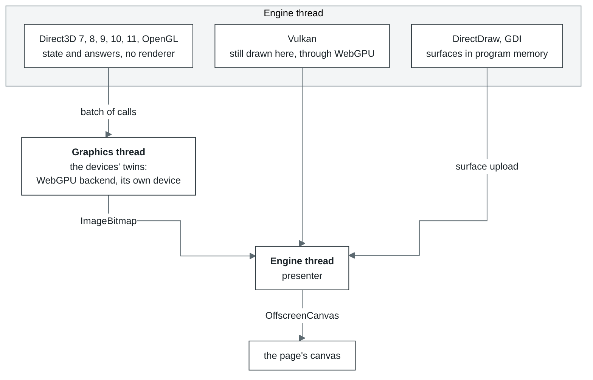

# Graphics

| Where | What it does |
| --- | --- |
| Page | Hands the `<canvas>` to the engine once (`transferControlToOffscreen`) and fits it into the window, keeping its proportions (`ui/src/components/PlayScreen.jsx`) |
| Engine thread | Every graphics API the program uses. The Direct3D 7, 8, 9, 10 and 11 devices and the OpenGL contexts keep the state and answer the program, but draw nothing themselves. Vulkan still draws right here through the WebGPU backend. DirectDraw and GDI draw into software surfaces in the program's memory, which the presenter uploads. The presenter also puts the finished frame into the `OffscreenCanvas` |
| Graphics thread | The twins of the Direct3D 7, 8, 9, 10 and 11 devices and the OpenGL contexts play the same calls on the thread's own WebGPU device and return the frame as an `ImageBitmap` |
| OPFS | Not used. Pipeline and shader caches live in memory only |

- **How calls travel.** Each call is written into a binary batch as it is made (`remote/wire.js`),
  in place in the root's ring of calls in shared memory, where the graphics thread reads it
  (`remote/ring.js`); answers come back through a second ring. A batch is published at most once
  a millisecond while no call waits on it (a timer sends what the turns left behind, and a long
  turn sends its own), and at once when a call waits for an answer, which parks the program's
  thread, never the engine's. A batch that outgrows the room it was built in (half the 2 MiB
  ring at most) is copied in, one longer than a record goes in parts, and one that finds no room
  waits on the engine's side with everything after it. The graphics thread plays each batch where
  it lies and gives its room back at once, a batch a task of its event loop, so the GPU's answers
  run between two; the arguments of a waited call are copied first, as its answer may fill them
  later. Resource bytes ride in the same batch. For a Direct3D buffer that is what the program
  wrote between `Lock` and `Unlock`; for a texture, everything written up to the next call that
  may read it. Where the program's memory is shared, what a Direct3D 8 or 9 texture's or
  surface's unlock let the program write is lent rather than copied: the batch says where the
  bytes lie, and the graphics thread copies them out of guest memory when it plays the record
  (`remote/lending.js`). A buffer's bytes are copied. OpenGL reads the program's memory at the call
  itself, so whatever a call read goes ahead of it. The DirectDraw surfaces Direct3D 7 draws into
  cross by number and are described again when they change. A renderer on the engine thread reads
  the bytes at those same moments, so the picture comes out the same wherever Direct3D draws.
- **What the graphics thread keeps of the program's memory.** Each twin reads the bytes it was
  sent out of a mirror of guest memory in 64 KiB pages (`remote/replay.js` `createMirror`),
  which keeps a page only while memory the twin holds lies on it - a resource's storage it
  allocated, a DirectDraw surface Direct3D 7 described to it - or while a write reached it in the
  last two batches; every other page is let go between batches. A resource's bytes are read at a
  later batch than the one that sent them (a buffer unlocked at load and drawn from later, a target
  the program wrote, uploaded at its next draw); everything else is read with the call it came
  with. So what the mirror holds is the twin's live resources, not everything the program ever
  sent: a resource let go of, or a surface DirectDraw gave back, takes its pages with it. Every
  twin is made over the mirror the same way (`playedOverMirror`), and the memory report counts it
  as `heaps.mirror`.
- **Texels a device keeps.** Every device keeps the texels it holds past the call that made them
  in one texel store (`internal/texel-store.js`): a body handed over is readable at once, in
  place, and moves into the run's cache (Cellar) under the root's own names once the cache grants
  its room, asked for without waiting; idle there, it goes to the disk. A root drawn in the
  graphics worker is given its names there; one drawn on the process's own thread takes them from
  the cache layer (`owner('texels')`, numbered by the run's keeper, its room taken through that
  thread's reader as a body is put), let go of with the graphics layer. A process in a worker
  of its own is served names the same way, numbered by the keeper across its link, its roots in
  the graphics worker by a channel it sends the keeper's thread (`process/run-cache.js`
  `remoteCacheOwners`). A body under 4 KiB (the cache's unit of room), one refused room, and
  every body of a device the run serves no names (a layer built alone, with no cache) stay in
  plain memory under the same contract. A body the
  cache cannot give back is a `loss` and reads as zeros. An OpenGL level's texels are the
  device's once a draw uploads them. Until then the graphics thread hands them, and the blocks of
  a level kept as S3TC, about once a second to the store (`opengl/gpu.js` `spill`); nothing on
  the graphics thread holds them once they moved. A draw's upload of a level reads them where
  they wait (an S3TC level's blocks too, uploaded as blocks or decoded on their way up), and they
  wait on until the level is let go of; any other reader of the level (a write in place, a
  read-back) takes them back as they were, copied once out of the cache. An upload or a depth
  write that waits in its frame's order (a level written while the frame being recorded already
  samples it) hands its bytes to the store as they stood, and the replay reads them there: an
  OpenGL frame lets them go once it is replayed (`opengl/gpu.js` `keptForReplay`), a Direct3D 8
  or 9 frame with its arena (`d3d8/render.js` `releaseFrame`). An upload that goes to the queue
  at once keeps nothing of its own: a Direct3D 8 or 9 level is taken out tight from its rows,
  widened to the format the backend samples, or decoded from S3TC on a device without block
  compression in the renderer's rooms (`d3d8/render.js` `rooms`), scratches held in the run's
  cache and reused by the next level, so a texture written every frame grows them once; on a
  root drawn in the graphics worker they are held under the root's names there, or plain
  memory, kept the same way, on a root that lends guest memory (the program's thread may wait
  on the worker then, and the worker waits for a hold on the program's thread). Direct3D 10's
  converted formats, each volume slice in its place, are bytes of the call, gone when it
  returns. A
  DirectDraw blit works in rooms kept between blits - its copy of the source rectangle, it
  converted to the destination's format, a DXTn source's texels and the row it builds - each a
  scratch held in the run's cache (`ddraw/blit.js` `blitRooms`, `cache/scratch.js`): a program
  that blits its whole screen every frame grows them once. The WebGPU backend's copy of its
  uniform ring on this side (`webgpu/internal/bindings.js` `createUniformPool`), as large as
  the ring and zeroed when the ring is made, and the picture the presenter converts a surface
  in guest memory into on its way up (`webgpu/internal/presenter.js`) are scratches the same
  way, where the graphics layer made them; the run's presenter, which the run makes outside
  the layer, holds them under names of the run's own (`RunCache.scratch`), and the backend in
  the graphics worker under names the run hands it when the run starts (`remote/connect.js`
  `lendBackend`), plain memory until then. A picture sent to another thread as bytes - a
  process in a worker of its own (`host/process.worker.js` `sendFrames`), or the graphics
  worker's frames where the page cannot take a picture from it - is written into memory held in
  the run's cache, and the message carries the view of it, which the thread that shows it reads
  in place onto its device; its answer (`shown`) lets the hold go, and the cache takes the room
  back. One with no room there is not sent, and is a loss (`unsent` in the presenter's report). A Direct3D 8 or 9 frame's uniform arena, which its
  draws take their blocks from and its replay reads, is memory held in the run's cache
  (`d3d8/render.js` `createUniformArena`, `cache/scratch.js` `hold`), one hold a generation:
  outgrown mid-frame, it holds a larger one and lets the old go only at its next reset, after
  the frame that read it replayed, and all of them when the device goes. The glyphs GDI draws
  text with (`gdi/fonts.js`) are pages of the run's cache under `glyphs/`, each a face's request
  and a run of 32 codes: a record a code (its advance, its box, where its coverage starts) and
  the coverage of the glyphs drawn so far, a glyph drawn for the first time putting its page
  again with it added. Named by what they hold (a family a program added a face to is named by
  that face's bytes), they are shared by the run's processes; one the cache lets go of is drawn
  again as it is asked for, and where the cache has no room a page is plain memory, let go of
  all at once past 1 MiB. A glyph is read in place (`glyph(code, font, read, arg)`): TextOut,
  GetGlyphOutline, DirectWrite's system faces and D3DX's font read its coverage inside the
  read, and D3DX's font reads it again when it writes its page of the device. An OpenGL sized level's RGBA, which a read-back or a copy makes from its
  bytes on a device, is made again at each read and not kept; the processor's rasteriser keeps
  it, and an S3TC level's texels decoded from its blocks, while the level is unchanged, in memory
  held in the run's cache (`opengl/context-textures.js` `rgbaCache`, the context's `holds`) that
  it samples in place, let go of when the level is written or collected. A display list keeps an
  S3TC rectangle's blocks, not its texels, and its own copy of every byte array a call hands it.
  On the processor a level's own bytes - its RGBA texels, a sized level's data, its kept S3TC
  blocks - go to the texel store once no draw has sampled the level since the look before
  (about a second of swaps), through the same accessors as the device path's
  (`opengl/level-spill.js`, `opengl/processor-levels.js`), its held RGBA let go of with them;
  its first reader or writer takes them back. A game loads
  every texture of a level and draws a part of them: in the Doom 3 demo's first level, 1323 of
  2132 textures held 88.5 MB this way. Once uploaded, they are let go; a read of the level's
  image (`glGetTexImage`) by the context that draws copies it back from the device, once what
  the context recorded before it has run (`opengl/gpu.js` `readLevel`).
- **The Direct3D 8 and 9 command ring.** A program sets states, transforms and textures hundreds
  of times a frame and locks a buffer around every draw. Those setters and draws, a buffer's
  `Lock` and `Unlock`, and the getters of render states, transforms, texture stage states and
  the viewport (and Direct3D 9's sampler states) run in the guest: a setter or a draw writes a
  record into a ring in the device's block in guest memory, a getter reads the value its setter
  wrote there. A texture's `GetSurfaceLevel` and `GetLevelDesc` and a surface's `GetDesc` read
  the pointer and the description the host published once in the texture's and the surface's
  own blocks. The host makes the ring's calls, in order, through the device's own methods on
  its way into any method of its own (`graphics/seam/shadow.js`, `d3d8/commands.js`).
  With several executors the routine and the host may run on different cores, and a host that
  reorders stores (arm64) may show one core's stores to another out of order. So a routine
  lets the device's lock go with a locked instruction and publishes a record's length, its last
  word, with `xchg`: the engine makes both atomic there. The host reads each length with an
  atomic load before the record, and lets the lock go with an atomic swap. What the routine
  wrote before, the vertices the program wrote before the call included, is then there too.
- **Direct3D 10's command ring.** This version's setters and draws are `void`, so the guest's
  routines (`graphics/seam/d3d10-inguest.js`, written as `@guestCode`) carry every call they
  can with no state to check: the shaders, layouts, buffers, views, samplers and states bound,
  the viewports, scissors and targets, the four draws and the two clears go into the device's
  ring, and the host makes them on its way into any method of its own (`d3d10-ring.js`,
  `d3d10/commands.js`). What a resource maps lives in the program's memory: a map is the
  address, and an unmap reads the pages written since (`d3d10/render.js`, `GuestStorage`).
  The host's copy of every resource's bytes, which a copy, an update and a read-back work in,
  is held in the run's cache for the resource's life (`backingOf`, `cache/scratch.js` `hold`):
  zero when made, in a block of a power of two from 4 KiB, under the process's `scratch/<n>/`
  names on the program's thread (in a worker of its own too) and under the root's `resources/<n>/` names in the graphics
  worker; plain memory of its own length where the cache has no room (a resource past a
  segment of 16 MiB) or there is no cache. It is let go of when the backing is collected - a
  view, a share's other device or a read-back in flight outlives the program's last
  reference - and the root or the process going takes back what is still held. A
  dynamic buffer's map and unmap run in the guest too: NO_OVERWRITE hands out the storage the
  buffer is on, DISCARD moves it onto another storage the host has let go of (a buffer is given
  more, up to 32, when a DISCARD finds none), and the unmap is a record in the ring naming the
  storage, whose written pages the host takes in its turn (decision A74). Every other buffer
  has a block too, with no storage, for its whole updates: an `UpdateSubresource` of a buffer
  with no box, up to 4 KiB, is a record carrying the bytes, copied as the call is made.
- **Direct3D 11 over the same device.** Direct3D 10 put the pipeline on the device; 11 moved it
  to a context. Here one device serves both (`d3d10/device.js`): Direct3D 11's immediate context
  is the device's own pipeline under another interface (`d3d11/context.js`), so a call through
  either version is one call to the device, and every object answers both versions' interfaces.
  A deferred context keeps a pipeline of its own and records its calls; the command list it
  finishes is played on the device from a cleared pipeline. The seam's Direct3D 11 half
  (`seam/d3d11.js`) adds its descriptors to the Direct3D 10 seam's lists for the same objects.
  The immediate context's per-draw calls go into the device's command ring as 10's do: a call
  that means what 10's does is 10's routine and record, and where 11's arguments differ (class
  instances, viewports of floats, a map through the context) a routine of the context's writes
  the record. Compute shaders run as WebGPU compute passes among the draws; a buffer a shader
  may write takes the program's bytes, copies and read backs in their turn among them.
- **A device's GPU memory.** The backend is the module's and serves every device; a Direct3D 8
  or 9 device's renderer makes its surfaces and buffers through a view of it of its own
  (`webgpu/internal/scope.js`). A texture or buffer the program releases goes at the first
  present that finds it bound nowhere; when the program lets go of the device itself, no present
  comes, so whatever its renderer still holds (back buffers, depth, the last frame's releases,
  its rings) goes back then, once what it queued is submitted. A program that makes a device for
  each scene and drops it holds one device's memory, not one per scene.
- **Dynamic buffers.** A program may write a dynamic buffer through the pointer a lock gave it,
  after the `Unlock`, and draw from it with no lock between, so a draw sends what changed in the
  range it reads since the buffer was last sent. Only the part of the range on pages written
  since the last comparison is compared. A store into a watched page marks it by the same
  page-flag test that finds translated code: the first store after the page is armed makes one
  compare-and-swap. The host's writes and a worker's
  writes in place mark it too. The cpu layer's write watch (`cpu/internal/write-clock.js`) gives
  each buffer its own view of the marks, since one look arms a page again for everyone, and takes
  a page armed while another executor was running guest code as written until that run has ended:
  a store tested before the arming may land after it unmarked. Any buffer an unlock has sent
  whole, dynamic or not, is watched the same way from then on, and its next unlock sends only the
  pages written since. A loop that streams stores into watched pages marks the pages its next
  turns may reach once, before them, and runs its stores untested.
- **A DISCARD in the guest.** A `DISCARD` of a dynamic buffer while the ring still holds draws
  the host has not made would write over what those draws read. Rather than leave it to the host,
  which would make the draws first, the first such `DISCARD` of a buffer gives it another storage
  of its length (`d3d8/storages.js`, two at most). From then on the guest's `Lock` moves the buffer onto
  a free one, writes the move into the ring (`Buffer.Rename`) and goes on writing there; the host
  makes the move in order with the draws, so each draw reads the storage it was made with, and
  frees the storage left. What the buffer held outside the range locked comes along, copied by
  the guest from the storage left: the host's DISCARD keeps the storage, and a program may draw
  what it wrote before a DISCARD past the range it locked (decision A52). Each storage is sent
  whole once, then by the pages written since. A draw
  from a dynamic buffer reads its indices, as its vertices, out of guest memory at the draw. No
  move while a lock taken in place (with no draw in the ring) waits for the host to replay it
  before the ring's next run, nor for a lock the host would refuse. A dynamic buffer held locked
  under NOOVERWRITE is not replayed at the host's entries: its draws read it. The buffer's one
  copy on the GPU holds the storage left after a move, so the pages of the storage moved onto
  count stale: a draw uploads what it reaches of them, an unlock only what was written.
- **Who waits for whom.** `Present` waits for the graphics thread only when it is more than two frames
  behind. It does wait for the display, as a driver does: under every presentation interval but
  `IMMEDIATE` (windowed Direct3D 8 only under `COPY_VSYNC`) the calling thread stops until the next
  blank of the guest's raster, or as many blanks on as the interval says, at the rate of the mode
  the device asked for when the display lists it and 60 Hz otherwise; how often the page shows a
  frame does not pace the program. OpenGL's `SwapBuffers` waits the same way, as many blanks on as
  `wglSwapIntervalEXT` set (one unless set, none for zero), once three frames wait to be shown. Only the calls whose result only the renderer knows wait for
  an answer. For Direct3D 8/9 those are `GetData` on a query other than an event or occlusion
  query, `GetRenderTargetData`, `GetFrontBuffer(Data)`, plus `LockRect` and `GetDC` on a render
  target, and `CopyRects` out of one something has drawn into since it was last read back. And
  what waits is the program's thread, not the engine's: the bridge parks it in the scheduler,
  and the program's other threads keep running. An event query answers on the program's side.
  An occlusion query's count is asked of the renderer once its end is issued, and the program's
  polls are answered `S_FALSE`, as a driver answers them, until the count comes back; each answer
  brings every other count the renderer already holds, each marked with the `Issue(END)` it
  belongs to.
- **Shaders.** Direct3D 8/9 shader bytecode is parsed and translated to WGSL
  (`graphics/d3d9/shader.js`, `wgsl.js`), as is Direct3D 10 and 11's shader model 4 and 5
  (`graphics/d3d10/wgsl.js`), whose doubles WGSL lacks: they are IEEE binary64 worked out in
  integers (`wgsl-doubles.js`). For the fixed-function pipeline, WGSL is generated
  (`webgpu/internal/fixedfunction.js`). OpenGL's GLSL 1.10 to 4.60 is compiled on the engine thread
  (`graphics/opengl/glsl-*.js`: preprocessor, parser, checker, linker) and written as WGSL where it
  is drawn (`glsl-wgsl.js`), with GL's built-in state packed into the program's uniform block; ARB
  assembly programs go through `arb-wgsl.js`.
- **Textures** of up to eight bits a channel go to the GPU as `bgra8unorm`, those of sixteen and
  thirty-two bits a channel as half floats (`rgba16float`, `rg16float`, `r16float`), the formats
  every WebGPU device filters and blends; DXT-compressed ones are decoded on the CPU by
  default (`graphics.compressedTextures` in [`core/configuration.md`](../core/configuration.md#graphics)),
  through the one S3TC codec D3DX reads and writes them with too (media's `internal/s3tc.js`).
  In Direct3D 10 and 11 a DXT volume stays compressed only where the GPU has
  `texture-compression-bc-sliced-3d`, and a 16-bit normalised texture is kept in 32-bit floats
  where those filter: a browser samples its 16-bit normalised formats unfiltered alone. A
  format of three 32-bit channels (`R32G32B32_FLOAT`, `_UINT`, `_SINT`), which WebGPU has no
  texture of, is kept in four, the fourth what sampling one answers. A stage that reads more
  textures than the GPU binds to one (16 at least, Direct3D 128) is not drawn, and says so.
- **Windows on surfaces of their own.** Inside a process the screen is composed as Windows 7's
  desktop window manager composes it (`graphics/gdi/screen.js`): each top-level window draws on a
  surface of its own, unclipped by the other top-level windows, and the screen is the desktop's
  background with the shown windows copied over it, bottom to top. A window moved, raised, hidden
  or closed paints nothing; the screen is composed again. A full-screen picture a GPU drew (an
  OpenGL context, a Direct3D device) has no bytes for the desktop to be composed onto, so the
  windows over it - the message box a program ends with - are laid over each of its frames by the
  presenter from the desktop the process composed (`overlay`), until they go. A windowed device's
  window - a DXGI swap chain's, or the window a Direct3D 8 or 9 present was last shown in - shows
  the device's last frame, not its own surface, which GDI never drew it into: with nothing over
  it, the frame as it is; while it has the screen (full screen, or a window as large as it), the
  frame with the windows over it laid over it (`swapChainShows`); one smaller than the screen with
  a window over it shows the desktop, its own surface under that window. A full-screen
  device whose window is hidden holds nothing: the desktop is the screen, and a box shown before
  that window first appears is seen. Whether a
  Direct3D 8 or 9 present is shown depends on the window it goes into, decided at each present
  (`graphics/seam/present-window.js`): Present's override, else the swap chain's own window
  (the device's for its own chain). A shown window shows the picture and a hidden one shows
  nothing, as under the desktop window manager, so a device made on a hidden helper window
  shows its frames through a chain into the program's visible window. A full-screen device
  owns the screen.
- **Several processes, one screen.** Each process's user32 tells the run's window manager
  (`win32/user32/manager.js`, on the engine thread beside the window directory) what every window
  of its is (class, title, style, rectangle, visibility), and the manager holds the z-order of
  the run's top-level windows, the one keyboard focus (a window taking it brings its top-level
  window up and takes it from every other, whichever process each is) and the window that
  captured the mouse, for every process alike. Every frame says which process drew it; the presenter keeps each process's
  newest picture and, while windows of more than one process show, composes the screen from them
  by the manager's order, bottom to top (`webgpu/internal/compose.js`). The page's input goes
  where the manager says: a pointer to the process of the window holding the mouse or under it,
  the keyboard to the process of the window with the focus (`inputTarget`); with no such window,
  to no program. One process or four, on one thread or
  in workers, it is the same manager.
- **When something breaks.** If the graphics thread does not open, Direct3D and OpenGL draw on the
  engine thread and a warning goes to the console. A lost WebGPU device is not recovered
  ([`core/limits.md`](../core/limits/graphics.md)).

Where to look in the code: [`core/src/layers/graphics/`](../../modules/core/src/layers/graphics/) (`d3d7`, `d3d8`, `d3d9`, `d3d10`, `ddraw`,
`gdi`, `opengl`, `glu`, `vulkan`, `webgpu`, and `seam`: the interfaces and exports the program
calls, the routines that run in the guest, the command ring and the raster); the graphics thread
is `graphics/remote/` and [`core/src/host/graphics.worker.js`](../../modules/core/src/host/graphics.worker.js).
