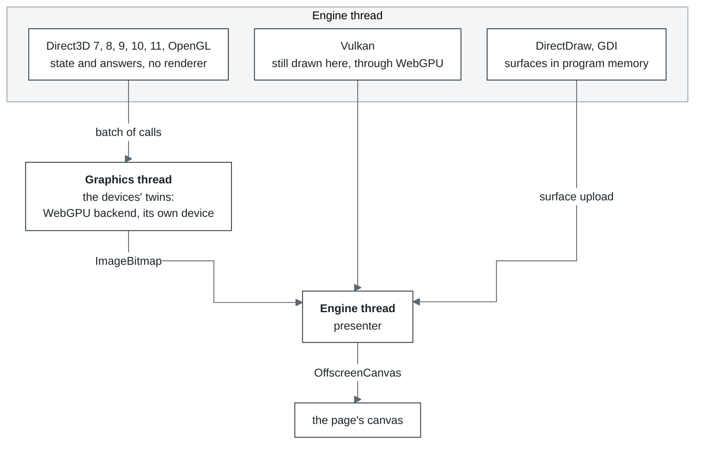

# Graphics

| Where | What it does |
| --- | --- |
| Page | Hands the `<canvas>` to the engine once (`transferControlToOffscreen`) and fits it into the window, keeping its proportions (`ui/src/components/PlayScreen.jsx`) |
| Engine thread | Every graphics API the program uses. The Direct3D 7, 8, 9, 10 and 11 devices and the OpenGL contexts keep the state and answer the program, but draw nothing themselves. Vulkan still draws right here through the WebGPU backend. DirectDraw and GDI draw into software surfaces in the program's memory, which the presenter uploads. The presenter also puts the finished frame into the `OffscreenCanvas` |
| Graphics thread | The twins of the Direct3D 7, 8, 9, 10 and 11 devices and the OpenGL contexts play the same calls on the thread's own WebGPU device and return the frame as an `ImageBitmap` |
| OPFS | Not used. Pipeline and shader caches live in memory only |

- **How calls travel.** Each call is written into a binary batch as it is made (`remote/wire.js`).
  A batch goes at most once a millisecond while no call waits on it (a timer sends what the
  turns left behind, and a long turn sends its own), and at once when a call waits for an
  answer. Resource bytes ride in the same batch. For a Direct3D buffer that is what the program
  wrote between `Lock` and `Unlock`; for a texture, everything written up to the next call that
  may read it. Where the program's memory is shared, what a Direct3D 8 or 9 texture's or
  surface's unlock let the program write is lent rather than copied: the batch says where the
  bytes lie, and the graphics thread copies them out of guest memory when it plays the record
  (`remote/lending.js`). A buffer's bytes are copied. OpenGL reads the program's memory at the call
  itself, so whatever a call read goes ahead of it. The DirectDraw surfaces Direct3D 7 draws into
  cross by number and are described again when they change. A renderer on the engine thread reads
  the bytes at those same moments, so the picture comes out the same wherever Direct3D draws.
- **The Direct3D 8 and 9 command ring.** A program sets states, transforms and textures hundreds
  of times a frame and locks a buffer around every draw. Those setters and draws, a buffer's
  `Lock` and `Unlock`, and the getters of render states, transforms, texture stage states and
  the viewport (and Direct3D 9's sampler states) run in the guest: a setter or a draw writes a
  record into a ring in the device's block in guest memory, a getter reads the value its setter
  wrote there. The host makes the ring's calls, in order, through the device's own methods on
  its way into any method of its own (`graphics/seam/shadow.js`, `d3d8/commands.js`).
  With several executors the routine and the host may run on different cores, and a host that
  reorders stores (arm64) may show one core's stores to another out of order. So a routine
  lets the device's lock go with a locked instruction and publishes a record's length, its last
  word, with `xchg`: the engine makes both atomic there. The host reads each length with an
  atomic load before the record, and lets the lock go with an atomic swap. What the routine
  wrote before, the vertices the program wrote before the call included, is then there too.
- **Direct3D 10's command ring.** This version's setters and draws are `void`, so the guest's
  routines (`graphics/seam/d3d10-inguest.js`, written as `@guestCode`) carry every call they
  can with no state to check: the shaders, layouts, buffers, views, samplers and states bound,
  the viewports, scissors and targets, the four draws and the two clears go into the device's
  ring, and the host makes them on its way into any method of its own (`d3d10-ring.js`,
  `d3d10/commands.js`). What a resource maps lives in the program's memory: a map is the
  address, and an unmap reads the pages written since (`d3d10/render.js`, `GuestStorage`). A
  dynamic buffer's map and unmap run in the guest too: NO_OVERWRITE hands out the storage the
  buffer is on, DISCARD moves it onto another storage the host has let go of (a buffer is given
  more, up to 32, when a DISCARD finds none), and the unmap is a record in the ring naming the
  storage, whose written pages the host takes in its turn (decision A74).
- **Direct3D 11 over the same device.** Direct3D 10 put the pipeline on the device; 11 moved it
  to a context. Here one device serves both (`d3d10/device.js`): Direct3D 11's immediate context
  is the device's own pipeline under another interface (`d3d11/context.js`), so a call through
  either version is one call to the device, and every object answers both versions' interfaces.
  A deferred context keeps a pipeline of its own and records its calls; the command list it
  finishes is played on the device from a cleared pipeline. The seam's Direct3D 11 half
  (`seam/d3d11.js`) adds its descriptors to the Direct3D 10 seam's lists for the same objects.
  The immediate context's per-draw calls go into the device's command ring as 10's do: a call
  that means what 10's does is 10's routine and record, and where 11's arguments differ (class
  instances, viewports of floats, a map through the context) a routine of the context's writes
  the record. Compute shaders run as WebGPU compute passes among the draws; a buffer a shader
  may write takes the program's bytes, copies and read backs in their turn among them.
- **Dynamic buffers.** A program may write a dynamic buffer through the pointer a lock gave it,
  after the `Unlock`, and draw from it with no lock between, so a draw sends what changed in the
  range it reads since the buffer was last sent. Only the part of the range on pages written
  since the last comparison is compared. A store into a watched page marks it by the same
  page-flag test that finds translated code: the first store after the page is armed makes one
  compare-and-swap. The host's writes and a worker's
  writes in place mark it too. The cpu layer's write watch (`cpu/internal/write-clock.js`) gives
  each buffer its own view of the marks, since one look arms a page again for everyone, and takes
  a page armed while another executor was running guest code as written until that run has ended:
  a store tested before the arming may land after it unmarked. Any buffer an unlock has sent
  whole, dynamic or not, is watched the same way from then on, and its next unlock sends only the
  pages written since. A loop that streams stores into watched pages marks the pages its next
  turns may reach once, before them, and runs its stores untested.
- **A DISCARD in the guest.** A `DISCARD` of a dynamic buffer while the ring still holds draws
  the host has not made would write over what those draws read. Rather than leave it to the host,
  which would make the draws first, the first such `DISCARD` of a buffer gives it another storage
  of its length (`d3d8/storages.js`, two at most). From then on the guest's `Lock` moves the buffer onto
  a free one, writes the move into the ring (`Buffer.Rename`) and goes on writing there; the host
  makes the move in order with the draws, so each draw reads the storage it was made with, and
  frees the storage left. What the buffer held outside the range locked comes along, copied by
  the guest from the storage left: the host's DISCARD keeps the storage, and a program may draw
  what it wrote before a DISCARD past the range it locked (decision A52). Each storage is sent
  whole once, then by the pages written since. A draw
  from a dynamic buffer reads its indices, as its vertices, out of guest memory at the draw. No
  move while a lock taken in place (with no draw in the ring) waits for the host to replay it
  before the ring's next run, nor for a lock the host would refuse. A dynamic buffer held locked
  under NOOVERWRITE is not replayed at the host's entries: its draws read it. The buffer's one
  copy on the GPU holds the storage left after a move, so the pages of the storage moved onto
  count stale: a draw uploads what it reaches of them, an unlock only what was written.
- **Who waits for whom.** `Present` waits for the graphics thread only when it is more than two frames
  behind. It does wait for the display, as a driver does: under every presentation interval but
  `IMMEDIATE` (windowed Direct3D 8 only under `COPY_VSYNC`) the calling thread stops until the next
  blank of the guest's raster, or as many blanks on as the interval says, at the rate of the mode
  the device asked for when the display lists it and 60 Hz otherwise; how often the page shows a
  frame does not pace the program. Only the calls whose result only the renderer knows wait for
  an answer. For Direct3D 8/9 those are `GetData` on a query other than an event or occlusion
  query, `GetRenderTargetData`, `GetFrontBuffer(Data)`, plus `LockRect` and `GetDC` on a render
  target, and `CopyRects` out of one something has drawn into since it was last read back. And
  what waits is the program's thread, not the engine's: the bridge parks it in the scheduler,
  and the program's other threads keep running. An event query answers on the program's side.
  An occlusion query's count is asked of the renderer once its end is issued, and the program's
  polls are answered `S_FALSE`, as a driver answers them, until the count comes back; each answer
  brings every other count the renderer already holds, each marked with the `Issue(END)` it
  belongs to.
- **Shaders.** Direct3D 8/9 shader bytecode is parsed and translated to WGSL
  (`graphics/d3d9/shader.js`, `wgsl.js`). For the fixed-function pipeline, WGSL is generated
  (`webgpu/internal/fixedfunction.js`). OpenGL's GLSL 1.10 to 4.60 is compiled on the engine thread
  (`graphics/opengl/glsl-*.js`: preprocessor, parser, checker, linker) and written as WGSL where it
  is drawn (`glsl-wgsl.js`), with GL's built-in state packed into the program's uniform block; ARB
  assembly programs go through `arb-wgsl.js`.
- **Textures** of up to eight bits a channel go to the GPU as `bgra8unorm`, those of sixteen and
  thirty-two bits a channel as half floats (`rgba16float`, `rg16float`, `r16float`), the formats
  every WebGPU device filters and blends; DXT-compressed ones are decoded on the CPU by
  default (`graphics.compressedTextures` in [`core/configuration.md`](../core/configuration.md#graphics)).
- **Windows on surfaces of their own.** Inside a process the screen is composed as Windows 7's
  desktop window manager composes it (`graphics/gdi/screen.js`): each top-level window draws on a
  surface of its own, unclipped by the other top-level windows, and the screen is the desktop's
  background with the shown windows copied over it, bottom to top. A window moved, raised, hidden
  or closed paints nothing; the screen is composed again.
- **Several processes, one screen.** Each process's user32 tells the run's window manager
  (`win32/user32/manager.js`, on the engine thread beside the window directory) what every window
  of its is (class, title, style, rectangle, visibility), and the manager holds the z-order of
  the run's top-level windows, the one keyboard focus (a window taking it brings its top-level
  window up and takes it from every other, whichever process each is) and the window that
  captured the mouse, for every process alike. Every frame says which process drew it; the presenter keeps each process's
  newest picture and, while windows of more than one process show, composes the screen from them
  by the manager's order, bottom to top (`webgpu/internal/compose.js`). The page's input goes
  where the manager says: a pointer to the process of the window holding the mouse or under it,
  the keyboard to the process of the window with the focus (`inputTarget`); with no such window,
  to no program. One process or four, on one thread or
  in workers, it is the same manager.
- **When something breaks.** If the graphics thread does not open, Direct3D and OpenGL draw on the
  engine thread and a warning goes to the console. A lost WebGPU device is not recovered
  ([`core/limits.md`](../core/limits/graphics.md)).

Where to look in the code: [`core/src/layers/graphics/`](../../modules/core/src/layers/graphics/) (`d3d7`, `d3d8`, `d3d9`, `d3d10`, `ddraw`,
`gdi`, `opengl`, `glu`, `vulkan`, `webgpu`, and `seam`: the interfaces and exports the program
calls, the routines that run in the guest, the command ring and the raster); the graphics thread
is `graphics/remote/` and [`core/src/host/graphics.worker.js`](../../modules/core/src/host/graphics.worker.js).
