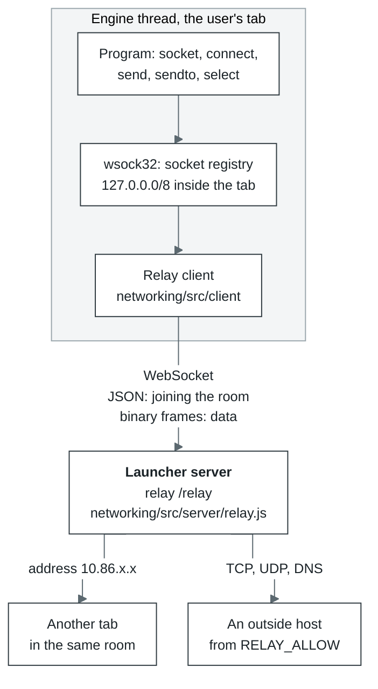

# Networking

| Where | What it does |
| --- | --- |
| Page | Passes `createApp` the client module (`/networking/client/index.js`), the relay's address (`ws://` or `wss://` on the same host, path `/relay`) and the room, which is the bundle's id |
| Engine thread | `wsock32`, `ws2_32` and `mswsock`: the socket registry, the `127.0.0.0/8` loopback inside the tab, and the relay client. The WebSocket opens in the worker |
| Launcher server | The `/relay` relay runs in the same process and on the same port as HTTP |
| OPFS | Not used |

A browser does not let a tab open TCP or UDP, only WebSocket. So the program's sockets go through
the relay: it connects tabs in the same room and, when allowed, opens real connections to the outside
itself. The relay and the client as a library of their own are described in
[the networking README](../../modules/networking/README.md).

- **A room** is a small network of its own: tabs with the same bundle see each other as if on one
  LAN. Each tab gets the lowest free address in `10.86.0.0/16`, and a room holds up to 32 peers.
  Broadcasts reach only the peers in the room listening on that UDP port.
- **The outside is closed by default.** Unconfigured, the relay is a LAN, not an open proxy. Which
  hosts are allowed is set when the relay starts: `--allow` for the relay run on its own
  ([the networking README](../networking/README.md#run-a-relay)), the comma-separated
  `RELAY_ALLOW` for the launcher's; `*` alone allows every host. The relay resolves host names
  itself and remembers them, so the policy judges the name, not just the address. With an empty
  list, DNS answers nothing at all.
- **Frames.** Joining a room is JSON: `hello`, answered by `welcome` with the address and the list of
  peers. Data travels in binary frames: a 20-byte header and up to 64 KiB of payload. One `send()` is
  one frame, so UDP datagram boundaries are kept. A TCP `send()` over 64 KiB, however, is not yet split
  into frames and fails.

| Offset | Type | Field |
| --- | --- | --- |
| 0 | u8 | op: `DIAL`, `OPENED`, `STREAM`, `HANGUP`, `DATAGRAM`, `LISTEN`, `UNLISTEN`, `ACCEPTED`, `RESOLVE`, `RESOLVED` |
| 1 | u8 | flags: `REJECT`, `HALF`, `STREAM` |
| 2 | u16 | reserved |
| 4 | u32 | tag: the TCP stream or DNS query number |
| 8 | u32 | sender IP |
| 12 | u32 | receiver IP |
| 16 | u16 | sender port |
| 18 | u16 | receiver port |

TCP goes like this: `DIAL`, answered by `OPENED` (or `HANGUP` with `REJECT`), then data in `STREAM`.
`shutdown(SD_SEND)` is `HANGUP` with the `HALF` flag. All fields are little-endian.

Where to look in the code: [`core/src/layers/win32/wsock32/`](../../modules/core/src/layers/win32/wsock32/) (sockets and transport),
[`networking/src/`](../../modules/networking/src/) (the client, `protocol.js`, the server); the wiring is in `ui/server.mjs` and
`ui/src/engine/session.js`.
