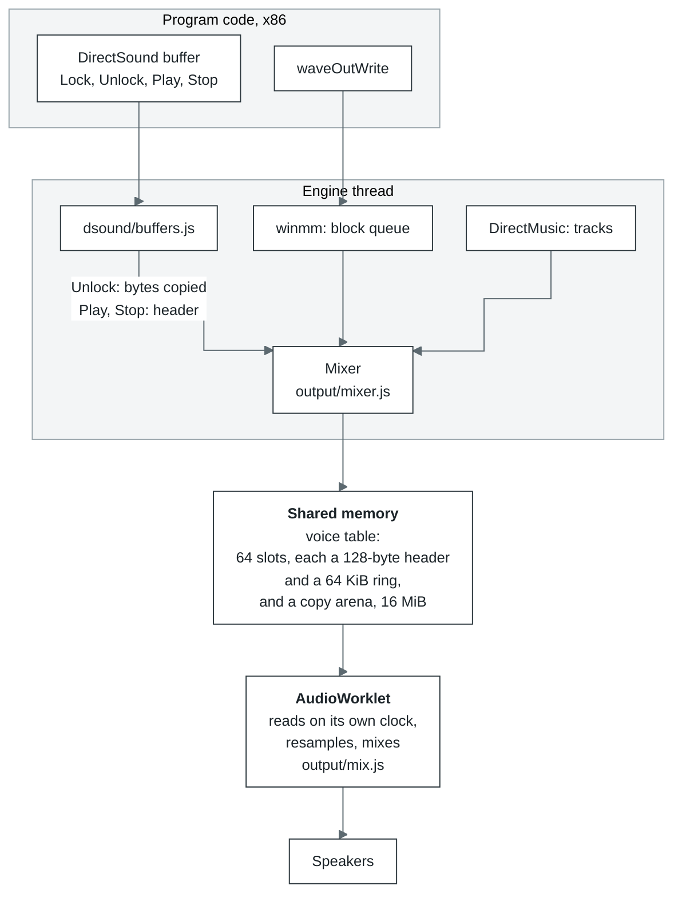

# Sound

| Where | What it does |
| --- | --- |
| Page | Before the start, creates the `AudioContext` and loads `worklet.js`; after the start, creates the `AudioWorkletNode` over the voice table the engine returned |
| Engine thread | DirectSound, waveOut, DirectMusic and MP3 for Miles. Every time before it yields to the browser, it writes into shared memory what the program has written since, carries over volume and pan, and sends notifications |
| AudioWorklet | Reads the 64 voice slots on its own clock, resamples linearly, applies volume and pan, and mixes it all |
| OPFS | Not used |

A DirectSound buffer behaves like a voice on a sound card: a copy of its data lives in shared memory,
and the AudioWorklet reads it from there by itself, like DMA. So the sound does not break up even
while the engine is busy loading or translating code, as long as the program's buffer holds enough
sound.

- **A voice** is a slot in the table: a header of 32 words (`RATE`, `CHANNELS`, `BITS`, `GAIN`, the
  left and right cut, `POSITION`, `LOOPING`, `PLAYING`, `LAPS` and others) plus a copy of the buffer
  in the arena. When the engine first sees a buffer playing, it copies it whole; after that, only
  what the program changed between `Lock` and `Unlock`. `Play` writes the position, `LOOPING` and
  `PLAYING`; `Stop` writes `PLAYING = 0`.
- **The play cursor** shows how far the AudioWorklet has read (`POSITION` and `LAPS`), and the write
  cursor runs 30 ms ahead. So `GetCurrentPosition` and position notifications match what is actually
  heard.
- **A streaming buffer** is one the program keeps writing as it plays, the way the Miles and FMOD
  mixers do. A voice does not play past what has been written: if the program is late, silence plays,
  not the previous lap again. If the wait lasts longer than max(250 ms, one lap of the buffer), the
  voice stops waiting and goes on round.
- **waveOut** is one track per device. `waveOutWrite` copies the block at once, and `WOM_DONE`
  arrives when the AudioWorklet has finished reading it.
- **MP3 for Miles.** In place of the program's own `Mp3dec.asi`, our provider runs, attached through
  `mss32.dll`'s `RIB` entry points. Decoding is minimp3 built to wasm (`audio/asi/`). There is also an
  MP3 codec for ACM.
- **Limits.** With no free slot, or no room for its copy in the arena, a buffer plays through a
  queue track, and its cursor follows the clock instead. The rest (3D sound, capture) is in
  [`core/limits.md`](../core/limits/README.md#sound).
- **Without cross-origin isolation** (the COOP/COEP headers, which `ui/server.mjs` sets unless
  `ISOLATION=off`) there is no `SharedArrayBuffer`. The engine then mixes into a ring of its own,
  and `output/feed.js` posts the mix to the worklet over a `MessageChannel` the page made, in
  chunks no more than 160 ms ahead of what the worklet has played; the worklet reports how far it
  got every four blocks, and that report is what the ring counts as consumed. A DirectSound
  buffer's cursor follows the clock here.

Where to look in the code: [`core/src/layers/audio/`](../../modules/core/src/layers/audio/): `output/mixer.js`, `output/mix.js`,
`output/worklet.js`, `dsound/buffers.js`, `asi/provider.js`; waveOut is
[`core/src/layers/win32/winmm/functions.js`](../../modules/core/src/layers/win32/winmm/functions.js).
