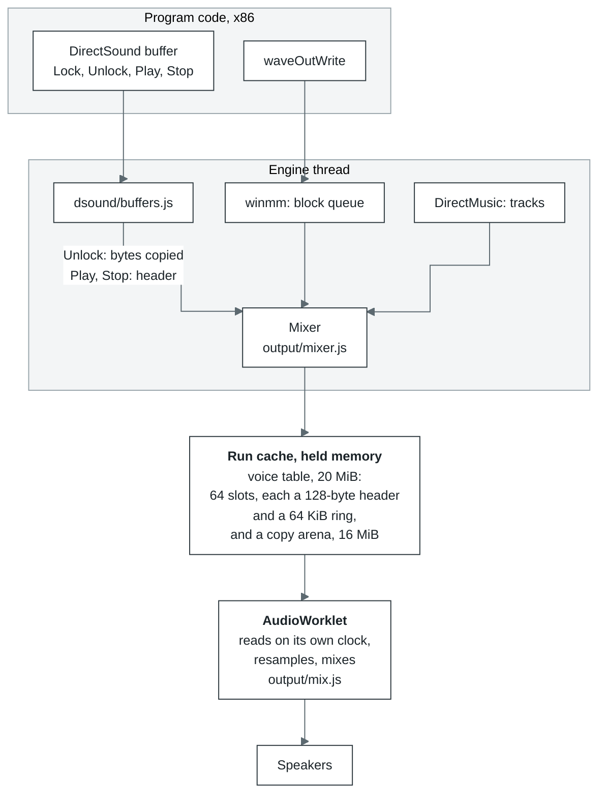

# Sound

| Where | What it does |
| --- | --- |
| Page | Before the start, creates the `AudioContext` and loads `worklet.js`; after the start, creates the `AudioWorkletNode` over the voice table the engine returned |
| Engine thread | DirectSound, waveOut, WASAPI's shared-mode streams (`IAudioClient`), DirectMusic and MP3 for Miles. Every time before it yields to the browser, it writes into shared memory what the program has written since, carries over volume and pan, and sends notifications |
| AudioWorklet | Reads the 64 voice slots on its own clock, resamples linearly, applies volume and pan, and mixes it all |
| OPFS | Not used |

A DirectSound buffer behaves like a voice on a sound card: a copy of its data lives in shared memory,
and the AudioWorklet reads it from there by itself, like DMA. So the sound does not break up even
while the engine is busy loading or translating code, as long as the program's buffer holds enough
sound. The voice is given at `Play` itself and starts where the cursor was put; opened at the next
pump, it was put where the cursor had run on to meanwhile, and a sound's first milliseconds were lost.

- **The table's memory** is the run's cache's (Cellar): 20 MiB held whole under `sound/output/<n>`
  for as long as the output stands (`hold`), counted in the cache's budget and its figures
  (`runCache().spaces`), never taken back, cooled or moved. The engine writes it and the AudioWorklet
  reads it in place; the page, a rebuilt machine and a process in a worker are handed the table
  (`{ table }`, a view of that memory). A process that runs beside another with an output of its own
  gives its table back as it goes. A machine with no cache around it (a layer built alone) makes a
  buffer of its own and says so (`divergence`).
- **A voice** is a slot in the table: a header of 32 words (`RATE`, `CHANNELS`, `BITS`, `GAIN`, the
  left and right cut, `POSITION`, `LOOPING`, `PLAYING`, `LAPS` and others) plus a copy of the buffer
  in the arena. When the engine first sees a buffer playing, it copies it whole; after that, only
  what the program changed between `Lock` and `Unlock`. `Play` writes the position, `LOOPING` and
  `PLAYING`; `Stop` writes `PLAYING = 0`.
- **The play cursor** shows how far the AudioWorklet has read (`POSITION` and `LAPS`), and the write
  cursor runs 30 ms ahead. So `GetCurrentPosition` and position notifications match what is actually
  heard.
- **A streaming buffer** is one the program keeps writing as it plays, the way the Miles and FMOD
  mixers do. A voice does not play past what has been written: if the program is late, silence plays,
  not the previous lap again. If the wait lasts longer than max(250 ms, one lap of the buffer), the
  voice stops waiting and goes on round.
- **Effects** (`SetFX`) are DMOs made through COM and run in place, in the guest, over a copy of
  what the program wrote: over a span when it is unlocked and over the whole buffer at Play. The
  voice and the mix then play that copy (`effectedWindow`), the program's samples left as they
  are. The standard effects are `dsound/effects.js`; they keep their parameters and change
  nothing yet (`roadmap/decisions.md` A264).
- **The audio adapter.** A queue track - waveOut's, WASAPI's - tells the program its sound was
  taken `DEVICE_LEAD_MS` (80 ms, `output/mix.js`) before the AudioWorklet plays it, as a sound
  card's FIFO takes it ahead of the speaker, never past what was written and not while the track
  is held, as a stream is before its Start (`playedBytes`). That much is always in the table already, so a turn of the engine's
  thread up to that long (a busy frame, 40 ms at worst under a virtual machine) does not reach the
  speaker, whatever queue the program keeps. `played()`, which films are timed by, stays what was
  heard.
- **waveOut** is one track per device. `waveOutWrite` copies the block at once, and `WOM_DONE`
  arrives when the adapter has taken it.
- **WASAPI** shared-mode streams hand what `ReleaseBuffer` released to their track at once; the
  padding is what the adapter has not taken yet. An event-driven stream's event is set when the
  program has a period's room, looked at twice a period by a timer the kernel's clock fires on the
  host, so its wakes follow the device and not the guest's clock.
- **MP3 for Miles.** In place of the program's own `Mp3dec.asi`, our provider runs, attached through
  `mss32.dll`'s `RIB` entry points. Decoding is minimp3 built to wasm (`audio/asi/`). There is also an
  MP3 codec for ACM.
- **Limits.** With no free slot, or no room for its copy in the arena, a buffer plays through a
  queue track, and its cursor follows the clock instead. The rest (3D sound, capture) is in
  [`core/limits.md`](../core/limits/README.md#sound).

Where to look in the code: [`core/src/layers/audio/`](../../modules/core/src/layers/audio/): `output/mixer.js`, `output/mix.js`,
`output/worklet.js`, `dsound/buffers.js`, `asi/provider.js`; waveOut is
[`core/src/layers/win32/winmm/functions.js`](../../modules/core/src/layers/win32/winmm/functions.js).
