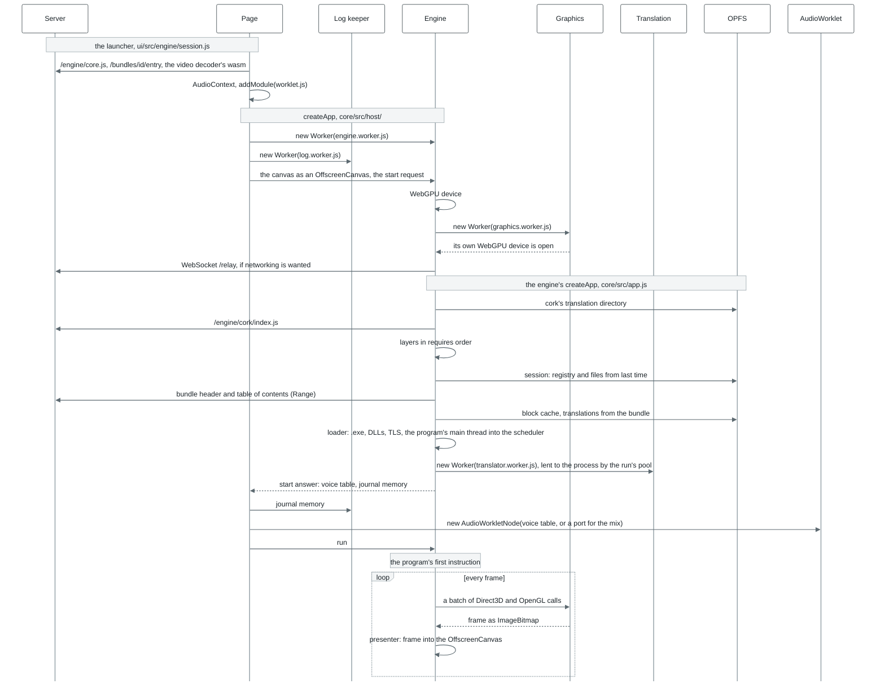

# Startup: from createApp to the first instruction

The order matters in three places.

- **The WebGPU device and the graphics thread open before the layers.** The engine's `createApp`
  receives the graphics thread in its device options (`device.worker`), so the `graphics` layer knows
  while it is being built where Direct3D and OpenGL will draw.
- **The session is applied before the program's first instruction,** so the program sees its saves
  and registry from the very start. A session in the origin's file system is read and laid on the
  volume a file at a time, and the volume's writable layer stands on the run's page file
  ([storage.md](storage.md)) where the engine's thread has one.
- **The program starts only on `run`,** once the page has attached the log, input and sound.
  Libraries' `DllMain` and TLS callbacks are the program's code too: a stub at the start of the main
  thread calls them, not the host. Every thread made later begins in a stub of its own that calls
  them with `DLL_THREAD_ATTACH` before its start routine, and with `DLL_THREAD_DETACH` when it
  ends, under the same loader lock (`kernel32/thread-calls.js`). The process's end and the last
  `FreeLibrary` tell each image's TLS callbacks `DLL_PROCESS_DETACH` before its `DllMain`
  (`kernel32/dllentry.js`).

With processes at once (`concurrency` 2 or 4), the engine thread builds the run's system instead:
it mounts the bundle, lays the session and the page's files on the volume, makes the registry and
opens the journal and the sound output (`buildSystemHost` in [`core/src/app.js`](../../modules/core/src/app.js)). The steps from
the layers to the program's first instruction run in the program's process thread.

Where to look in the code: `ui/src/engine/session.js` (what the launcher passes),
[`core/src/host/create.js`](../../modules/core/src/host/create.js) and `remote.js` (the page side), `serve.js` (the engine side),
[`core/src/app.js`](../../modules/core/src/app.js) (`createApp`, `buildApp`, the loader).
