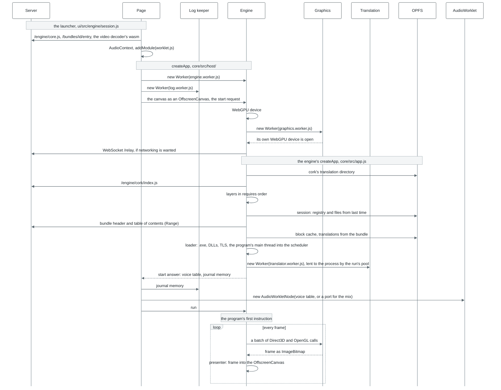

# Startup: from createApp to the first instruction

The order matters in three places.

- **The WebGPU device and the graphics thread open before the layers.** The engine's `createApp`
  receives the graphics thread in its device options (`device.worker`), so the `graphics` layer knows
  while it is being built where Direct3D and OpenGL will draw.
- **The session is applied before the program's first instruction,** so the program sees its saves
  and registry from the very start. A session in the origin's file system is laid under the
  volume's writable layer unread, each file read when the program reads it, and the writable layer
  stands on the run's page file
  ([storage.md](storage.md)) where the engine's thread has one.
- **The program starts only on `run`,** once the page has attached the log, input and sound.
  Libraries' `DllMain` and TLS callbacks are the program's code too: a stub at the start of the main
  thread calls them, not the host. Every thread made later begins in a stub of its own that calls
  them with `DLL_THREAD_ATTACH` before its start routine, and with `DLL_THREAD_DETACH` when it
  ends, under the same loader lock (`kernel32/thread-calls.js`). The process's end and the last
  `FreeLibrary` tell each image's TLS callbacks `DLL_PROCESS_DETACH` before its `DllMain`
  (`kernel32/dllentry.js`). A static import of a library found nowhere and carried by no Windows
  puts the loader's refusal in that stub's place: ExitProcess with STATUS_DLL_NOT_FOUND, nothing
  attached and nothing of the program run (`roadmap/decisions.md` A256).
- **What the loader leaves in a process appears with its first instruction.** The engine maps and
  binds every image before the process exists for anyone to see, but the program's import slots,
  the module list, the process heap and the service pack in the process block are put in place
  only before the first slice any of its threads gets (`kernel.beforeFirstSlice`), as Windows'
  loader initialises a process inside whichever thread starts first. A parent reading a child made
  `CREATE_SUSPENDED` sees the slots as the file has them and those fields empty, until the child's
  first thread, or a thread made in it from outside, runs. 32-bit only: a 64-bit process carries
  them from its creation. The libraries' own imports are bound at creation in both widths, where
  Windows binds them in the child too.
- **A session is a logon.** Its first process's stub first calls the engine's RunOnce pass
  (`programs/runonce.js`): each command under `HKLM` and then `HKCU`
  `Software\Microsoft\Windows\CurrentVersion\RunOnce`, by name, run by the system program it names
  (regsvr32 above all) on that thread and waited for, its value deleted first, or after it
  succeeds for a name starting with `!`. A regsvr32 command for a library of the other width is
  not run and its value is kept for a session of that width. A process the session starts later
  skips it. An install
  that registers no COM server itself leaves `regsvr32 /s` there (`roadmap/decisions.md` A261).

With processes at once (`concurrency` 2 or 4), the engine thread builds the run's system instead:
it mounts the bundle, lays the session and the page's files on the volume, makes the registry and
opens the journal and the sound output (`buildSystemHost` in [`core/src/app.js`](../../modules/core/src/app.js)). The steps from
the layers to the program's first instruction run in the program's process thread.

Where to look in the code: `ui/src/engine/session.js` (what the launcher passes),
[`core/src/host/create.js`](../../modules/core/src/host/create.js) and `remote.js` (the page side), `serve.js` (the engine side),
[`core/src/app.js`](../../modules/core/src/app.js) (`createApp`, `buildApp`), the process's modules in
[`core/src/process/`](../../modules/core/src/process/) (`module-table.js`: by name, path and base; `system-modules.js`: the engine's
libraries made modules; `library-loader.js`: imports resolved, libraries loaded and let go at run time;
`libraries.js`: the names a load is tried under, the directories searched, where a library is placed;
`system-host.js`: what a run's processes share, built once; `controller.js`: the object a process is
to whoever started it; `beside.js`: the processes a run starts beside its first, each in
a worker of its own or in this thread; `memories.js`: the guest memories of processes gone, kept for
the next (2 GiB of them in all: a browser counts each memory a thread holds against that thread's heap), and each process's part of the machine's memory; `sound.js`: the sound output each process plays into; `servers.js`: the
class servers COM starts beside a process; `sidecar.js`: a bundle's sidecar hooks bound;
`run-waits.js`: how it waits while it runs; `layer-config.js`: what each layer of a
process is configured with; `image-resources.js`: an image's resources read without running it;
`process-layout.js`: the layout's numbers; `bundle-mount.js`: a bundle mounted as the
volume; `session.js`: the session's layer, saved and opened again; `live-dump.js`: frames taken apart
while a program runs), and what `createApp` is given in [`core/src/app-options.js`](../../modules/core/src/app-options.js).
