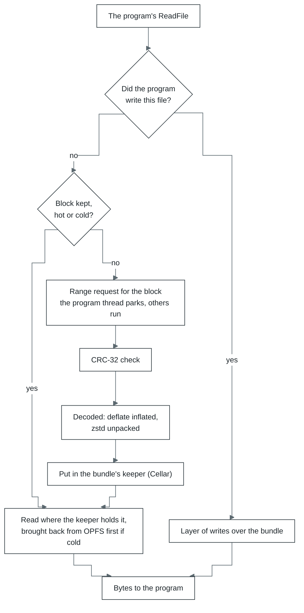

# Storage

OPFS is the browser's file system, and each origin (scheme, host, port) has its own. So the launcher
should always be opened at the same address: at another address there is another OPFS, with other
saves. The default is `http://127.0.0.1:5180`. With `TLS_DIR` the server listens for https on every
address: from another machine, without a secure context, there is neither OPFS nor
`SharedArrayBuffer`.

| Store | Where | What it holds | How it works |
| --- | --- | --- | --- |
| Block cache | OPFS: `blocks/<id>/` | bundle blocks already fetched from the server, decoded | A Cellar keeper of the bundle's own (`modules/core/vendor/cellar/`): each block is a body named by its index, as a read hands it out (a deflate block inflated, a zstd block unpacked, as it is fetched). Hot, it lies in the keeper's shared memory, 64 MiB at most a bundle, and a read copies it from there into what the program asked for; idle 30 s, or pushed out for room, it goes cold into the keeper's packs in the directory (`pack-<n>`, appended), and a read brings it back from there at once. Every two seconds at most, after a batch is fetched, and at the end of the run, what is hot and not on the disk yet is written out and then an index of what the disk holds (`index-a` and `index-b` in turn, the newer whole one read): the next run reads that index and finds the blocks there. An index never names bytes the packs were not flushed with, and an entry past its pack's end is skipped: a block lost so is fetched again, never handed out as another's. The order blocks were first asked for in (up to 4096) is a body of its own beside them. A write the browser refuses for lack of room (quota, a full disk) is said once (`storage-full`) and lets the other bottles' caches go, the oldest first (unless `bundle.evictOthers` is off, the launcher's Storage setting); the block it was for stays in memory while there is room and is fetched again after. Before a run starts, the caches of other bundles are removed, the oldest first, until the origin uses at most 80% of its quota (also only with `evictOthers`). A run's caches - its bottle's and its layers' - are never removed for one another. Another tab holding the bundle's files, or a thread with no synchronous handle, keeps the blocks in memory alone (`bundle-unbacked`), the least recently put let go for room. `<id>` is the bundle's id and its index's fingerprint (`<id>-<crc32>`); a layer a bottle stands on (`bundle.layers`) has a cache of its own under the layer's id, which every bottle on that layer shares. The files of the layouts before (`<id>.index`, `<id>.pack.<n>`, `<id>.order` at the root, and those before them) are deleted and their blocks fetched again |
| cork translations | OPFS: `cork/<id>.v3/` | translated regions, each keyed by its entry, the x87 stack top it was made for (any, for a region with no x87 in it) and the run's modes, and a version of other bytes at the same entry (code patched as it runs) beside it under its bytes' hash; the modules their code is in; and a map from every stored block to the region holding it, so a run that meets a block first in another order takes that region | `records` holds the records one after another, `index` a log of where each one is. A record lies in the file after a byte that says how: as it is, or compressed (raw deflate, five to six times smaller for translated code) where it is a kilobyte or more and that makes it smaller; it is compressed by the platform's `CompressionStream` as it is written and read back by the platform's inflate where the reader may wait, or by the engine's own (`record-frame.js`) where an executor reads it between two slices. The index is read once, a miss touches no disk, a hit is one read at an offset. New records are appended in batches; a record can also grow by pieces appended to it, read back whole. Nothing waits for the run's end: a run its page's going away ends keeps what it wrote. The map of blocks grows by the blocks each process formed, appended every few seconds, and is written whole again at a start where half of it is blocks met twice; the records a run read are marked used in the index within two seconds. A worker of the store's own writes them, where the browser lets two handles stand on one file, so the engine thread never waits for the disk. A region's record names the batch module its code is in, and the module lives as long as a region naming it. On opening, the last run's records stay whole; older ones stay while they fit under 512 MiB with them, the most recently used first, a region and its module together, and a record no run has used in the last two is dead. Each region's function marks its entry entered the first time it runs (a byte the process's executors share), and a region a run took from the store and never entered is dead at that run's end: ready before its code was met, nobody needed it. One a run made and did not enter stays a run, since the interpreter met its code while it was being translated and the next run, finding it ready, may enter it. The file is copied, live records only, when a quarter of it is dead and it is past 64 MiB, or when the index has grown past 4 MiB and four times the lines its live records need. A relinked module is stored too, and the regions it holds name it from then on: a later run takes them as they are and relinks only what it adds |
| Session | OPFS: `<id>.files/` | the files the program wrote, its registry, its hard links, its reparse points and its files' numbers and attributes | One entry per file, named by a hash of its path, which it holds inside; the registry is an entry of its own. A file with more than one name (`CreateHardLink`) is one entry under the path its bytes are kept at, and a `<links>` entry lists its other names; a reparse point (`FSCTL_SET_REPARSE_POINT`: a junction, a symbolic link, a tag of a program's own) is a record there too, its buffer in base64 and the place it names beside it, and a junction recorded before buffers were kept reads back as the mount point it is; a file's number on the volume (FileInternalInformation, an open by id), given the first time a program asks and kept across renames and under every name, is a record there too, saved as soon as it is given, so the file has the same number in the next run, and a file a session numbered nothing for is numbered anew when asked; the attributes a program set on a file (`SetFileAttributes`, a create's), which every name of the file shows, go in the same record, and a session saved before they were kept reads its files as never set; a record changed alone saves the `<links>` entry and not the file; a session with no links has no such entry, as before links existed. Laid under `C:`'s writable layer and over the bundle before the first instruction, nothing of it read: a file is read when the program reads it, a megabyte piece at a time, copied into the writable layer when the program writes it, and a deletion leaves a tombstone; a file on another drive, or one a hard link names, is applied whole. Restoring saves nothing back; 250 ms after the program stops writing, only the files it changed are written or removed, at a run's first save too (with the registry and any file the folder has no entry for) when the run read its session from the folder; a program that keeps writing is saved at most a tenth of the time, the next save waiting nine times as long as the last took. An older `<id>.session` (one deflate-raw stream) is read once and replaced. The bundle itself never changes |
| Page file | OPFS: `bottlify-runs/<name>/pages`, in the run's own folder | what the program wrote, past what memory keeps of it | The volume's writable layer keeps a file in pieces of 1 MiB (a small file's first piece from 4 KiB, doubling). At most 64 MiB of pieces stay in memory; past that the least recently used is written to the page file through one synchronous handle and let go of, and read back when the program reaches it. A piece takes an extent of its own length, and the extent of a piece let go of (a file deleted or cut) goes to the next piece of that length. A saved file is read back a piece at a time as the session's writer reaches it. The run's folder goes with the run; one a run left behind (a killed tab) is taken away by the next, unless a running run holds its lock. Where the engine's thread has no synchronous handle (the page's own thread, a browser without OPFS) everything stays in memory |
| Run cache disk | OPFS: `bottlify-runs/<name>/cache/`, in the run's own folder | bodies of the run's cache that are the only copy for the run: texels the GPU was given | The run's Cellar keeper writes such a body to its packs when it is idle 30 s or pushed out for room, and reads it back when a draw needs it; a body the cache can make again is never written there, and the saved index names nothing, so the next run reads nothing of it. The folder goes with the run, as the page file's |
| Settings | localStorage | the launcher's settings, time to first frame | |

How the program reads a file:

- **A bottle kept on this device is read as it is:** its file (`bundle.local`) is the only copy,
  so a block read from it is not checked against its CRC-32 nor read again on a mismatch - the
  same bytes would come back. Only a block fetched from a server is checked, and asked for again
  when it arrived damaged.
- **The block cache does not keep the bundle in memory:** a program can be larger than a gigabyte.
  What is hot is under the keeper's budget; the rest is on the disk, or fetched again.
- **Synchronous handles** (`createSyncAccessHandle`) exist only in a worker. In return, a read from
  OPFS waits for nothing, and `ReadFile` on a block already fetched answers at once.
- **The session** is read and written asynchronously (`getFile`, `createWritable`).
- **One writer:** every store above writes through one module, which says once how: a
  synchronous handle is taken in one place; a write the disk takes in part is a failure, as a
  refused one is (a translation record so written breaks the store for the run, a block stays
  in memory and is fetched again once pushed out, the page file stops writing out); an entry of the session is replaced
  through a stream, so a save cut short leaves the last one whole, and a stream refused for
  room is aborted, and the next save is written once there is room; a translation store's
  `current` cut short names no generation, and nothing is removed for it.
- **What the program writes is not held in memory whole:** an installer that unpacks a gigabyte
  holds the page file's 64 MiB of it, and its first write into a file the bundle carries copies
  that file into the writable layer a mebibyte at a time.

Where to look in the code: [`core/src/layers/filesystem/internal/bundle/cache.js`](../../modules/core/src/layers/filesystem/internal/bundle/cache.js) (blocks),
[`core/src/layers/filesystem/internal/opfs-disk.js`](../../modules/core/src/layers/filesystem/internal/opfs-disk.js) (the keeper's disk),
[`core/src/layers/filesystem/internal/bundle/saved.js`](../../modules/core/src/layers/filesystem/internal/bundle/saved.js) (what a page reads of it),
[`core/src/layers/filesystem/internal/page-file.js`](../../modules/core/src/layers/filesystem/internal/page-file.js) (the page file),
[`core/src/layers/filesystem/internal/run-folder.js`](../../modules/core/src/layers/filesystem/internal/run-folder.js) (the run's folder),
[`core/src/process/run-cache.js`](../../modules/core/src/process/run-cache.js) (the run cache),
[`core/src/layers/cpu/internal/translation-store.js`](../../modules/core/src/layers/cpu/internal/translation-store.js) (translations), [`core/src/storage.js`](../../modules/core/src/storage.js)
(sessions), [`core/src/system/opfs-file.js`](../../modules/core/src/system/opfs-file.js) (how every one of them writes).
