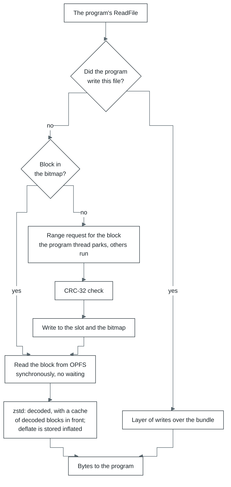

# Storage

OPFS is the browser's file system, and each origin (scheme, host, port) has its own. So the launcher
should always be opened at the same address: at another address there is another OPFS, with other
saves. The default is `http://127.0.0.1:5180`. With `TLS_DIR` the server listens for https on every
address: from another machine, without a secure context, there is neither OPFS nor
`SharedArrayBuffer`.

| Store | Where | What it holds | How it works |
| --- | --- | --- | --- |
| Block cache | OPFS: `<id>.pack.<n>`, `<id>.index`, `<id>.order` | bundle blocks already fetched from the server | Blocks are appended in the order they arrive to segments of 128 MiB each (`.pack.0`, `.pack.1`, ...), each block after a 16-byte header (a mark, the block's index, its length); `.index` holds each block's place, eight bytes a block (the segment's number times its span plus the offset in it), 0 for a block not here. A segment is as long as the blocks it holds, whichever of the bundle they are. A write the browser refuses for lack of room (quota, a full disk) removes one segment and is tried again: the running bottle's own written longest ago, of those not written in the last two hours, and where it has none, another bottle's, the oldest first (unless `bundle.evictOthers` is off, the launcher's Storage setting); a game larger than the room keeps its newest blocks, and the browser is not left to clear the whole origin, saves with it. A segment another tab holds open stays. A read checks the record's header before the bytes go to the program, so a table that names another block's record (another writer's, a write cut short) is a block fetched again. A block goes where its segment ends as the store has it at the write, so two caches of one bundle never put two blocks in one place. `.order` is the order blocks were first asked for in (up to 4096). The files of earlier layouts (`<id>.blocks` with `.present`, `.slots`, the segments `<id>.blocks.<k>` with `.held`, the one-file `<id>.pack`) are deleted and their blocks fetched again. A block the store refuses with nothing left to remove is held in the heap for the run, and `storage-full` says there is no room. Before a run starts, the caches of other bundles are removed, the oldest first, until the origin uses at most 80% of its quota (also only with `evictOthers`) |
| cork translations | OPFS: `cork/<id>.v3/` | translated regions, each keyed by its entry, the x87 stack top it was made for (any, for a region with no x87 in it) and the run's modes; the modules their code is in; and a map from every stored block to the region holding it, so a run that meets a block first in another order takes that region | `records` holds the records one after another, `index` a log of where each one is. The index is read once, a miss touches no disk, a hit is one read at an offset. New records are appended in batches. A worker of the store's own writes them, where the browser lets two handles stand on one file, so the engine thread never waits for the disk. A region's record names the batch module its code is in, and the module lives as long as a region naming it. On opening, the last run's records stay whole; older ones stay while they fit under 1 GiB with them, the most recently used first, a region and its module together, and a record no run has used in the last four is dead. The file is copied, live records only, when half of it is dead and it is past 64 MiB, or when the index has grown past 4 MiB and four times the lines its live records need. A relinked module is stored too, and the regions it holds name it from then on: a later run takes them as they are and relinks only what it adds |
| Session | OPFS: `<id>.files/` | the files the program wrote, its registry, and its hard links | One entry per file, named by a hash of its path, which it holds inside; the registry is an entry of its own. A file with more than one name (`CreateHardLink`) is one entry under the path its bytes are kept at, and a `<links>` entry lists its other names; a session with no links has no such entry, as before links existed. Applied before the first instruction; 250 ms after the program stops writing, only the files it changed are written or removed; a program that keeps writing is saved at most a tenth of the time, the next save waiting nine times as long as the last took. An older `<id>.session` (one deflate-raw stream) is read once and replaced. The bundle itself never changes |
| Settings | localStorage | the launcher's settings, time to first frame | |

How the program reads a file:

- **The block cache does not keep the bundle in memory:** a program can be larger than a gigabyte.
  If the bitmap's size does not match the bundle, the bitmap is reset and the blocks are fetched
  again.
- **Synchronous handles** (`createSyncAccessHandle`) exist only in a worker. In return, a read from
  OPFS waits for nothing, and `ReadFile` on a block already fetched answers at once.
- **The session** is read and written asynchronously (`getFile`, `createWritable`).

Where to look in the code: [`core/src/layers/filesystem/internal/bundle/cache.js`](../../modules/core/src/layers/filesystem/internal/bundle/cache.js) (blocks),
[`core/src/layers/filesystem/internal/opfs-store.js`](../../modules/core/src/layers/filesystem/internal/opfs-store.js) (handles),
[`core/src/layers/cpu/internal/translation-store.js`](../../modules/core/src/layers/cpu/internal/translation-store.js) (translations), [`core/src/storage.js`](../../modules/core/src/storage.js)
(sessions).
