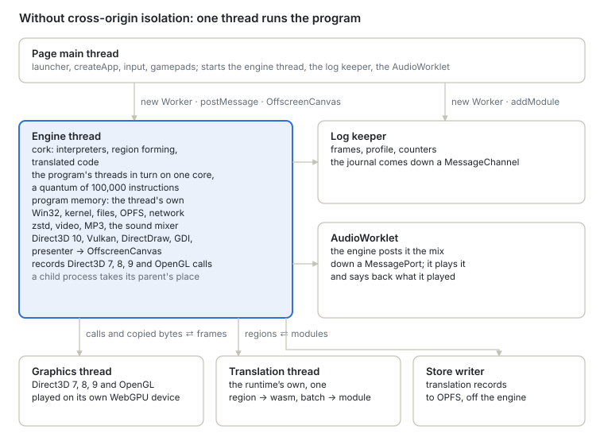
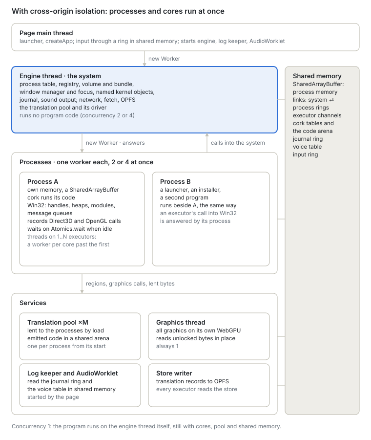
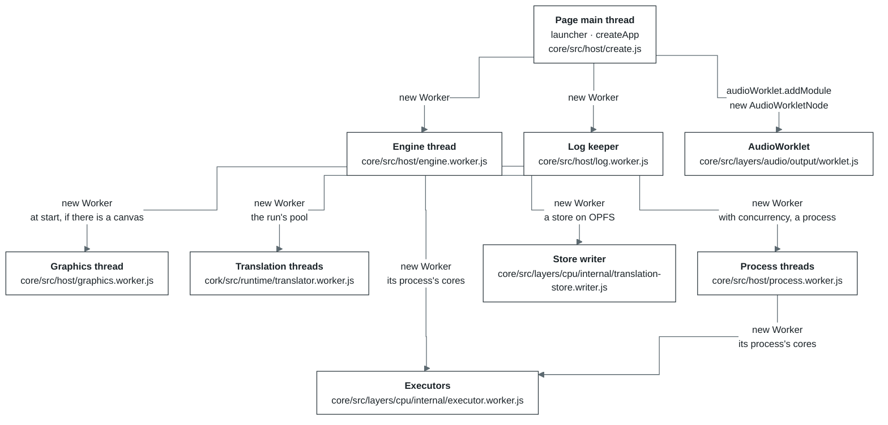
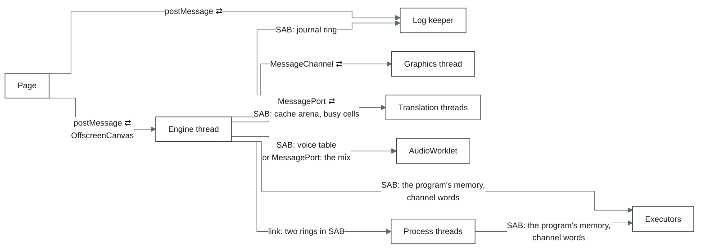

# Threads: who starts whom, and why

A tab runs nine kinds of thread, three of them several times over. The page starts three: the
engine thread, the log keeper and the AudioWorklet. The engine thread starts the graphics thread, a
process thread for each process where processes run at once, the run's pool of translation
threads, which it lends to the processes, and the writer of the translation store. The thread a
process runs on starts that process's executors: one worker for each processor core the program is
given past the first.

Nearly all the work happens on the thread the program runs on: the engine thread, or, where
processes run at once, the process's own thread. The others take from it what can run in parallel,
or what the browser only allows off the main thread.

How a run is laid out depends on whether the page is cross-origin isolated:

| Thread | Started by | When | Why a thread of its own |
| --- | --- | --- | --- |
| Page main thread | the browser | always | The launcher's interface, the `createApp` call and DOM events live here. Per frame it does one thing only: polls the gamepads (`requestAnimationFrame` → `input.poll`) |
| Engine thread | the page, [`core/src/host/create.js`](../../modules/core/src/host/create.js) | always. With `?host=thread` the engine runs on the page's thread instead, over the same protocol | The program runs in long quanta. On the page's thread it would be interrupted by garbage collection and the interface's rendering, and a click would wait for the quantum to end. Synchronous OPFS access also exists only in a worker. A WebGPU device cannot move between threads, so the worker opens its own and gets the canvas as an `OffscreenCanvas` |
| Log keeper | the page, [`core/src/host/remote.js`](../../modules/core/src/host/remote.js) | always. Without `Worker`, a `MessageChannel` on the page takes its place | The engine writes its journal, counters and tables into shared memory and answers no questions. The keeper drains the ring before it laps, keeps the history and works out frames, the profile and the per-module breakdown. Logging then costs neither the page nor the engine anything |
| Graphics thread | the engine thread, [`core/src/host/graphics-worker.js`](../../modules/core/src/host/graphics-worker.js) (called from `serve.js`) | at start, if the engine has a canvas and `device.graphicsWorker: false` is not set (`?graphicsWorker=off` in the launcher). Survives a change of program. If it opens no device within 10 s, everything draws on the engine thread | Its job is to draw all the graphics, so the engine thread only keeps state and answers the program. Today Direct3D 7, 8, 9, 10, 11 and OpenGL are played here on a WebGPU device of its own; Vulkan will move here too. In the `tools/graphics-bench --remote` bench the engine thread spends 0.69 ms a Direct3D frame instead of 2.95 |
| Translation threads | the run's pool, [`core/src/host/pool/pool.js`](../../modules/core/src/host/pool/pool.js) (made in `app.js`) | when the engine is cork, the page can share memory and a translator would use a worker; elsewhere each process opens a translator of its own. A process is lent one at its start, however many the run holds (one left waiting interprets nearly all it runs), and the pool's driver adds more while its translation lags (section 5) and the run holds fewer than the host's cores less two (`cork.poolCapacity`); a process whose workers sat idle 5 s gives back its first, translates on its own thread, and is lent one again as soon as it does and one is free. One sleeping worker is kept; the others are closed. The pool lends to the process's own thread and, for a process on the pool's thread, to its other executors as well, each taken as one more borrower; an executor of a process in a worker of its own opens a translator of its own. Until the first answers `ready`, regions are translated on the process's own thread | Emits wasm for regions, builds a module and compiles it. The process's thread does not wait for it: it posts a batch and publishes the result between frames, whenever it arrives. A translation thread works for one process at a time, over a port of its own; one that works for none sleeps and holds nothing of any process |
| Executors | the thread a process runs on, [`core/src/layers/cpu/internal/executor.js`](../../modules/core/src/layers/cpu/internal/executor.js) | under cork, on a page that can share memory, when the process has more than one core ([`cpu.cores`](../core/configuration.md#cpu)): one for each core past the first, opened when a thread of the program wants one | Runs the program's threads at once with the process's own thread, over the process's memory itself. A call into Win32 or the kernel, and a fault, waits while the process's thread answers it over the executor's registers. Each opens a translator of its own and takes translations from the run's store through the process |
| Store writer | the engine thread, [`core/src/layers/cpu/internal/translation-store.js`](../../modules/core/src/layers/cpu/internal/translation-store.js) | where the run's translation store is a directory on OPFS | Writes the store's records through a handle of its own: a write through the synchronous handle waits for the disk, which on the engine thread held a frame |
| AudioWorklet | the page, `ui/src/engine/session.js` | if sound is on | The Web Audio real-time thread. On a cross-origin isolated page it reads the voices from shared memory on its own clock, so sound does not break up even while the engine is busy; elsewhere the engine posts it the mix down a channel of their own and it says back what it played |
| Process thread | the engine thread, [`core/src/host/process-worker.js`](../../modules/core/src/host/process-worker.js) (called from `app.js`) | with `concurrency` 2 or 4 under cork, once per process, the program the page started included, for as long as it runs | A process (the launcher, and the game it starts) runs on a thread of its own, beside its parent, with its own memory and translator. It blocks while it waits instead of taking turns with the engine's event loop, and the engine's thread runs no program at all |

How the threads exchange data. ⇄ means both ways; SAB is `SharedArrayBuffer`, that is, shared
memory.

- **Page ⇄ engine.** Requests and input go by `postMessage`. Along with each message the page
  increments a signal word in shared memory, so the engine notices the message right away, between
  two turns of the scheduler, rather than at its next scheduled pause. Where processes run at once,
  input and visibility go through a ring in shared memory instead, read between two turns, and
  requests are still posted. The canvas is handed over once (`transferControlToOffscreen`), and
  from then on only the engine draws into it.
- **Engine → log keeper.** Shared memory only: the keeper looks into the ring every 200 ms. Without
  `SharedArrayBuffer` the page forwards the records to it as messages.
- **Engine ⇄ graphics.** Direct3D 7, 8, 9, 10 (with 11, which shares its device) and OpenGL each have a `MessageChannel` of their own. Calls go into one
  buffer per batch, and the buffer is transferred without a copy. Back come the frame as an
  `ImageBitmap` and the answers to calls only the renderer knows.
- **Engine ⇄ translation.** Regions missing from the store go one way; module bytes and an already
  compiled `WebAssembly.Module` come back.
- **Engine → AudioWorklet.** On a cross-origin isolated page, no messages at all. The voice table
  lives in shared memory: the page gets it in the answer to the start request and hands it to the
  `AudioWorkletNode`. Elsewhere the page gives the engine and the worklet the two ends of a
  `MessageChannel`, the engine posts the mix down it, and the worklet says back what it played.
- **A process ⇄ its executors.** The program's memory is shared with them as it is; a few words
  of shared memory per executor carry its turns. The process asks for a slice, and every call into
  Win32 or the kernel and every fault the slice reaches waits while the process's thread answers it
  with its own handlers, the executor's registers swapped into its state block for the answer
  (`executor.js`). How the executors share translations and the store is in section 5. Each
  executor also counts its runs of guest code in those words, which the graphics recorder's write
  watch reads (section 7).

**Processes.** How many processes run at once is `createApp({ concurrency })`; what 1, 2 and 4
give, and when a run falls back to `compatible`, is in
[`core/README.md`](../core/README.md#which-mode). With 1, the default, the program runs on the engine
thread, and a child process runs beside it there from `CreateProcess` on, the two machines
taking turns. With 2 or 4 every process has a thread of its own, and one past that many takes
turns with its parent on the parent's thread. A call a parent makes in its child
(`VirtualAllocEx`, `ReadProcessMemory`, `SuspendThread` on its thread and the like) is sent to the
child and made there with its own kernel32, between its turns, whichever way it runs
([`kernel32/cross-process.js`](../../modules/core/src/layers/win32/kernel32/cross-process.js)); only
bytes cross. The engine
thread then runs no program and is the system (what it builds before any process starts is in
section 4), and what the page asks of the program it asks the program's thread.

What the processes of a run share stays on the engine thread: the registry, the volume and the
sharing of its open files, the window directory, ids, named events, semaphores and mutexes, the
bundle, COM's class table and the services it started ([`core/src/com-link.js`](../../modules/core/src/com-link.js)), the run's directory of processes, the translation store ([`core/src/layers/cpu/internal/store-link.js`](../../modules/core/src/layers/cpu/internal/store-link.js)),
and the batch modules the processes in workers compile: each is posted to the engine thread,
which keeps it alive for the run (`withHeldModules`, as many wasm bytes as `sharedModuleBytes`),
so a later process that compiles the same bytes from the store gets the code V8 compiled and
tiered up for the first, since V8 keeps one compiled module for the bytes of any module still
alive in the browser's process.
A process that ends gives back what it held of these, as an exit closes every handle at once: its
references to named objects go (a name no other process holds is free again), a mutex one of its
threads held is abandoned to the next waiter, and an object another process still holds keeps its
state and nothing of the gone process - not its memory, its scheduler or its link
([`core/src/system-objects.js`](../../modules/core/src/system-objects.js),
[`kernel32/named-objects.js`](../../modules/core/src/layers/win32/kernel32/named-objects.js)).
The engine thread answers a process thread across a link: two rings in shared memory, one each
way, with a doorbell word per side ([`core/src/system/link.js`](../../modules/core/src/system/link.js), values encoded by `codec.js`). The
process thread blocks on its doorbell for each answer and answers what it is asked meanwhile (the
engine asks it about its windows); a message longer than a ring holds goes in parts. Each side
looks at its doorbell for a few microseconds before it sleeps on it, since a thread woken from
sleep costs far more than the answer.

A process thread seldom asks the volume: every change to a drive moves that drive's word in shared
memory (one word per drive letter), and the process thread keeps what it read of a drive (64 KB
pieces of files, sizes, entries, listings) until that word moves. The sharing every open is
settled against is a table in shared memory under a lock, and a process thread settles its own
opens against it ([`core/src/layers/filesystem/internal/volume-link.js`](../../modules/core/src/layers/filesystem/internal/volume-link.js), `shared-sharing.js`).

A process's Direct3D devices draw on the graphics thread through a port of their own, its
DirectDraw and GDI pictures come to the engine as bytes, its sound is mixed on the run's voice
table in a span its parent lends it, and the page's input reaches it as the run's window manager
routes it (section 7). What it cannot have yet is in [`core/limits.md`](../core/limits/processes.md).

**Modes.** `createApp({ mode })` says how much of this rides on shared memory. `isolated` (which
needs a cross-origin isolated page) puts the program's memory in a `SharedArrayBuffer`,
`compatible` leaves it the engine thread's own and copies whatever crosses to another thread, and
`auto` (the default) takes `isolated` where the page is isolated. Only in `isolated` does the
graphics thread read what the program wrote between `Lock` and `Unlock` straight out of its
memory and write read-backs into it in place, and only there do the program's threads run on
several cores; in `compatible` the program is told of one core. What each mode costs the page is
in [`core/README.md`](../core/README.md#which-mode). The run's mode is in the `app` layer's
diagnostics ([`core/src/mode.js`](../../modules/core/src/mode.js)); the launcher takes `auto` unless
`?mode=compatible` or `?mode=isolated` asks for another.
