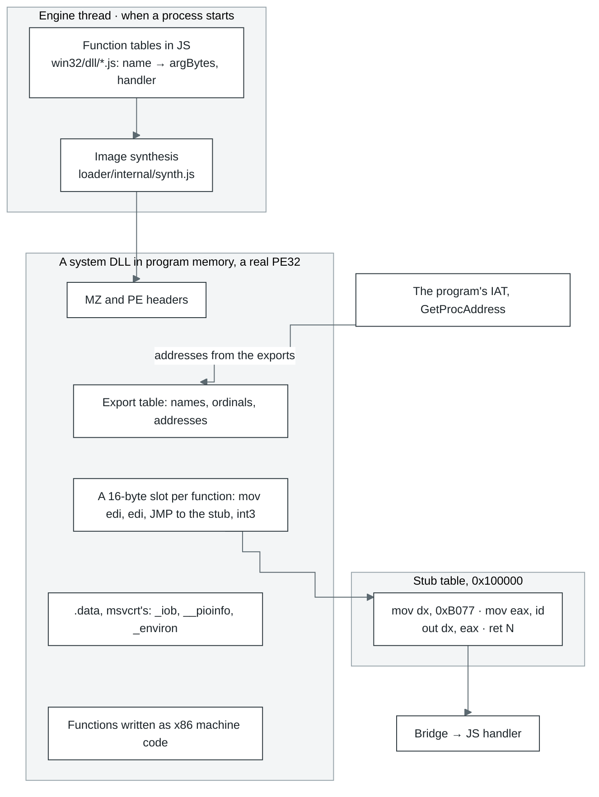
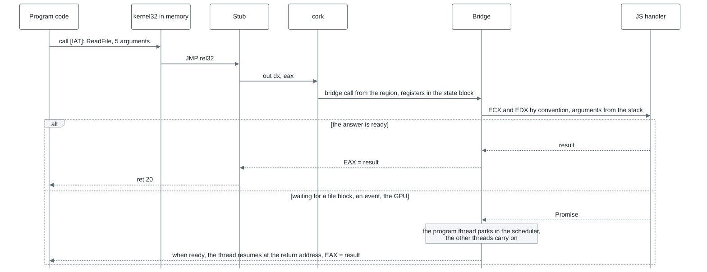
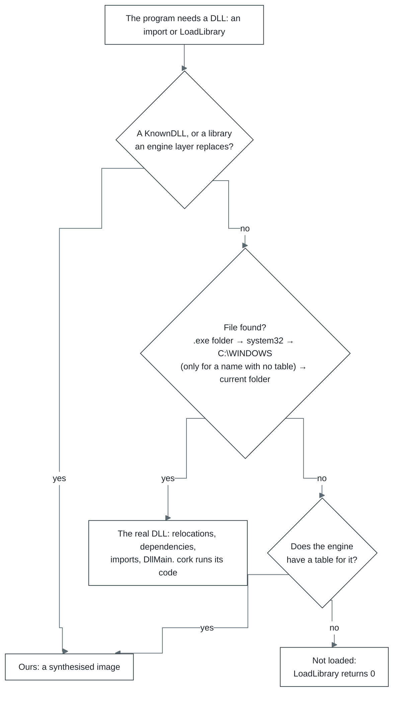

# Win32 in JavaScript: how a DLL comes about

Each system library is a set of tables in JS. For every function they record which handler runs it,
how many bytes of arguments to take off the stack, and its calling convention (stdcall unless
stated). For example, `AddAtomA: { argBytes: 4, handler: ([p]) => add(p) }` in
[`core/src/layers/win32/kernel32/atoms.js`](../../modules/core/src/layers/win32/kernel32/atoms.js).

When a process starts, the loader builds real PE32 images of `kernel32.dll`, `d3d9.dll` and the rest
from these tables (PE32+, AMD64, in a 64-bit process) and places them in the program's memory. To the program they are ordinary DLLs,
with headers, an export table and code. So the address `GetProcAddress` returns is the one the import
was bound to.

| Where | What lives there |
| --- | --- |
| Engine thread (a process's own thread with `concurrency` above 1) | The function tables, image building, the bridge and the handlers |
| Program memory | The DLL images; the stub table from `0x100000` (16,384 slots of 16 bytes); COM objects and their method tables |



A stub is 16 bytes, one per function:

```
66 BA 77 B0      mov dx, 0xB077     ; the trap port
B8 xx xx xx xx   mov eax, id        ; the function's number in the bridge
EF               out dx, eax        ; cork calls the bridge
C2 nn nn         ret N              ; C3 for cdecl
CC ...           int3 up to 16 bytes
```

How many bytes `ret N` takes off, the bridge decides from the calling convention: stdcall takes all
of `argBytes`, cdecl none, and thiscall and fastcall leave out the arguments passed in registers.

## One call, from the program to JS and back



- **COM objects** (Direct3D, DirectSound, DirectInput) live in the program's memory too. The
  object's first word points at its method table, and each method there is a stub like any
  other, except those that run in the guest: IUnknown's `AddRef` and `Release` for an object
  whose count lives in guest memory, and the Direct3D 8 and 9 methods a program calls most
  (section 7). Methods are stdcall, with the interface pointer as the first argument on the
  stack.
- **Callbacks:** a window procedure, a COM callback, `DllMain`. The bridge stops the thread, builds a
  frame on the program's stack and runs the program's code until it returns into a sentinel trap.
  A host call that calls the program back many times in a row (a D3DX effect's pass setting each
  state through the program's own state manager) is written as steps (`bridge.drive`): a generator
  that yields each guest call. The bridge sends the thread into each routine in the slice the call
  came in and takes its answer at the sentinel there, with no park and no turn of the run loop
  between them. Through promises every guest call of a pass was a turn of the run loop of its own,
  and a frame of effect passes spent more time in turns than in the program. The steps are on by
  default (`driveGuestCalls`); off, the same calls run through promises, and
  `effect-steps.itest.js` holds the two to the same results. The bridge's `driveMs` and
  `driveCallMs` split the steps' time between the steps and the guest.
- **Some code runs in program memory directly.** Some exports and methods are x86 machine code
  the program runs itself, with no trap, at cork's speed; only what they cannot handle goes to the
  bridge. Some are written as x86: msvcrt's and kernel32's functions a program calls most, among
  them the interlocked calls, critical sections, slim reader/writer locks, one-time
  initialisation, SLists, the heap's small blocks (up to 1 KiB), and events and mutexes nobody
  waits on. An event has a word of its own in program memory: SetEvent and ResetEvent change it
  and WaitForSingleObject takes a signalled one with `lock cmpxchg`, and a poll of one that is not
  signalled times out there, so a thread on another executor handing work to another, or polling
  for it, does not wait for the process's executor to answer. The host takes the word over (one
  flag) while a thread is queued on the event, since only the host wakes a waiter. A mutex nobody
  else wants is taken and given back in the guest the same way, on a word of the mutex's own,
  which the host takes over as soon as anyone waits, the mutex is abandoned or the host otherwise
  touches it. Sleep(0) answers in the guest while no thread waits to run, read from a count the scheduler
  keeps. Others are written once in JavaScript, marked `@guestCode`, and compiled to i386 by the
  build ([`core/scripts/guest-code/`](../../modules/core/scripts/guest-code/)): the compiled bytes sit beside the source as `*.x86.js`. The
  JavaScript stays the host's handler and the reference a test holds the x86 to, and
  `return host()` hands a rare case to that handler. D3DX's vector, matrix and quaternion math and
  its effect setters, msvcrt's string, float and math functions and GLU are written so.
- **When a function is missing.** Each name has a stub of its own. If it is known how many bytes of
  arguments to take off (an `@N` decoration, a C++ name, a cdecl library, or a library the program
  brought), it simply returns 0. Otherwise the program stops with `unimplemented import`, and the
  error names the function needed and its caller.

## Which DLL the program gets



- **Always ours:** the KnownDLLs (`kernel32`, `user32`, `msvcrt`, `ole32` and others), the
  runtimes the engine stands in for whoever's copy it is (`DSETUP.dll`, `MSVCR80.dll`,
  `Mp3dec.asi` for sound and `ijl15.dll` for media), and the C runtime's API sets
  (`api-ms-win-crt-*`), which are `ucrtbase.dll` under the names they are imported by.
- **Where `LoadLibrary` looks:** the `.exe` folder, then `C:\WINDOWS\system32\`, `C:\WINDOWS\` and
  the current folder. Static imports are looked up the same way, without the current folder. For
  a name the engine has a table for, the system directories are skipped: a copy an installer put
  there would be a second library of the name in the process beside the engine's.
- **A DLL already loaded** is handed back with its count raised. A bare name finds the first module
  of that name; a path finds only the module read from that file, so a second file of a loaded
  module's name is a module of its own (the .NET Framework loads a mixed assembly's native image
  so while the assembly is loaded).
- **A real DLL** is parsed and relocated by the loader, its dependencies are loaded first, its
  imports (delayed ones included) are bound, and its `DllMain` is called through the bridge as
  program code. Every image's TLS is supported, a library's loaded at run time too: a slot, a
  copy of its block in every thread (those already running when it is loaded included), and TLS
  callbacks for every reason its `DllMain` hears, before it. `FreeLibrary` gives the slot and the
  copies back. A module keeps no copy of its file for its resources or its TLS directory: both are
  read where it lies in guest memory, as Windows reads them, and a DLL's file and mapped image are
  let go once it is bound.
- **DirectX's redistributables** (`d3dx9_*` and the rest) are not part of the engine: a game brings
  them, through its installer's DirectX setup, which puts them in `C:\WINDOWS\system32\`, or as DLLs
  beside its `.exe`. A copy beside the `.exe` is loaded as the real DLL; for every other the
  engine's table answers `d3dx9_*`, `d3dx10_*` and `d3dx11_42`/`_43`, the copy in `system32`
  included. D3DX 10 and 11 are one library over two devices: the image loaders make their
  textures through the device's own creates, the compiles go to `D3DCompile`.
- **Where an engine library stands as a file:** in the system folder, as a file a setup or a
  program can find, read and replace (`withSystemLibraries`). The programs the engine runs in
  place of the system's (`msiexec`, `rundll32`, `regsvr32`, `reg`, `notepad`) stand the same way
  where Windows keeps them: a setup checks that the Windows Installer service's `msiexec.exe` is
  there before it installs anything.
- **The Windows Imaging Component** (`windowscodecs.dll`) is the engine's too, its factory a COM
  class as on Windows: its decoders reuse the D3DX and media layers' readers, and a bitmap's
  pixels live in guest memory, since its lock hands the program a pointer into them. The
  `<Interface>_<Method>_Proxy` exports .NET calls go straight to the object's method when the
  object is the engine's and through its vtable when the program wrote it.

- **DirectWrite** (`DWrite.dll`) is a table of the engine's over the same faces gdi32 draws:
  the system collection's files are TrueType tables written from the font engine's measurements,
  a program's own files and loaders are read through their streams, and a glyph run is drawn
  from the browser's glyphs as GDI's text is. A bitmap render target is a gdi32 memory context
  with a DIB section ([`core/src/layers/win32/dwrite/`](../../modules/core/src/layers/win32/dwrite/)).

Where to look in the code: [`core/src/layers/loader/internal/synth.js`](../../modules/core/src/layers/loader/internal/synth.js) (the image),
[`core/src/layers/cpu/internal/thunks.js`](../../modules/core/src/layers/cpu/internal/thunks.js) (the stubs), [`core/src/layers/bridge/`](../../modules/core/src/layers/bridge/) (the bridge), the
tables in `core/src/layers/win32/<dll>/`, the search order in [`core/src/app.js`](../../modules/core/src/app.js)
(`libraryCandidates`, `answeredByEngine`).
