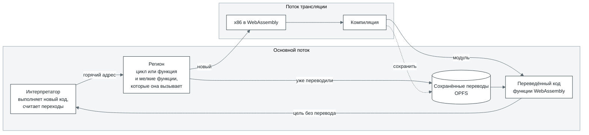
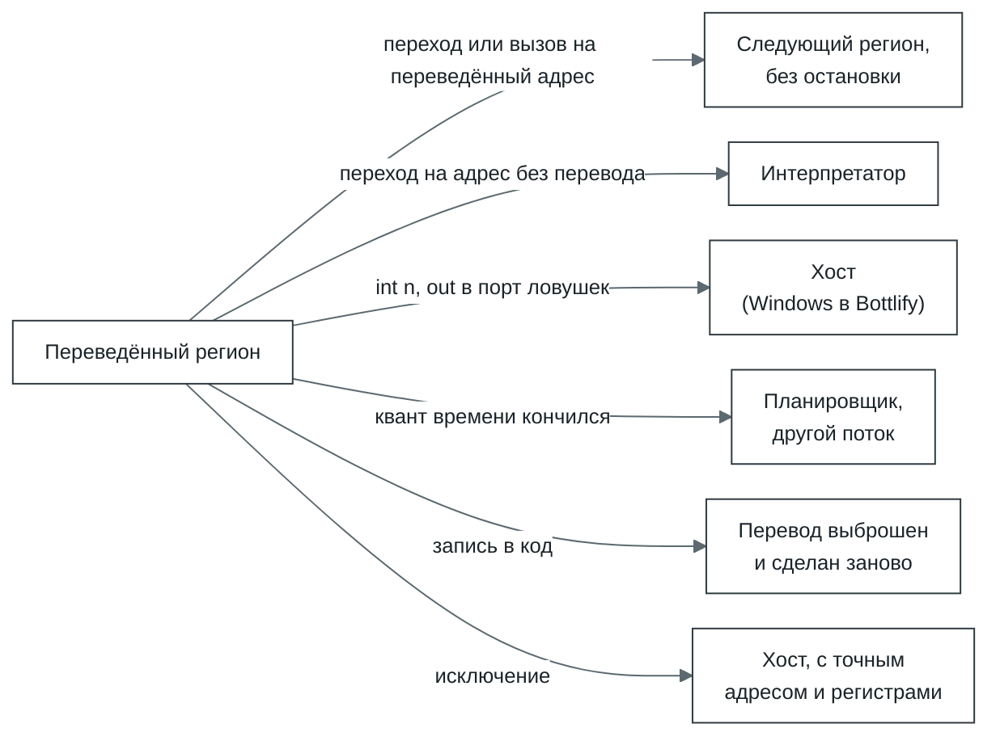
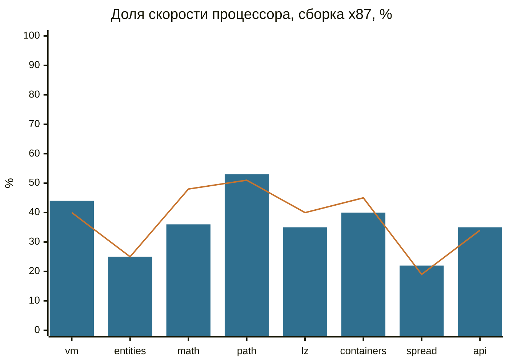
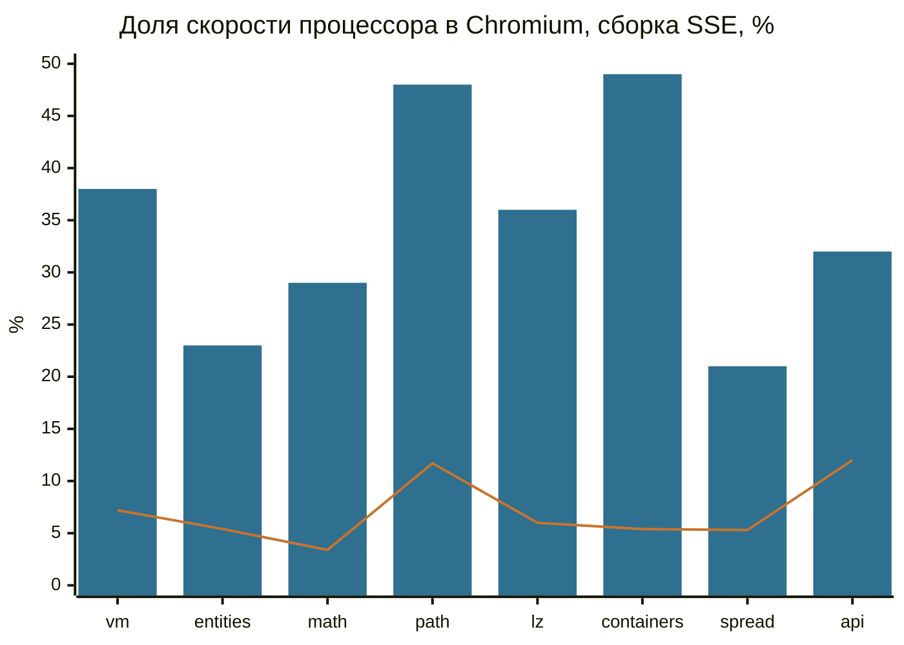

# cork

[English](README.md)

Cork - это модуль, который выполняет программы для x86, в основном 32-битные, в браузере. Браузер
не умеет выполнять машинный код x86, поэтому cork переводит его в WebAssembly, а WebAssembly
браузер уже сам компилирует под свой процессор. Так одна сборка Bottlify работает и на x86, и на
ARM. Переведённый код работает в двадцать с лишним раз быстрее, чем если бы каждую инструкцию
разбирать заново, и в среднем лишь втрое медленнее настоящего процессора.

Cork переводит горячие циклы и функции целиком и сохраняет готовые переводы, поэтому второй запуск
программы сразу быстрый. Потоки программы могут выполняться параллельно, на разных ядрах, над
общей памятью. Подробно об этом в разделах [«Почему он быстрый»](#почему-он-быстрый) и
[«Как устроен»](#как-устроен).

В [Bottlify](../../README.md) cork служит процессором. Про Windows он ничего не знает: системный
вызов, запись в порт или исключение останавливают его и возвращают управление
[`@bottlify/core`](../../modules/core/README.md), где реализованы Windows API, DirectX и звук.

Cork написан на чистом JavaScript и WebAssembly, без зависимостей, и работает в браузере и в Node.

## Что умеет

- 32-битный код x86 пользовательского режима: целочисленные инструкции, x87, MMX, SSE, SSE2 и SSE3,
  а также POPCNT и RDRAND. Именно этот набор cork сообщает программе через `cpuid`.
- 64-битный код x86-64 пользовательского режима: тот же набор с шестнадцатью 64-битными регистрами,
  тем же транслятором и средой выполнения на 64-битной ширине, память в окне 4 ГиБ: обращение по
  адресу от 4 ГиБ и выше даёт исключение ([`roadmap/x64.ru.md`](../../roadmap/x64.ru.md)).
- Код, который переписывает сам себя. Если программа пишет поверх уже переведённого кода, старый
  перевод выбрасывается и делается новый. Страницу, которую переписывают снова и снова (восемь раз
  за 100 мс), на время оставляют интерпретатору.
- Несколько потоков на общей памяти. С настройкой `atomic`, которую Bottlify включает, когда процесс
  работает на нескольких исполнителях, инструкции с `lock` и `xchg` с памятью выполняются как
  атомарные операции WebAssembly, и потоки не теряют записи друг друга. С настройкой `ordered`
  (выключена, пока страница её не попросит) атомарными становятся и загрузки и записи
  целочисленных операндов не через esp, так что на хосте arm64 потоки видят обычные записи друг
  друга в том порядке, в каком они сделаны, как на x86.
- Точные исключения. Деление на ноль, неизвестная инструкция или запись в закрытую страницу
  останавливают выполнение ровно на этой инструкции, с теми же регистрами, что были бы на
  настоящем процессоре.

## Чего не умеет

- 16-битный код, привилегированные инструкции, сегменты, кроме базы `fs` в 32-битном коде и базы
  `gs` в 64-битном (другой префикс ничего не добавляет).
- SSSE3 и всё, что новее: SSE4.1, SSE4.2 (кроме POPCNT), AVX.
- 80-битную точность x87. Регистры FPU хранятся как обычные 64-битные double: одинарная и двойная
  точность соблюдаются, расширенная считается как двойная. Синус, логарифм и прочие функции
  берутся из `Math`. Маски исключений x87 не учитываются: любое исключение ведёт себя как
  замаскированное.

## Почему он быстрый

В среднем cork выполняет программу втрое медленнее настоящего процессора, а на плотных циклах
вдвое. На одних и тех же программах он в 5–8 раз быстрее v86, самого известного эмулятора x86 в
браузере (цифры ниже). Вот за счёт чего:

- **Переводит циклы и функции целиком, а не по одной инструкции.** Цикл или функция вместе с
  мелкими функциями, которые она вызывает, становится одной функцией WebAssembly. Такой кусок мы
  называем регионом. Компилятор браузера видит в нём обычный цикл и оптимизирует его так же, как
  любой другой код.
- **Регистры хранятся в локальных переменных.** Внутри региона регистры x86 становятся локальными
  переменными функции, и браузер раскладывает их по настоящим регистрам процессора. Вся память
  программы лежит в одном `WebAssembly.Memory`, поэтому `mov eax, [esi+8]` становится одной
  загрузкой, без промежуточных таблиц страниц.
- **Флаги считаются только там, где их читают.** Почти каждая инструкция x86 меняет флаги, а
  читают их редко. Пара `cmp` и `jl` превращается в одно сравнение.
- **Переведённый код не возвращается в JavaScript.** Регионы переходят друг в друга обычными
  вызовами между функциями WebAssembly.
- **Угадывает цели виртуальных вызовов.** cork следит, куда на самом деле уходят вызовы через
  указатель. Если вызов уходит в основном в несколько маленьких функций (до четырёх, и на каждую
  приходится не меньше восьмой части вызовов), они встраиваются прямо в регион, и вызов
  превращается в сравнение.
- **Программа не ждёт транслятор.** Перевод идёт в отдельных потоках, а программа тем временем
  продолжает работать в интерпретаторе. Основной поток отдаёт транслятору не больше нескольких
  миллисекунд подряд, поэтому игра не замирает, когда доходит до нового кода.
- **Второй запуск сразу быстрый.** Готовые переводы сохраняются в хранилище браузера (OPFS) и в
  следующий раз берутся оттуда. Бандл может привезти их с собой.

## Как устроен



1. **Интерпретатор.** Новый код выполняет интерпретатор и заодно считает, сколько раз программа
   переходила на каждый адрес. Адрес, на который перешли достаточно часто (в Bottlify два раза, у
   собственной машины cork 50), становится кандидатом на перевод.
2. **Регион.** От кандидата cork собирает все блоки, до которых можно дойти обычными переходами (до
   128 блоков или 8 КиБ кода), и встраивает мелкие функции, которые оттуда вызываются.
3. **Перевод.** Регионы уходят в поток трансляции пачками от 32, и каждая пачка становится одним
   модулем WebAssembly. Когда очередь длинная, например пока игра загружается, пачка забирает
   четверть ожидающих, но не больше 256.
4. **Выполнение.** Переведённые регионы вызывают друг друга напрямую. Наружу они выходят, только
   когда без этого никак:



5. **Следующий запуск.** Переводы лежат в OPFS, и второй запуск той же программы загружает то, что
   перевёл первый, вместо того чтобы переводить заново. Ключ региона: точка входа, вершина стека x87
   при входе (любая, если кода x87 в регионе нет) и режимы транслятора. Если до блока дошли в
   другом порядке, берётся сохранённый регион, в котором этот блок лежит.

Вся память программы лежит в одном `WebAssembly.Memory`. В Bottlify адрес `a` из программы
находится в нём по смещению `a`, а собственное состояние cork лежит в первых 64 КиБ программы,
которые программа для Windows никогда не занимает:

```
0x00000   первая страница программы: чтение по нулевому указателю находит здесь нули
0x01000   регистры и собственное состояние cork, за ними данные wasm-интерпретатора, до 0x05000;
          запись программы сюда вызывает исключение
0x05000   дальше память программы (в Bottlify 1 ГиБ)
  конец   таблицы cork: байт флагов на каждую страницу в 4 КиБ (закрыта, в ней переведённый код,
          за записью в неё следят, ...), где в каждой странице лежит код, хеш входов
  дальше  при нескольких исполнителях: состояние и таблицы каждого следующего исполнителя;
          флаги страниц у них остаются одной общей таблицей
```

Когда память адресуется с её начала, машинный код короче: на ARM чтение памяти программы занимает
одну инструкцию, а смещение в 64 КиБ добавляло к нему ещё две. Программа, которой могут понадобиться
её первые 64 КиБ, получает раскладку cork по умолчанию: её адрес `a` по смещению `0x10000 + a`,
состояние под ним.

## Скорость

Скорость меряет [`bench/`](../../modules/cork/bench/README.md): 32-битная программа для Windows на C++ с восемью
задачами, похожими на то, чем заняты игры. Тот же `.exe` запускается и прямо на процессоре, через
маленький загрузчик для Linux (`bench/bin/peload`). Так cork и процессор выполняют один и тот же
машинный код, а каждый прогон заодно сверяет их контрольные суммы.

Каждая задача шла в десять раз дольше обычного, чтобы перевод и холодный старт занимали лишь
несколько процентов времени и замер показывал скорость самого переведённого кода. Из трёх
прогонов брался лучший. За 100% принята скорость процессора:

| Задача | Что делает | Node, x87 | Node, SSE | Chromium, x87 | Chromium, SSE |
| --- | --- | ---: | ---: | ---: | ---: |
| `vm` | интерпретатор байткода, один большой `switch` | 40% | 32% | 44% | 38% |
| `entities` | 4096 объектов, виртуальные вызовы | 25% | 23% | 25% | 23% |
| `math` | скиннинг, трансформации, свет | 48% | 39% | 36% | 29% |
| `path` | A* на сетке 128x128 | 51% | 57% | 53% | 48% |
| `lz` | LZ77, CRC, Хаффман | 40% | 35% | 35% | 36% |
| `containers` | хеш-таблица, сортировки, двоичный поиск | 45% | 51% | 40% | 49% |
| `spread` | 512 функций, вызывающих друг друга | 19% | 17% | 22% | 21% |
| `api` | вызовы Windows API между короткими кусками работы | 34% | 34% | 35% | 32% |
| **все восемь** (среднее геометрическое) | | **36%** | **34%** | **35%** | **33%** |



Столбцы показывают Chromium 141, линия Node 22.

Медленнее всего `spread` и `entities`. В обеих задачах много вызовов через указатели на функции,
и цель всё время меняется. Когда вызов уходит в основном в несколько функций, cork их угадывает,
но в `spread` их сотни, и каждый такой вызов ищет цель в таблице. Ближе всего к процессору
подходят плотные циклы над данными (`path`, `containers`): там выходит около половины его
скорости.

Сколько даёт сам перевод (сборка x87, Node):

| | Доля скорости процессора (среднее геометрическое) |
| --- | ---: |
| только интерпретатор (`translate: false`) | 1,5% (от 0,7% до 3,7%) |
| с переводом, прогон обычной длины, перевод и старт включены | 19% (от 7,2% до 30%) |
| с переводом, в десять раз длиннее | 36% (от 19% до 51%) |

Переведённый код в двадцать с лишним раз быстрее интерпретатора, и уже на прогоне в несколько
десятых секунды перевод окупается с большим запасом.

### Сравнение с v86

Самый известный способ запустить x86-код в браузере: [v86](https://github.com/copy/v86). Он тоже
переводит горячий код в WebAssembly. Мы запустили в нём те же `bench-x87.exe` и
`bench-sse.exe`: v86 загружает Linux со своего тестового образа, а внутри бенчмарк идёт через тот же
`peload`, что и на процессоре. Контрольные суммы совпали везде. Chromium 141, задачи в десять раз
длиннее обычного, доля скорости процессора:

| Задача | v86, x87 | cork, x87 | cork быстрее | v86, SSE | cork, SSE | cork быстрее |
| --- | ---: | ---: | ---: | ---: | ---: | ---: |
| `vm` | 7,7% | 44% | в 5,7 раза | 7,2% | 38% | в 5,3 раза |
| `entities` | 1,7% | 25% | в 14,6 раза | 5,4% | 23% | в 4,3 раза |
| `math` | 0,6% | 36% | в 59 раз | 3,4% | 29% | в 8,4 раза |
| `path` | 12,7% | 53% | в 4,2 раза | 11,7% | 48% | в 4,1 раза |
| `lz` | 6,2% | 35% | в 5,6 раза | 6,0% | 36% | в 6,1 раза |
| `containers` | 4,9% | 40% | в 8,2 раза | 5,4% | 49% | в 8,9 раза |
| `spread` | 5,2% | 22% | в 4,1 раза | 5,3% | 21% | в 3,9 раза |
| `api` | 9,9% | 35% | в 3,5 раза | 12,0% | 32% | в 2,7 раза |
| **все восемь** (среднее геометрическое) | **4,5%** | **35%** | **в 7,8 раза** | **6,5%** | **33%** | **в 5,1 раза** |



Столбцы показывают cork, линия v86. В Node то же самое: в среднем cork быстрее v86 в 7,1 раза на
сборке x87 и в 4,6 раза на SSE.

При этом v86 делает для той же программы гораздо больше работы. Он эмулирует компьютер целиком,
поэтому бенчмарк работает поверх ядра Linux, и каждое обращение к памяти проходит через
эмулированные таблицы страниц. x87 у v86 настоящий, 80-битный, посчитанный программно, а cork
считает в 64-битных double. Этим объясняется почти вся разница в строке `math` для x87, поэтому на
графике показана сборка SSE. Зато v86 загружает целые операционные системы, а cork выполняет
только код программы.

<details>
<summary>Как мерили</summary>

- 14 октября 2026, cork на `00bc4680`; строка про интерпретатор на `a24f5d9a` (то, что
  изменилось между ними, интерпретатора не касается). Node 22.22.0 (V8 12.4); Chromium
  141.0.7390.37 без окна (V8 14.1), каждый прогон в новой вкладке и отдельном воркере
  минифицированной сборки.
- Виртуальная машина Linux x86-64 на 4 ядра, Intel Xeon @ 2,10 ГГц. Схема питания не записана.
- Node: `node modules/cork/bench/run.mjs --variant <x87|sse> --only <задача> --iterations
  <10 x обычная> --reps 3`, каждый прогон запускался одновременно с таким же прогоном `a24f5d9a`,
  чтобы дрейф скорости машины (до четверти за час) приходился на оба; процессор отдельно, лучший из
  трёх прогонов `bench/bin/peload`. Chromium: `node modules/cork/bench/browser/suite.mjs
  '{"before":{},"after":{}}' --scale 10 --reps 3` на бандлах обоих деревьев, в таблицах сторона
  `after`. Строка про интерпретатор: `run.mjs --native --variant x87 --cork '{"translate":false}'`
  на `a24f5d9a`; строка про обычную длину: `run.mjs --variant x87` против десятой части времени
  процессора на десятикратной длине; по одному прогону.
- Процессор выполнял задачи со скоростью от 1,6 до 13,0 млрд инструкций в секунду, cork в Chromium
  от 0,3 до 4,7 млрд. В Chromium три прогона одной задачи расходились до пятой части (`math` на
  x87), чаще в пределах десятой.
- v86 0.5.471 с npm, образы BIOS из его репозитория и `linux4.iso` из его тестовых образов; 512 МиБ
  памяти гостя; файлы переданы через его файловую систему 9p. Каждая задача шла в госте как
  `peload bench-<сборка>.exe <задача> <10 x обычная>`, время мерил сам `peload` (часы хоста вокруг
  команды сходились с ним в пределах нескольких процентов). В Node три загрузки и лучший прогон, в
  Chromium (на странице, не в воркере) одна загрузка. Проценты v86 посчитаны от тех же цифр
  процессора, что и у cork в Chromium.

</details>

## Как запустить

Из терминала, с Node 22 или новее (один раз `npm ci` в корне репозитория):

```sh
node modules/cork/bin/cork.mjs run program.elf --linux
```

`cork run <файл>` загружает 32-битный ELF (little-endian) по его собственным адресам или просто
кусок кода по адресу `--at` (по умолчанию `0x1000`), запускает его и печатает, почему он
остановился, что лежит в регистрах и сколько инструкций выполнено, в том числе в переведённом коде:

```
fib ok
stopped: exit 0 at 0x00401134
eax 0x00000001  ecx 0x00000000  edx 0x00000000  ebx 0x00000000  esp 0x00ffffe4  ...
6627675 instructions, 6626800 of them translated, 0.051 s
```

| Опция | Что делает |
| --- | --- |
| `--linux` | Отвечает на `int 0x80` так же, как Linux i386 отвечает на `exit` (1), `exit_group` (252) и `write` (4) в stdout и stderr; на любой другой вызов отвечает `-ENOSYS`. Без неё первый же `int 0x80` останавливает выполнение. |
| `--at addr`, `--entry addr` | Куда грузить код и откуда начинать (по умолчанию точка входа ELF или `--at`). |
| `--ram MiB` | Память программы (по умолчанию 16, больше, если образу нужно). Стек начинается с её верха. |
| `--max n` | Остановиться примерно после `n` инструкций. |
| `--set eax=1,ecx=2` | Регистры перед стартом. |
| `--config '<json>'` | Настройки ([`SETTINGS.ru.md`](../../modules/cork/SETTINGS.ru.md)). |
| `--json` | Отчёт одной строкой JSON. |

Код выхода: с `--linux` тот, с которым вышла программа, после `hlt` 0, при любой другой остановке
1, при неверной командной строке или ошибке 2.

Программа из примера выше (библиотека C ей не нужна):

```c
// fib.c -- clang --target=i386-linux-gnu -O2 -nostdlib -static -ffreestanding -fno-pic
//          -fuse-ld=lld fib.c -o fib.elf
static int sys(int n, int a, int b, int c){
    int r;
    __asm__ volatile("int $0x80" : "=a"(r) : "a"(n), "b"(a), "c"(b), "d"(c) : "memory");
    return r;
}
static unsigned fib(unsigned n){ return n < 2 ? n : fib(n - 1) + fib(n - 2); }
void _start(void){
    char text[] = "fib ok\n";
    if (fib(27) == 196418) sys(4, 1, (int)text, 7);
    sys(1, 0, 0, 0);
}
```

`cork translate <файл> --entry addr -o out.wasm` сохраняет регион, который cork собирает с этого
адреса, отдельным модулем WebAssembly, чтобы изучить его через `wasm2wat` или `wasm-objdump`
(`--at` кладёт кусок кода так же, как для `run`; `--precise` переводит так, как с настройкой
`precise`). Сам по себе модуль не запустится: память и вспомогательные функции он берёт у cork.

Из JavaScript:

```js
import { createMachine } from '@bottlify/cork';

const machine = createMachine({ ramSize: 16 << 20 });
// mov ecx, 1000; L: mov eax, ecx; int 0x80; add edi, eax; dec ecx; jnz L; hlt
machine.load(0x1000, [0xb9, 0xe8, 3, 0, 0, 0x89, 0xc8, 0xcd, 0x80, 0x01, 0xc7, 0x49, 0x75, 0xf7,
    0xf4]);
machine.setReg('eip', 0x1000);
machine.setReg('esp', (16 << 20) - 16);

for (;;)
{
    const stop = await machine.run();
    if (stop.reason === 'interrupt' && stop.vector === 0x80)
    {
        // Здесь отвечаем на системный вызов: eip уже после инструкции int.
        machine.setReg('eax', machine.reg('eax') * 2);
        continue;
    }
    console.log(stop.reason, machine.reg('edi'));   // halt 1001000
    break;
}
await machine.dispose();
```

`createMachine({ ramSize, config, trapPort })` даёт память, регистры и `run`. `run` выполняет
программу, пока ей не понадобится что-то снаружи:

| `stop.reason` | Что случилось | Где `eip` |
| --- | --- | --- |
| `halt` | `hlt` | после неё |
| `interrupt` | `int n`, `int3`, `into`; номер `n` в `stop.vector` | после неё, как его оставляет процессор |
| `fault` | исключение: `#DE` 0, `#UD` 6, `#GP` 13 и так далее; номер в `stop.vector` | на ней |
| `trap` | `out` в порт ловушек (любой `out`, если `trapPort` не задан); значение в `stop.value` | после неё |
| `unsupported` | инструкция, которую cork не умеет; её название в `stop.op` | на ней |
| `limit` | кончился лимит `run({ maxInstructions })` (переведённый код может пройти чуть дальше) | где остановился |

В `stop.retired` число выполненных инструкций, в `stop.translated` сколько из них пришлось на
переведённый код. Ещё у машины есть `load`, `read`, `reg` и `setReg` (восемь регистров общего
назначения, `eip`, `eflags`), `memory` (`WebAssembly.Memory`), `layout` (где в ней лежит каждый
регистр), `runtime` (транслятор за машиной), `diagnostics()` и `dispose()`.
`regionModule({ code, at, entry })` делает то же, что `cork translate`, только из кода.

Все пороги и размеры, с которыми работает cork, настраиваются: список в
[`SETTINGS.ru.md`](../../modules/cork/SETTINGS.ru.md).

Собранная копия cork уже лежит в `@bottlify/core`, поэтому этот пакет нужен, только чтобы
использовать cork отдельно или подключить свою сборку через `createApp({ cork: { moduleUrl } })`
([API](../core/api.md)).

## Исходники

| Часть | Файлы | Что делает |
| --- | --- | --- |
| Декодер | [`src/decode/`](../../modules/cork/src/decode/) | Разбирает байты на инструкции. Таблицы опкодов написаны вручную: про каждую инструкцию декодер знает операнды, длину, какие флаги она читает и пишет и как может упасть. На неизвестном опкоде он останавливается и называет его. |
| Сборщик регионов | [`src/region.js`](../../modules/cork/src/region.js), [`src/helpers.js`](../../modules/cork/src/helpers.js) | Собирает регион от точки входа. Узнаёт по байтам вспомогательные функции компилятора вроде `_ftol2` из MSVC и подставляет вместо вызова то, что они делают. |
| Генератор | [`src/emit/`](../../modules/cork/src/emit/) | Превращает регион в одну функцию WebAssembly: целочисленные инструкции, флаги, память, x87, MMX и SSE (`simd.js`), инструкции с `lock` как атомарные операции (`locked.js`), каждое в своём файле. Работает прямо с разобранными инструкциями, без промежуточного языка. |
| Кодировщик | [`src/wasm/`](../../modules/cork/src/wasm/) | Пишет байты WebAssembly и выясняет, что умеет движок (SIMD, хвостовые вызовы). |
| Рантайм | [`src/runtime/`](../../modules/cork/src/runtime/) | Всё вокруг перевода: очередь кандидатов, пачки, потоки трансляции (`translator.worker.js`), общая память для готового кода (`arena.js`), публикация, хеш входов, флаги страниц (`pages.js`), сброс переписанного кода, предсказание косвенных вызовов, сборка мелких модулей в крупные, записи в хранилище переводов (`cache.js`) и то, что исполнители одного процесса знают о коде сообща (`shared-code.js`). |
| Интерпретаторы | [`src/interp.js`](../../modules/cork/src/interp.js), [`src/fast.js`](../../modules/cork/src/fast.js), [`src/interp-wasm.c`](../../modules/cork/src/interp-wasm.c) | Интерпретатор на JavaScript для самых первых шагов, потом интерпретатор, собранный из C в WebAssembly (в Bottlify; собственная машина cork обходится интерпретатором на JavaScript). |
| Модель инструкций | [`src/ir.js`](../../modules/cork/src/ir.js), [`src/ir-x87.js`](../../modules/cork/src/ir-x87.js), [`src/ir-simd.js`](../../modules/cork/src/ir-simd.js) | Медленное и простое описание того, что делает каждая инструкция. На нём работает интерпретатор на JavaScript, и с ним сверяется переведённый код. |

Как cork встроен в Bottlify (загрузка по URL, контракт исполнителя
[`engine.js`](../../modules/core/src/layers/cpu/engine.js), потоки, пул трансляции, несколько исполнителей
одного процесса), описано в [`docs/architecture.ru.md`](../architecture.ru.md), раздел 5.

## Тесты

```sh
npm test -w @bottlify/cork                  # юнит-тесты и гейты, минута-две
npm run fetch:corpus                        # один раз: корпус инструкций
npm run test:integration -w @bottlify/cork  # наборы по корпусу
node modules/cork/bench/run.mjs             # бенчмарк (bench/README.md)
```

- **Корпус инструкций** (`npm run fetch:corpus`, версия зафиксирована в
  [`corpus-lock.json`](../../modules/cork/corpus-lock.json)): случаи, записанные на настоящих процессорах. Каждый
  проходит через декодер, оба интерпретатора и переведённый код, и результат обязан совпасть с
  железом.
- **Корпус последовательностей**
  ([`src/testing/sequences-judge.js`](../../modules/cork/src/testing/sequences-judge.js)): сгенерированные цепочки
  инструкций выполняются на модели и в переведённом коде и сравниваются бит в бит.
- **Гейты**: у каждого быстрого пути есть медленный двойник, и они сравниваются на сгенерированных
  программах. Переведённое выполнение против интерпретации (`machine.test.js`), перевод в воркере
  против перевода в том же потоке (`runtime/translators.test.js`), общая арена
  (`runtime/arena.test.js`), пачка, собранная и опубликованная по частям, против собранной разом
  (`runtime/forming-parts.test.js`), инструкции с `lock` против модели (`emit/locked.test.js`),
  корпус, переведённый для общей раскладки процесса и выполненный на его третьем исполнителе,
  против железа (`emit/corpus-shared.itest.js`).

Обычные ES-модули с JSDoc, тесты на `node:test`. Лицензия MPL-2.0.
