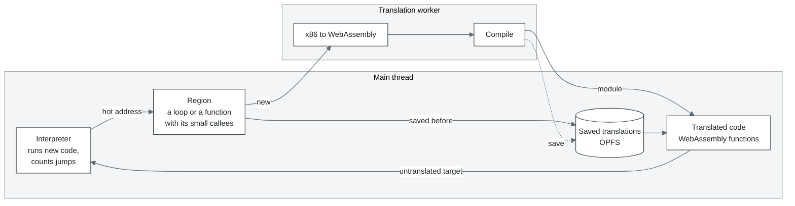
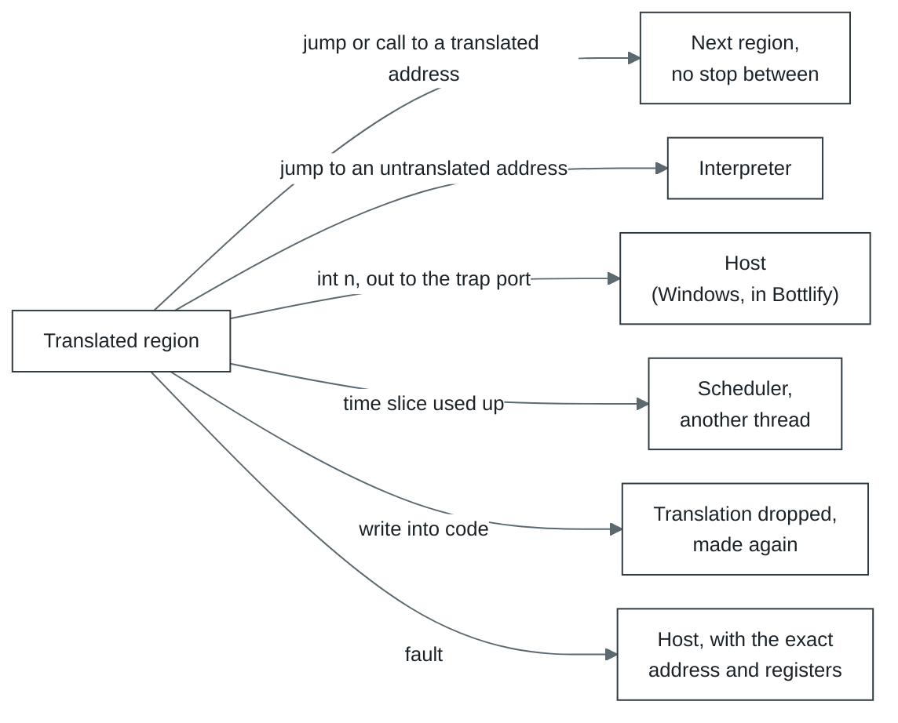

# How cork works



1. **Interpreter.** New code runs in the interpreter, which also counts how many times the program
   jumps to each address. An address jumped to often enough (twice in Bottlify, 50 times on cork's
   own machine) becomes a candidate for translation.
2. **Region.** From the candidate cork gathers every block reachable by ordinary jumps (up to 128
   blocks or 8 KiB of code) and builds in the small functions they call.
3. **Translation.** Regions go to the translation thread in batches of 32 or more, each batch one
   WebAssembly module. When the queue is deep, as while a game loads, a batch takes a quarter of
   what waits, up to 256.
4. **Running.** Translated regions call each other directly. They leave only when there is no
   other way:



5. **The next run.** Translations are kept in OPFS, so the second run of the same program loads
   what the first one translated instead of translating it again. A region is kept under its entry,
   the x87 stack top it is entered at (any top when it has no x87 code) and the translator's modes,
   and a block reached first in another order is taken as the stored region that holds it.

All of the program's memory is one `WebAssembly.Memory`. In Bottlify the program's address `a` is
at offset `a` in it, and cork's own state lies in the program's first 64 KiB, which a Windows
program never maps:

```
0x00000   the program's first page: a read through a null pointer finds zeroes there
0x01000   registers and cork's own state, then the wasm interpreter's data, to 0x05000;
          a store of the program's there faults
0x05000   the program's memory from here on (1 GiB in Bottlify)
  end     cork's tables: one byte of flags for every 4 KiB page (closed, holds translated code,
          watched for writes, ...), where code lies in each page, the entry hash
  past    with several executors, each other executor's state and tables; the page flags
          stay one table for all of them
```

Memory addressed from its start is shorter machine code: on ARM a load of the program's memory
is one instruction, where an offset of 64 KiB took two more. A program that may use its first
64 KiB gets cork's own default instead: its address `a` at `0x10000 + a`, the state below it.
