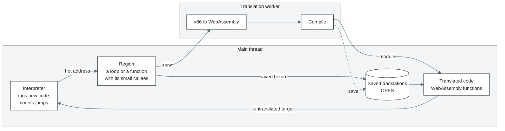
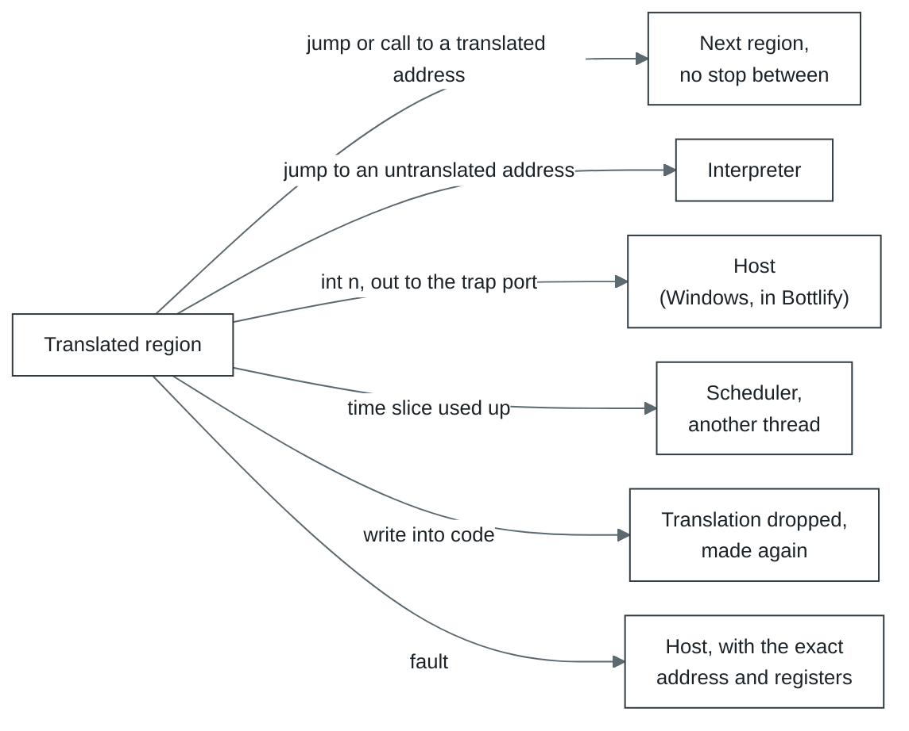

# How cork works



1. **Interpreter.** New code runs in the interpreter, which also counts how many times the program
   jumps to each address. An address jumped to often enough (twice in Bottlify, 50 times on cork's
   own machine) becomes a candidate for translation.
2. **Region.** From the candidate cork gathers every block reachable by ordinary jumps (up to 128
   blocks or 8 KiB of code) and builds in the small functions they call.
3. **Translation.** Regions go to the translation thread in batches of 32 or more, each batch one
   WebAssembly module. When the queue is deep, as while a game loads, a batch takes a quarter of
   what waits, up to 256.
4. **Running.** Translated regions call each other directly. They leave only when there is no
   other way:



5. **The next run.** Translations are kept in OPFS, so the second run of the same program loads
   what the first one translated instead of translating it again. A region is kept under its entry,
   the x87 stack top it is entered at (any top when it has no x87 code) and the translator's modes;
   a version of other bytes at the same entry - code the program patches as it runs - is kept beside
   it under its bytes' hash, so each version is found. A block reached first in another order is
   taken as the stored region that holds it.

All of the program's memory is one `WebAssembly.Memory`. In Bottlify the program's address `a` is
at offset `a` in it, and cork's own state lies in the program's first 64 KiB, which a Windows
program never maps:

```
0x00000   the program's first page: a read through a null pointer finds zeroes there
0x01000   registers and cork's own state, then the wasm interpreter's data, to 0x05000;
          a store of the program's there faults
0x05000   the program's memory from here on (1 GiB in Bottlify)
  end     cork's tables: one byte of flags for every 4 KiB page (closed, holds translated code,
          watched for writes, ...), where code lies in each page, the entry hash
  past    with several executors, each other executor's state and tables; the page flags
          stay one table for all of them
```

Memory addressed from its start is shorter machine code: on ARM a load of the program's memory
is one instruction, where an offset of 64 KiB took two more. A program that may use its first
64 KiB gets cork's own default instead: its address `a` at `0x10000 + a`, the state below it.

## Functions cork knows by their bytes

A compiler links the same functions into every program it builds: its own helpers (`_ftol2` and
`_ftol2_sse`, the latter formed as `cvttsd2si` while the runtime's SSE2 flag is set, the
32-bit quadword arithmetic `_allmul`, `_alldiv`, `_aulldiv`, `_allrem`, `_aullrem`, `_aulldvrm`,
the quadword shifts, `__chkstk` and `__security_check_cookie`, 32-bit and x86-64), and the C
runtime's `memcpy`, `memmove`,
`memset`, `strlen`, `memcmp`, `strcmp`, `memchr`, `strchr`, `sqrt`, `floor` and `ceil` in a program
linked with the runtime statically, and Visual C++ 7.1's to 10's x87 transcendentals `_CIsin`, `_CIcos`,
`_CItan`, `_CIatan`, `_CIasin`, `_CIacos`, `_CIlog`, `_CIlog10`, `_CIexp` and `_CIpow`. cork keeps a dictionary of them (`modules/cork/src/crt-dictionary.js`,
`helpers.js`), each a signature of its code: the bytes reachable from its entry, with the bytes
that differ where it is linked (relocated addresses, RIP-relative offsets, calls out of it)
left out. A direct call whose target matches is not made, nor a call through an import slot to
one in a runtime the program loads as a library, nor a direct call to that import's thunk
(`jmp [slot]`, as a compiler links a call to an import it was not told is one), while the slot
still holds it (not in a wide window):
it is formed as what the function does, a copy as one `memory.copy`, a fill as one `memory.fill`, a string's length as a loop over
its bytes, a comparison or a search as a loop over the bytes to the first that decides it, a
square root as the x87's at the precision the control word says (as the runtime
takes it), `floor` and `ceil` as SSE4.1's exact rounding, a quadword multiply or divide as wasm's
own, a transcendental as the host's own function for it rather than the runtime's SSE2 code,
within a unit in the last place of its result. The result lands
where the function leaves it and no other register changes.

Where the operation cannot be done whole in place, the call is made as it was and the function's
own code runs: a span that reaches a closed page or translated code itself, an address past
4 GiB, a `sqrt` of a negative number or a NaN (which sets `errno`), a `floor` or `ceil` of an
infinity or a NaN, a transcendental's argument outside its domain or where its result would
overflow or underflow (where the runtime sets `errno`), a divide by zero, a stack that `__chkstk` would probe into a closed page or (x86-64) grow past
the thread's limit. A copy
or fill into a page that only holds code elsewhere, or is watched for writes, is made in place, the
watched page marked written as a store marks it. A process over a wide window (a 64-bit image at
0x140000000) forms its copies, fills, string lengths, comparisons and searches over the whole
window, past 4 GiB too.

The dictionary holds Microsoft's runtimes from Visual C++ 7.1 to 14 (2015 to 2022), 32-bit and
x86-64; Visual C++ 9's (2008) is checked against it too. `tools/crt-dictionary.mjs` reads a
signature out of a runtime's DLL, looks it up in other
images (`--find`), and runs the DLL's own function against its operation on seeded arguments
(`--verify`). An entry goes in only once `--verify` finds no difference on any of the function's
paths. A stub too short for its bytes to tell it apart, `__security_check_cookie`'s compare
of an argument with a global and return, is known by its shape instead: those bytes are that
test whatever global and report they name, and only the test is formed, the report left to the
call. Functions that share one entry stub, as the `_CI*` ones do, are told apart by a second
signature: of the code the stub's jump leads to. The `helpers` setting turns the dictionary off.
Bottlify's own C runtime (which stands in for `msvcrt.dll` and `MSVCR80.dll`) has its `memmove`,
`memset`, `strlen`, `strcmp`, `memcmp` and `strchr` compiled to x86 and x86-64 as guest code; the
app hands their bytes to cork (`helpersAlso`), so a program's call to them is formed the same way.
