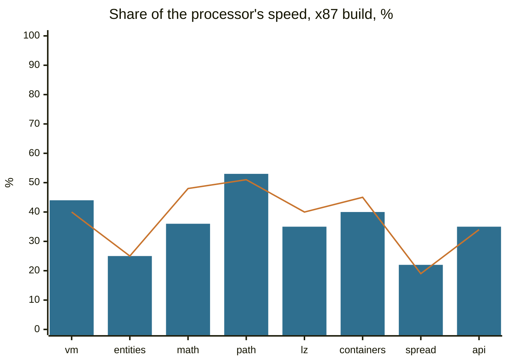
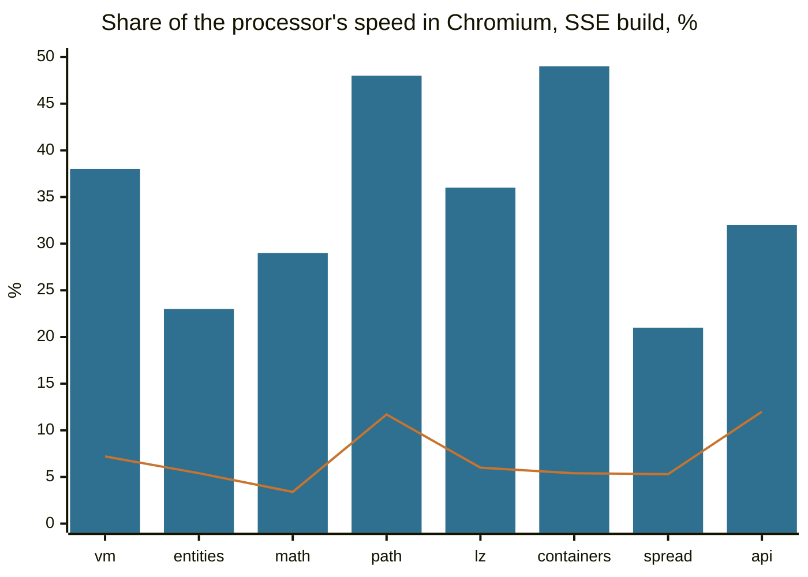

# How fast cork is

Speed is measured with [`bench/`](../../modules/cork/bench/README.md): a 32-bit Windows program in C++ with eight
workloads shaped like what games do. The same `.exe` also runs directly on the processor through a
small Linux loader (`bench/bin/peload`). So cork and the processor run the same machine code, and
every run checks that both got the same checksum.

Each workload ran ten times its own length, so that translation and the cold start are a few per
cent of the run and the numbers are the speed of the translated code itself. Best of three. 100%
is the processor:

| Workload | What it does | Node, x87 | Node, SSE | Chromium, x87 | Chromium, SSE |
| --- | --- | ---: | ---: | ---: | ---: |
| `vm` | bytecode interpreter, one big `switch` | 40% | 32% | 44% | 38% |
| `entities` | 4096 objects, virtual calls | 25% | 23% | 25% | 23% |
| `math` | skinning, transforms, lights | 48% | 39% | 36% | 29% |
| `path` | A* on a 128x128 grid | 51% | 57% | 53% | 48% |
| `lz` | LZ77, CRC, Huffman | 40% | 35% | 35% | 36% |
| `containers` | hash table, sorts, binary search | 45% | 51% | 40% | 49% |
| `spread` | 512 functions calling each other | 19% | 17% | 22% | 21% |
| `api` | Windows API calls between short bits of work | 34% | 34% | 35% | 32% |
| **all eight** (geometric mean) | | **36%** | **34%** | **35%** | **33%** |

Bars: Chromium 141. Line: Node 22.

`spread` and `entities` are the slowest. Both make many calls through function pointers whose
targets keep changing. When a call goes mostly to a few functions cork guesses them, but `spread`
has hundreds, and each such call looks its target up in a table. Tight loops over data (`path`,
`containers`) get closest to the processor: about half of its speed.

What translation buys, x87 build in Node:

| | Share of the processor's speed (geometric mean) |
| --- | ---: |
| interpreter only (`translate: false`) | 1.5% (from 0.7% to 3.7%) |
| translated, a run of the workload's own length, translation and start included | 19% (from 7.2% to 30%) |
| translated, ten times that length | 36% (from 19% to 51%) |

Translated code is over twenty times faster than the interpreter, and even a run of a few tenths of
a second pays for its translation many times over.

## Against v86

[v86](https://github.com/copy/v86) is the best-known way to run x86 code in a browser, and it also
translates hot code to WebAssembly. We ran the same `bench-x87.exe` and `bench-sse.exe` in it: v86
boots Linux from its own test image, and inside it the benchmark runs through the same `peload` that
runs it on the processor. Every checksum matched. Chromium 141, ten times the workloads' length,
share of the processor's speed:

| Workload | v86, x87 | cork, x87 | cork is faster | v86, SSE | cork, SSE | cork is faster |
| --- | ---: | ---: | ---: | ---: | ---: | ---: |
| `vm` | 7.7% | 44% | 5.7x | 7.2% | 38% | 5.3x |
| `entities` | 1.7% | 25% | 14.6x | 5.4% | 23% | 4.3x |
| `math` | 0.6% | 36% | 59x | 3.4% | 29% | 8.4x |
| `path` | 12.7% | 53% | 4.2x | 11.7% | 48% | 4.1x |
| `lz` | 6.2% | 35% | 5.6x | 6.0% | 36% | 6.1x |
| `containers` | 4.9% | 40% | 8.2x | 5.4% | 49% | 8.9x |
| `spread` | 5.2% | 22% | 4.1x | 5.3% | 21% | 3.9x |
| `api` | 9.9% | 35% | 3.5x | 12.0% | 32% | 2.7x |
| **all eight** (geometric mean) | **4.5%** | **35%** | **7.8x** | **6.5%** | **33%** | **5.1x** |

Bars: cork. Line: v86. Node tells the same story: on average cork is 7.1 times faster than v86 on
the x87 build and 4.6 times on the SSE build.

v86 does a lot more work for the same program, though. It emulates a whole computer, so the
benchmark runs on top of a Linux kernel and every memory access goes through v86's emulated page
tables. Its x87 is the real 80-bit arithmetic, done in software, where cork computes in 64-bit
doubles: that explains most of the x87 `math` row, which is why the chart shows the SSE build. In
return v86 boots whole operating systems, where cork only runs a program's code.

How it was measured

- 2026-10-14, cork at `00bc4680`; the interpreter row at `a24f5d9a` (what changed between them does
  not touch the interpreter). Node 22.22.0 (V8 12.4); Chromium 141.0.7390.37 headless (V8 14.1),
  each run in a fresh tab and a dedicated worker of a minified build.
- A 4-core x86-64 Linux VM, Intel Xeon @ 2.10 GHz. Power plan: not recorded.
- Node: `node modules/cork/bench/run.mjs --variant <x87|sse> --only <workload> --iterations
  <10 x own> --reps 3`, each started together with the same run of `a24f5d9a`, so the machine's
  drift (up to a quarter within an hour) falls on both; the processor alone, the best of three runs
  of `bench/bin/peload`. Chromium: `node modules/cork/bench/browser/suite.mjs
  '{"before":{},"after":{}}' --scale 10 --reps 3` over bundles of the two trees, the `after` side in
  the tables. The interpreter row: `run.mjs --native --variant x87 --cork '{"translate":false}'` at
  `a24f5d9a`; the row of the workload's own length: `run.mjs --variant x87` against a tenth of the
  processor's time for ten times the length; one run each.
- The processor ran the workloads at 1.6 to 13.0 billion instructions a second, cork in Chromium at
  0.3 to 4.7 billion. In Chromium the three runs of one workload were up to a fifth apart (`math` on
  x87), most within a tenth.
- v86 0.5.471 from npm, with the BIOS images from its repository and `linux4.iso` from its test
  images; 512 MiB of guest memory; the files handed in over its 9p filesystem. Each workload ran as
  `peload bench-<build>.exe <workload> <10 x own>` in the guest, timed by `peload` itself (the host's
  clock around the command agreed within a few per cent). In Node, three boots and the best run; in
  Chromium (a page, not a worker), one boot. v86's percentages are taken against the same processor
  figures as cork's in Chromium.

