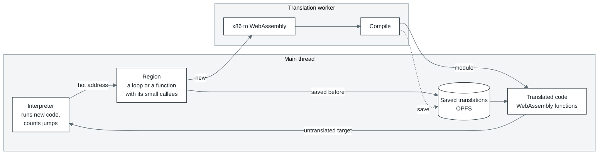
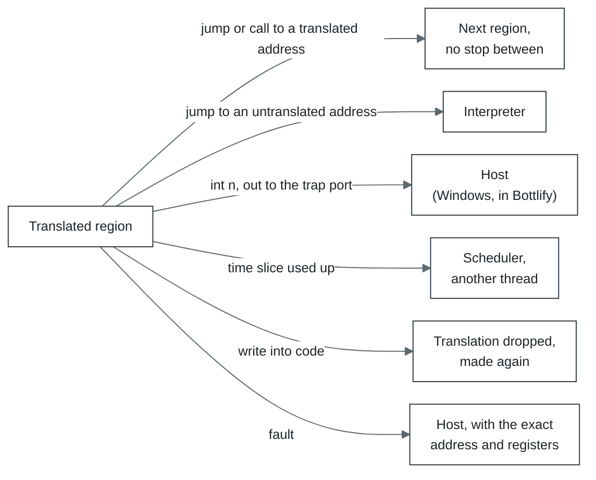
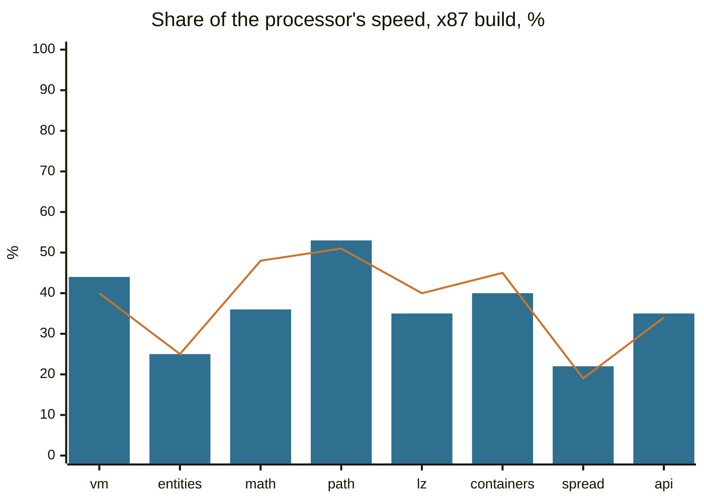
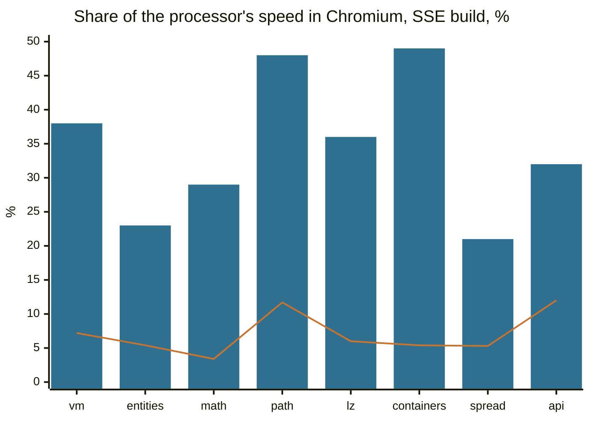

# cork

[По-русски](README.ru.md)

cork is a module for running x86 code (mostly 32-bit) right in the browser. It translates the
program's machine code into WebAssembly, and the browser compiles that into native instructions.
So one build of Bottlify runs on ordinary x86 machines and on ARM alike.

cork is the processor of [Bottlify](../../README.md), and only the processor. It knows nothing
about Windows: when the program makes a system call, writes to a port or hits a fault, cork stops
and hands control back to whoever started it. In Bottlify that is
[`@bottlify/core`](../core/README.md), home of the Windows API, DirectX, sound and the rest.

Plain JavaScript and WebAssembly, with no dependencies. It runs in a browser and in Node.

## What it runs

- 32-bit user-mode x86: integer instructions, the x87, MMX, SSE, SSE2 and SSE3, with POPCNT and
  RDRAND. Exactly the set cork reports through `cpuid`.
- Code that rewrites itself. When the program writes over code that is already translated, the old
  translation is thrown away and a new one made. A page rewritten over and over (eight times within
  100 ms) is left to the interpreter for a while.
- Several threads over one memory. With the `atomic` setting, which Bottlify turns on when a
  process runs on several executors, `lock`-prefixed instructions and `xchg` with memory run as
  WebAssembly atomics, so threads do not lose each other's writes.
- Exact faults. A division by zero, an unknown instruction or a write to a closed page stops right
  at that instruction, with the registers a real processor would have.

## What it does not run

- 64-bit code (planned, see [`roadmap/x64.md`](../../roadmap/x64.md)), 16-bit code, privileged
  instructions, segments other than the `fs` base (a `gs:` override adds nothing).
- SSSE3 and anything newer: SSE4.1, SSE4.2 (POPCNT aside), AVX.
- The x87's 80-bit precision. The FPU registers are plain 64-bit doubles: single and double
  precision are honoured, extended is computed as double. Sine, logarithm and the rest come from
  `Math`. Exception masks are not honoured: every x87 exception behaves as masked.

## Why it is fast

cork runs a program at about a third of the real processor's speed on average, and at half of it on
tight loops. On the same bytes it is 5 to 8 times faster than v86, the best-known x86 in a browser
(numbers below). This is where the speed comes from:

- **It translates whole loops and functions, not single instructions.** A loop or a function,
  together with the small functions it calls, becomes one WebAssembly function. We call such a
  piece a region. The browser's compiler sees an ordinary loop in it and optimizes it like any
  other code.
- **Registers live in local variables.** Inside a region the x86 registers are locals of the
  function, and the browser puts them in the processor's own registers. The program's memory is one
  `WebAssembly.Memory`, so `mov eax, [esi+8]` is a single load with no page tables in between.
- **Flags are worked out only where they are read.** Nearly every x86 instruction sets flags and
  hardly anything reads them. A `cmp` followed by a `jl` becomes one comparison.
- **Translated code stays in WebAssembly.** Regions go from one to another with plain calls between
  WebAssembly functions, never through JavaScript.
- **It guesses where virtual calls go.** cork watches where calls through a pointer actually land.
  When a call goes mostly to a few small functions (up to four, each taking at least an eighth of
  its calls), they are built right into the region and the call becomes a comparison.
- **The program never waits for the translator.** Translation runs in worker threads while the
  program keeps going in the interpreter. The main thread gives the translator a few milliseconds
  at a time at most, so a game does not freeze when it reaches new code.
- **The second run is fast from the start.** Finished translations are kept in the browser's
  storage (OPFS) and loaded from there the next time. A bundle can bring them along.

## How it works



1. **Interpreter.** New code runs in the interpreter, which also counts how many times the program
   jumps to each address. An address reached often enough (twice in Bottlify, 50 times on cork's
   own machine) becomes a candidate for translation.
2. **Region.** From the candidate cork gathers every block reachable by ordinary jumps (up to 128
   blocks or 8 KiB of code) and builds in the small functions they call.
3. **Translation.** Regions go to the translation thread in batches of 32 or more, each batch one
   WebAssembly module. When the queue is deep, as while a game loads, a batch takes a quarter of
   what waits, up to 256. While the thread translates and compiles, the program keeps running in
   the interpreter.
4. **Running.** Translated regions call each other directly. They leave only when there is no
   other way:



5. **The next run.** Translations are kept in OPFS, so the second run of the same program loads
   what the first one translated instead of translating it again. A region is kept under its entry,
   the x87 stack top it is entered at (any top when it has no x87 code) and the translator's modes,
   and a block reached first in another order is taken as the stored region that holds it.

All of the program's memory is one `WebAssembly.Memory`. The program's address `a` is at offset
`0x10000 + a` in it:

```
0x00000   registers and cork's own state (64 KiB)
0x10000   the program's memory: its address 0 is here (1 GiB in Bottlify)
  end     cork's tables: one byte of flags for every 4 KiB page (closed, holds translated code,
          watched for writes, ...), where code lies in each page, the entry hash
  past    with several executors, each other executor's state and tables; the page flags
          stay one table for all of them
```

## Speed

[`bench/`](bench/README.md) is the yardstick: a 32-bit Windows program in C++ with eight workloads
shaped like what games do. The very same `.exe` also runs directly on the processor through a
small Linux loader (`bench/bin/peload`). So cork and the processor run the same bytes, and every
run checks that both got the same checksum.

Each workload ran ten times its own length, so that translation and the cold start are a few per
cent of the run and the numbers are the speed of the translated code itself. Best of three. 100%
is the processor:

| Workload | What it does | Node, x87 | Node, SSE | Chromium, x87 | Chromium, SSE |
| --- | --- | ---: | ---: | ---: | ---: |
| `vm` | bytecode interpreter, one big `switch` | 40% | 32% | 44% | 38% |
| `entities` | 4096 objects, virtual calls | 25% | 23% | 25% | 23% |
| `math` | skinning, transforms, lights | 48% | 39% | 36% | 29% |
| `path` | A* on a 128x128 grid | 51% | 57% | 53% | 48% |
| `lz` | LZ77, CRC, Huffman | 40% | 35% | 35% | 36% |
| `containers` | hash table, sorts, binary search | 45% | 51% | 40% | 49% |
| `spread` | 512 functions calling each other | 19% | 17% | 22% | 21% |
| `api` | Windows API calls between short bits of work | 34% | 34% | 35% | 32% |
| **all eight** (geometric mean) | | **36%** | **34%** | **35%** | **33%** |



Bars: Chromium 141. Line: Node 22.

`spread` and `entities` are the slowest. Both make many calls through function pointers whose
targets keep changing. When a call goes mostly to a few functions cork guesses them, but `spread`
has hundreds, and each such call looks its target up in a table. Tight loops over data (`path`,
`containers`) get closest to the processor: about half of its speed.

What translation buys, x87 build in Node:

| | Share of the processor's speed (geometric mean) |
| --- | ---: |
| interpreter only (`translate: false`) | 1.5% (from 0.7% to 3.7%) |
| translated, a run of the workload's own length, translation and start included | 19% (from 7.2% to 30%) |
| translated, ten times that length | 36% (from 19% to 51%) |

Translated code is over twenty times faster than the interpreter, and even a run of a few tenths of
a second pays for its translation many times over.

### Against v86

[v86](https://github.com/copy/v86) is the best-known way to run x86 code in a browser, and it also
translates hot code to WebAssembly. We ran the same `bench-x87.exe` and `bench-sse.exe` in it: v86
boots Linux from its own test image, and inside it the benchmark runs through the same `peload` that
runs it on the processor. Every checksum matched. Chromium 141, ten times the workloads' length,
share of the processor's speed:

| Workload | v86, x87 | cork, x87 | cork is faster | v86, SSE | cork, SSE | cork is faster |
| --- | ---: | ---: | ---: | ---: | ---: | ---: |
| `vm` | 7.7% | 44% | 5.7x | 7.2% | 38% | 5.3x |
| `entities` | 1.7% | 25% | 14.6x | 5.4% | 23% | 4.3x |
| `math` | 0.6% | 36% | 59x | 3.4% | 29% | 8.4x |
| `path` | 12.7% | 53% | 4.2x | 11.7% | 48% | 4.1x |
| `lz` | 6.2% | 35% | 5.6x | 6.0% | 36% | 6.1x |
| `containers` | 4.9% | 40% | 8.2x | 5.4% | 49% | 8.9x |
| `spread` | 5.2% | 22% | 4.1x | 5.3% | 21% | 3.9x |
| `api` | 9.9% | 35% | 3.5x | 12.0% | 32% | 2.7x |
| **all eight** (geometric mean) | **4.5%** | **35%** | **7.8x** | **6.5%** | **33%** | **5.1x** |



Bars: cork. Line: v86. Node tells the same story: on average cork is 7.1 times faster than v86 on
the x87 build and 4.6 times on the SSE build.

To be fair, v86 does a lot more work for the same program. It emulates a whole computer, so the
benchmark runs on top of a Linux kernel and every memory access goes through v86's emulated page
tables. Its x87 is the real 80-bit arithmetic, done in software, where cork computes in 64-bit
doubles: that is most of the x87 `math` row, which is why the chart shows the SSE build. In return
v86 boots whole operating systems. cork does not try to: Bottlify runs Windows programs on its own
Windows, and all it needs from cork is to run their code fast.

<details>
<summary>How it was measured</summary>

- 2026-10-14, cork at `00bc4680`; the interpreter row at `a24f5d9a` (what changed between them does
  not touch the interpreter). Node 22.22.0 (V8 12.4); Chromium 141.0.7390.37 headless (V8 14.1),
  each run in a fresh tab and a dedicated worker of a minified build.
- A 4-core x86-64 Linux VM, Intel Xeon @ 2.10 GHz. Power plan: not recorded.
- Node: `node modules/cork/bench/run.mjs --variant <x87|sse> --only <workload> --iterations
  <10 x own> --reps 3`, each started together with the same run of `a24f5d9a`, so the machine's
  drift (up to a quarter within an hour) falls on both; the processor alone, the best of three runs
  of `bench/bin/peload`. Chromium: `node modules/cork/bench/browser/suite.mjs
  '{"before":{},"after":{}}' --scale 10 --reps 3` over bundles of the two trees, the `after` side in
  the tables. The interpreter row: `run.mjs --native --variant x87 --cork '{"translate":false}'` at
  `a24f5d9a`; the row of the workload's own length: `run.mjs --variant x87` against a tenth of the
  processor's time for ten times the length; one run each.
- The processor ran the workloads at 1.6 to 13.0 billion instructions a second, cork in Chromium at
  0.3 to 4.7 billion. In Chromium the three runs of one workload were up to a fifth apart (`math` on
  x87), most within a tenth.
- v86 0.5.471 from npm, with the BIOS images from its repository and `linux4.iso` from its test
  images; 512 MiB of guest memory; the files handed in over its 9p filesystem. Each workload ran as
  `peload bench-<build>.exe <workload> <10 x own>` in the guest, timed by `peload` itself (the host's
  clock around the command agreed within a few per cent). In Node, three boots and the best run; in
  Chromium (a page, not a worker), one boot. v86's percentages are taken against the same processor
  figures as cork's in Chromium.

</details>

## Running it

From a terminal, with Node 22 or later (`npm ci` once at the repository's root):

```sh
node modules/cork/bin/cork.mjs run program.elf --linux
```

`cork run <file>` loads a 32-bit little-endian ELF at its own addresses, or a piece of flat code at
`--at` (default `0x1000`), runs it, and prints why it stopped, what is in the registers, and how
many instructions ran, and how many of those in translated code:

```
fib ok
stopped: exit 0 at 0x00401134
eax 0x00000001  ecx 0x00000000  edx 0x00000000  ebx 0x00000000  esp 0x00ffffe4  ...
6627675 instructions, 6626800 of them translated, 0.051 s
```

| Option | What it does |
| --- | --- |
| `--linux` | Answers `int 0x80` the way Linux i386 does for `exit` (1), `exit_group` (252) and `write` (4) to stdout and stderr; any other call gets `-ENOSYS`. Without it the first `int 0x80` stops the run. |
| `--at addr`, `--entry addr` | Where flat code is loaded, and where to start (default: the ELF's entry, or `--at`). |
| `--ram MiB` | Memory for the program (default 16, more if the image needs it). The stack starts at its top. |
| `--max n` | Stop after about `n` instructions. |
| `--set eax=1,ecx=2` | Registers before the start. |
| `--config '<json>'` | Settings ([`SETTINGS.md`](SETTINGS.md)). |
| `--json` | The report as one line of JSON. |

The exit status: the program's own with `--linux`, 0 after a `hlt`, 1 for any other stop, 2 for a
bad command line or an error.

The program from the example above, which needs no C library:

```c
// fib.c -- clang --target=i386-linux-gnu -O2 -nostdlib -static -ffreestanding -fno-pic
//          -fuse-ld=lld fib.c -o fib.elf
static int sys(int n, int a, int b, int c){
    int r;
    __asm__ volatile("int $0x80" : "=a"(r) : "a"(n), "b"(a), "c"(b), "d"(c) : "memory");
    return r;
}
static unsigned fib(unsigned n){ return n < 2 ? n : fib(n - 1) + fib(n - 2); }
void _start(void){
    char text[] = "fib ok\n";
    if (fib(27) == 196418) sys(4, 1, (int)text, 7);
    sys(1, 0, 0, 0);
}
```

`cork translate <file> --entry addr -o out.wasm` saves the region cork forms from that address as a
WebAssembly module of its own, to look at with `wasm2wat` or `wasm-objdump` (`--at` places flat
code as for `run`; `--precise` translates as the `precise` setting does). It does not run on its
own: it takes its memory and helpers from cork.

From JavaScript:

```js
import { createMachine } from '@bottlify/cork';

const machine = createMachine({ ramSize: 16 << 20 });
// mov ecx, 1000; L: mov eax, ecx; int 0x80; add edi, eax; dec ecx; jnz L; hlt
machine.load(0x1000, [0xb9, 0xe8, 3, 0, 0, 0x89, 0xc8, 0xcd, 0x80, 0x01, 0xc7, 0x49, 0x75, 0xf7,
    0xf4]);
machine.setReg('eip', 0x1000);
machine.setReg('esp', (16 << 20) - 16);

for (;;)
{
    const stop = await machine.run();
    if (stop.reason === 'interrupt' && stop.vector === 0x80)
    {
        // The system call answered here: eip is already past the int.
        machine.setReg('eax', machine.reg('eax') * 2);
        continue;
    }
    console.log(stop.reason, machine.reg('edi'));   // halt 1001000
    break;
}
await machine.dispose();
```

`createMachine({ ramSize, config, trapPort })` gives memory, registers and `run`. `run` goes on
until the program needs something from outside:

| `stop.reason` | What happened | Where `eip` is |
| --- | --- | --- |
| `halt` | `hlt` | after it |
| `interrupt` | `int n`, `int3`, `into`; `n` in `stop.vector` | after it, as the processor leaves it |
| `fault` | a fault: `#DE` 0, `#UD` 6, `#GP` 13 and so on; its number in `stop.vector` | on it |
| `trap` | an `out` to the trap port (any `out` if `trapPort` is not set); the value in `stop.value` | after it |
| `unsupported` | an instruction cork has no model of; its name in `stop.op` | on it |
| `limit` | `run({ maxInstructions })` ran out (translated code may go a little past) | where it stopped |

`stop.retired` is how many instructions ran, `stop.translated` how many of them in translated code.
The machine also has `load`, `read`, `reg` and `setReg` (the eight general registers, `eip`,
`eflags`), `memory` (the `WebAssembly.Memory`), `layout` (where each register is in it), `runtime`
(the translator behind it), `diagnostics()` and `dispose()`. `regionModule({ code, at, entry })`
does what `cork translate` does, from code.

Every threshold and size cork works with can be set: the list is in [`SETTINGS.md`](SETTINGS.md).
The defaults are the ones games were measured with.

Bottlify does not import cork; it loads it by URL. `createEngine` implements the contract in
[`engine.js`](../core/src/layers/cpu/engine.js), and the core adds Win32, threads and the scheduler
on top. `@bottlify/core` ships a built copy of cork, so this package is needed directly only to use
cork on its own, or to load another build with `createApp({ cork: { moduleUrl } })`.

## Source

| Part | Files | What it does |
| --- | --- | --- |
| Decoder | `src/decode/` | Turns bytes into instructions. The opcode tables are written by hand: for each instruction the decoder knows its operands, its length, which flags it reads and writes, and how it can fault. An unknown opcode stops it, named. |
| Region former | `src/region.js`, `src/helpers.js` | Forms a region from an entry. Recognises compiler helpers such as MSVC's `_ftol2` by their bytes and puts what they do in place of the call. |
| Emitter | `src/emit/` | Turns a region into one WebAssembly function: integer instructions, flags, memory, the x87, MMX and SSE (`simd.js`), `lock`-prefixed instructions as atomics (`locked.js`), each in a file of its own. It works straight from the decoded instructions, with no intermediate language. |
| Encoder | `src/wasm/` | Writes the WebAssembly bytes, and finds out what the engine supports (SIMD, tail calls). |
| Runtime | `src/runtime/` | Everything around translation: the candidate queue, batches, translation workers (`translator.worker.js`), the shared memory finished code is kept in (`arena.js`), publishing, the entry hash, page flags (`pages.js`), dropping rewritten code, indirect call prediction, gathering small modules into big ones, the records kept in the translation store (`cache.js`), and what the executors of one process share about code (`shared-code.js`). |
| Interpreters | `src/interp.js`, `src/fast.js`, `src/interp-wasm.c` | An interpreter in JavaScript for the very first steps, then one built from C into WebAssembly (in Bottlify; cork's own machine keeps to the JavaScript one). |
| Instruction model | `src/ir.js`, `src/ir-x87.js`, `src/ir-simd.js` | A slow, simple account of what each instruction does. The JavaScript interpreter runs on it, and translated code is checked against it. |

How cork sits in Bottlify (threads, the translation pool, several executors of one process):
[`docs/architecture.md`](../../docs/architecture.md), section 5.

## Testing

```sh
npm test -w @bottlify/cork                  # unit tests and gates, a minute or two
npm run fetch:corpus                        # once: the instruction corpus
npm run test:integration -w @bottlify/cork  # the suites over the corpus
node modules/cork/bench/run.mjs             # the benchmark (bench/README.md)
```

- **Instruction corpus** (`npm run fetch:corpus`, its version pinned in `corpus-lock.json`): cases
  recorded on real processors. Each goes through the decoder, both interpreters and translated code,
  and the result has to match the hardware.
- **Sequence corpus** (`src/testing/sequences-judge.js`): generated chains of instructions run on
  the model and in translated code and are compared bit for bit.
- **Gates**: every fast path has a slow twin, and the two are compared on generated programs.
  Translated against interpreted (`machine.test.js`), a worker's translation against one on the
  same thread (`runtime/translators.test.js`), the shared arena (`runtime/arena.test.js`), a batch
  formed and published in parts against one formed whole (`runtime/forming-parts.test.js`),
  `lock`-prefixed instructions against the model (`emit/locked.test.js`), the corpus translated
  for a process's shared layout and run on its third executor against the hardware
  (`emit/corpus-shared.itest.js`).

Plain ES modules with JSDoc, tests on `node:test`. Licensed MPL-2.0.
