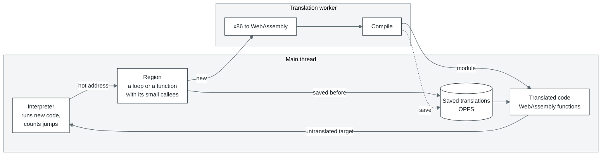
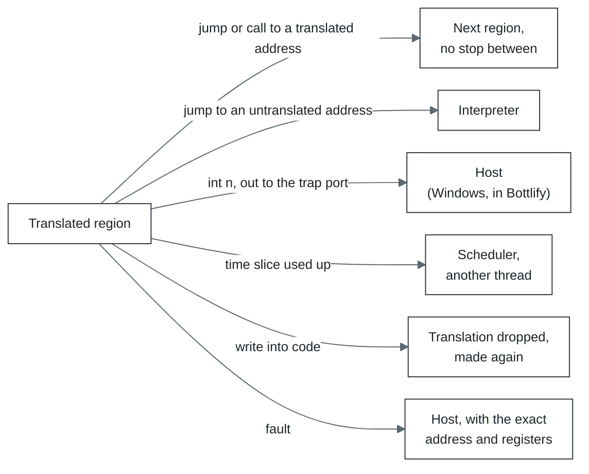
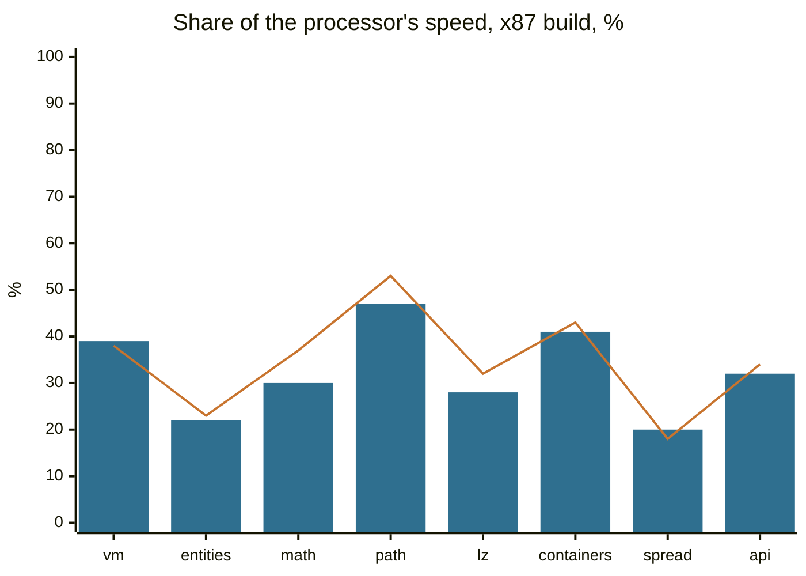
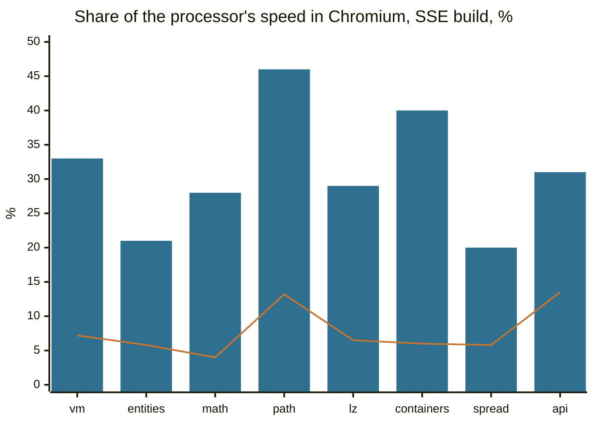

# cork

[По-русски](README.ru.md)

cork runs 32-bit x86 machine code in a browser or in Node. Code that runs for the first time goes
through an interpreter; code that turns out to run often is translated to WebAssembly in a worker
thread, and the browser compiles it to the processor's own code. cork is the processor of
[Bottlify](../../README.md), but it knows nothing about Windows or any other system: a system call,
an I/O port or a fault stops the run and is handed to the program that runs cork. In Bottlify that
is [`@bottlify/core`](../core/README.md).

Plain JavaScript and WebAssembly, no dependencies.

What it runs:

- 32-bit user-mode x86: integer instructions, the x87 FPU, MMX, SSE, SSE2 and SSE3 (what its
  `cpuid` reports).
- Code that rewrites itself. A write into translated code throws away the translations whose bytes
  changed, and they are made again.
- Several threads over one memory: `lock`-prefixed instructions become WebAssembly atomics.
- Exact faults. A division by zero, an unknown instruction or a write to a closed page stops right
  at the instruction, with the registers the processor would have.

What it does not:

- 64-bit code (planned, see [`roadmap/v2/`](../../roadmap/v2/README.md)), 16-bit code, privileged
  instructions, segments other than the `fs` and `gs` bases.
- SSSE3 and anything newer: AVX, SSE4.
- The x87's 80-bit precision. The FPU registers are 64-bit doubles; single and double precision
  control are honoured, extended is treated as double. Sine, logarithm and the rest go through the
  host's `Math`. Exception masks are not honoured: every x87 exception behaves as masked.

## Why it is fast

- **It translates whole loops and functions, not single instructions.** A region (a loop, or a
  function with the small functions it calls) becomes one WebAssembly function, and the browser's
  optimizing compiler treats it like any other loop.
- **Registers are local variables, memory is memory.** Inside a region the x86 registers are locals
  of the function, so they end up in the processor's registers. The program's memory is one
  `WebAssembly.Memory`, so `mov eax, [esi+8]` is one load, with no page tables in between.
- **Flags are worked out only where they are read.** Nearly every x86 instruction sets flags and
  hardly anything reads them; `cmp` followed by `jl` is one comparison.
- **Translated code stays in WebAssembly.** A jump or call from one translated region to another is
  a call between WebAssembly functions, not a trip back to JavaScript.
- **The program does not wait for the translator.** Translation runs in worker threads while the
  program keeps going in the interpreter; the main thread gives the translator a few milliseconds at
  a time at most.
- **The second run starts warm.** Translations are kept in the browser's storage (OPFS) and loaded
  the next time; a bundle can bring them along.

## How it works



1. **Interpreter.** New code runs in an interpreter that counts jumps to every address. An address
   reached often enough (twice, in Bottlify) becomes a candidate for translation.
2. **Region.** From a candidate, cork collects every block reachable by plain jumps, up to 128 blocks
   or 8 KiB, and pulls in small functions it calls. This is a region: the unit that becomes one
   WebAssembly function.
3. **Translation.** Regions go to a worker in batches of 32, one WebAssembly module per batch. The
   worker translates and compiles; the main thread keeps running the interpreter meanwhile and
   spends at most 4 ms at a time on the translator's side of the work.
4. **Running.** Translated regions call each other without going back to JavaScript. They leave only
   when they have to:



5. **Next run.** Translations are kept in the browser's storage (OPFS). A second run of the same
   program loads them instead of translating again; a bundle can bring them along.

The program's memory is one `WebAssembly.Memory`, and address `a` of the program is `0x10000 + a`
in it:

```
0x00000   registers and cork's own state (64 KiB)
0x10000   the program's memory: its address 0 is here (1 GiB in Bottlify)
  end     cork's tables: one byte of flags for every 4 KiB page, the entry hash
```

## Speed

[`bench/`](bench/README.md) is a 32-bit Windows program in C++ with eight workloads in the shape of
what games do. The same `.exe` also runs directly on the processor through a small Linux loader
(`bench/bin/peload`), so cork and the processor run the same bytes, and every run checks that both
got the same checksum.

Each workload ran ten times its own length, so that translation and the cold start are a few per
cent of the run and what is measured is the translated code. Best of three. 100% is the processor:

| Workload | What it does | Node, x87 | Node, SSE | Chromium, x87 | Chromium, SSE |
| --- | --- | ---: | ---: | ---: | ---: |
| `vm` | bytecode interpreter, one big `switch` | 38% | 31% | 39% | 33% |
| `entities` | 4096 objects, virtual calls | 23% | 26% | 22% | 21% |
| `math` | skinning, transforms, lights | 37% | 34% | 30% | 28% |
| `path` | A* on a 128x128 grid | 53% | 48% | 47% | 46% |
| `lz` | LZ77, CRC, Huffman | 32% | 32% | 28% | 29% |
| `containers` | hash table, sorts, binary search | 43% | 48% | 41% | 40% |
| `spread` | 512 functions calling each other | 18% | 17% | 20% | 20% |
| `api` | Windows API calls between short bits of work | 34% | 33% | 32% | 31% |
| **all eight** (geometric mean) | | **33%** | **32%** | **31%** | **30%** |



Bars: Chromium 141. Line: Node 22.

`spread` and `entities` are the slowest: both make many calls through function pointers whose
targets keep changing, and each such call looks its target up in a table. Tight loops over data
(`path`, `containers`) get closest to the processor.

What the translation buys, the x87 build in Node:

| | Share of the processor's speed (geometric mean) |
| --- | ---: |
| interpreter only (`translate: false`) | 1.5% (from 0.7% to 3.7%) |
| translated, a run of the workload's own length, translation and start included | 18% (from 6.5% to 28%) |
| translated, ten times that length | 33% (from 18% to 53%) |

### Against v86

[v86](https://github.com/copy/v86) is the best-known way to run x86 code in a browser, and it also
translates hot code to WebAssembly. The same `bench-x87.exe` and `bench-sse.exe` ran in v86 0.5.471
(the npm release): v86 boots Linux from its own test image, and inside it the benchmark runs through
the same `peload` that runs it on the processor. Every checksum matched. Chromium 141, ten times the
workloads' length, share of the processor's speed:

| Workload | v86, x87 | cork, x87 | cork is faster | v86, SSE | cork, SSE | cork is faster |
| --- | ---: | ---: | ---: | ---: | ---: | ---: |
| `vm` | 8.4% | 39% | 4.7x | 7.2% | 33% | 4.5x |
| `entities` | 1.9% | 22% | 11.5x | 5.8% | 21% | 3.6x |
| `math` | 0.7% | 30% | 46x | 4.0% | 28% | 7.1x |
| `path` | 13.8% | 47% | 3.4x | 13.2% | 46% | 3.5x |
| `lz` | 6.9% | 28% | 4.0x | 6.5% | 29% | 4.4x |
| `containers` | 5.4% | 41% | 7.6x | 6.0% | 40% | 6.7x |
| `spread` | 5.7% | 20% | 3.5x | 5.8% | 20% | 3.5x |
| `api` | 11.1% | 32% | 2.9x | 13.5% | 31% | 2.3x |
| **all eight** (geometric mean) | **4.9%** | **31%** | **6.3x** | **7.1%** | **30%** | **4.2x** |



Bars: cork. Line: v86. In Node the picture is the same: cork is 5.7 times faster than v86 on the
x87 build and 3.75 times on the SSE build (geometric means).

v86 does more for the same program. It emulates a whole computer, so the benchmark runs on top of a
Linux kernel and every memory access goes through v86's emulated page tables; its x87 is exact
80-bit arithmetic done in software, where cork computes in 64-bit doubles (that is most of the x87
`math` row, which is why the chart shows the SSE build). In return v86 boots whole operating
systems, which cork does not try to do: Bottlify runs Windows programs on its own Windows, and cork
only has to run their code.

<details>
<summary>How it was measured</summary>

- 2026-10-14, cork at `a24f5d9a`. Node 22.22.0 (V8 12.4); Chromium 141.0.7390.37 headless (V8
  14.1), each run in a fresh tab and a dedicated worker of a minified build.
- A 4-core x86-64 Linux VM, Intel Xeon @ 2.10 GHz. Power plan: not recorded.
- `node modules/cork/bench/run.mjs --native --variant <x87|sse> --only <workload> --iterations
  <10 x own> --reps 3`; `node modules/cork/bench/browser/suite.mjs '{"head":{}}' --scale 10 --reps
  3`. The interpreter row and the row of the workload's own length: `run.mjs --native --variant
  x87`, with and without `--cork '{"translate":false}'`, one run each.
- The processor ran the workloads at 1.5 to 11.9 billion instructions a second, cork in Chromium at
  0.3 to 3.4 billion. In Chromium the three runs of one workload were up to a fifth apart.
- v86 0.5.471 from npm, with the BIOS images from its repository and `linux4.iso` from its test
  images; 512 MiB of guest memory; the files handed in over its 9p filesystem. Each workload ran as
  `peload bench-<build>.exe <workload> <10 x own>` in the guest, timed by `peload` itself (the host's
  clock around the command agreed within a few per cent). In Node, three boots and the best run; in
  Chromium (a page, not a worker), one boot. The processor's figures for every percentage above are
  the ones measured beside cork in Chromium.

</details>

## Running it

From a terminal, Node 22 or later (`npm ci` once at the repository's root):

```sh
node modules/cork/bin/cork.mjs run program.elf --linux
```

`cork run <file>` loads a 32-bit little-endian ELF at its own addresses, or flat code at `--at`
(default `0x1000`), runs it from its entry, and prints why it stopped, the registers, and how many
instructions ran and how many of them in translated code:

```
fib ok
stopped: exit 0 at 0x00401134
eax 0x00000001  ecx 0x00000000  edx 0x00000000  ebx 0x00000000  esp 0x00ffffe4  ...
6627675 instructions, 6626800 of them translated, 0.051 s
```

| Option | What it does |
| --- | --- |
| `--linux` | Answers `int 0x80` the way Linux i386 does for `exit` (1), `exit_group` (252) and `write` (4) to stdout and stderr; any other call gets `-ENOSYS`. Without it the first `int 0x80` stops the run. |
| `--at addr`, `--entry addr` | Where flat code is loaded, and where to start (default: the ELF's entry, or `--at`). |
| `--ram MiB` | Memory for the program (default 16, more if the image needs it). The stack starts at its top. |
| `--max n` | Stop after about `n` instructions. |
| `--set eax=1,ecx=2` | Registers before the start. |
| `--config '<json>'` | Settings ([`SETTINGS.md`](SETTINGS.md)). |
| `--json` | The report as one line of JSON. |

The exit status is the program's under `--linux`, 0 for a `hlt`, 1 for anything else.

The program above, which needs no C library:

```c
// fib.c -- clang --target=i386-linux-gnu -O2 -nostdlib -static -ffreestanding -fno-pic
//          -fuse-ld=lld fib.c -o fib.elf
static int sys(int n, int a, int b, int c){
    int r;
    __asm__ volatile("int $0x80" : "=a"(r) : "a"(n), "b"(a), "c"(b), "d"(c) : "memory");
    return r;
}
static unsigned fib(unsigned n){ return n < 2 ? n : fib(n - 1) + fib(n - 2); }
void _start(void){
    char text[] = "fib ok\n";
    if (fib(27) == 196418) sys(4, 1, (int)text, 7);
    sys(1, 0, 0, 0);
}
```

`cork translate <file> --entry addr -o out.wasm` writes what cork makes of the code at an address:
one region as a WebAssembly module, to read with `wasm2wat` or `wasm-objdump`. It imports cork's
memory and helpers, so it does not run on its own.

From JavaScript:

```js
import { createMachine } from '@bottlify/cork';

const machine = createMachine({ ramSize: 16 << 20 });
// mov ecx, 1000; L: mov eax, ecx; int 0x80; add edi, eax; dec ecx; jnz L; hlt
machine.load(0x1000, [0xb9, 0xe8, 3, 0, 0, 0x89, 0xc8, 0xcd, 0x80, 0x01, 0xc7, 0x49, 0x75, 0xf7,
    0xf4]);
machine.setReg('eip', 0x1000);
machine.setReg('esp', (16 << 20) - 16);

for (;;)
{
    const stop = await machine.run();
    if (stop.reason === 'interrupt' && stop.vector === 0x80)
    {
        // Your system call: eip is already past the int.
        machine.setReg('eax', machine.reg('eax') * 2);
        continue;
    }
    console.log(stop.reason, machine.reg('edi'));   // halt 1001000
    break;
}
await machine.dispose();
```

`createMachine({ ramSize, config, trapPort })` gives memory, registers and `run`. `run` goes on
until the program needs you:

| `stop.reason` | What happened | Where `eip` is |
| --- | --- | --- |
| `halt` | `hlt` | after it |
| `interrupt` | `int n`, `int3`, `into`; `stop.vector` is `n` | after it, as the processor pushes it |
| `fault` | an exception: `#DE` 0, `#UD` 6, `#GP` 13 and so on; `stop.vector` | at the instruction |
| `trap` | an `out` to the trap port (every `out` when no `trapPort` is given); `stop.value` | after it |
| `unsupported` | an instruction cork has no model for; `stop.op` | at it |
| `limit` | `run({ maxInstructions })` ran out (translated code may run a few past it) | wherever it was |

`stop.retired` is how many instructions the run retired, `stop.translated` how many of them in
translated code. The machine also has `load`, `read`, `reg` and `setReg` (the eight general
registers, `eip`, `eflags`), `memory` (the `WebAssembly.Memory`), `layout` (where each register
is in it), `diagnostics()` and `dispose()`. `regionModule({ code, at, entry })` is `cork
translate` as a function.

Every number cork works with is a setting: [`SETTINGS.md`](SETTINGS.md). The defaults are the ones
games were measured with.

In Bottlify the core loads cork by URL and never imports it: `createEngine` implements the contract
in [`engine.js`](../core/src/layers/cpu/engine.js), and the core adds Win32, threads and the
scheduler on top. `@bottlify/core` ships a built copy; this package is needed directly only to use
cork on its own, or to load your own build with `createApp({ cork: { moduleUrl } })`.

## Source

| Part | Files | What it does |
| --- | --- | --- |
| Decoder | `src/decode/` | Bytes to instructions. Hand-written opcode tables; for every instruction it knows its operands, length, the flags it reads and writes and how it can fault. An unknown opcode is refused by name. |
| Region builder | `src/region.js`, `src/helpers.js` | Collects a region from an entry address. Recognizes compiler helpers such as MSVC's `_ftol2` by their bytes. |
| Emitter | `src/emit/` | A region to one WebAssembly function: integer instructions, flags, memory, x87, MMX and SSE each in a file of their own. Works on decoded instructions directly, without an intermediate language. |
| Encoder | `src/wasm/` | WebAssembly bytes; finds out which features (SIMD, tail calls) the engine has. |
| Runtime | `src/runtime/` | The candidate queue, batches, workers (`translator.worker.js`), the shared store of already emitted functions (`arena.js`), publishing, the entry hash, page flags, dropping code that was written over, relinking small modules into large ones. |
| Interpreters | `src/interp.js`, `src/fast.js`, `src/interp-wasm.c` | A JavaScript interpreter for the first steps, then one compiled from C to WebAssembly. |
| Instruction model | `src/ir.js`, `src/ir-x87.js`, `src/ir-simd.js` | A slow, plain description of what each instruction does. The JavaScript interpreter runs on it, and translated code is checked against it. |

How cork sits in Bottlify (threads, the translation pool, several executors of one process):
[`docs/architecture.md`](../../docs/architecture.md), section 5.

## Testing

```sh
npm test -w @bottlify/cork                  # unit tests and gates, a minute or two
npm run fetch:corpus                        # once: the instruction corpus
npm run test:integration -w @bottlify/cork  # the corpus suites
node modules/cork/bench/run.mjs             # the benchmark (bench/README.md)
```

- **Instruction corpus** (`npm run fetch:corpus`, pinned by `corpus-lock.json`): cases recorded on
  real processors. Every case runs through the decoder, both interpreters and translated code, and
  the result must match the hardware's.
- **Sequence corpus** (`src/testing/sequences-judge.js`): generated sequences of instructions, run
  on the instruction model and on translated code, compared bit for bit.
- **Gates**: every fast path is compared with the slow one beside it on generated programs.
  Translated against interpreted runs (`machine.test.js`), worker against same-thread translation
  (`runtime/translators.test.js`), the shared arena (`runtime/arena.test.js`), a batch formed and
  published in parts against one done at once (`runtime/forming-parts.test.js`), locked
  instructions against the model (`emit/locked.test.js`).

Vanilla ES modules with JSDoc, tests on `node:test`. MPL-2.0.
