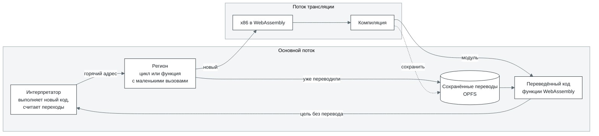
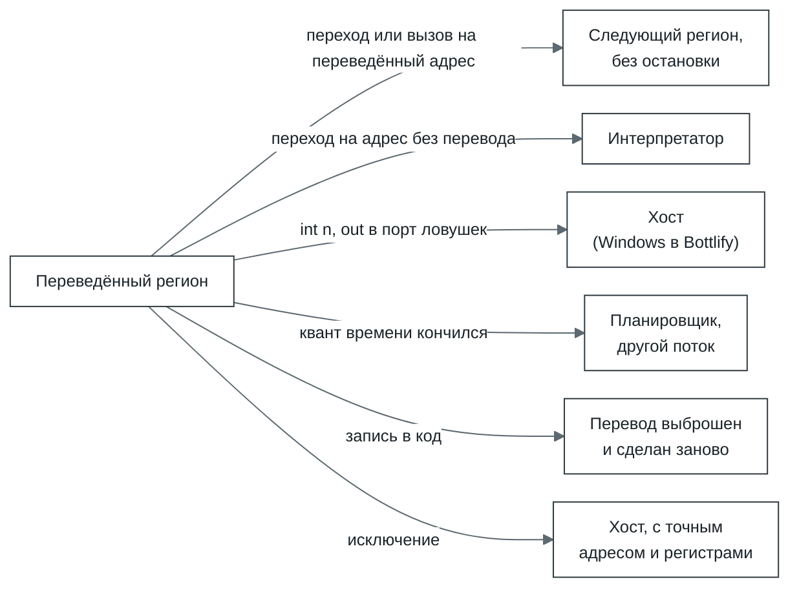
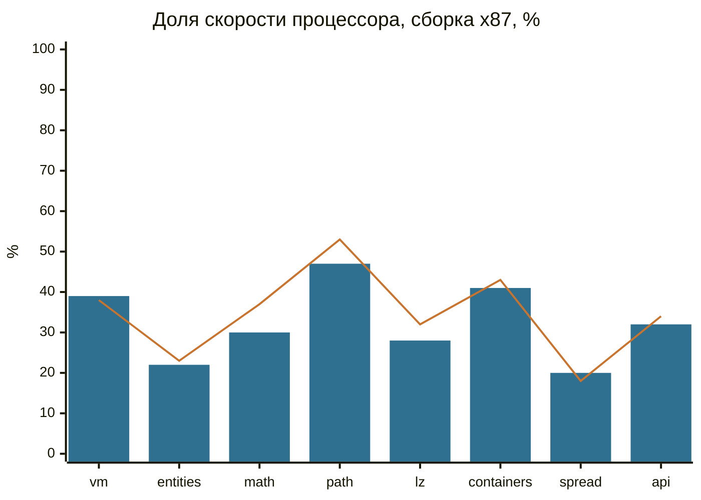
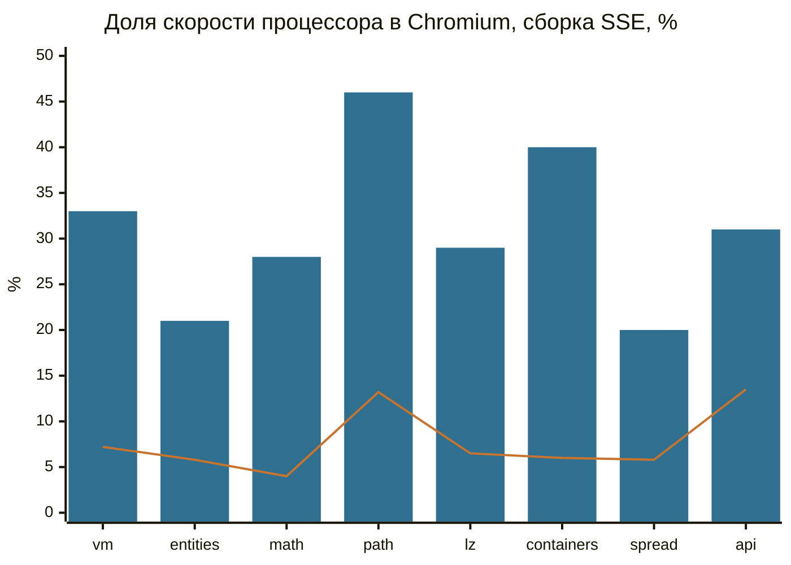

# cork

[English](README.md)

cork выполняет 32-битный машинный код x86 в браузере или в Node. Код, который выполняется впервые,
идёт через интерпретатор; код, который оказался частым, переводится в WebAssembly в отдельном
потоке, и браузер компилирует его в родной код процессора. cork это процессор
[Bottlify](../../README.md), но он ничего не знает ни о Windows, ни о другой системе: системный
вызов, порт ввода-вывода или исключение останавливают выполнение, и разбираться с ними будет тот,
кто запустил cork. В Bottlify это [`@bottlify/core`](../core/README.md).

Чистые JavaScript и WebAssembly, без зависимостей.

Что умеет:

- 32-битный x86 пользовательского режима: целочисленные инструкции, FPU x87, MMX, SSE, SSE2 и SSE3
  (то, что сообщает его `cpuid`).
- Код, который переписывает сам себя. Запись в переведённый код выбрасывает переводы, чьи байты
  изменились, и они делаются заново.
- Несколько потоков над одной памятью: инструкции с префиксом `lock` становятся атомарными операциями
  WebAssembly.
- Точные исключения. Деление на ноль, неизвестная инструкция или запись в закрытую страницу
  останавливают выполнение ровно на инструкции, с теми регистрами, которые были бы у процессора.

Чего не умеет:

- 64-битный код (в планах, см. [`roadmap/v2/`](../../roadmap/v2/README.md)), 16-битный код,
  привилегированные инструкции, сегменты кроме баз `fs` и `gs`.
- SSSE3 и всё новее: AVX, SSE4.
- 80-битную точность x87. Регистры FPU это 64-битные double; режимы одинарной и двойной точности
  соблюдаются, расширенная считается как двойная. Синус, логарифм и остальное идут через `Math`
  хоста. Маски исключений не соблюдаются: любое исключение x87 ведёт себя как замаскированное.

## Почему он быстрый

- **Переводит целые циклы и функции, а не отдельные инструкции.** Регион (цикл или функция вместе с
  маленькими функциями, которые она вызывает) становится одной функцией WebAssembly, и
  оптимизирующий компилятор браузера обращается с ней как с любым другим циклом.
- **Регистры это локальные переменные, память это память.** Внутри региона регистры x86 это
  локальные переменные функции, поэтому они попадают в регистры процессора. Память программы это
  один `WebAssembly.Memory`, поэтому `mov eax, [esi+8]` это одна загрузка, без таблиц страниц
  посередине.
- **Флаги вычисляются только там, где их читают.** Почти каждая инструкция x86 меняет флаги, а читают
  их редко; `cmp` и следом `jl` превращаются в одно сравнение.
- **Переведённый код не выходит из WebAssembly.** Переход или вызов из одного переведённого региона в
  другой это вызов между функциями WebAssembly, без возврата в JavaScript.
- **Программа не ждёт транслятор.** Перевод идёт в отдельных потоках, а программа тем временем
  продолжает работать в интерпретаторе; основной поток отдаёт транслятору не больше нескольких
  миллисекунд подряд.
- **Второй запуск стартует тёплым.** Переводы сохраняются в хранилище браузера (OPFS) и в следующий
  раз загружаются оттуда; бандл может привезти их с собой.

## Как устроен



1. **Интерпретатор.** Новый код выполняет интерпретатор и считает переходы на каждый адрес. Адрес, на
   который пришли достаточно раз (в Bottlify два), становится кандидатом на перевод.
2. **Регион.** От кандидата cork собирает все блоки, до которых можно дойти обычными переходами, до
   128 блоков или 8 КиБ, и подтягивает маленькие функции, которые оттуда вызываются. Это регион:
   единица, которая становится одной функцией WebAssembly.
3. **Перевод.** Регионы уходят в поток трансляции пачками по 32, одна пачка это один модуль
   WebAssembly. Поток переводит и компилирует; основной поток в это время продолжает работать в
   интерпретаторе и тратит на свою часть работы транслятора не больше 4 мс подряд.
4. **Выполнение.** Переведённые регионы вызывают друг друга, не возвращаясь в JavaScript. Выходят они
   только тогда, когда без этого нельзя:



5. **Следующий запуск.** Переводы хранятся в хранилище браузера (OPFS). Второй запуск той же
   программы загружает их вместо того, чтобы переводить заново; бандл может привезти их с собой.

Память программы это один `WebAssembly.Memory`, и адрес `a` программы лежит в нём по адресу
`0x10000 + a`:

```
0x00000   регистры и собственное состояние cork (64 КиБ)
0x10000   память программы: её адрес 0 здесь (в Bottlify 1 ГиБ)
  конец   таблицы cork: байт флагов на каждую страницу в 4 КиБ, хеш входов
```

## Скорость

[`bench/`](bench/README.md) это 32-битная программа для Windows на C++ с восемью задачами того вида,
что бывают в играх. Тот же `.exe` запускается и прямо на процессоре через маленький загрузчик для
Linux (`bench/bin/peload`), так что cork и процессор выполняют одни и те же байты, и каждый прогон
проверяет, что контрольная сумма у обоих одна.

Каждая задача шла в десять раз дольше своей обычной длины, чтобы перевод и холодный старт были
несколькими процентами прогона и мерился сам переведённый код. Лучший из трёх. 100% это процессор:

| Задача | Что делает | Node, x87 | Node, SSE | Chromium, x87 | Chromium, SSE |
| --- | --- | ---: | ---: | ---: | ---: |
| `vm` | интерпретатор байткода, один большой `switch` | 38% | 31% | 39% | 33% |
| `entities` | 4096 объектов, виртуальные вызовы | 23% | 26% | 22% | 21% |
| `math` | скиннинг, трансформации, свет | 37% | 34% | 30% | 28% |
| `path` | A* на сетке 128x128 | 53% | 48% | 47% | 46% |
| `lz` | LZ77, CRC, Хаффман | 32% | 32% | 28% | 29% |
| `containers` | хеш-таблица, сортировки, двоичный поиск | 43% | 48% | 41% | 40% |
| `spread` | 512 функций, вызывающих друг друга | 18% | 17% | 20% | 20% |
| `api` | вызовы Windows API между короткими кусками работы | 34% | 33% | 32% | 31% |
| **все восемь** (среднее геометрическое) | | **33%** | **32%** | **31%** | **30%** |



Столбцы: Chromium 141. Линия: Node 22.

Медленнее всего `spread` и `entities`: в обеих много вызовов через указатели на функции с постоянно
меняющейся целью, и каждый такой вызов ищет цель в таблице. Ближе всего к процессору плотные циклы
над данными (`path`, `containers`).

Что даёт перевод, сборка x87 в Node:

| | Доля скорости процессора (среднее геометрическое) |
| --- | ---: |
| только интерпретатор (`translate: false`) | 1,5% (от 0,7% до 3,7%) |
| с переводом, прогон обычной длины, перевод и старт включены | 18% (от 6,5% до 28%) |
| с переводом, в десять раз длиннее | 33% (от 18% до 53%) |

### Против v86

[v86](https://github.com/copy/v86) самый известный способ запускать код x86 в браузере, и он тоже
переводит горячий код в WebAssembly. Те же `bench-x87.exe` и `bench-sse.exe` запускались в v86 0.5.471
(релиз с npm): v86 загружает Linux со своего тестового образа, и внутри него бенчмарк идёт через тот же
`peload`, которым он запускается на процессоре. Все контрольные суммы совпали. Chromium 141, задачи в
десять раз длиннее обычного, доля скорости процессора:

| Задача | v86, x87 | cork, x87 | cork быстрее | v86, SSE | cork, SSE | cork быстрее |
| --- | ---: | ---: | ---: | ---: | ---: | ---: |
| `vm` | 8,4% | 39% | в 4,7 раза | 7,2% | 33% | в 4,5 раза |
| `entities` | 1,9% | 22% | в 11,5 раза | 5,8% | 21% | в 3,6 раза |
| `math` | 0,7% | 30% | в 46 раз | 4,0% | 28% | в 7,1 раза |
| `path` | 13,8% | 47% | в 3,4 раза | 13,2% | 46% | в 3,5 раза |
| `lz` | 6,9% | 28% | в 4,0 раза | 6,5% | 29% | в 4,4 раза |
| `containers` | 5,4% | 41% | в 7,6 раза | 6,0% | 40% | в 6,7 раза |
| `spread` | 5,7% | 20% | в 3,5 раза | 5,8% | 20% | в 3,5 раза |
| `api` | 11,1% | 32% | в 2,9 раза | 13,5% | 31% | в 2,3 раза |
| **все восемь** (среднее геометрическое) | **4,9%** | **31%** | **в 6,3 раза** | **7,1%** | **30%** | **в 4,2 раза** |



Столбцы: cork. Линия: v86. В Node картина та же: cork быстрее v86 в 5,7 раза на сборке x87 и в 3,75
раза на сборке SSE (средние геометрические).

v86 делает для той же программы больше работы. Он эмулирует целый компьютер, поэтому бенчмарк
работает поверх ядра Linux, и каждое обращение к памяти проходит через эмулированные таблицы страниц
v86; его x87 это точная 80-битная арифметика программно, а cork считает в 64-битных double (отсюда
почти вся строка `math` в сборке x87, поэтому на графике сборка SSE). Зато v86 загружает целые
операционные системы, а cork этого делать и не пытается: Bottlify запускает программы Windows на
своей собственной Windows, и cork достаточно выполнять их код.

<details>
<summary>Как мерили</summary>

- 14 октября 2026, cork на `a24f5d9a`. Node 22.22.0 (V8 12.4); Chromium 141.0.7390.37 без окна (V8
  14.1), каждый прогон в новой вкладке и отдельном воркере минифицированной сборки.
- Виртуальная машина Linux x86-64 на 4 ядра, Intel Xeon @ 2,10 ГГц. Схема питания: не записана.
- `node modules/cork/bench/run.mjs --native --variant <x87|sse> --only <задача> --iterations
  <10 x обычная> --reps 3`; `node modules/cork/bench/browser/suite.mjs '{"head":{}}' --scale 10 --reps
  3`. Строки про интерпретатор и про обычную длину: `run.mjs --native --variant x87`, с
  `--cork '{"translate":false}'` и без, по одному прогону.
- Процессор выполнял задачи со скоростью от 1,5 до 11,9 млрд инструкций в секунду, cork в Chromium от
  0,3 до 3,4 млрд. В Chromium три прогона одной задачи расходились до пятой части.
- v86 0.5.471 с npm, образы BIOS из его репозитория и `linux4.iso` из его тестовых образов; 512 МиБ
  памяти гостя; файлы переданы через его файловую систему 9p. Каждая задача шла в госте как
  `peload bench-<сборка>.exe <задача> <10 x обычная>`, время мерил сам `peload` (часы хоста вокруг
  команды сходились в пределах нескольких процентов). В Node три загрузки и лучший прогон, в Chromium
  (на странице, не в воркере) одна загрузка. Цифры процессора для всех процентов выше те, что
  измерены рядом с cork в Chromium.

</details>

## Как запустить

Из терминала, Node 22 или новее (один раз `npm ci` в корне репозитория):

```sh
node modules/cork/bin/cork.mjs run program.elf --linux
```

`cork run <файл>` загружает 32-битный ELF (little-endian) по его собственным адресам или плоский код
по адресу `--at` (по умолчанию `0x1000`), запускает с точки входа и печатает, почему остановился,
регистры, сколько инструкций выполнено и сколько из них в переведённом коде:

```
fib ok
stopped: exit 0 at 0x00401134
eax 0x00000001  ecx 0x00000000  edx 0x00000000  ebx 0x00000000  esp 0x00ffffe4  ...
6627675 instructions, 6626800 of them translated, 0.051 s
```

| Опция | Что делает |
| --- | --- |
| `--linux` | Отвечает на `int 0x80` так, как Linux i386 отвечает на `exit` (1), `exit_group` (252) и `write` (4) в stdout и stderr; любой другой вызов получает `-ENOSYS`. Без неё первый `int 0x80` останавливает выполнение. |
| `--at addr`, `--entry addr` | Куда грузить плоский код и откуда начинать (по умолчанию точка входа ELF или `--at`). |
| `--ram MiB` | Память для программы (по умолчанию 16, больше, если образу нужно). Стек начинается с её верха. |
| `--max n` | Остановиться примерно после `n` инструкций. |
| `--set eax=1,ecx=2` | Регистры перед стартом. |
| `--config '<json>'` | Настройки ([`SETTINGS.ru.md`](SETTINGS.ru.md)). |
| `--json` | Отчёт одной строкой JSON. |

Код выхода: под `--linux` код программы, 0 после `hlt`, 1 в остальных случаях.

Программа выше, которой не нужна библиотека C:

```c
// fib.c -- clang --target=i386-linux-gnu -O2 -nostdlib -static -ffreestanding -fno-pic
//          -fuse-ld=lld fib.c -o fib.elf
static int sys(int n, int a, int b, int c){
    int r;
    __asm__ volatile("int $0x80" : "=a"(r) : "a"(n), "b"(a), "c"(b), "d"(c) : "memory");
    return r;
}
static unsigned fib(unsigned n){ return n < 2 ? n : fib(n - 1) + fib(n - 2); }
void _start(void){
    char text[] = "fib ok\n";
    if (fib(27) == 196418) sys(4, 1, (int)text, 7);
    sys(1, 0, 0, 0);
}
```

`cork translate <файл> --entry addr -o out.wasm` записывает, во что cork превращает код по адресу:
один регион как модуль WebAssembly, чтобы посмотреть его через `wasm2wat` или `wasm-objdump`. Он
импортирует память и помощников cork, поэтому сам по себе не запускается.

Из JavaScript:

```js
import { createMachine } from '@bottlify/cork';

const machine = createMachine({ ramSize: 16 << 20 });
// mov ecx, 1000; L: mov eax, ecx; int 0x80; add edi, eax; dec ecx; jnz L; hlt
machine.load(0x1000, [0xb9, 0xe8, 3, 0, 0, 0x89, 0xc8, 0xcd, 0x80, 0x01, 0xc7, 0x49, 0x75, 0xf7,
    0xf4]);
machine.setReg('eip', 0x1000);
machine.setReg('esp', (16 << 20) - 16);

for (;;)
{
    const stop = await machine.run();
    if (stop.reason === 'interrupt' && stop.vector === 0x80)
    {
        // Ваш системный вызов: eip уже за инструкцией int.
        machine.setReg('eax', machine.reg('eax') * 2);
        continue;
    }
    console.log(stop.reason, machine.reg('edi'));   // halt 1001000
    break;
}
await machine.dispose();
```

`createMachine({ ramSize, config, trapPort })` даёт память, регистры и `run`. `run` работает, пока
программе не понадобитесь вы:

| `stop.reason` | Что случилось | Где `eip` |
| --- | --- | --- |
| `halt` | `hlt` | за ней |
| `interrupt` | `int n`, `int3`, `into`; в `stop.vector` номер `n` | за ней, как его кладёт процессор |
| `fault` | исключение: `#DE` 0, `#UD` 6, `#GP` 13 и так далее; `stop.vector` | на инструкции |
| `trap` | `out` в порт ловушек (любой `out`, если `trapPort` не задан); `stop.value` | за ней |
| `unsupported` | инструкция, для которой у cork нет модели; `stop.op` | на ней |
| `limit` | кончился `run({ maxInstructions })` (переведённый код может пройти чуть дальше) | где был |

`stop.retired` это сколько инструкций выполнено, `stop.translated` сколько из них в переведённом
коде. Ещё у машины есть `load`, `read`, `reg` и `setReg` (восемь регистров общего назначения, `eip`,
`eflags`), `memory` (`WebAssembly.Memory`), `layout` (где в нём лежит каждый регистр),
`diagnostics()` и `dispose()`. `regionModule({ code, at, entry })` это `cork translate` в виде
функции.

Каждое число, с которым работает cork, можно настроить: [`SETTINGS.ru.md`](SETTINGS.ru.md). Значения
по умолчанию те, с которыми мерили игры.

В Bottlify ядро загружает cork по URL и никогда не импортирует его напрямую: `createEngine` выполняет
контракт из [`engine.js`](../core/src/layers/cpu/engine.js), а ядро добавляет сверху Win32, потоки и
планировщик. В `@bottlify/core` уже лежит собранная копия; сам этот пакет нужен только чтобы
использовать cork отдельно или подключить свою сборку через `createApp({ cork: { moduleUrl } })`.

## Исходники

| Часть | Файлы | Что делает |
| --- | --- | --- |
| Декодер | `src/decode/` | Байты в инструкции. Таблицы опкодов написаны вручную; про каждую инструкцию он знает операнды, длину, какие флаги она читает и пишет и как может упасть. Неизвестный опкод отвергается с его названием. |
| Сборщик регионов | `src/region.js`, `src/helpers.js` | Собирает регион от адреса входа. Узнаёт помощников компилятора вроде `_ftol2` из MSVC по их байтам. |
| Генератор | `src/emit/` | Регион в одну функцию WebAssembly: целочисленные инструкции, флаги, память, x87, MMX и SSE, каждое в своём файле. Работает прямо с декодированными инструкциями, без промежуточного языка. |
| Кодировщик | `src/wasm/` | Байты WebAssembly; выясняет, что умеет движок (SIMD, хвостовые вызовы). |
| Рантайм | `src/runtime/` | Очередь кандидатов, пачки, потоки трансляции (`translator.worker.js`), общее хранилище уже сгенерированных функций (`arena.js`), публикация, хеш входов, флаги страниц, сброс переписанного кода, пересборка мелких модулей в крупные. |
| Интерпретаторы | `src/interp.js`, `src/fast.js`, `src/interp-wasm.c` | Интерпретатор на JavaScript для первых шагов, потом интерпретатор, собранный из C в WebAssembly. |
| Модель инструкций | `src/ir.js`, `src/ir-x87.js`, `src/ir-simd.js` | Медленное и простое описание того, что делает каждая инструкция. На нём работает интерпретатор на JavaScript, и с ним сверяется переведённый код. |

Как cork встроен в Bottlify (потоки, пул трансляции, несколько исполнителей одного процесса):
[`docs/architecture.ru.md`](../../docs/architecture.ru.md), раздел 5.

## Тесты

```sh
npm test -w @bottlify/cork                  # юнит-тесты и гейты, минута-две
npm run fetch:corpus                        # один раз: корпус инструкций
npm run test:integration -w @bottlify/cork  # наборы по корпусу
node modules/cork/bench/run.mjs             # бенчмарк (bench/README.md)
```

- **Корпус инструкций** (`npm run fetch:corpus`, версия зафиксирована в `corpus-lock.json`): случаи,
  записанные на настоящих процессорах. Каждый проходит через декодер, оба интерпретатора и
  переведённый код, и результат должен совпасть с железом.
- **Корпус последовательностей** (`src/testing/sequences-judge.js`): сгенерированные цепочки
  инструкций выполняются на модели инструкций и в переведённом коде и сравниваются бит в бит.
- **Гейты**: каждый быстрый путь сравнивается с медленным рядом с ним на сгенерированных программах.
  Переведённое выполнение против интерпретации (`machine.test.js`), перевод в воркере против перевода
  в том же потоке (`runtime/translators.test.js`), общая арена (`runtime/arena.test.js`), пачка,
  собранная и опубликованная по частям, против собранной разом (`runtime/forming-parts.test.js`),
  инструкции с `lock` против модели (`emit/locked.test.js`).

Обычные ES-модули с JSDoc, тесты на `node:test`. MPL-2.0.
