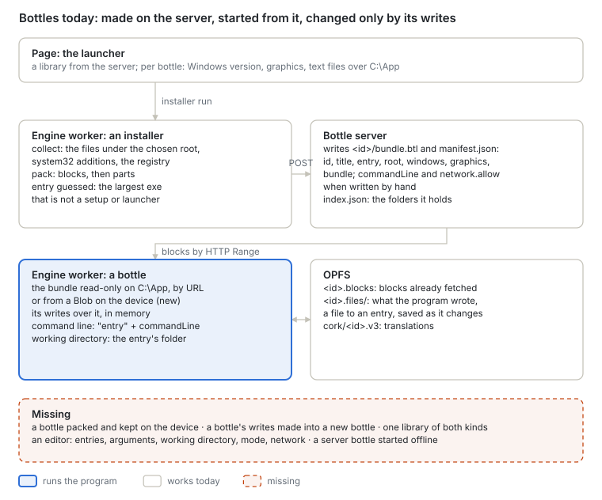
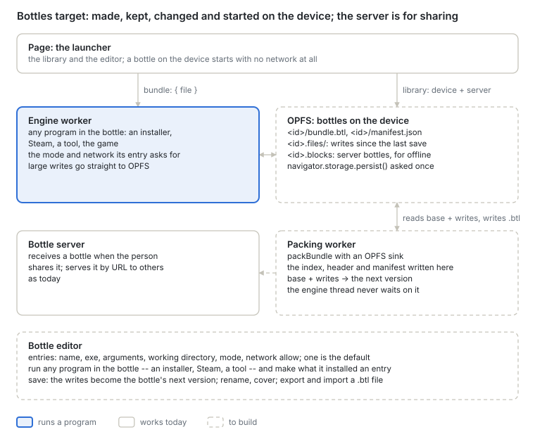

# Bottles on the device, and the bottle editor

Русская версия: [README.ru.md](README.ru.md).

**Status:** proposed 2026-10-04, against `main` 997998cb. Steam is the first program this serves:
[`../steam/`](../steam/README.md).

A bottle today is made by our server and started from it. That serves a library we host. It does
not serve a person who installs a game themselves — from a disc, an installer, Steam — and wants it
kept on their own device, nor a phone client that keeps its bottles in its own data and starts them
without asking a server. And once made, a bottle cannot be changed: what it starts, with which
arguments, in which mode, is fixed when it is packed.

1. [What a bottle is](#what-a-bottle-is)
2. [Where we are](#where-we-are)
3. [Where it goes](#where-it-goes)
4. [Stage 1 — the engine reads a bottle from a file on the device](#stage-1--the-engine-reads-a-bottle-from-a-file-on-the-device)
5. [Stage 2 — a bottle packed on the device](#stage-2--a-bottle-packed-on-the-device)
6. [Stage 3 — a bottle's writes become its next version](#stage-3--a-bottles-writes-become-its-next-version)
7. [Stage 4 — one library](#stage-4--one-library)
8. [Stage 5 — the bottle editor](#stage-5--the-bottle-editor)
9. [Stage 6 — a server bottle offline](#stage-6--a-server-bottle-offline)
10. [Open questions](#open-questions)

## What a bottle is

| Part | What it is | Where it lives |
| --- | --- | --- |
| **The bundle** | The installed program, read-only: files under `C:\App`, system32 additions, the registry as installed (`.btl`, cut into blocks) | the server, or OPFS on the device |
| **The writes** | What the program wrote since: saves, configuration, downloads | OPFS, `<id>.files/`, a file to an entry |
| **The manifest** | Its name, its entries and how each starts | beside the bundle |

**An entry** is one way of starting the bottle: an exe inside it, the arguments, the working
directory, the mode (`auto`, `compatible`, `isolated`) and the network it may reach. A bottle has one or more,
and one is the default. Today a bottle has exactly one, `entry` with `commandLine`, and the mode and
network belong to the launcher's settings or the server's environment rather than to the entry.

## Where we are

| Piece | Today |
| --- | --- |
| Making one | An installer run in the engine is collected (files under the chosen root, system32 additions, the registry), packed into blocks and uploaded in parts; the bottle server writes `<id>/bundle.btl` and `manifest.json` (`modules/installer`, `server/index.js`). The entry is guessed: the largest exe whose name is not a setup's or a launcher's |
| The manifest | `id`, `title`, `entry`, `root`, `windows`, `graphics`, `bundle` (sizes, `indexSha256`); `commandLine` and `network.allow` are read when present but nothing writes them |
| Listing | The launcher reads `/bundles/index.json`, which the launcher server builds from the folders it holds |
| Starting | The bundle is read a block at a time by HTTP `Range` and the blocks kept in OPFS (`<id>.blocks`); or, since 997998cb, from a `Blob` the page holds — a file in OPFS, a file the person chose — with `store: null`, so no second copy is kept. The command line is the quoted entry and `commandLine`; the working directory is the entry's folder |
| The writes | In memory while it runs; saved to OPFS a file at a time as they change (`storage.js`, `opfsSession`) |
| Changing one | The launcher sets a Windows version and graphics per bottle, and text files laid over `C:\App`. Nothing changes the entry, its arguments, the mode or the network. Nothing makes a bottle's writes part of its bundle: `tools/make-btl.mjs` packs a folder on the host |

## Where it goes

The device is where a bottle is made and kept; the server is where it is shared. A bottle on the
device starts with no network at all unless its entry asks for some.

## Stage 1 — the engine reads a bottle from a file on the device

**Done** in 997998cb. `bundle: { file, store: null }` crosses to the worker as the `Blob` itself,
cloned by reference, and the engine reads a range at a time from it. Verified with a bottle of
several hundred megabytes started from a `Blob` through the public `createApp`, in node.

## Stage 2 — a bottle packed on the device

**Goal.** An installer run on the device ends as a bottle in OPFS, with no server.

**Work.** `packBundle` already produces the blocks in a stream; the server's part is the index and
the header written after the last block, and the manifest. That part moves into a function both use,
and the sink becomes an OPFS file written through a synchronous access handle, in a worker of its
own, so the engine's thread never waits on it. The bottle's id is unique on the device, because the
block cache recognises a bundle by its block count alone.

**Accepted when** the same installer run packed on the device and on the server gives the same bytes
of `bundle.btl` and the same manifest, and the bottle on the device starts with the network off.

## Stage 3 — a bottle's writes become its next version

**Goal.** What a program wrote into a bottle — a download, a patch, a configuration — becomes part
of the bottle, so the bottle can be shared as it is and its writes start empty again.

**Work.** Pack the bundle's files with the writes over them — a file the program deleted is left
out — into the bottle's next version, then drop the writes that went into it. The base is read
through the block cache, the writes from `<id>.files/`; nothing is held whole in memory. The
previous version is kept until the next one has started once.

Packing again copies the whole bottle. For a game of many gigabytes a second layer — the writes as
a bundle of their own over the base — costs only the writes, at the price of two bundles to read.
Which one, decided by measuring both on a large bottle.

**Accepted when** a bottle whose program downloaded files starts from its next version with those
files present and its writes empty.

## Stage 4 — one library

**Goal.** The launcher lists the bottles on the device and on the server in one library.

**Work.** Bottles on the device are listed from OPFS (`<id>/manifest.json`); the entry exe is read
on the page through `openBundle` over the `Blob`, rather than from the server's `/entry`. A bottle
can be exported as a `.btl` file and imported from one — the way to move it between devices, or to
back it up — and uploaded to the bottle server only when the person shares it.

**Accepted when** with the server unreachable the library lists the device's bottles and starts any
of them.

## Stage 5 — the bottle editor

**Goal.** A person changes what a bottle starts and how, without packing it again.

**Work.**

- **Entries.** Add, remove and change entries: the exe (picked from the bottle's files), the
  arguments, the working directory, the mode and the network it may reach; choose the default.
  `createApp` gains a working directory option; it takes the entry's folder today.
- **Run anything in the bottle.** Start any exe in the bottle once — an installer, Steam's program,
  a tool — with the network and mode chosen for that run; what it installed is then picked as an
  entry.
- **Entries suggested from what was installed**, from the source that knows: Steam's launch
  configuration (`app_info_print`), an installer's shortcuts in the Start menu, not a guess by size.
- **Save.** The manifest is replaced as a whole; the writes become the next version (stage 3) when
  the person asks. Name and cover are edited here.

The manifest keeps `entry` and `commandLine` as the default entry, so a launcher that does not know
`entries` still starts the bottle.

**Accepted when** a bottle that started Steam's program is changed to start the game it downloaded,
with arguments, and starts it after a reload.

## Stage 6 — a server bottle offline

**Goal.** A bottle from the server, once played, starts without the server.

**Work.** Keep its header, index and manifest in OPFS beside the blocks; start from them when the
server does not answer, and fetch only the blocks not yet here. A bottle wholly fetched is a bottle
on the device.

**Accepted when** a server bottle played once starts with the server down, as far as its fetched
blocks go.

## Open questions

- **Storage on phones:** how much OPFS a phone's browser gives an origin, and whether a persistent
  grant (`navigator.storage.persist()`) holds against eviction for bottles of many gigabytes.
- **A second layer or packing again** (stage 3), by measurement.
- **Sharing a bottle with a person's sign-in in it.** Steam keeps its sign-in in the bottle's
  files; a bottle shared must leave them out, and the editor has to know which they are.
