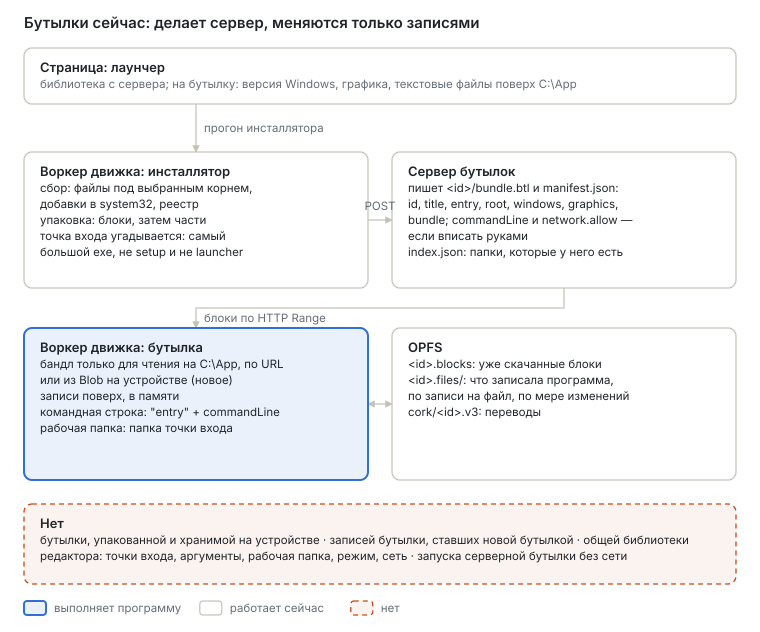
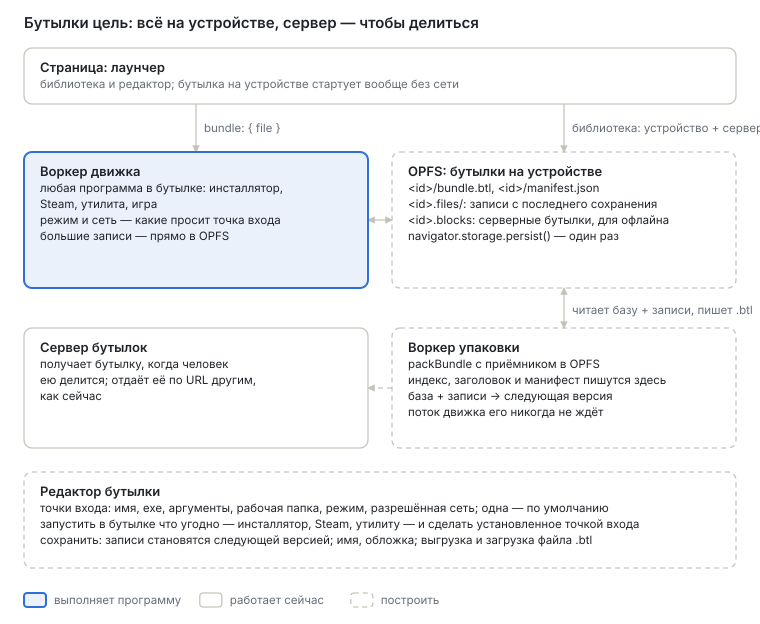

# Бутылки на устройстве и редактор бутылок

English version: [README.md](README.md).

**Статус:** предложен 4 октября 2026, по `main` 997998cb. Первая программа, которой это служит, —
Steam: [`../steam/`](../steam/README.ru.md).

Бутылку сейчас делает наш сервер, и запускается она с него. Это годится для библиотеки, которую
держим мы. Это не годится человеку, который сам ставит игру — с диска, инсталлятором, через Steam —
и хочет держать её на своём устройстве, и не годится клиенту для телефона, который хранит бутылки в
своих данных и запускает их, не спрашивая сервер. А сделанную бутылку нельзя изменить: что она
запускает, с какими аргументами, в каком режиме — фиксируется при упаковке.

1. [Что такое бутылка](#что-такое-бутылка)
2. [Где мы сейчас](#где-мы-сейчас)
3. [Куда идём](#куда-идём)
4. [Этап 1 — движок читает бутылку из файла на устройстве](#этап-1--движок-читает-бутылку-из-файла-на-устройстве)
5. [Этап 2 — бутылка, упакованная на устройстве](#этап-2--бутылка-упакованная-на-устройстве)
6. [Этап 3 — записи бутылки становятся её следующей версией](#этап-3--записи-бутылки-становятся-её-следующей-версией)
7. [Этап 4 — одна библиотека](#этап-4--одна-библиотека)
8. [Этап 5 — редактор бутылки](#этап-5--редактор-бутылки)
9. [Этап 6 — серверная бутылка без сети](#этап-6--серверная-бутылка-без-сети)
10. [Открытые вопросы](#открытые-вопросы)

## Что такое бутылка

| Часть | Что это | Где живёт |
| --- | --- | --- |
| **Бандл** | Установленная программа, только для чтения: файлы под `C:\App`, добавки в system32, реестр после установки (`.btl`, нарезанный на блоки) | на сервере или в OPFS на устройстве |
| **Записи** | То, что программа записала потом: сохранения, настройки, загрузки | OPFS, `<id>.files/`, по записи на файл |
| **Манифест** | Имя, точки входа и как стартует каждая | рядом с бандлом |

**Точка входа** — один способ запустить бутылку: exe внутри неё, аргументы, рабочая папка, режим
(`auto`, `safe`, `full`) и сеть, до которой ей можно дотянуться. У бутылки их одна или больше, и одна
— по умолчанию. Сейчас у бутылки ровно одна, `entry` с `commandLine`, а режим и сеть принадлежат
настройкам лаунчера или окружению сервера, а не точке входа.

## Где мы сейчас

| Что | Сейчас |
| --- | --- |
| Изготовление | Прогон инсталлятора в движке собирается (файлы под выбранным корнем, добавки в system32, реестр), пакуется в блоки и загружается частями; сервер бутылок пишет `<id>/bundle.btl` и `manifest.json` (`modules/installer`, `server/index.js`). Точка входа угадывается: самый большой exe, чьё имя не похоже на setup или launcher |
| Манифест | `id`, `title`, `entry`, `root`, `windows`, `graphics`, `bundle` (размеры, `indexSha256`); `commandLine` и `network.allow` читаются, если есть, но их никто не пишет |
| Список | Лаунчер читает `/bundles/index.json`, который сервер лаунчера строит из своих папок |
| Запуск | Бандл читается по блоку через HTTP `Range`, блоки остаются в OPFS (`<id>.blocks`); или, с 997998cb, из `Blob`, который держит страница — файл в OPFS, файл, выбранный человеком, — со `store: null`, чтобы второй копии не было. Командная строка — точка входа в кавычках и `commandLine`; рабочая папка — папка точки входа |
| Записи | В памяти, пока идёт прогон; сохраняются в OPFS по файлу по мере изменения (`storage.js`, `opfsSession`) |
| Изменение | Лаунчер задаёт на бутылку версию Windows, графику и текстовые файлы поверх `C:\App`. Точку входа, аргументы, режим и сеть не меняет ничто. Ничто не делает записи бутылки частью её бандла: `tools/make-btl.mjs` пакует папку на хосте |

## Куда идём

Устройство — место, где бутылку делают и хранят; сервер — место, где ею делятся. Бутылка на
устройстве запускается вообще без сети, если её точка входа не просит сеть.

## Этап 1 — движок читает бутылку из файла на устройстве

**Сделано** в 997998cb. `bundle: { file, store: null }` переходит в воркер самим `Blob` — клонируется
по ссылке, — и движок читает его по диапазону. Проверено бутылкой в несколько сотен мегабайт,
запущенной из `Blob` через публичный `createApp`, в node.

## Этап 2 — бутылка, упакованная на устройстве

**Цель.** Прогон инсталлятора на устройстве заканчивается бутылкой в OPFS, без сервера.

**Работа.** `packBundle` уже выдаёт блоки потоком; на сервере остаются индекс и заголовок, которые
пишутся после последнего блока, и манифест. Эта часть переезжает в функцию, общую для обоих, а
приёмником становится файл OPFS, который пишется через синхронный access handle, в отдельном
воркере, чтобы поток движка его никогда не ждал. Id бутылки уникален на устройстве, потому что кеш
блоков узнаёт бандл только по числу блоков.

**Принято, когда** один и тот же прогон инсталлятора, упакованный на устройстве и на сервере, даёт
одинаковые байты `bundle.btl` и одинаковый манифест, а бутылка на устройстве запускается с
выключенной сетью.

## Этап 3 — записи бутылки становятся её следующей версией

**Цель.** То, что программа записала в бутылку — загрузка, патч, настройки, — становится частью
бутылки, чтобы ею можно было поделиться как есть, а записи снова начинались с пустого.

**Работа.** Упаковать файлы бандла с записями поверх — файл, который программа удалила, не
попадает — в следующую версию бутылки, затем убрать записи, которые в неё вошли. База читается
через кеш блоков, записи — из `<id>.files/`; ничто не держится в памяти целиком. Предыдущая версия
хранится, пока следующая не запустилась хотя бы раз.

Переупаковка копирует всю бутылку. Для игры в много гигабайт второй слой — записи отдельным бандлом
поверх базы — стоит только записей, ценой двух бандлов на чтение. Что выбрать — решить замером
обоих на большой бутылке.

**Принято, когда** бутылка, чья программа скачала файлы, запускается из следующей версии с этими
файлами на месте и пустыми записями.

## Этап 4 — одна библиотека

**Цель.** Лаунчер показывает бутылки на устройстве и на сервере одной библиотекой.

**Работа.** Бутылки на устройстве перечисляются из OPFS (`<id>/manifest.json`); exe точки входа
читается на странице через `openBundle` поверх `Blob`, а не с серверного `/entry`. Бутылку можно
выгрузить файлом `.btl` и загрузить из файла — так она переезжает между устройствами или
сохраняется в резервную копию, — а на сервер бутылок она попадает, только когда человек ею делится.

**Принято, когда** при недоступном сервере библиотека показывает бутылки устройства и запускает
любую из них.

## Этап 5 — редактор бутылки

**Цель.** Человек меняет, что и как запускает бутылка, не упаковывая её заново.

**Работа.**

- **Точки входа.** Добавить, убрать, изменить: exe (выбирается из файлов бутылки), аргументы,
  рабочая папка, режим и сеть, до которой можно дотянуться; выбрать точку по умолчанию. `createApp`
  получает опцию рабочей папки; сейчас она берётся из папки точки входа.
- **Запустить в бутылке что угодно.** Однократно запустить любой exe из бутылки — инсталлятор,
  программу Steam, утилиту — с сетью и режимом, выбранными на этот прогон; то, что он поставил,
  потом выбирается точкой входа.
- **Точки входа подсказываются из того, что установлено**, источником, который знает:
  конфигурация запуска Steam (`app_info_print`), ярлыки инсталлятора в меню «Пуск», а не догадка по
  размеру.
- **Сохранить.** Манифест заменяется целиком; записи становятся следующей версией (этап 3), когда
  человек просит. Здесь же меняются имя и обложка.

Манифест сохраняет `entry` и `commandLine` как точку по умолчанию, так что лаунчер, не знающий
`entries`, всё равно запускает бутылку.

**Принято, когда** бутылка, которая запускала программу Steam, переделана на запуск скачанной ею
игры с аргументами и запускает её после перезагрузки страницы.

## Этап 6 — серверная бутылка без сети

**Цель.** Бутылка с сервера, в которую играли хоть раз, запускается без сервера.

**Работа.** Хранить её заголовок, индекс и манифест в OPFS рядом с блоками; стартовать с них, когда
сервер не отвечает, и докачивать только те блоки, которых ещё нет. Бутылка, скачанная целиком, —
это бутылка на устройстве.

**Принято, когда** серверная бутылка, в которую играли раз, запускается с лежащим сервером —
насколько хватает скачанных блоков.

## Открытые вопросы

- **Хранилище на телефонах:** сколько OPFS браузер телефона даёт origin и держится ли постоянное
  разрешение (`navigator.storage.persist()`) против вытеснения для бутылок в много гигабайт.
- **Второй слой или переупаковка** (этап 3) — по замеру.
- **Поделиться бутылкой, в которой чей-то вход.** Steam хранит вход в файлах бутылки; бутылка,
  которой делятся, должна их не включать, и редактор должен знать, какие это файлы.
