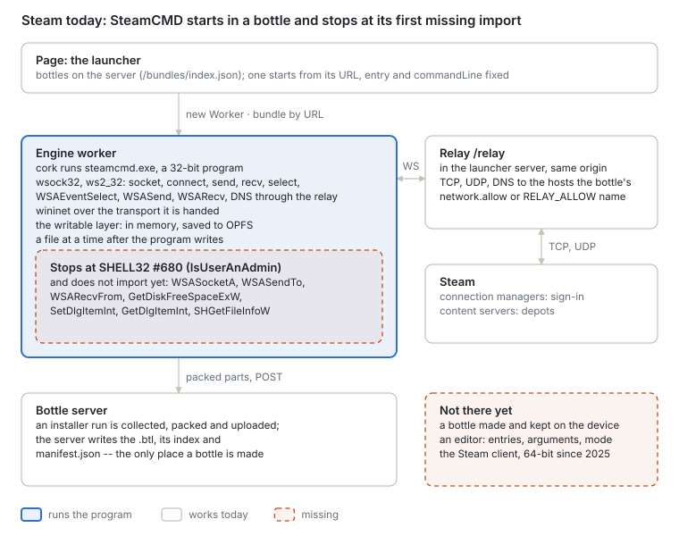
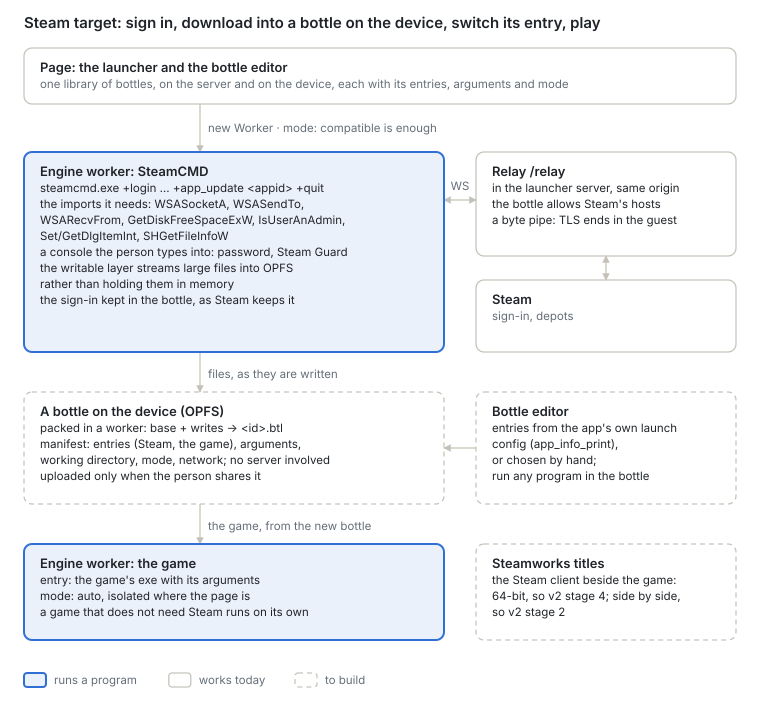

# Steam in a bottle

Русская версия: [README.ru.md](README.ru.md).

**Status:** proposed 2026-10-04, against `main` 997998cb. It rests on two other plans: bottles kept
on the device and the bottle editor are [`../bottles/`](../bottles/README.md); processes side by
side and x86-64 are [`../v2/`](../v2/README.md), stages 2 and 4.

What the person does, as on a desktop with CrossOver: signs in to Steam with their own account,
downloads a game they own from Steam's servers into a bottle, starts it; the bottle is kept, and
started again whenever they like, without Steam's servers and without ours.

1. [Principles](#principles)
2. [Where we are](#where-we-are)
3. [Where it goes](#where-it-goes)
4. [The network and cross-origin isolation](#the-network-and-cross-origin-isolation)
5. [How a Steam game starts](#how-a-steam-game-starts)
6. [Stage 0 — what SteamCMD asks for](#stage-0--what-steamcmd-asks-for)
7. [Stage 1 — SteamCMD signs in and downloads](#stage-1--steamcmd-signs-in-and-downloads)
8. [Stage 2 — downloads the size of a game](#stage-2--downloads-the-size-of-a-game)
9. [Stage 3 — the download becomes a bottle](#stage-3--the-download-becomes-a-bottle)
10. [Stage 4 — titles that need the Steam client](#stage-4--titles-that-need-the-steam-client)
11. [Outside the browser](#outside-the-browser)
12. [Open questions](#open-questions)

## Principles

1. **With Steam, never around it.** Steam's own programs sign in and download, on the person's own
   account. Nothing here fakes a sign-in, answers for Steam's servers, patches a check out of a
   program or stands in for `steam_api.dll`. A title that needs the Steam client runs with the
   Steam client (stage 4), or does not run yet.
2. **The account stays the person's.** The password and the Steam Guard code are typed into
   Steam's own program inside the bottle. The relay carries bytes it cannot read: SteamCMD speaks
   TLS through its own library, so encryption begins and ends in the guest. What Steam keeps to
   stay signed in is kept where Steam keeps it, in the bottle, on the device.
3. **The generic layer, not a Steam layer.** Every gap below is a Win32 contract — a Winsock
   function, a shell call, a file system that holds gigabytes — that any program on the same path
   needs. Steam is the program that finds them, as a game found the others.
4. **No claims for titles not measured.** Whether a given game runs is found by running it here.

## Where we are

| Piece | Today |
| --- | --- |
| SteamCMD (`steamcmd.exe`, PE machine `0x14c`, 32-bit) | Loads and runs for 2.5 s in node through `tools/install-watch.mjs`, then calls `SHELL32.dll` ordinal 680 (`IsUserAnAdmin`), which is not implemented. Also imported and not implemented: `WSASocketA`, `WSASendTo`, `WSARecvFrom` (ws2_32), `GetDiskFreeSpaceExW` (kernel32; the A form exists), `SetDlgItemInt`, `GetDlgItemInt` (user32), `SHGetFileInfoW` (shell32; the A form exists) |
| The Steam client | 64-bit only on Windows since Valve's update of December 2025, so it waits on v2 stage 4. Its interface is a Chromium build of its own (`steamwebhelper.exe`) |
| Winsock | `wsock32` and `ws2_32` share one table: sockets TCP and UDP, `connect`, `send`, `recv`, `sendto`, `recvfrom`, `select`, `WSAAsyncSelect`, `WSAEventSelect`, `WSASend`, `WSARecv`, `gethostbyname`, the `mswsock` extensions. No `getaddrinfo` |
| The relay | `/relay` in the launcher server, same origin. A room is a LAN; the outside is closed unless the bottle's `manifest.network.allow` or `RELAY_ALLOW` names the host. TCP, UDP and DNS. A TCP `send` over 64 KiB is not split into frames yet and fails |
| HTTP | `wininet` takes a transport that nothing hands it today, so it answers "cannot connect". No WinHTTP, no TLS of the system's own (schannel). SteamCMD needs neither: it brings its own TLS over Winsock |
| Where downloads go | The writable layer keeps files in memory and saves them to OPFS a file at a time (`<id>.files/`). A game of several gigabytes does not fit that way |
| A bottle from them | Made only by the bottle server, from an installer run. See [`../bottles/`](../bottles/README.md) |

## Where it goes

One bottle holds Steam's program and the game it downloaded. The bottle editor gives it two
entries: SteamCMD (or later the client) with the network Steam needs, and the game, which needs
none. The person runs the first, then makes the second the default.

## The network and cross-origin isolation

Cross-origin isolation (`Cross-Origin-Opener-Policy: same-origin` with
`Cross-Origin-Embedder-Policy: require-corp`) governs what a page may **load** from other origins
— scripts, images, `fetch` without CORS — and whether it has `SharedArrayBuffer`. It does not apply
to WebSocket. The relay is a WebSocket to the page's own origin, and the connections to Steam are
the relay's, in Node, where no browser policy reaches. So:

| Step | Network | Needs isolation |
| --- | --- | --- |
| SteamCMD signs in, downloads | through the relay, in either mode | no: `compatible` is enough |
| Packing the bottle | none | no |
| The game | none, or the relay for multiplayer | no; `isolated` is faster where the page allows it |

Isolation never blocks the network; the browser blocks something else: a page cannot open TCP or
UDP at all, isolated or not, and it cannot `fetch` Steam's content servers, which send no CORS
headers. That is why the relay exists. Running an installer, or SteamCMD, in `compatible` mode is
reasonable: it draws little and loses nothing; its sound, mixed on the engine's thread and posted
to the worklet, lags the picture more than in `isolated`.

## How a Steam game starts

- **Through the client:** `steam.exe -applaunch <appid> [arguments]` asks a running Steam to start
  the app; Steam starts it as its launch configuration says.
- **The launch configuration** is part of the app's metadata: for each launch option an
  executable, its arguments, a working directory, a type and the systems it is for. SteamCMD
  prints it: `+app_info_print <appid>`. That is where the bottle editor takes its entries from,
  rather than from a guess about which exe is the game.
- **Directly:** a title that does not use Steamworks is an exe like any other and starts as the
  launch configuration says, with Steam gone.
- **Steamworks titles:** `steam_api.dll` looks for a running client (it records where it is in
  `HKCU\Software\Valve\Steam\ActiveProcess`) and talks to it across processes. Such a title,
  started directly, may ask Steam to restart it (`SteamAPI_RestartAppIfNecessary`) and exit. These
  need the client running beside them: stage 4.

## Stage 0 — what SteamCMD asks for

**Goal.** The list of what SteamCMD needs from the system, measured rather than guessed.

**Work.** Implement each import as its contract says, in the order the run reaches them, and
record every run's journal: the unimplemented imports, the hosts it resolves and dials (the relay
logs them), the files it writes and their sizes. On its first start SteamCMD updates itself — it
downloads its own packages and starts again — so the first list comes from the update.

**Accepted when** `steamcmd.exe +quit` completes its self-update in node and exits 0, with the hosts
it needed written down.

## Stage 1 — SteamCMD signs in and downloads

**Goal.** SteamCMD in a bottle signs in and downloads an app.

**Work.**

- **The imports stage 0 found**, each with tests from its contract: `IsUserAnAdmin`,
  `WSASocketA`, `WSASendTo`, `WSARecvFrom`, `GetDiskFreeSpaceExW` (answered from the storage the
  bottle has: `navigator.storage.estimate()`), `SetDlgItemInt`, `GetDlgItemInt`, `SHGetFileInfoW`,
  and whatever the next runs reach.
- **The relay:** a TCP `send` over 64 KiB split into frames; Steam's hosts allowed for a bottle
  that runs Steam's program (`manifest.network.allow`, written by the editor, never a wildcard
  for the whole internet).
- **A console the person types into.** SteamCMD asks for the password and the Steam Guard code on
  standard input. The launcher shows the console and sends what is typed to the program's input;
  nothing typed is stored by the launcher.

**Accepted when** in the browser, in `compatible` mode, `+login anonymous +app_update <appid> +quit`
downloads an app Steam lets anyone download (a dedicated server), and `+login <account>` signs in
with a Steam Guard code typed by the person.

## Stage 2 — downloads the size of a game

**Goal.** A download of several gigabytes completes, on a desktop and on a phone, without holding
it in memory.

**Work.**

- **The writable layer writes large files to OPFS as they are written**, through synchronous access
  handles in the worker (`opfs-store.js` already holds the store; today it serves the block cache
  only), rather than keeping them in memory until a save.
- **Free space** answered honestly, and the bottle's storage made persistent
  (`navigator.storage.persist()`) before a large download, so the browser does not evict it.
- **Throughput measured:** where the time of a download goes — the relay, the engine's Winsock,
  SteamCMD's own decompression and hashing in translated code — and the cost fixed in the layer
  where it is.

**Accepted when** a download of several gigabytes completes in the browser with the engine's memory
flat, and a reload in the middle resumes it as SteamCMD resumes on Windows.

## Stage 3 — the download becomes a bottle

**Goal.** What SteamCMD downloaded is a bottle on the device that starts the game.

**Work.** This is [`../bottles/`](../bottles/README.md) stages 2 to 5 applied: the bottle's writes
packed into its next version on the device, and the editor adding the game's entry from
`app_info_print`'s launch configuration.

**Accepted when** a game that does not use Steamworks, downloaded with the person's account, starts
from its bottle with the network off.

## Stage 4 — titles that need the Steam client

**Goal.** A Steamworks title runs beside the Steam client, signed in, in one bottle.

**Depends on** v2 stage 2 (processes side by side, named objects and shared memory between them —
how `steam_api` reaches the client) and v2 stage 4 (x86-64, since the client is 64-bit), and on the
client's own interface, a Chromium build running in the engine.

**Accepted when** the client starts, signs in and launches an installed Steamworks title with
`-applaunch`.

## Outside the browser

A Bottlify client of its own — on a phone, or a desktop shell — opens TCP and UDP itself, so it
needs no relay: the same `win32.network` transport contract (`wsock32/transport.js`) over the
platform's sockets. Its bottles live in its own data directory with the layout of
[`../bottles/`](../bottles/README.md), so a bottle is downloaded once and started without our
servers. In Chrome, the Direct Sockets API gives the same to an Isolated Web App.

## Open questions

- **Which Steam hosts a bottle must allow**, measured in stage 0, and whether that list is stable
  enough to write into a manifest.
- **Who runs the relay for Steam traffic.** Game-sized downloads through our server cost bandwidth;
  a client outside the browser does not need it.
- **The client's interface:** whether the Chromium the Steam client brings can run in the engine
  at a usable speed, or the client must be driven without it.
