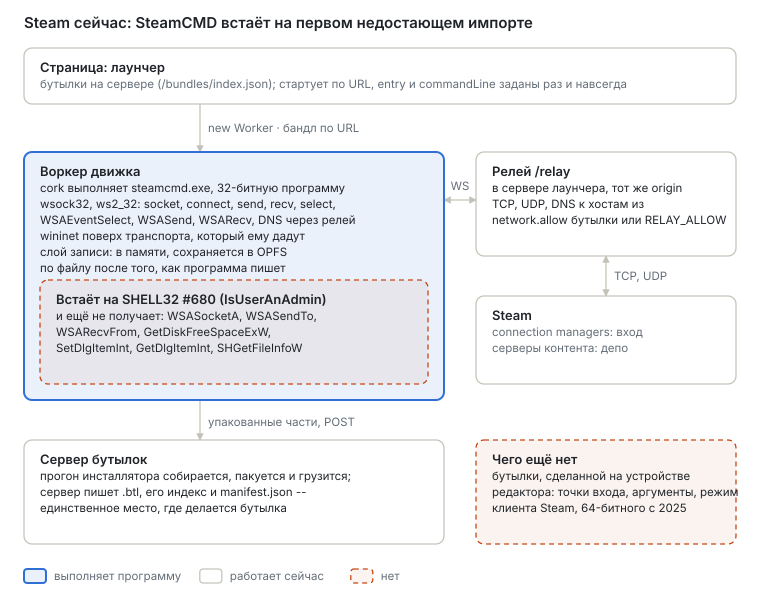
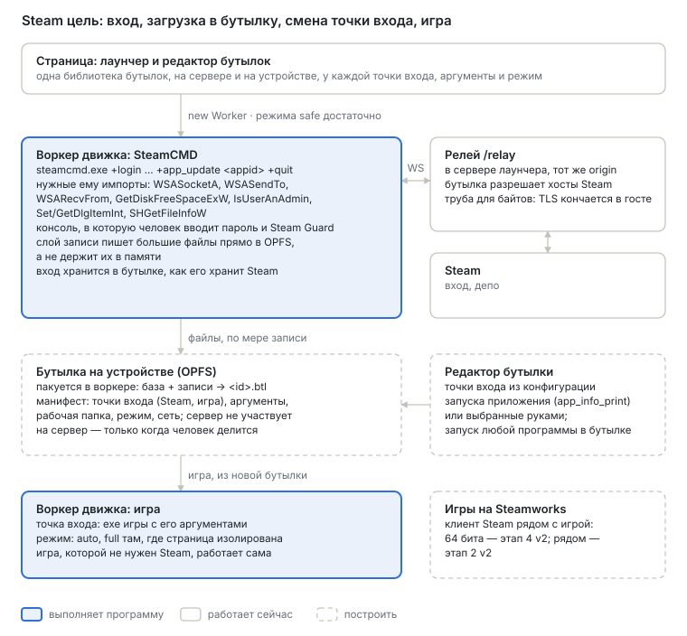

# Steam в бутылке

English version: [README.md](README.md).

**Статус:** предложен 4 октября 2026, по `main` 997998cb. Опирается на два других плана: бутылки на
устройстве и редактор бутылок — [`../bottles/`](../bottles/README.ru.md); процессы рядом друг с
другом и x86-64 — [`../v2/`](../v2/README.ru.md), этапы 2 и 4.

Что делает человек — как на десктопе с CrossOver: входит в Steam своей учётной записью, скачивает
купленную игру с серверов Steam в бутылку и запускает её; бутылка остаётся и запускается снова,
когда захочется, без серверов Steam и без наших.

1. [Принципы](#принципы)
2. [Где мы сейчас](#где-мы-сейчас)
3. [Куда идём](#куда-идём)
4. [Сеть и cross-origin isolation](#сеть-и-cross-origin-isolation)
5. [Как стартует игра Steam](#как-стартует-игра-steam)
6. [Этап 0 — что просит SteamCMD](#этап-0--что-просит-steamcmd)
7. [Этап 1 — SteamCMD входит и скачивает](#этап-1--steamcmd-входит-и-скачивает)
8. [Этап 2 — загрузки размером с игру](#этап-2--загрузки-размером-с-игру)
9. [Этап 3 — загрузка становится бутылкой](#этап-3--загрузка-становится-бутылкой)
10. [Этап 4 — игры, которым нужен клиент Steam](#этап-4--игры-которым-нужен-клиент-steam)
11. [Вне браузера](#вне-браузера)
12. [Открытые вопросы](#открытые-вопросы)

## Принципы

1. **Со Steam, а не в обход.** Входят и скачивают собственные программы Steam, на учётной записи
   самого человека. Здесь ничто не подделывает вход, не отвечает за серверы Steam, не вырезает
   проверку из программы и не подменяет `steam_api.dll`. Игра, которой нужен клиент Steam,
   запускается с клиентом Steam (этап 4) — или пока не запускается.
2. **Учётная запись остаётся у человека.** Пароль и код Steam Guard вводятся в собственную
   программу Steam внутри бутылки. Релей несёт байты, которые не может прочитать: SteamCMD говорит
   TLS своей библиотекой, так что шифрование начинается и заканчивается в госте. То, что Steam
   хранит, чтобы оставаться в системе, хранится там, где его хранит Steam, — в бутылке, на
   устройстве.
3. **Общий слой, а не слой для Steam.** Каждый пробел ниже — контракт Win32: функция Winsock,
   вызов оболочки, файловая система, которая держит гигабайты, — и он нужен любой программе на том
   же пути. Steam — программа, которая их находит, как другие находила игра.
4. **Никаких утверждений об играх, которые не мерили.** Запускается ли игра, выясняется запуском
   здесь.

## Где мы сейчас

| Что | Сейчас |
| --- | --- |
| SteamCMD (`steamcmd.exe`, PE machine `0x14c`, 32 бита) | Загружается и работает 2,5 с в node через `tools/install-watch.mjs`, затем зовёт `SHELL32.dll` ordinal 680 (`IsUserAnAdmin`), которого нет. Импортирует и не получает ещё: `WSASocketA`, `WSASendTo`, `WSARecvFrom` (ws2_32), `GetDiskFreeSpaceExW` (kernel32; форма A есть), `SetDlgItemInt`, `GetDlgItemInt` (user32), `SHGetFileInfoW` (shell32; форма A есть) |
| Клиент Steam | На Windows только 64-битный с обновления Valve в декабре 2025, так что ждёт этапа 4 v2. Его интерфейс — собственная сборка Chromium (`steamwebhelper.exe`) |
| Winsock | У `wsock32` и `ws2_32` одна таблица: сокеты TCP и UDP, `connect`, `send`, `recv`, `sendto`, `recvfrom`, `select`, `WSAAsyncSelect`, `WSAEventSelect`, `WSASend`, `WSARecv`, `gethostbyname`, расширения `mswsock`. `getaddrinfo` нет |
| Релей | `/relay` в сервере лаунчера, тот же origin. Комната — это LAN; наружу закрыто, пока хост не назван в `manifest.network.allow` бутылки или в `RELAY_ALLOW`. TCP, UDP и DNS. TCP `send` больше 64 КиБ ещё не режется на кадры и падает |
| HTTP | `wininet` берёт транспорт, который ему сейчас никто не даёт, и отвечает «cannot connect». WinHTTP нет, своего системного TLS (schannel) нет. SteamCMD не нужно ни то ни другое: он приносит свой TLS поверх Winsock |
| Куда ложатся загрузки | Слой записи держит файлы в памяти и сохраняет их в OPFS по файлу (`<id>.files/`). Игра в несколько гигабайт так не помещается |
| Бутылка из них | Делается только сервером бутылок, из прогона инсталлятора. См. [`../bottles/`](../bottles/README.ru.md) |

## Куда идём

В одной бутылке — программа Steam и скачанная ею игра. Редактор бутылки даёт ей две точки входа:
SteamCMD (позже — клиент) с сетью, которая нужна Steam, и игру, которой сеть не нужна. Человек
запускает первую, потом делает вторую точкой по умолчанию.

## Сеть и cross-origin isolation

Cross-origin isolation (`Cross-Origin-Opener-Policy: same-origin` вместе с
`Cross-Origin-Embedder-Policy: require-corp`) решает, что страница может **загружать** с других
origin — скрипты, картинки, `fetch` без CORS, — и есть ли у неё `SharedArrayBuffer`. На WebSocket
она не действует. Релей — это WebSocket к собственному origin страницы, а соединения со Steam
открывает релей, в Node, куда политики браузера не дотягиваются. Поэтому:

| Шаг | Сеть | Нужна изоляция |
| --- | --- | --- |
| SteamCMD входит и скачивает | через релей, в любом режиме | нет: хватит `safe` |
| Упаковка бутылки | никакой | нет |
| Игра | никакой, или релей для сетевой игры | нет; `full` быстрее там, где страница изолирована, а звуку она сегодня нужна |

Изоляция никогда не запрещает сеть; браузер запрещает другое: страница не может открыть TCP или
UDP вообще, изолирована она или нет, и не может сделать `fetch` к серверам контента Steam, которые
не шлют заголовков CORS. Для этого и есть релей. Запускать инсталлятор или SteamCMD в режиме `safe`
разумно: рисуют они мало и ничего не теряют. Что `safe` теряет сегодня — звук, потому что
AudioWorklet читает кольцо в `SharedArrayBuffer`; звук через message port — открытая работа в
области звука.

## Как стартует игра Steam

- **Через клиент:** `steam.exe -applaunch <appid> [аргументы]` просит запущенный Steam запустить
  приложение; Steam запускает его так, как сказано в конфигурации запуска.
- **Конфигурация запуска** — часть метаданных приложения: для каждого варианта запуска —
  исполняемый файл, его аргументы, рабочая папка, тип и системы, для которых он. SteamCMD её
  печатает: `+app_info_print <appid>`. Отсюда редактор бутылки и берёт точки входа, а не из догадки,
  какой exe — игра.
- **Напрямую:** игра без Steamworks — обычный exe и запускается так, как сказано в конфигурации
  запуска, без Steam.
- **Игры на Steamworks:** `steam_api.dll` ищет запущенный клиент (где он, записано в
  `HKCU\Software\Valve\Steam\ActiveProcess`) и говорит с ним между процессами. Такая игра,
  запущенная напрямую, может попросить Steam перезапустить её (`SteamAPI_RestartAppIfNecessary`) и
  выйти. Им нужен клиент рядом: этап 4.

## Этап 0 — что просит SteamCMD

**Цель.** Список того, что SteamCMD нужно от системы, — измеренный, а не угаданный.

**Работа.** Реализовать каждый импорт по его контракту в том порядке, в каком до них доходит прогон,
и записывать журнал каждого прогона: нереализованные импорты, хосты, которые он резолвит и к которым
подключается (их пишет релей), файлы, которые он пишет, и их размеры. При первом старте SteamCMD
обновляет себя — скачивает свои пакеты и стартует заново, — так что первый список даёт обновление.

**Принято, когда** `steamcmd.exe +quit` в node проходит самообновление и выходит с 0, а нужные ему
хосты записаны.

## Этап 1 — SteamCMD входит и скачивает

**Цель.** SteamCMD в бутылке входит и скачивает приложение.

**Работа.**

- **Импорты, найденные на этапе 0**, каждый с тестами из его контракта: `IsUserAnAdmin`,
  `WSASocketA`, `WSASendTo`, `WSARecvFrom`, `GetDiskFreeSpaceExW` (ответ из хранилища, которое есть
  у бутылки: `navigator.storage.estimate()`), `SetDlgItemInt`, `GetDlgItemInt`, `SHGetFileInfoW` и
  то, до чего дойдут следующие прогоны.
- **Релей:** TCP `send` больше 64 КиБ режется на кадры; хосты Steam разрешены для бутылки, которая
  запускает программу Steam (`manifest.network.allow`, его пишет редактор; никогда не маска на весь
  интернет).
- **Консоль, в которую печатает человек.** SteamCMD спрашивает пароль и код Steam Guard со
  стандартного ввода. Лаунчер показывает консоль и отдаёт напечатанное на ввод программе; сам
  лаунчер ничего из напечатанного не хранит.

**Принято, когда** в браузере, в режиме `safe`, `+login anonymous +app_update <appid> +quit`
скачивает приложение, которое Steam даёт скачать любому (выделенный сервер), а `+login <учётка>`
входит с кодом Steam Guard, который ввёл человек.

## Этап 2 — загрузки размером с игру

**Цель.** Загрузка в несколько гигабайт доходит до конца — на десктопе и на телефоне, — не держась в
памяти.

**Работа.**

- **Слой записи пишет большие файлы в OPFS по мере записи**, через синхронные access handle в
  воркере (`opfs-store.js` уже держит такое хранилище; сейчас им пользуется только кеш блоков), а не
  держит их в памяти до сохранения.
- **Свободное место** — честным ответом, а хранилище бутылки делается постоянным
  (`navigator.storage.persist()`) до большой загрузки, чтобы браузер его не вытеснил.
- **Измерить пропускную способность:** куда уходит время загрузки — релей, Winsock движка,
  собственная распаковка и хеширование SteamCMD в переведённом коде — и чинить стоимость в том слое,
  где она.

**Принято, когда** загрузка в несколько гигабайт доходит до конца в браузере при ровной памяти
движка, а перезагрузка посередине продолжает её так, как SteamCMD продолжает на Windows.

## Этап 3 — загрузка становится бутылкой

**Цель.** То, что скачал SteamCMD, — бутылка на устройстве, которая запускает игру.

**Работа.** Это этапы 2–5 из [`../bottles/`](../bottles/README.ru.md): записи бутылки упаковываются
в её следующую версию на устройстве, а редактор добавляет точку входа игры из конфигурации запуска
`app_info_print`.

**Принято, когда** игра без Steamworks, скачанная учётной записью человека, запускается из своей
бутылки с выключенной сетью.

## Этап 4 — игры, которым нужен клиент Steam

**Цель.** Игра на Steamworks работает рядом с клиентом Steam, вошедшим в учётную запись, в одной
бутылке.

**Зависит от** этапа 2 v2 (процессы рядом, именованные объекты и общая память между ними — так
`steam_api` достаёт клиента) и этапа 4 v2 (x86-64, потому что клиент 64-битный), а ещё от
собственного интерфейса клиента — сборки Chromium, работающей в движке.

**Принято, когда** клиент стартует, входит и запускает установленную игру на Steamworks через
`-applaunch`.

## Вне браузера

Собственный клиент Bottlify — на телефоне или в десктопной оболочке — сам открывает TCP и UDP, и
релей ему не нужен: тот же контракт транспорта `win32.network` (`wsock32/transport.js`) поверх
сокетов платформы. Его бутылки лежат в его собственной папке данных с раскладкой из
[`../bottles/`](../bottles/README.ru.md), так что бутылка скачивается один раз и запускается без
наших серверов. В Chrome то же самое Isolated Web App даёт Direct Sockets API.

## Открытые вопросы

- **Какие хосты Steam бутылка должна разрешать** — измерить на этапе 0, и достаточно ли этот список
  постоянен, чтобы писать его в манифест.
- **Кто держит релей для трафика Steam.** Загрузки размером с игру через наш сервер стоят трафика;
  клиенту вне браузера он не нужен.
- **Интерфейс клиента:** пойдёт ли Chromium, который приносит клиент Steam, в движке с пригодной
  скоростью, или клиентом придётся управлять без него.
