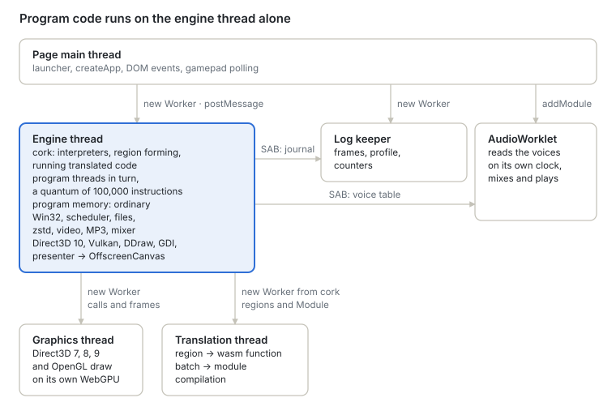
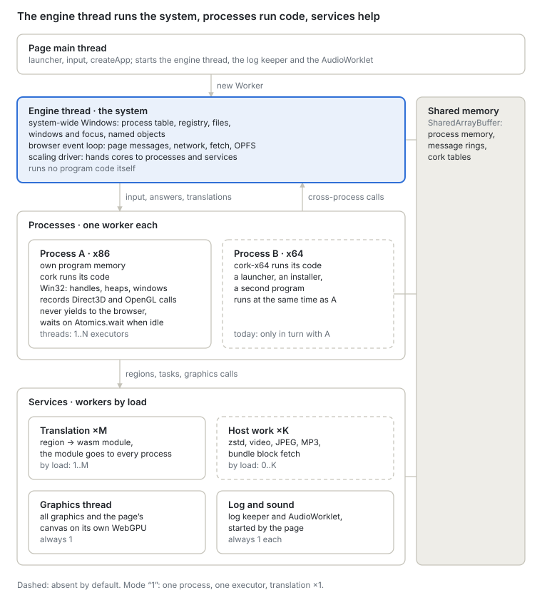

# Roadmap v2 — a multi-worker platform

Русская версия: [README.ru.md](README.ru.md).

**Status:** proposed 2026-10-03, revised against `main` 6554baf0; the workers of stage 2 decided
2026-10-07 on `cork2` (no pool code yet). How the engine works today is in
[`docs/architecture.md`](../../docs/architecture.md); this document is where it goes next.

v2 turns the engine from one thread that does everything into a platform of workers whose number
follows the load: one worker while one copes, four when two are choking, never four held idle. On
that platform come, in order, x86-64 programs and ARM and ARM64 programs; Direct3D 11 depends on
none of it and can be built alongside.

1. [Why](#why)
2. [Where we are](#where-we-are)
3. [Where v2 goes](#where-v2-goes)
4. [Principles](#principles)
5. [Before stage 1 — two measurements](#before-stage-1--two-measurements)
6. [Stage 1 — Layering, one executor](#stage-1--layering-one-executor)
7. [Stage 2 — Processes and services in workers of their own](#stage-2--processes-and-services-in-workers-of-their-own)
8. [Stage 3 — More executors per process](#stage-3--more-executors-per-process)
9. [Stage 4 — x86-64](#stage-4--x86-64)
10. [Stage 5 — Direct3D 11](#stage-5--direct3d-11)
11. [Stage 6 — ARM and ARM64](#stage-6--arm-and-arm64)
12. [Open questions](#open-questions)

## Why

What limits speed today is how work is distributed across threads, not how fast translated
instructions run.

- **The graphics worker proved it.** cork 1.3 moved Direct3D 8 and 9 off the engine thread into a
  worker of their own. In `tools/graphics-bench --remote` the engine thread's time per frame fell
  from 2.95 ms to 0.69 ms (`docs/core/graphics.md`), and a measured run of World of Warcraft went
  from 40–50 to 70–80 frames a second. Nothing about the instructions changed.
- **The browser's event loop sits on the hot path.** The engine loop's own comment in
  `core/src/app.js` records that a trip round the event loop on every turn was the largest host
  phase of a run. The thread that runs the program has to yield to the browser because the same
  thread also receives the page's messages, timers, fetches and OPFS answers.
- **Everything else is still on that thread:** cork runs every guest thread in turn (a quantum of
  100,000 instructions), all of Win32, file reads, zstd, the video decoder, MP3, the sound pump,
  Direct3D 10, Vulkan and the presenter.
- **Only one process runs at a time.** `CreateProcess` replaces the parent with the child, or runs
  the child on a second machine while the parent is paused, and copies back what the child wrote.

## Where we are

Six threads, of which one runs the program and answers it, and the guest's memory is an ordinary
`WebAssembly.Memory` only that thread can touch.

## Where v2 goes

Three levels, each with one job:

| Level | In Windows terms | Holds | Runs where |
| --- | --- | --- | --- |
| **The system** | The part of Windows every process shares | Process table, registry, file system, window manager and focus, named objects (mutexes, events, file mappings, pipes), clipboard; the browser's event loop; the scaling driver | The engine thread, as the coordinator. It runs no program code |
| **Processes** | A process | Its own guest memory, its engine (cork or cork-x64), the per-process half of Win32: handles, heaps, modules, TLS, message queue, the recording of Direct3D and OpenGL calls | One worker per process, 1..N executors inside it for the process's threads |
| **Services** | Drivers and system services | Translation, host work (decoders, block fetch), graphics with the canvas, log keeper, AudioWorklet | Worker pools sized by the driver |

The program's code and the Win32 calls it makes synchronously live in the same worker, so a call
answered at once never crosses a thread. What crosses is either slow anyway (a file block, a
decoded frame, a translation) or rare (a call into another process's window, a named object, the
registry).

## Principles

These hold through every stage.

1. **One engine, two modes.** Single-thread mode is today's behaviour: one executor, plain
   translations, no atomics. Multi-thread mode is the same code with more executors and the atomic
   variant of every translation. The mode is chosen at run time; it is never a different build.
2. **Capacity follows the load.** No worker is kept that has nothing to do; one is added when the
   ones there are falling behind. The minimums reproduce today: one executor, one translation
   worker, no host-work worker, one graphics worker.
3. **The executor never waits for the browser.** Everything a process receives — input, I/O
   completions, answers from the renderer, published translations — arrives through rings in shared
   memory. An executor with nothing to run sleeps on `Atomics.wait` and is woken by
   `Atomics.notify`. The page's signal word, incremented on every message it posts, is the first
   such ring already.
4. **Shared memory from the start, so the page is cross-origin isolated.** `shared` is fixed when a
   `WebAssembly.Memory` is created and cannot change later, and an unshared memory cannot be handed
   to another worker. Plain loads and stores on shared memory cost the same, so single-thread mode
   loses nothing by it. What it costs is the page: a `SharedArrayBuffer` exists only under
   `Cross-Origin-Opener-Policy` and `Cross-Origin-Embedder-Policy`, which constrain how the player
   is embedded (an iframe, third-party resources, sign-in pop-ups). Today shared memory is optional
   — the audio ring and the log journal fall back without it; from stage 1 the engine requires it,
   and the product has to say so.
5. **Each stage lands in single-thread mode first** and is accepted there before multi-thread mode
   is switched on for it.
6. **A run can be made reproducible.** Today a run is a function of its inputs: one executor, a
   quantum counted in guest instructions, a journal of what the host answered. That is what lets a
   bug from a browser run be replayed in node and bisected there. Every stage keeps a pinned mode —
   one executor, no scaling decisions, the same journal as `main` — and the journal records every
   decision the driver takes, so a run that went wrong under scaling can be replayed pinned.

Acceptance is measured as the translator's work is today: frame times in a browser vary by a tenth
to a quarter from one run to the next, so "within noise of `main`" hides a regression of that size.
A stage is accepted on the thresholds in the product plan, on node benchmarks run alternated against
`main`, and on instruction counts (callgrind) where a change claims to cost nothing.

## Before stage 1 — two measurements

The plan's largest cost and its largest gain both rest on numbers nobody has yet.

- **The atomic tax.** Wasm has only sequentially consistent atomics, and x86 programs rely on x86's
  store order: neither stores nor loads are reordered among themselves. On an ARM host plain loads
  may be reordered, so the atomic variant needs ordered loads as well as ordered stores, and on an
  x86 host an ordered wasm store is an `xchg`. Measure the variant — every guest load and store
  atomic, `lock` as read-modify-write — on the instruction corpus's workloads and the cork
  benchmarks, on x86-64 and arm64 hosts.
- **How parallel the programs are.** The kernel's scheduler already knows, every turn, how many of
  a process's threads are ready. Record the share of time two or more are ready, per title, over
  the titles the project runs. Several executors pay only where that share is large (stage 3).

Neither needs any of the stages: both are a script and a counter.

## Stage 1 — Layering, one executor

**Goal.** The layers the platform needs, with today's engine running on them exactly as it does
now: one executor, plain translations.

**Work.**

- **Shared guest memory.** `cork-host.js` creates the guest memory with `shared: true`; the page
  is cross-origin isolated (principle 4).
- **An executor's state is not in the code.** Translated code reaches the state block, the call
  stack of wasm calls, the entry hash and the other tables by absolute offsets compiled into every
  module (`load offset: layout.eflags`). Two executors over one memory need a state block each, so
  either each executor has translations of its own — no sharing, and `emitBatch` per executor — or
  the emitter addresses that state from a base the instance is given. The second keeps one cache
  for all executors at the cost of an add per access, to be measured on the benchmarks before it
  is chosen. The function table's indices must then be the same in every executor, or the entry
  hash becomes per executor too.
- **Executors.** In the `cpu` layer an executor becomes a thing of its own: a thread with its own
  module instances, function table and state block over the shared memory. Publishing a
  translation and dropping one when code is written are addressed to every executor: page flags in
  shared memory plus an epoch each executor checks.
- **Win32 split in two.** The system-wide half (process table, registry, file system, window
  manager, named objects, clipboard) and the per-process half (handles, heaps, modules, TLS,
  message queue, Direct3D and OpenGL recording), with one interface between them. In single-thread
  mode it is a direct call; across threads, a ring and a wait. A wait for a reply to `SendMessage`
  is not a plain wait: a thread blocked in it must still take the messages other threads send to
  its own windows, or two threads sending to each other deadlock; the interface carries that from
  the start.
- **Inbound rings** for input, I/O completions, renderer answers and published translations, in
  place of `postMessage` into the thread that runs program code.

**Accepted when** every existing suite passes unchanged, the journal of a pinned run is the same
bytes as `main`'s on the integration programs, and the benchmarks are within the product plan's
thresholds of `main`.

## Stage 2 — Processes and services in workers of their own

**Goal.** The engine thread becomes the system, processes run in workers of their own, and the
services scale with the load. Every process still has one executor.

This is where the evidence in [Why](#why) points: the graphics worker's gain came from taking work
off the thread that runs the program, not from running the program's threads at once.

**Work.**

- **Split the engine worker** into the coordinator (event loop, I/O, network, system-wide Win32,
  pools, driver) and process workers (cork, per-process Win32).
- **A window manager for the run** ([windows.md](windows.md)): every process's windows, as its
  user32 tells it, with their order across processes, foreground and capture, and views -- the
  GDI compositor, input, later a JS view -- that subscribe to it, in place of the rules that ignore
  other processes' windows. It comes before the translation pools.
- **Processes side by side.** Each process runs in its own worker with its own memory, sized per
  process (`memorySize`). This replaces process replacement (`roadmap/decisions.md`, C) and the
  copy-back after a child exits: the registry and files are the system's, so what one process
  writes another sees at once. Separate memories also remove the reason replacement was chosen,
  two images wanting `0x400000`.
- **What two processes share in memory.** A named file mapping two processes both map, a DLL's
  shared section, `ReadProcessMemory` and `WriteProcessMemory` all expect one set of bytes visible
  from two address spaces, and a region of one `WebAssembly.Memory` cannot be shown inside
  another. Each needs a mechanism of its own — a copy kept coherent at the points the program can
  observe (a wait, a message, a call that maps or unmaps), or a second shared memory both process
  workers import — chosen per case by measurement; launchers and installers are where they occur.
- **Threads that are always there.** The coordinator and the graphics worker. Graphics stays one
  thread: everything a WebGPU device makes lives in the thread that made it, and the calls of a
  frame run in order. What in graphics is pure — shader bytecode to WGSL, DXT decoding, format
  conversion — goes to the pool as jobs. The AudioWorklet is the browser's own audio thread.
- **Process workers.** One per running process, apart from the pool, for as long as the process
  runs. Running code stays there; nothing of it moves to the pool.
- **The worker pool.** Workers that take any job without state: a batch of translation (formed,
  emitted and compiled), zstd blocks, `ijl15`, the pure part of graphics. Two priorities: urgent,
  which code is waiting for (the batch of a region the interpreter keeps meeting, a block a thread
  reads), and background (relinks of hot code, reading ahead). A worker on standby sleeps on
  `Atomics.wait` and holds nothing — no core, nothing of any process — so standby costs memory
  only: an operating system schedules only threads that have something to run.
- **What a worker holds.** Nothing between jobs. Translation does keep something worth keeping:
  the functions already emitted, which a relink or a merge takes again instead of emitting them
  anew — today a cache of up to 48 MB inside the translation worker. That is the process's, not
  the worker's: it is keyed by the process's code, and a second worker with a cache of its own
  would miss what the first one kept. A worker's heap cannot be shared or handed to another
  worker — each has its own; what workers share is bytes (`SharedArrayBuffer`, a shared
  `WebAssembly.Memory`) and compiled modules, which a message passes without copying their code.
  So the cache becomes bytes in an arena of the process's own, in shared memory: every pool worker
  working for the process looks functions up there and adds the ones it emits, a worker that
  leaves loses nothing, and the arena goes when the process exits. It is filled lazily, by the
  translation that happens anyway, and since loading is when it is used, a process quiet for long
  enough can let it go (whether a later load gains from the earlier one's functions is not
  measured).
- **The rule.** The pool always keeps standby workers in proportion to the running processes; the
  first is never let go, since translation never quite stops. When a process's work starts to lag —
  its urgent jobs queue behind the ones out and its workers are busy — standby workers join it, one
  at a time; when its work subsides they leave it and wait again. Joining is quick (a window of a
  few hundred milliseconds), leaving slow (seconds without the process's work), so the pool does
  not swing. The pool has a ceiling: at most `max(2, hardwareConcurrency − 2)` of its workers at
  work at once across all processes — the coordinator and graphics taken out, never fewer than
  two — and one process may take all of them when it alone needs them. Standby workers are outside
  that count, since they take no core. A worker joins only if the work queued outlasts
  what bringing it up costs, and after it joins the driver checks the yield — the work the
  process's workers get through each second; a worker that adds little (a second thread on a busy
  core, a throttled machine, another tab's load) leaves, and that ceiling is kept for the run.
- **The driver.** In the coordinator, one for the whole engine. Workers write their own state into
  shared memory — busy or idle, queue length, time at work — the way the engine already publishes
  its journal and counters for the log keeper, so the driver only reads. Each decision is a
  comparison of a few numbers between scheduler turns, and each is written to the journal
  (principle 6); a pinned run keeps the pool's size fixed. Its thresholds are chosen on recorded
  series of real loads, replayed through the driver as a test, before it runs in the engine.
- **Measured** (2026-10-07, node 22, 4-core x86-64 VM, `cork2` f39364f2, one translation worker;
  `tools/launch-probe.mjs --series`). While loading, the one translation worker is the bottleneck:
  Doom 3 busy 70–95 % of the time with work queued behind the batch out 90–98 % of it and up to
  2,807 regions queued; Tron's game up to 90 % busy, 1,183 queued. Run warm from a filled
  translation store, Doom 3 reached the end of loading in 13–15 s instead of 20 s (three runs):
  about a third of its loading is translation, the most a faster translator can take. After
  loading the worker is busy under 1 % of the time. Two threads were ready at once 0–4 % of the
  time (`negative-results.md`, 2026-10-07).
- **Measured: what a worker holds** (2026-10-07, same machine; one cold run each, Doom 3 60 s and
  Tron's game 40 s; Chromium 141 headless). Idle, a worker is small: in Chromium the JS heap of
  four idle workers was 1.1 MB without the emitter and 7.6 MB with it loaded, about 2 MB each
  (`performance.measureUserAgentSpecificMemory`, which counts the JS heap and not the thread
  itself); in node an idle worker with the emitter loaded added 15 MB of resident memory (eight at
  once). Loading, the translation worker's cache reached its 48 MB limit within 18 s; at the end
  the worker held 31–37 MB of heap besides the cache, and its heap had peaked at 225 MB on the way
  (garbage of emitting). The cache pays: without it the worker was busy 23.3 s instead of 14.6 s
  for Doom 3 and 15.2 s instead of 9.9 s for Tron. Replayed under other limits, its hits are 10 %
  of lookups at 16 MB, 29 % at 24 MB, 33 % at 48 MB and 33 % unbounded (83 MB at most) for Doom 3;
  21 %, 21 %, 29 % and 29 % (76 MB) for Tron — a few megabytes keep almost nothing. Doom 3 took
  no hits after its 39th second.

| Thread | How many | Joins when | Leaves when |
| --- | --- | --- | --- |
| Coordinator, graphics | 1 each | — | — |
| Process worker | one per running process | the process starts | the process exits |
| Pool, on standby | in proportion to the processes, at least 1 | — | — |
| Pool, working for a process | 0 up to `max(2, hardwareConcurrency − 2)`, all processes together | its urgent work queues and its workers are busy | seconds without its work |

| Setting | Today | Larger |
| --- | --- | --- |
| Processes, P | 1: a child and its parent take turns | P process workers, each with its own memory |
| Executors per process, N | 1: on the engine thread | 1 here; N with the atomic variant in stage 3 |
| Translation | 1 worker per process, one batch out | pool workers joining the process, several batches out |
| Host work | on the engine thread or in the process | pool jobs; the program thread waits as it waits for a file |
| Graphics (`graphicsWorker`) | 1: Direct3D 7, 8, 9, OpenGL | 1: all graphics and the canvas |
| Guest memory | ordinary `WebAssembly.Memory` | shared (`shared: true`) from stage 1 |

**Accepted when** with the minimums the benchmarks are within the thresholds of `main`, a parent
and a child process run at the same time and see each other's registry and file writes, and under
a synthetic load the driver grows and shrinks each pool without oscillating.

## Stage 3 — More executors per process

**Goal.** A process whose threads are ready at the same time runs them at the same time — where the
measurement before stage 1 says that pays.

**Work.**

- **The atomic variant.**
  - *plain* — today's code.
  - *atomic* — `lock`-prefixed instructions become wasm atomic read-modify-writes, loads and stores
    are ordered as x86 orders them, and an atomic access to an address that is not naturally
    aligned takes a fallback path (a lock held across the access), since a misaligned wasm atomic
    traps where x86 does not.

  The store's key already carries a variant (`runtime/cache.js`); the two are kept side by side.
  The interpreters, JavaScript and wasm, get the same variant: the host runs them where no region
  can be made.
- **What the translator assumes of one executor.** Some of cork's optimisations hold only while
  nothing else writes memory between two instructions: stores to the stack without a page check
  (no translated code on a stack page), page checks hoisted out of loops for a window of accesses,
  leaving at once after a store into code. Each is re-examined for the atomic variant, and kept,
  narrowed or turned off there.
- **Choosing the mode.** Switching a running process means every thread stops at a quantum
  boundary, its translations are dropped and the atomic ones loaded — seconds of stall for a
  program with thousands of regions. So the mode is chosen when a process starts, from what the
  translation store recorded of the program's earlier runs, and switched while it runs only after
  a long spell that contradicts it.

| Pool | Min | Max | Grows when | Shrinks |
| --- | --- | --- | --- | --- |
| Executors of a process | 1 | `hardwareConcurrency`, at most the process's thread count | two or more of its threads are ready most of the time | rarely, after a long quiet spell: it is a mode switch |

**What it costs, and when it pays.** The atomic variant makes every executor slower by the tax *t*
measured before stage 1. Two executors win when their speedup *S* satisfies *S* × (1 − *t*) > 1.
At *t* = 20 % that is *S* > 1.25, which by Amdahl's law needs more than 40 % of the work to run in
parallel. A program with one busy thread never pays the tax.

**Accepted when** in multi-thread mode with a single executor every suite passes on the atomic
variant, a test set of programs that synchronise through `lock` instructions and plain stores
(message passing, spin locks, interlocked counters) gives the same results as on one executor, and
the titles the measurement picked run faster than on one executor by the product plan's margin.

## Stage 4 — x86-64

**Goal.** 64-bit programs, on the platform built above.

**Work.**

- **`cork-x64`**, a package of its own on the same executor contract, reusing cork's `./wasm` and
  `./runtime`. The contract's fields are already named for `bits: 64` (`cpu/engine.js`), with
  `gsBase` beside `fsBase`. The seams cork was built with for this carry over: the decoder takes a
  mode, the IR and the lazy-flag algebra are written for sizes up to 8, the state layout has a
  width, the entry hash keys on a full address, guest addresses are numbers below 2^53 on the
  JavaScript side, and the emitter takes the address type from the layout.
- **Bitness is a property of the process.** The loader reads the PE machine field (`0x014c` x86,
  `0x8664` x64) and starts the process worker on cork or cork-x64. 32- and 64-bit processes run
  side by side, as under WOW64. The system adds the WOW64 redirections: `System32` and `SysWOW64`,
  and `Wow6432Node` in the registry.
- **Win32 with 64-bit structure layouts.** Pointers and handles are 8 bytes and alignment differs,
  so every handler that reads or writes a program's structure needs its 64-bit layout. This is the
  largest part of the stage.
- **The x64 calling convention** in the bridge: RCX, RDX, R8, R9 and the shadow space, one
  convention instead of stdcall, cdecl and thiscall. COM method tables with 8-byte slots.
- **Exceptions.** x64 SEH is table-based (`.pdata` and `.xdata` unwind information) rather than a
  chain of frames on the stack, so the dispatcher is new.
- **PE32+** in the loader (`loader/internal/pe.js` accepts i386 only today), synthesised PE32+
  system DLLs and 64-bit trap stubs. `out dx, eax` works the same in 64-bit mode.
- **The address space.** A 64-bit program expects addresses above 4 GiB; its image defaults to
  `0x140000000`. Either wasm `memory64`, with a 64-bit index, or a 32-bit memory with everything
  placed inside a 4 GiB window, relocating images below it. The emitter's address type is one
  setting, so the choice touches one file; see the open questions.

**Accepted when** a set of 64-bit test programs and the x86-64 instruction corpus pass on
cork-x64, alone and beside a 32-bit process.

## Stage 5 — Direct3D 11

**Goal.** Direct3D 11, which most 64-bit games draw with — and many 32-bit ones from the years
before them. It needs nothing of stages 1 to 4 and can be built alongside any of them. The
`graphics` layer has DirectDraw, Direct3D 7 to 10, OpenGL and Vulkan today.

**Work.** Direct3D 11 and its DXGI on the WebGPU backend, recorded where the program runs and
played in the graphics worker as Direct3D 7 to 9 are; shader bytecode (shader models 4 and 5)
translated to WGSL; what Direct3D 10 already has (DXGI formats, its pipeline objects) shared rather
than copied.

**Accepted when** the layer's unit and contract tests and reference-frame comparisons cover it as
they cover Direct3D 9, and a Direct3D 11 program draws in the browser harness.

## Stage 6 — ARM and ARM64

**Goal.** Windows programs built for ARM (PE machine `0x01C4`) and ARM64 (`0xAA64`), as further
engine packages on the same executor contract, chosen per process the way cork and cork-x64 are.
ARM64EC and ARM64X binaries mix x64 and ARM64 code in one process and would need two engines in
one executor.

## Open questions

- **The atomic tax** (measured before stage 1): how much the atomic variant costs per executor on
  x86 and on ARM hosts, and whether ordering can be limited to fewer than every load and store
  without breaking programs that rely on x86's order. Wasm offers no acquire and release
  orderings yet; the proposal that adds them would change the answer.
- **Executor state: a base or translations per executor** (stage 1), decided by measuring the add
  per access against a cache per executor.
- **Memory shared between processes** (stage 2): which mechanism for named mappings, shared
  sections and cross-process reads and writes, and which programs need them coherent rather than
  copied at a wait.
- **Cross-origin isolation:** which ways of embedding the player it rules out, and whether any of
  them matter to the product.
- **The x64 address space:** `memory64` or a 4 GiB window. `memory64` ships in Chrome and Firefox;
  whether Safari has it decides whether it can be the only path.
- **Memory per process on phones:** how many process memories a phone's browser allows at once,
  and the default `memorySize` for a helper process. A shared memory reserves its maximum when it
  is created.
- **Stage 6's scope:** whether it is Windows-on-ARM programs alone, as written here.
