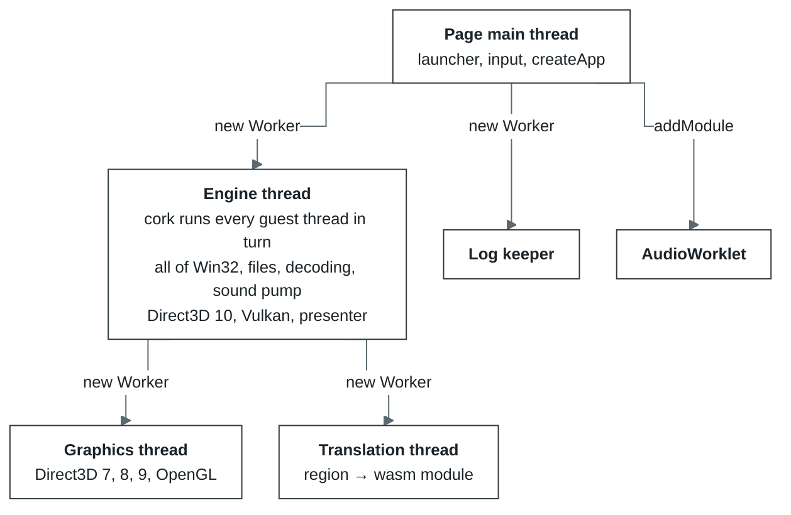
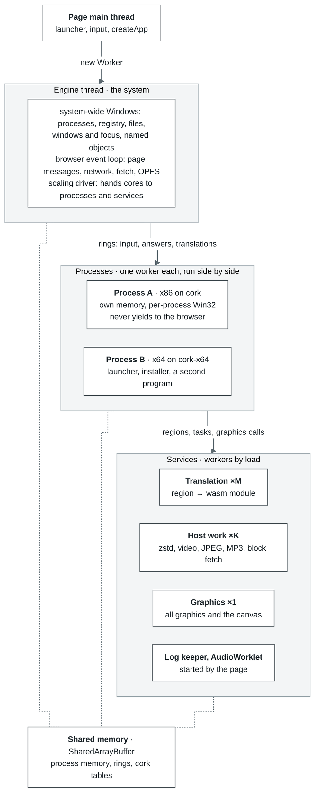

# Roadmap v2 — a multi-worker platform

**Status:** proposed 2026-10-03, against `main` cf293c0. How the engine works today is in
[`docs/architecture.md`](../../docs/architecture.md); this document is where it goes next.

v2 turns the engine from one thread that does everything into a platform of workers whose number
follows the load: one worker while one copes, four when two are choking, never four held idle. On
that platform come, in order, x86-64 programs, Direct3D 11, and ARM and ARM64 programs.

1. [Why](#why)
2. [Where we are](#where-we-are)
3. [Where v2 goes](#where-v2-goes)
4. [Principles](#principles)
5. [Stage 1 — Layering: one engine, two modes](#stage-1--layering-one-engine-two-modes)
6. [Stage 2 — The multi-worker platform with auto-scaled capacity](#stage-2--the-multi-worker-platform-with-auto-scaled-capacity)
7. [Stage 3 — x86-64](#stage-3--x86-64)
8. [Stage 4 — Direct3D 11](#stage-4--direct3d-11)
9. [Stage 5 — ARM and ARM64](#stage-5--arm-and-arm64)
10. [Open questions](#open-questions)

## Why

What limits speed today is how work is distributed across threads, not how fast translated
instructions run.

- **The graphics worker proved it.** cork 1.3 moved Direct3D 8 and 9 off the engine thread into a
  worker of their own. In `tools/graphics-bench --remote` the engine thread's time per frame fell
  from 2.95 ms to 0.69 ms (`docs/core/graphics.md`), and a measured run of World of Warcraft went
  from 40–50 to 70–80 frames a second. Nothing about the instructions changed.
- **The browser's event loop sits on the hot path.** The engine loop's own comment in
  `core/src/app.js` records that a trip round the event loop on every turn was the largest host
  phase of a run. The thread that runs the program has to yield to the browser because the same
  thread also receives the page's messages, timers, fetches and OPFS answers.
- **Everything else is still on that thread:** cork runs every guest thread in turn (a quantum of
  100,000 instructions), all of Win32, file reads, zstd, the video decoder, MP3, the sound pump,
  Direct3D 10, Vulkan and the presenter.
- **Only one process runs at a time.** `CreateProcess` replaces the parent with the child, or runs
  the child on a second machine while the parent is paused, and copies back what the child wrote.

## Where we are

Six threads, of which one runs the program and answers it, and the guest's memory is an ordinary
`WebAssembly.Memory` only that thread can touch.

## Where v2 goes

Three levels, each with one job:

| Level | In Windows terms | Holds | Runs where |
| --- | --- | --- | --- |
| **The system** | The part of Windows every process shares | Process table, registry, file system, window manager and focus, named objects (mutexes, events, file mappings, pipes), clipboard; the browser's event loop; the scaling driver | The engine thread, as the coordinator. It runs no program code |
| **Processes** | A process | Its own guest memory, its engine (cork or cork-x64), the per-process half of Win32: handles, heaps, modules, TLS, message queue, the recording of Direct3D and OpenGL calls | One worker per process, 1..N executors inside it for the process's threads |
| **Services** | Drivers and system services | Translation, host work (decoders, block fetch), graphics with the canvas, log keeper, AudioWorklet | Worker pools sized by the driver |

The program's code and the Win32 calls it makes synchronously live in the same worker, so a call
answered at once never crosses a thread. What crosses is either slow anyway (a file block, a
decoded frame, a translation) or rare (a call into another process's window, a named object, the
registry).

## Principles

These hold through every stage.

1. **One engine, two modes.** Single-thread mode is today's behaviour: one executor, plain
   translations, no atomics. Multi-thread mode is the same code with more executors and the atomic
   variant of every translation. The driver chooses the mode at run time; it is never a different
   build.
2. **Capacity follows the load.** No worker is kept that has nothing to do; one is added when the
   ones there are falling behind. The minimums reproduce today: one executor, one translation
   worker, no host-work worker, one graphics worker.
3. **The executor never waits for the browser.** Everything a process receives — input, I/O
   completions, answers from the renderer, published translations — arrives through rings in shared
   memory. An executor with nothing to run sleeps on `Atomics.wait` and is woken by
   `Atomics.notify`. The page's signal word, incremented on every message it posts, is the first
   such ring already.
4. **Shared memory from the start.** `shared` is fixed when a `WebAssembly.Memory` is created and
   cannot change later, and an unshared memory cannot be handed to another worker. Plain loads and
   stores on shared memory cost the same, so single-thread mode loses nothing by it.
5. **Each stage lands in single-thread mode first** and is accepted there before multi-thread mode
   is switched on for it.

## Stage 1 — Layering: one engine, two modes

**Goal.** The right layers, so that today's engine runs in single-thread mode exactly as it does now
and can run in multi-thread mode, where atomic operations are needed.

**Work.**

- **Shared guest memory.** `cork-host.js` creates the guest memory with `shared: true`. Nothing
  else changes in single-thread mode.
- **Two translation variants.**
  - *plain* — today's code.
  - *atomic* — `lock`-prefixed instructions become wasm atomic read-modify-writes, stores become
    ordered, and an atomic access to an address that is not naturally aligned takes a fallback
    path, since a misaligned wasm atomic traps where x86 does not.

  The store's key already carries a variant (`runtime/cache.js`); the two are kept side by side.
- **Executors.** In the `cpu` layer an executor becomes a thing of its own: a thread with its own
  module instances, function table and state block over the shared memory. Publishing a
  translation and dropping one when code is written are addressed to every executor: page flags in
  shared memory plus an epoch each executor checks.
- **Win32 split in two.** The system-wide half (process table, registry, file system, window
  manager, named objects, clipboard) and the per-process half (handles, heaps, modules, TLS,
  message queue, Direct3D and OpenGL recording), with one interface between them. In single-thread
  mode it is a direct call; across threads, a ring and a wait.
- **Inbound rings** for input, I/O completions, renderer answers and published translations, in
  place of `postMessage` into the thread that runs program code.

**What multi-thread mode costs, and when it pays.** The atomic variant makes every executor slower
by some tax *t*, still to be measured on the corpus and the benchmarks. Two executors win when their
speedup *S* satisfies *S* × (1 − *t*) > 1. At *t* = 20 % that is *S* > 1.25, which by Amdahl's law
needs more than 40 % of the work to run in parallel. The driver switches to multi-thread mode only
when two or more of a process's threads are ready to run most of the time, so a program with one
busy thread never pays the tax.

**Accepted when** in single-thread mode every existing suite passes unchanged and benchmark frame
times are within noise of `main`, and in multi-thread mode with a single executor the same suites
pass on the atomic variant.

## Stage 2 — The multi-worker platform with auto-scaled capacity

**Goal.** The engine thread becomes the system, processes run in workers of their own, and the
services scale with the load.

**Work.**

- **Split the engine worker** into the coordinator (event loop, I/O, network, system-wide Win32,
  pools, driver) and process workers (cork, per-process Win32).
- **Processes side by side.** Each process runs in its own worker with its own memory, sized per
  process (`memorySize`). This replaces process replacement and the copy-back after a child exits:
  the registry and files are the system's, so what one process writes another sees at once.
  Separate memories also remove the reason replacement was chosen, two images wanting `0x400000`.
- **Service pools.** Translation ×M (`emitBatch` is already a pure function). Host work ×K: zstd
  blocks, the video decoder, `ijl15`, MP3, block fetch. Graphics takes the canvas and the APIs still
  drawn on the engine thread: Direct3D 10, Vulkan, DirectDraw and GDI presentation.
- **The scaling driver.** One for the whole engine, in the coordinator, because the pools share the
  same cores and drivers of their own would take them from each other. Its budget is
  `navigator.hardwareConcurrency` minus the fixed threads (page, coordinator, AudioWorklet,
  graphics). Workers write their own state into shared memory — busy or idle, queue length, time
  at work — the way the engine already publishes its journal and counters for the log keeper, so
  the driver only reads. Each decision is a comparison of a few numbers between scheduler turns.
- **More executors per process** by switching modes at a safe point: every thread stops at a
  quantum boundary, published translations are dropped, the atomic variants are loaded, and work
  resumes. Back to one executor the same way.

| Pool | Min | Max | Grows when | Shrinks |
| --- | --- | --- | --- | --- |
| Executors of a process | 1 | budget, at most the process's thread count | two or more of its threads are ready most of the time | rarely, after a long quiet spell: it is a mode switch |
| Translation | 1 | budget | hot code waits for translation, the batch queue grows | after seconds idle |
| Host work | 0 | budget | program threads wait on decoding or block fetch | after seconds idle |
| Graphics, log keeper, AudioWorklet | 1 | 1 | — | — |

| Setting | Today | Larger |
| --- | --- | --- |
| Processes, P | 1: a child and its parent take turns | P process workers, each with its own memory |
| Executors per process, N | 1: on the engine thread | N per process, atomic translation variant |
| Translation, M | 1 worker | M workers, batches split between them |
| Host work, K | 0: all on the engine thread | K workers; the program thread waits as it waits for a file |
| Graphics (`graphicsWorker`) | 1: Direct3D 7, 8, 9, OpenGL | 1: all graphics and the canvas |
| Guest memory | ordinary `WebAssembly.Memory` | shared (`shared: true`) from the start |

**Accepted when** with the minimums frame times on the benchmark set are no worse than `main`, a
parent and a child process run at the same time and see each other's registry and file writes,
and under a synthetic load the driver grows and shrinks each pool without oscillating.

## Stage 3 — x86-64

**Goal.** 64-bit programs, on the multi-thread platform from the start.

**Work.**

- **`cork-x64`**, a package of its own on the same executor contract, reusing cork's `./wasm` and
  `./runtime`. The contract's fields are already named for `bits: 64` (`cpu/engine.js`), with
  `gsBase` beside `fsBase`. The seams cork was built with for this carry over: the decoder takes a
  mode, the IR and the lazy-flag algebra are written for sizes up to 8, the state layout has a
  width, the entry hash keys on a full address, guest addresses are numbers below 2^53 on the
  JavaScript side, and the emitter takes the address type from the layout.
- **Bitness is a property of the process.** The loader reads the PE machine field (`0x014c` x86,
  `0x8664` x64) and starts the process worker on cork or cork-x64. 32- and 64-bit processes run
  side by side, as under WOW64. The system adds the WOW64 redirections: `System32` and `SysWOW64`,
  and `Wow6432Node` in the registry.
- **Win32 with 64-bit structure layouts.** Pointers and handles are 8 bytes and alignment differs,
  so every handler that reads or writes a program's structure needs its 64-bit layout. This is the
  largest part of the stage.
- **The x64 calling convention** in the bridge: RCX, RDX, R8, R9 and the shadow space, one
  convention instead of stdcall, cdecl and thiscall. COM method tables with 8-byte slots.
- **Exceptions.** x64 SEH is table-based (`.pdata` and `.xdata` unwind information) rather than a
  chain of frames on the stack, so the dispatcher is new.
- **PE32+** in the loader (`pe.js` accepts i386 only today), synthesised PE32+ system DLLs and
  64-bit trap stubs. `out dx, eax` works the same in 64-bit mode.
- **The address space.** A 64-bit program expects addresses above 4 GiB; its image defaults to
  `0x140000000`. Either wasm `memory64`, with a 64-bit index, or a 32-bit memory with everything
  placed inside a 4 GiB window, relocating images below it. The emitter's address type is one
  setting, so the choice touches one file; see the open questions.

**Accepted when** a set of 64-bit test programs and the x86-64 instruction corpus pass on
cork-x64, alone and beside a 32-bit process.

## Stage 4 — Direct3D 11

**Goal.** Direct3D 11, which most 64-bit games draw with. The `graphics` layer has DirectDraw,
Direct3D 7 to 10, OpenGL and Vulkan today.

**Work.** Direct3D 11 and its DXGI on the WebGPU backend, recorded in the process worker and played
in the graphics worker as Direct3D 7 to 9 are; shader bytecode (shader models 4 and 5) translated to
WGSL; what Direct3D 10 already has (DXGI formats, its pipeline objects) shared rather than copied.

**Accepted when** the layer's unit and contract tests and reference-frame comparisons cover it as
they cover Direct3D 9, and a Direct3D 11 program draws in the browser harness.

## Stage 5 — ARM and ARM64

**Goal.** Windows programs built for ARM (PE machine `0x01C4`) and ARM64 (`0xAA64`), as further
engine packages on the same executor contract, chosen per process the way cork and cork-x64 are.
ARM64EC and ARM64X binaries mix x64 and ARM64 code in one process and would need two engines in
one executor.

## Open questions

- **The x64 address space:** `memory64` or a 4 GiB window. `memory64` ships in Chrome and Firefox;
  whether Safari has it decides whether it can be the only path.
- **The atomic tax:** how much the atomic variant costs per executor on x86 and on ARM hosts, and
  whether ordered stores can be limited to fewer than every store without breaking programs that
  rely on x86's store order.
- **Memory per process on phones:** how many process memories a phone's browser allows at once,
  and the default `memorySize` for a helper process.
- **Stage 5's scope:** whether it is Windows-on-ARM programs alone, as written here.
