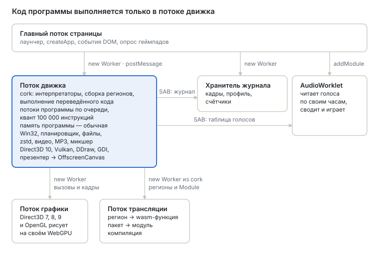
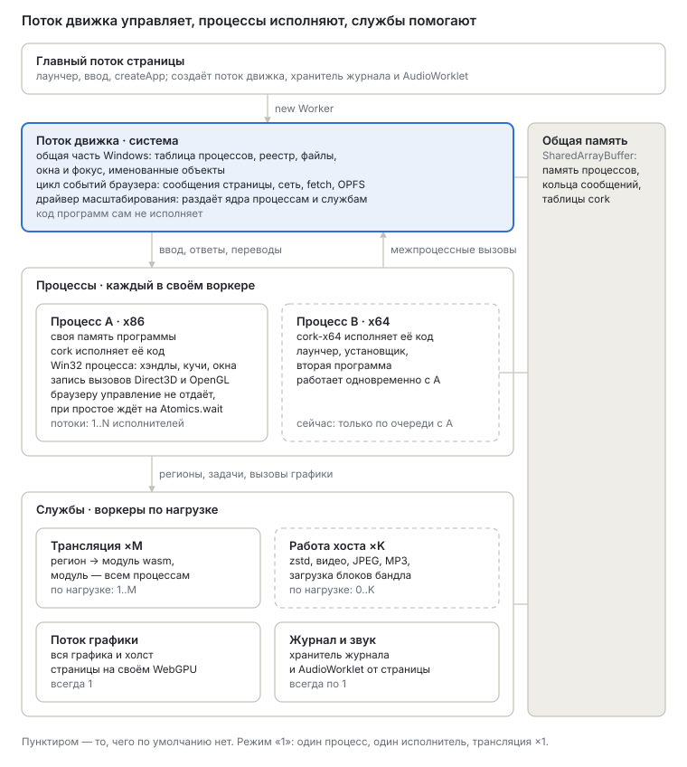

# Roadmap v2 — мультиворкерная платформа

English version: [README.md](README.md).

**Статус:** предложен 3 октября 2026, пересмотрен по `main` 6554baf0; воркеры этапа 2 и арена
кэша трансляции решены 7 октября 2026 в `cork2`; пул трансляции, его драйвер и арена появились там
же в тот же день; zstd остаётся на координаторе — по замеру переносить его пока незачем
(`negative-results.md`, 8 октября 2026). Атомарный вариант этапа 3, раскладки исполнителей (у
каждого исполнителя своя страница состояния, таблицы и статика интерпретатора над одной гостевой
RAM), исполнители в собственных воркерах и ядро, выполняющее потоки процесса на них одновременно,
появились в `cork2` 8 октября 2026 (`executors` у `createApp`); выбор режима для процесса и
неразрывные подпрограммы хоста (ниже) — открыты. Как движок устроен сейчас — в
[`docs/architecture.ru.md`](../../docs/architecture.ru.md); здесь — куда он идёт дальше.

v2 превращает движок из одного потока, который делает всё, в платформу воркеров, число которых
следует за нагрузкой: один воркер, пока он справляется, четыре — когда двое задыхаются, и никогда
четыре без дела. На этой платформе по очереди появятся 64-битные программы и программы для ARM и
ARM64; Direct3D 11 ни от чего из этого не зависит и может строиться параллельно.

1. [Зачем](#зачем)
2. [Где мы сейчас](#где-мы-сейчас)
3. [Куда идёт v2](#куда-идёт-v2)
4. [Принципы](#принципы)
5. [До этапа 1 — два замера](#до-этапа-1--два-замера)
6. [Этап 1 — Разметка, один исполнитель](#этап-1--разметка-один-исполнитель)
7. [Этап 2 — Процессы и службы в своих воркерах](#этап-2--процессы-и-службы-в-своих-воркерах)
8. [Этап 3 — Несколько исполнителей на процесс](#этап-3--несколько-исполнителей-на-процесс)
9. [Этап 4 — x86-64](#этап-4--x86-64)
10. [Этап 5 — Direct3D 11](#этап-5--direct3d-11)
11. [Этап 6 — ARM и ARM64](#этап-6--arm-и-arm64)
12. [Открытые вопросы](#открытые-вопросы)

## Зачем

Скорость сейчас упирается в то, как работа разложена по потокам, а не в то, как быстро выполняются
переведённые инструкции.

- **Это доказал поток графики.** В cork 1.3 Direct3D 8 и 9 ушли из потока движка в отдельный
  воркер. В бенче `tools/graphics-bench --remote` время потока движка на кадр упало с 2,95 мс до
  0,69 мс (`docs/core/graphics.md`), а замер World of Warcraft показал рост с 40–50 до 70–80 кадров
  в секунду. Сами инструкции при этом не изменились.
- **Цикл событий браузера стоит на горячем пути.** В комментарии к циклу хода в `core/src/app.js`
  записано: проход по циклу событий на каждом ходу был самой большой фазой хоста за весь прогон.
  Поток, который выполняет программу, вынужден отдавать управление браузеру, потому что он же
  принимает сообщения страницы, таймеры, ответы `fetch` и OPFS.
- **Всё остальное тоже в этом потоке:** cork по очереди выполняет все потоки программы (квант —
  100 000 инструкций), весь Win32, чтение файлов, zstd, видеодекодер, MP3, подкачка звука,
  Direct3D 10, Vulkan и презентер.
- **Одновременно работает только один процесс.** `CreateProcess` либо заменяет родителя ребёнком,
  либо запускает ребёнка на второй машине, пока родитель стоит на паузе, а потом копирует обратно
  то, что ребёнок записал.

## Где мы сейчас

Шесть потоков, и только один из них выполняет программу и отвечает ей. Память программы — обычная
`WebAssembly.Memory`, к которой может прикасаться только этот поток.

## Куда идёт v2

Три уровня, у каждого одна задача:

| Уровень | В терминах Windows | Что в нём | Где работает |
| --- | --- | --- | --- |
| **Система** | Часть Windows, общая для всех процессов | Таблица процессов, реестр, файловая система, оконный менеджер и фокус, именованные объекты (мьютексы, события, отображения файлов, каналы), буфер обмена; цикл событий браузера; драйвер масштабирования | Поток движка в роли координатора. Код программ он не выполняет |
| **Процессы** | Процесс | Своя память программы, свой движок (cork или cork-x64) и Win32 процесса: хэндлы, кучи, модули, TLS, очередь сообщений, запись вызовов Direct3D и OpenGL | Отдельный воркер на каждый процесс, внутри — от 1 до N исполнителей для его потоков |
| **Службы** | Драйверы и системные службы | Трансляция, работа хоста (декодеры, загрузка блоков), графика вместе с холстом, хранитель журнала, AudioWorklet | Пулы воркеров, размер которых выбирает драйвер |

Код программы и вызовы Win32, на которые она ждёт ответа сразу, живут в одном воркере. Поэтому
вызов, на который можно ответить немедленно, никогда не переходит между потоками. Между потоками
ходит только то, что и так медленное (блок файла, кадр видео, перевод), или то, что вызывают редко
(окно другого процесса, именованный объект, реестр).

## Принципы

Они действуют на всех этапах.

1. **Один движок, два режима.** Однопоточный режим — это то, как всё работает сейчас: один
   исполнитель, обычные переводы, никаких атомиков. Многопоточный — тот же код с несколькими
   исполнителями и атомарным вариантом каждого перевода. Режим выбирается во время работы; это
   никогда не отдельная сборка.
2. **Мощность идёт за нагрузкой.** Воркер без работы не держим; добавляем, когда имеющиеся не
   успевают. Минимумы повторяют то, что есть сейчас: один исполнитель, один воркер трансляции, ни
   одного воркера работы хоста, один поток графики.
3. **Исполнитель никогда не ждёт браузер.** Всё, что получает процесс, — ввод, завершение
   ввода-вывода, ответы рендерера, опубликованные переводы — приходит через кольца в общей памяти.
   Исполнитель, которому нечего делать, спит на `Atomics.wait`, и его будят `Atomics.notify`.
   Первое такое кольцо уже есть: слово-сигнал, которое страница увеличивает при каждом сообщении.
4. **Общая память с самого старта, а значит, страница изолирована по origin.** Признак `shared`
   задаётся при создании `WebAssembly.Memory` и потом не меняется, а обычную память нельзя отдать
   другому воркеру. Обычные чтения и записи в общую память стоят столько же, так что однопоточный
   режим на этом ничего не теряет. Платит за это страница: `SharedArrayBuffer` есть только под
   `Cross-Origin-Opener-Policy` и `Cross-Origin-Embedder-Policy`, а они ограничивают, как плеер
   встраивают (iframe, сторонние ресурсы, окна входа). Сейчас общая память необязательна — кольцо
   звука и журнал лога работают и без неё; с этапа 1 движок её требует, и продукт должен это
   сказать.
5. **Каждый этап сначала приходит в однопоточном режиме** и принимается в нём, и только потом для
   него включается многопоточный.
6. **Прогон можно сделать воспроизводимым.** Сейчас прогон — функция своих входов: один
   исполнитель, квант в инструкциях программы, журнал того, что ответил хост. Именно поэтому ошибку
   из браузера можно повторить в node и там сузить. Каждый этап сохраняет закреплённый режим — один
   исполнитель, никаких решений о масштабе, тот же журнал, что у `main`, — а журнал записывает
   каждое решение драйвера, так что прогон, который сломался при масштабировании, можно повторить
   закреплённым.

Приёмка меряется так же, как сейчас меряется работа транслятора: время кадра в браузере гуляет на
десятую-четверть от прогона к прогону, так что «в пределах шума `main`» прячет регрессию такого
размера. Этап принимается по порогам из продуктового плана, по бенчам в node, прогнанным
вперемежку с `main`, и по числу инструкций (callgrind) там, где изменение заявлено бесплатным.

## До этапа 1 — два замера

Самая большая цена плана и самый большой выигрыш опираются на числа, которых пока ни у кого нет.

- **Атомарный налог.** В wasm есть только последовательно согласованные атомики, а программы x86
  полагаются на порядок памяти x86: ни записи, ни чтения не переставляются между собой. На хосте
  ARM обычные чтения переставляться могут, поэтому атомарному варианту нужны упорядоченные чтения,
  а не только записи, а на хосте x86 упорядоченная запись wasm — это `xchg`. Замерить вариант —
  каждое чтение и запись программы атомарные, `lock` как read-modify-write — на нагрузках корпуса
  инструкций и бенчах cork, на хостах x86-64 и arm64.
- **Насколько программы параллельны.** Планировщик ядра уже на каждом ходу знает, сколько потоков
  процесса готовы. Записать долю времени, когда готовы два и больше, по каждой игре, которую
  проект запускает. Несколько исполнителей окупаются только там, где эта доля большая (этап 3).

Ни то ни другое не требует этапов: это скрипт и счётчик.

## Этап 1 — Разметка, один исполнитель

**Цель.** Слои, которые нужны платформе, и нынешний движок на них работает ровно как сейчас: один
исполнитель, обычные переводы.

**Что сделать.**

- **Общая память программы.** `cork-host.js` создаёт память программы с `shared: true`; страница
  изолирована по origin (принцип 4).
- **Состояние исполнителя не зашито в код.** Переведённый код обращается к блоку состояния, стеку
  wasm-вызовов, хешу входов и остальным таблицам по абсолютным смещениям, вкомпилированным в
  каждый модуль (`load offset: layout.eflags`). Двум исполнителям над одной памятью нужно по своему
  блоку состояния, поэтому либо у каждого исполнителя свои переводы — без общего кэша, `emitBatch`
  на каждого, — либо эмиттер адресует это состояние от базы, которую получает экземпляр. Второе
  сохраняет один кэш на всех ценой сложения на каждое обращение; прежде чем выбрать, это надо
  замерить на бенчах. Тогда и номера в таблице функций должны совпадать у всех исполнителей, иначе
  хеш входов тоже становится у каждого своим.
- **Исполнители.** В слое `cpu` исполнитель становится отдельной сущностью: поток со своими
  экземплярами модулей, своей таблицей функций и блоком состояния поверх общей памяти. Публикация
  перевода и его сброс при записи в код адресуются всем исполнителям: флаги страниц в общей памяти
  плюс эпоха, которую каждый исполнитель проверяет.
- **Win32 делится на две половины.** Общесистемная (таблица процессов, реестр, файловая система,
  оконный менеджер, именованные объекты, буфер обмена) и процессная (хэндлы, кучи, модули, TLS,
  очередь сообщений, запись Direct3D и OpenGL), с одним интерфейсом между ними. В однопоточном
  режиме это прямой вызов; между потоками — кольцо и ожидание. Ожидание ответа на `SendMessage` —
  не простое ожидание: поток, заблокированный в нём, обязан принимать сообщения, которые другие
  потоки шлют его окнам, иначе два потока, шлющие друг другу, встанут намертво; интерфейс несёт это
  с самого начала.
- **Входящие кольца** для ввода, завершений ввода-вывода, ответов рендерера и опубликованных
  переводов вместо `postMessage` в поток, который выполняет код программы.

**Принят, когда** все нынешние наборы тестов проходят без изменений, журнал закреплённого прогона
побайтно совпадает с журналом `main` на интеграционных программах, а бенчи укладываются в пороги
продуктового плана относительно `main`.

## Этап 2 — Процессы и службы в своих воркерах

**Цель.** Поток движка становится системой, процессы работают в своих воркерах, службы
масштабируются по нагрузке. У каждого процесса по-прежнему один исполнитель.

Сюда и указывают доводы из раздела [Зачем](#зачем): выигрыш потока графики дало то, что работу
убрали из потока, выполняющего программу, а не то, что потоки программы пошли одновременно.

**Что сделать.**

- **Оконный менеджер запуска** ([windows.ru.md](windows.ru.md)): окна всех процессов, как о них
  сообщает их user32, с порядком между процессами, активным окном и захватом, и виды —
  GDI-склейка, ввод, потом JS view, — подписанные на него, вместо правил, которые не учитывают
  окна других процессов. Идёт раньше пулов переводчиков.
- **Разделить воркер движка** на координатора (цикл событий, ввод-вывод, сеть, общесистемный
  Win32, пулы, драйвер) и воркеры процессов (cork, процессный Win32).
- **Процессы рядом.** Каждый процесс работает в своём воркере со своей памятью, размер которой
  задаётся для процесса (`memorySize`). Это заменяет подмену процесса (`roadmap/decisions.md`, C)
  и копирование обратно после выхода ребёнка: реестр и файлы принадлежат системе, так что записанное
  одним процессом другой видит сразу. Отдельная память убирает и причину, по которой выбрали
  подмену: два образа, которым нужен `0x400000`.
- **Что два процесса делят в памяти.** Именованное отображение файла, которое отображают оба
  процесса, общая секция DLL, `ReadProcessMemory` и `WriteProcessMemory` — все ждут одних и тех же
  байтов, видимых из двух адресных пространств, а показать область одной `WebAssembly.Memory`
  внутри другой нельзя. Каждому случаю нужен свой механизм — копия, согласуемая в точках, которые
  программа может наблюдать (ожидание, сообщение, вызов, отображающий или снимающий вид), или
  вторая общая память, которую импортируют оба воркера процессов, — выбранный замером; встречается
  это у лаунчеров и установщиков.
- **Потоки, которые есть всегда.** Два: координатор (хост) и графический воркер. Графика остаётся
  одним потоком: всё, что создаёт устройство WebGPU, живёт в потоке, который его создал, а вызовы
  кадра идут по порядку. Чистое в графике — байт-код шейдеров в WGSL, распаковка DXT, конвертация
  форматов — уходит в пул задачами. AudioWorklet — собственный аудиопоток браузера.
- **Воркеры процессов.** По одному на каждый запущенный процесс, отдельно от пула, на всё время
  жизни процесса. Выполнение кода остаётся там; в пул из него ничего не переезжает.
- **Пул воркеров.** Воркеры, которые берут любую задачу без состояния: пакет трансляции (собранный,
  сгенерированный и скомпилированный), блоки zstd, `ijl15`, чистую часть графики. Два приоритета:
  срочное, которого ждёт код (пакет региона, который всё время встречает интерпретатор, блок,
  который читает поток), и фоновое (пересборка горячего кода, чтение наперёд). Воркер пула работает
  на один процесс за раз. Воркер, который не работает ни на кого, спит на `Atomics.wait` и ничего не
  держит — ни ядра, ни чего-либо из процессов, — так что стоит только памяти: ОС ставит на ядро лишь
  потоки, которым есть что выполнять.
- **Что держит воркер.** Между задачами — ничего. Но у трансляции есть что хранить: уже
  сгенерированные функции, которые пересборка или слияние берут снова, а не генерируют заново, —
  сейчас это кэш до 48 МБ внутри воркера трансляции. Он принадлежит процессу, а не воркеру: ключ
  у него — код процесса, и второй воркер со своим кэшем промахнулся бы мимо того, что сохранил
  первый. Кучу воркера нельзя ни разделить, ни передать другому воркеру — у каждого своя; общими у
  воркеров бывают байты (`SharedArrayBuffer`, общая `WebAssembly.Memory`) и скомпилированные
  модули, которые сообщение передаёт без копирования их кода.
- **Арена кэша трансляции** (решено 7 октября 2026). Поэтому кэш становится байтами в собственной
  арене процесса в общей памяти: она создаётся вместе с процессом и уходит, когда он завершается.
  Каждый воркер пула, работающий на процесс, ищет функции там и добавляет туда сгенерированные им;
  подключившийся воркер находит то, что сгенерировали другие, а ушедший ничего с собой не уносит.
  Запись в арене — только байты: тело функции, её локальные переменные и подсказки, тип, форма
  региона и закодированный ответ генератора о нём, — за индексом в той же памяти по тому же ключу,
  что у кэша сейчас. Воркер берёт место под запись атомарным сложением и публикует её одной
  атомарной записью в индекс, так что читатель видит запись целиком или не видит вовсе, а два
  воркера, сгенерировавшие одну функцию одновременно, оба остаются правы (вторая копия — потраченное
  место, а не ошибка). Арена заполняется лениво, той трансляцией, которая и так идёт, растёт до
  своего предела (48 МБ, как сейчас) и освобождает место по сегменту, начиная со старого; что это
  сохраняет те же попадания, что порядок «давно не использованный — первым» у нынешнего кэша,
  проверяется до слияния: записанные поиски Doom 3 и Tron прогоняются через оба. Арена живёт столько
  же, сколько процесс, работает он или ждёт: это память процесса, ограниченная пределом, а следующая
  загрузка того же процесса начинает с того, что от предыдущих в ней осталось. Её гейт: случайные
  пакеты с зерном, сгенерированные несколькими воркерами через общую арену и одним воркером без
  кэша, дают одинаковые байты модулей, а счётчики кэша говорят, сколько функций взято из арены.
- **Правило** (решено 7 октября 2026). Когда запущено n процессов:
  - **Есть всегда:** два потока выше, n воркеров процессов и n воркеров пула — у каждого процесса
    один от запуска до завершения, потому что трансляция не прекращается совсем.
  - **Подключение.** Воркеры пула подключаются к процессу лениво, по одному, когда медианная
    нагрузка уже работающих на него воркеров пула — доля окна, которую каждый был занят, —
    доходит до 80 %. Медиана, а не сумма и не самый занятый: она говорит, что работа разошлась по
    ним и каждый почти полон, так что ещё один возьмёт свою долю. У двух воркеров на 90 % и 10 %
    медиана 50 %: работа не делится (одна цепочка пакетов, каждый ждёт предыдущего), и третий
    простаивал бы, как второй. У одного воркера медиана — его собственная нагрузка: 70–95 % у
    Doom 3 на загрузке подключают второго. Отметка 80 % и окно — точка, с которой начинает
    драйвер, а не измерение: оба проверяются на записанных рядах до того, как драйвер заработает.
  - **Потолки.** На один процесс работают не больше `hardwareConcurrency` (hc) воркеров пула; в
    пуле всего не больше hc × n. Это счёт воркеров, а не ядер: ждущий процесс не загружает ни
    одного из подключённых к нему, так что машину ограничивает не общий потолок, а правило медианы
    — каждый процесс просит только то, что может занять.
  - **Проба** (добавлена 7 октября 2026, по замеру). Занятый воркер — ещё не помогающий воркер: на
    четырёх ядрах один транслятор уже не оставляет свободного ядра на загрузке игры — поток движка,
    транслятор и собственные потоки браузера занимают 2,5–3,6 из них, — и два-три транслятора на
    процесс загружали Doom 3 и Tron медленнее одного (`negative-results.md`, 7 октября 2026).
    Поэтому каждое подключение взвешивается: если регионы, которые воркеры процесса выдают в
    секунду, за два следующих окна, в которых работа есть, не выросли хотя бы на половину того, что
    даёт ещё один воркер в лучшем случае, воркер уходит, а процесс запоминает это число как свой
    потолок до конца запуска. Пока подключение взвешивается, других к процессу не подключают.
  - **Отключение.** Подключённые воркеры отключаются от процесса лениво — после нескольких секунд,
    когда его медиана заметно ниже отметки, — и сразу, когда процесс перестаёт транслировать и
    ждёт; они возвращаются в пул и засыпают. Подключение быстрое (окно в несколько сотен
    миллисекунд), отключение медленное, чтобы пул не раскачивался. Ждущий процесс держит свою
    арену, так что когда он возобновится, подключившиеся воркеры найдут то, что было
    сгенерировано раньше. Когда процесс завершается, уходят его воркеры и его арена, а потолок пула
    опускается на hc.
- **Драйвер.** В координаторе, один на весь движок. Воркеры сами пишут своё состояние в общую
  память — занят или свободен, длина очереди, время работы, — так же, как движок уже публикует
  журнал и счётчики для хранителя журнала, и драйвер только читает. Каждое решение — сравнение
  нескольких чисел между ходами планировщика, и каждое записывается в журнал (принцип 6); в
  закреплённом прогоне размер пула фиксирован. Пороги подбираются на записанных рядах реальных
  загрузок, прогнанных через драйвер как тест, до того как он заработает в движке.
- **Измерено** (7 октября 2026, node 22, 4-ядерная VM x86-64, `cork2` f39364f2, один воркер
  трансляции; `tools/launch-probe.mjs --series`). На загрузке узкое место — единственный воркер
  трансляции: у Doom 3 он занят 70–95 % времени, работа ждёт за отправленным пакетом 90–98 % его, в
  очереди до 2807 регионов; у игры Tron занят до 90 %, в очереди 1183. С заполненным хранилищем
  трансляций Doom 3 доходит до конца загрузки за 13–15 с вместо 20 с (три прогона): трансляция —
  около трети загрузки, это предел того, что может дать более быстрый транслятор. После загрузки
  воркер занят меньше 1 % времени. Два потока были готовы одновременно 0–4 % времени
  (`negative-results.md`, 7 октября 2026).
- **Измерено: что держит воркер** (7 октября 2026, та же машина; по одному холодному прогону,
  Doom 3 60 с и игра Tron 40 с; Chromium 141 headless). Простаивающий воркер мал: в Chromium
  JS-куча четырёх простаивающих воркеров — 1,1 МБ без генератора и 7,6 МБ с ним, около 2 МБ на
  воркер (`performance.measureUserAgentSpecificMemory` считает JS-кучу, но не сам поток); в node
  простаивающий воркер с загруженным генератором добавил 15 МБ резидентной памяти (восемь разом).
  На загрузке кэш воркера трансляции дошёл до своего предела в 48 МБ за 18 с; к концу воркер
  держал 31–37 МБ кучи помимо кэша, а по пути куча доходила до 225 МБ (мусор генерации). Кэш
  окупается: без него воркер был занят 23,3 с вместо 14,6 с у Doom 3 и 15,2 с вместо 9,9 с у Tron.
  Если переиграть его с другими пределами, попаданий 10 % поисков при 16 МБ, 29 % при 24 МБ, 33 %
  при 48 МБ и 33 % без предела (не больше 83 МБ) у Doom 3; 21 %, 21 %, 29 % и 29 % (76 МБ) у
  Tron — несколько мегабайт не сохраняют почти ничего. После 39-й секунды у Doom 3 попаданий не
  было.

| Поток | Сколько | Подключается, когда | Отключается, когда |
| --- | --- | --- | --- |
| Координатор (хост), графика | по 1 | — | — |
| Воркер процесса | по одному на запущенный процесс | процесс запускается | процесс завершается |
| Пул, первый у процесса | по одному на запущенный процесс | процесс запускается | процесс завершается |
| Пул, подключённый к процессу | до hc − 1 сверх первого на процесс; в пуле не больше hc × n | медианная нагрузка воркеров пула процесса доходит до 80 % | процесс ждёт, или секунды заметно ниже отметки; вместе с процессом |

| Параметр | Сейчас | Больше |
| --- | --- | --- |
| Процессы, P | 1: ребёнок и родитель по очереди | P воркеров процессов, у каждого своя память |
| Исполнители на процесс, N | 1: в потоке движка | здесь 1; N с атомарным вариантом на этапе 3 |
| Трансляция | 1 воркер на процесс, один пакет в полёте | от 1 до hc воркеров пула на процесс, несколько пакетов в полёте, одна арена |
| Работа хоста | в потоке движка или в процессе | задачи пула; поток программы ждёт, как ждёт файл |
| Графика (`graphicsWorker`) | 1: Direct3D 7, 8, 9, OpenGL | 1: вся графика и холст |
| Память программы | обычная `WebAssembly.Memory` | общая (`shared: true`) с этапа 1 |

**Принят, когда** с минимумами бенчи укладываются в пороги относительно `main`, родитель и ребёнок
работают одновременно и видят записи друг друга в реестр и файлы, а под синтетической нагрузкой
драйвер растит и сжимает каждый пул без раскачки, а воркеры, подключившиеся к загружающемуся
процессу, берут функции из его арены — попаданий у неё не меньше, чем сейчас у собственного кэша
одного воркера.

## Этап 3 — Несколько исполнителей на процесс

**Цель.** Процесс, у которого потоки готовы одновременно, выполняет их одновременно — там, где
замер до этапа 1 говорит, что это окупается.

**Что сделать.**

- **Атомарный вариант.**
  - *обычный* — сегодняшний код.
  - *атомарный* (сделан, `emit/locked.js`) — инструкции с префиксом `lock` и `xchg` с памятью
    становятся атомиками wasm: read-modify-write из предложения threads, где он есть, и цикл
    compare-and-swap, где его нет (adc, sbb, neg). Невыровненный атомик wasm падает там, где x86
    нет, поэтому невыровненное обращение внутри одного выровненного qword — compare-and-swap этого
    qword, а через границу двух qword (split lock, который и железо делает медленным исключением)
    — обычный read-modify-write, неделимый не для другого исполнителя. Обычные чтения и записи
    остаются обычными: на хосте x86 они сохраняют порядок процессора; что они обещают другому
    потоку на других хостах — вопрос атомарного налога.

  Ключ хранилища уже несёт вариант (`runtime/cache.js`); оба хранятся рядом. Интерпретаторы, на JS
  и на wasm, получают тот же вариант: хост запускает их там, где регион не собрать.
- **Что транслятор предполагает об одном исполнителе.** Часть оптимизаций cork верна, только пока
  между двумя инструкциями память никто другой не пишет: записи в стек без проверки страницы (на
  стековой странице нет переведённого кода), проверки страниц, вынесенные из циклов на окно
  обращений, немедленный выход после записи в код. Каждая пересматривается для атомарного
  варианта: сохраняется, сужается или там выключается.
- **Выбор режима.** Переключить работающий процесс — значит остановить все потоки на границе
  кванта, сбросить их переводы и загрузить атомарные: секунды простоя у программы с тысячами
  регионов. Поэтому режим выбирается при старте процесса по тому, что хранилище переводов записало
  о прошлых запусках программы, а во время работы переключается только после долгого отрезка,
  который этому выбору противоречит.

| Пул | Мин. | Макс. | Растёт, когда | Сжимается |
| --- | --- | --- | --- | --- |
| Исполнители процесса | 1 | `hardwareConcurrency`, не больше числа потоков процесса | два и больше его потоков почти всё время готовы | редко, после долгого затишья: это переключение режима |

**Замерено** (8 октября 2026, `tools/executor-sweep.mjs`, node 22.22.0, 4-ядерная ВМ, без браузера;
три прогона на точку, медианы): синтетическая программа из T потоков, каждый над своими данными, с
`lock add` раз в 256 итераций или без него и с «вызовом хоста» раз в 4 096 или 65 536 или без него
(GetTickCount, который исполняется гостевым кодом: ни один вызов не дошёл до хоста — признано
недействительным как вызовы хоста, `negative-results.md`, 16 октября 2026), шла в 1.53–1.91 раза
быстрее с двумя потоками на трёх или четырёх исполнителях, чем на одном, и в 1.88–2.58 раза с тремя
потоками на четырёх; чем больше блокировок и вызовов хоста, тем больше выигрыш. Медленнее — в
0.64–0.86 раза — она шла, когда потоков больше, чем исполнителей помимо собственного у процесса, и
ни разу не быстрее на двух исполнителях всего (`negative-results.md`). Один поток не терял ни при
каком числе (0.94–1.10). Doom 3 на одном исполнителе против `728d9672` до этого этапа: загрузка до
той же отметки за 17 с против 18 с (медианы шести прогонов), темп после неё 14.56 против 14.78 M/с
(по три прогона по 70 с, разброс около 7 %) — не различимы.

**Замерено** (15 октября 2026, 7-Zip 26.04 x86 `7zr.exe b -md22`, sha256 `256feca8e274e5da…`,
через `createApp` с `cpu: { cores }`; node 22.22.0, 4-ядерная ВМ KVM x86-64, Intel Xeon @ 2.80 GHz,
без браузера, план питания не записан; три прогона на точку, старое и новое вперемежку, общий
рейтинг в MIPS, медианы с сырыми значениями): база `a6925e9b` — 1 ядро 1119 (1053 1177 1119),
2 ядра 1218 (1167 1222 1218), 4 ядра 1563 (1563 1535 1635); новое `89ab808d` — 1 ядро 1154
(1154 1162 1084), 2 ядра 1678 (1678 1740 1636), 4 ядра 3164 (3317 2901 3164). Против одного ядра:
1.09 и 1.40 раза до, 1.45 и 2.74 после; распаковка, чьи потоки независимы, — 3.28 раза на четырёх
(4547 против 1385). Тот же бенчмарк, собранный под хост (`7zz` 23.01 x64), на той же машине: 2.19 и
4.25 раза. Куда шло время исполнителей до: второй из двух гонял свой поток по кванту и ждал
процесс за следующим, простаивая 57 % жизни (153 731 срез за 45 с; планировщик отпускал его дальше,
только когда ни один поток, отданный собственному исполнителю процесса, не был готов, а тот был
готов всегда). Осталось после: фазы, где у программы готовых потоков меньше, чем исполнителей
(промежутки больше 5 мс — 7 с из 33 с исполнителя на двух), её вызовы, на которые отвечают только
на переходах процесса и между его ходами (в среднем 0,5 мс каждый), собственные ходы процесса,
остающиеся длиной в квант, пока работают другие (однопоточный прогон на двух исполнителях на
10–15 % ниже, чем на одном), и атомарный вариант (4 % общего на одном исполнителе, 8 % распаковки).

**Замерено** (16 октября 2026, воркер исполнителя открывается, когда его хочет готовый поток, а не
все сразу при старте — `cpu.eager` оставляет прежний путь для гейтов; node 22.22.0, та же ВМ, план
питания не записан; `tools/executor-sweep.mjs`, пять прогонов на точку, среднее трёх быстрейших):
один поток — 1.02 раза на двух исполнителях и 0.99 на четырёх против одного (0.93 и 0.96, когда
открыты все воркеры), потому что не открывает ни одного; два потока на двух — 0,670 с против 0,830
на одном, четыре на четырёх — 0,526 с, каждый на 50–90 мс позади варианта со всеми воркерами,
открытыми с начала (0,618 и 0,434): открытие оплачивается, пока потоки ждут. Прогон на четыре ядра
создаётся примерно за 150 мс против 330–410 (число прогонов не записано), а файл набора core,
порождающий процессы, на четырёх ядрах шёл 47,7 с против 59–60.

**Замерено** (16 октября 2026, исполнитель процесса прерывается остальными: слово, которое они
записывают, когда им нужен его ответ, переведённый код читает на каждом обратном ребре как нижнюю
границу бюджета; node 22.22.0, та же ВМ): поток-работник на втором исполнителе, вызывающий хост 20
000 раз, пока главный поток крутится на собственном исполнителе процесса без вызовов, шёл 10,8–11,6
с до — каждый вызов ждал 0,57 мс конца хода, остававшегося длиной в квант, 17–18 тысяч ходов — и
0,14–0,22 с после, 4–7 мкс на вызов за 15–19 ходов (по три прогона). Слово стоит загрузки на каждом
обратном ребре там, где у процесса больше одного ядра: бенчмарк cork на раскладке из четырёх,
программа только на первом исполнителе, против того же без слова — два раунда по десять повторов на
нагрузку, среднее трёх быстрейших, в обоих порядках: средние геометрические 1,004 и 0,987, то же
дерево против себя самого — 1,001 и 0,984; по отдельным нагрузкам в пределах тех десяти процентов,
на которые установившаяся цифра гуляет между процессами. Не различимо. Развёртка исполнителей (от 1
до 4 потоков на 1, 2 и 4 исполнителях, «вызов хоста» раз в 4096 оборотов или без него (GetTickCount,
который исполняется гостевым кодом: ни один вызов не дошёл до хоста — признано недействительным как
вызовы хоста, `negative-results.md`, 16 октября 2026), пять прогонов на точку, среднее трёх
быстрейших, против того же без слова): на одном исполнителе, где ничего не менялось, 0,96–1,06 — это
шум; с другими 0,88–1,05: два потока на двух — 0,566 с против 0,644, четыре на четырёх — 0,441
против 0,485, четыре на двух с вызовами хоста — 0,849 против 0,933; потоков больше, чем
исполнителей, — не медленнее.

**Замерено** (16 октября 2026, готовых потоков больше, чем исполнителей; node 22.22.0, та же ВМ):
другой исполнитель отдавал свой поток в конце каждого среза, пока какой-то поток ждал, — четыре
потока на двух исполнителях, 14 405 срезов по 48 мкс за 1,4 с, каждый с проходом через процесс,
исполнитель простаивал 44 % жизни, 1,00–1,09 раза против одного исполнителя. Теперь он держит поток
один ход, 1 мс (`executorHoldMs`), прежде чем отдать — как процессор держит поток до конца кванта;
поток, нужный сразу (приостановлен, отозван), по-прежнему отдаётся в конце среза. Та же программа
шла 747–845 мс против 1242–1338 (по три прогона; 0,25 мс — 817–976, 2 мс — 752–837). Развёртка (от 1
до 4 потоков на 1, 2 и 4 исполнителях, «вызов хоста» раз в 4096 оборотов или без него (GetTickCount,
который исполняется гостевым кодом: ни один вызов не дошёл до хоста — признано недействительным как
вызовы хоста, `negative-results.md`, 16 октября 2026), `lock` раз в 256 или без него, пять прогонов
на точку, среднее трёх быстрейших): все точки, где потоков больше, чем исполнителей, быстрее, в
0,74–0,91 раза по времени — четыре на двух 1,32–1,57 раза против одного исполнителя вместо
1,00–1,09, — остальные в пределах тех 0,87–1,09, в которых гуляли точки на одном исполнителе, где
ничего не менялось. 7-Zip 26.04 `7zr.exe b -md22` (три прогона на точку, плечи вперемежку, общий
рейтинг в MIPS): на двух ядрах 2217 (2316 2190 2217) против 2097 (2310 2097 2090), на четырёх 4024
(3850 4024 4112) против 3914 (3835 3914 3924).

**Замерено** (16 октября 2026, поток, вызывающий хост, остаётся на исполнителе процесса): экран
загрузки Far Cry (демо, sha256 бандла `ec81f9c260efb780…`, 40 с на установление и 40 с наблюдения в
`tools/cdp_test/frames.mjs --coi --worker --cores N --threads`; headless Chromium 141, SwiftShader,
та же ВМ, план питания не записан; по три прогона на плечо) рисовал 10,1, 11,3 и 8,5 кадра в секунду
на двух ядрах против 13,0–13,6 на одном (`negative-results.md`): рендерер, вызывающий хост раз в сто
инструкций, работал на другом исполнителе всякий раз, когда исполнитель процесса занимал звуковой
поток, и каждый его вызов был путём туда и обратно. Три изменения, каждое замерено поверх
предыдущего: поток, вызывающий хост чаще раза на 30 000 инструкций за последние срезы, работает
только на исполнителе процесса, а ход там, где запускать нечего, заканчивается сразу, пока ответ
хоста ждёт цикла событий, — 11,2, 11,8, 11,1 (одно ядро 13,5, 13,6, 13,5); поток, который держит
другой исполнитель, переходит к исполнителю процесса, как только тому нечего запускать, а не через 2
мс, — 12,2, 12,2, 12,4; поток, чьи запуски в другом месте в основном кончаются тем, что исполнитель
процесса зовёт его обратно, тоже остаётся там, а эта доля вдвое убывает каждую секунду, — 13,6,
12,3, 12,7; другой исполнитель при этом выполнил 179–202 среза и 0,7–1,0 % инструкций. Gothic 3
(`bundles/g3`, 120 с на установление, 40 с наблюдения): два ядра 4,4, 4,7, 4,4 против одного 4,4,
4,5, 4,5, было 3,4, 4,2, 4,1 против 4,6, 4,5, 4,6. Потоки, которые считают, сохраняют выигрыш (node
22.22.0, та же ВМ; `tools/executor-sweep.mjs`, пять прогонов на точку, среднее трёх быстрейших, два
раунда, `9791153d` против изменения): без вызовов хоста 1,31–1,51 раза на двух исполнителях для двух
и четырёх потоков против 1,24–1,45; с вызовом, на который отвечает хост (GetACP), раз в 4096
оборотов, около одного на 37 000 инструкций, 1,03–1,30 раза на двух и четырёх против 1,04–1,28; раз
в 1024 — 0,93–1,15 против 0,91–1,18, а раз в 256 — 0,91–1,10 против 0,58–0,74: такие потоки теперь
все на исполнителе процесса. 7-Zip 26.04 `7zr.exe b -md22`: (три прогона на точку, плечи вперемежку,
общий рейтинг в MIPS, медианы с сырыми значениями): одно ядро 1253 (1173 1314 1253) против 1239
(1239 1205 1262), два — 2073 (2109 2073 2023) против 2047 (2047 2050 1985), четыре — 3757 (3809 3757
3630) против 3634 (3442 3742 3634).

**Замерено** (16 октября 2026, ядра программы выбираются по умолчанию: на одно меньше, чем
процессоров у хоста, не больше восьми, там, где страница может делить память, — на этой ВМ три; с
планировщиком из абзаца выше; Chromium и условия те же, по три прогона на плечо вперемежку): экран
загрузки Far Cry — 11,6, 12,2 и 12,1 кадра в секунду на трёх ядрах против 12,0, 12,7 и 12,0 на
одном, два других исполнителя выполнили 189–195 срезов и 0,9–1,0 % инструкций; Gothic 3 — 4,4, 4,6 и
4,4 против 4,2, 4,6 и 4,4 (476–684 среза, 0,6–1,2 %); до этого планировщика три ядра давали 10,8,
12,7, 12,8 против 13,2, 13,0, 12,9 и 3,4, 4,1, 4,3 против 4,6, 4,6, 4,8. Бенчмарк cork — программа
из одного потока — на первом из трёх исполнителей с атомарным вариантом против одного ядра (node
22.22.0, каждая нагрузка в своём процессе, три прогона, медианы): среднее геометрическое 0,98 раза,
по нагрузкам 0,88–1,14, при том что то же дерево против самого себя давало 0,984–1,001. Страница,
открытая без указания ядер, открыла два исполнителя и рисовала 11,8 кадра в секунду. Принято:
запуск, который не называет ядер, получает их так в браузере; одно — там, где страница не может
делить память, в режиме `compatible` и под эмулятором; в node одно, если `BOTTLIFY_CORES` не
называет больше, чтобы набор тестов шёл одинаково на любой машине.

**Сколько стоит и когда окупается.** Атомарный вариант замедляет каждого исполнителя на налог *t*,
замеренный до этапа 1. Два исполнителя выигрывают, когда их ускорение *S* удовлетворяет
*S* × (1 − *t*) > 1. При *t* = 20 % это *S* > 1,25, а по закону Амдала для этого параллельно должно
выполняться больше 40 % работы. Программа с одним занятым потоком налог никогда не платит.

**Принят, когда** в многопоточном режиме с одним исполнителем все наборы проходят на атомарном
варианте, тестовый набор программ, синхронизирующихся через инструкции `lock` и обычные записи
(передача сообщений, спин-замки, interlocked-счётчики), даёт те же результаты, что на одном
исполнителе, а игры, выбранные замером, идут быстрее, чем на одном исполнителе, на запас из
продуктового плана.

## Этап 4 — x86-64

**Цель.** 64-битные программы на построенной выше платформе.

**Что сделать.**

- **`cork-x64`** — отдельный пакет на том же контракте исполнителя, использующий `./wasm` и
  `./runtime` из cork. Поля контракта уже названы под `bits: 64` (`cpu/engine.js`), рядом с `fsBase`
  есть `gsBase`. Швы, с которыми cork строился ради этого, переходят: декодер принимает режим, IR и
  алгебра ленивых флагов написаны для размеров до 8, у раскладки состояния есть ширина, хеш входов
  ключуется полным адресом, адреса программы на стороне JavaScript — числа ниже 2^53, а эмиттер
  берёт тип адреса из раскладки.
- **Разрядность — свойство процесса.** Загрузчик читает поле машины PE (`0x014c` x86, `0x8664` x64)
  и запускает воркер процесса на cork или cork-x64. 32- и 64-битные процессы работают рядом, как
  под WOW64. Система добавляет перенаправления WOW64: `System32` и `SysWOW64`, `Wow6432Node` в
  реестре.
- **Win32 с 64-битными раскладками структур.** Указатели и хэндлы по 8 байт, выравнивание другое,
  поэтому каждому обработчику, который читает или пишет структуру программы, нужна её 64-битная
  раскладка. Это самая большая часть этапа.
- **Соглашение о вызовах x64** в мосте: RCX, RDX, R8, R9 и теневое пространство, одно соглашение
  вместо stdcall, cdecl и thiscall. Таблицы методов COM со слотами по 8 байт.
- **Исключения.** SEH в x64 табличный (данные раскрутки `.pdata` и `.xdata`), а не цепочка кадров
  на стеке, так что диспетчер новый.
- **PE32+** в загрузчике (`loader/internal/pe.js` сейчас принимает только i386), синтезированные
  системные DLL PE32+ и 64-битные заглушки ловушек. `out dx, eax` в 64-битном режиме работает так
  же.
- **Адресное пространство.** 64-битная программа ждёт адресов выше 4 ГиБ; её образ по умолчанию
  грузится на `0x140000000`. Либо `memory64` в wasm с 64-битным индексом, либо 32-битная память, в
  окне 4 ГиБ которой размещено всё, с перемещением образов ниже. Тип адреса у эмиттера — одна
  настройка, так что выбор затрагивает один файл; см. открытые вопросы.

**Принят, когда** набор 64-битных тестовых программ и корпус инструкций x86-64 проходят на
cork-x64, отдельно и рядом с 32-битным процессом.

## Этап 5 — Direct3D 11

**Цель.** Direct3D 11, на котором рисует большинство 64-битных игр — и многие 32-битные из
предшествующих лет. Он не требует ничего из этапов 1–4 и может строиться параллельно с любым из
них. В слое `graphics` сейчас есть DirectDraw, Direct3D 7–10, OpenGL и Vulkan.

**Что сделать.** Direct3D 11 и его DXGI на бэкенде WebGPU, записываемые там, где работает
программа, и проигрываемые в потоке графики, как Direct3D 7–9; байткод шейдеров (модели 4 и 5),
переведённый в WGSL; то, что уже есть у Direct3D 10 (форматы DXGI, его объекты конвейера), —
общее, а не скопированное.

**Принят, когда** юнит- и контрактные тесты слоя и сравнения с эталонными кадрами покрывают его
так же, как Direct3D 9, а программа на Direct3D 11 рисует в браузерном стенде.

## Этап 6 — ARM и ARM64

**Цель.** Программы Windows для ARM (машина PE `0x01C4`) и ARM64 (`0xAA64`) — ещё пакеты движка на
том же контракте исполнителя, выбираемые на процесс так же, как cork и cork-x64. Бинарники ARM64EC
и ARM64X смешивают в одном процессе код x64 и ARM64, и им понадобились бы два движка в одном
исполнителе.

## Открытые вопросы

- **Атомарный налог** (замеряется до этапа 1): сколько стоит атомарный вариант на исполнителя на
  хостах x86 и ARM, и можно ли упорядочивать не каждое чтение и запись, не ломая программы,
  которые полагаются на порядок x86. Порядков acquire и release в wasm пока нет; предложение,
  которое их добавляет, изменило бы ответ.
- **Состояние исполнителя: база или свои переводы** — решено 8 октября 2026: свои переводы у
  каждого исполнителя. Раскладка исполнителя переносит его блок состояния, таблицы и статику
  wasm-интерпретатора на его собственную страницу состояния (`executorLayout`), так что его
  переводы несут его адреса константами и во время выполнения ничего не стоят; цена — перевод на
  каждого исполнителя. База стоила от +23 до +37 % на проход в худшем случае — цикле обращений к
  состоянию (node, три прогона; на бенчмарках не замерено). Wasm-интерпретатор для этого собран
  позиционно-независимым: на прогонах бенча cork только интерпретатором он медленнее на 0–7 %
  (node, x87, `translate: false`, три чередования; шум около ±6 %).
- **Неразрывные подпрограммы хоста при нескольких исполнителях** (этап 3). Гостевой код, который
  пишет хост, — швы, записывающие вызовы Direct3D и OpenGL, — помечен так, что срез внутри него не
  кончается, потому что вызов другого потока в хост читает то, что он пишет. Когда потоки идут
  одновременно, это больше не так: один поток может быть внутри такой подпрограммы, пока
  отвечают на вызов другого. Пока подпрограммы не защищены от этого (вызов хоста вокруг них или
  записи, принадлежащие каждому потоку), процесс, который их выполняет, держать на одном
  исполнителе.
- **Память, общая для процессов** (этап 2): какой механизм для именованных отображений, общих
  секций и чтений-записей между процессами, и каким программам нужна согласованность, а не копия в
  момент ожидания.
- **Изоляция по origin:** какие способы встраивания плеера она исключает и важен ли какой-то из
  них продукту.
- **Адресное пространство x64:** `memory64` или окно 4 ГиБ. `memory64` есть в Chrome и Firefox;
  есть ли он в Safari — решает, может ли он быть единственным путём.
- **Память на процесс на телефонах:** сколько памятей процессов браузер телефона позволяет держать
  одновременно и какой `memorySize` по умолчанию у вспомогательного процесса. Общая память
  резервирует свой максимум при создании.
- **Объём этапа 6:** только ли это программы Windows на ARM, как написано здесь.
