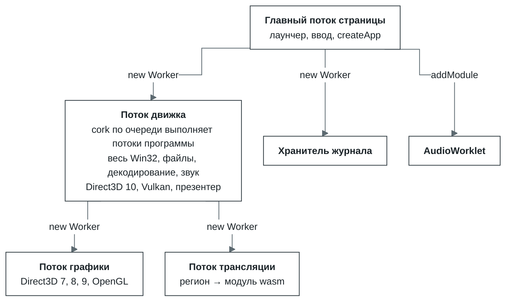
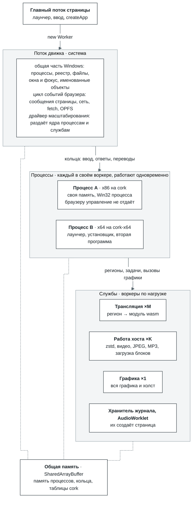

# Roadmap v2 — мультиворкерная платформа

English version: [README.md](README.md).

**Статус:** предложен 3 октября 2026, по `main` cf293c0. Как движок устроен сейчас — в
[`docs/architecture.ru.md`](../../docs/architecture.ru.md); здесь — куда он идёт дальше.

v2 превращает движок из одного потока, который делает всё, в платформу воркеров, число которых
следует за нагрузкой: один воркер, пока он справляется, четыре — когда двое задыхаются, и никогда
четыре без дела. На этой платформе по очереди появятся 64-битные программы, Direct3D 11 и программы
для ARM и ARM64.

1. [Зачем](#зачем)
2. [Где мы сейчас](#где-мы-сейчас)
3. [Куда идёт v2](#куда-идёт-v2)
4. [Принципы](#принципы)
5. [Этап 1 — Разметка: один движок, два режима](#этап-1--разметка-один-движок-два-режима)
6. [Этап 2 — Мультиворкерная платформа с автомасштабированием](#этап-2--мультиворкерная-платформа-с-автомасштабированием)
7. [Этап 3 — x86-64](#этап-3--x86-64)
8. [Этап 4 — Direct3D 11](#этап-4--direct3d-11)
9. [Этап 5 — ARM и ARM64](#этап-5--arm-и-arm64)
10. [Открытые вопросы](#открытые-вопросы)

## Зачем

Скорость сейчас упирается в то, как работа разложена по потокам, а не в то, как быстро выполняются
переведённые инструкции.

- **Это доказал поток графики.** В cork 1.3 Direct3D 8 и 9 ушли из потока движка в отдельный
  воркер. В бенче `tools/graphics-bench --remote` время потока движка на кадр упало с 2,95 мс до
  0,69 мс (`docs/core/graphics.md`), а замер World of Warcraft показал рост с 40–50 до 70–80 кадров
  в секунду. Сами инструкции при этом не изменились.
- **Цикл событий браузера стоит на горячем пути.** В комментарии к циклу хода в `core/src/app.js`
  записано: проход по циклу событий на каждом ходу был самой большой фазой хоста за весь прогон.
  Поток, который выполняет программу, вынужден отдавать управление браузеру, потому что он же
  принимает сообщения страницы, таймеры, ответы `fetch` и OPFS.
- **Всё остальное тоже в этом потоке:** cork по очереди выполняет все потоки программы (квант —
  100 000 инструкций), весь Win32, чтение файлов, zstd, видеодекодер, MP3, подкачка звука,
  Direct3D 10, Vulkan и презентер.
- **Одновременно работает только один процесс.** `CreateProcess` либо заменяет родителя ребёнком,
  либо запускает ребёнка на второй машине, пока родитель стоит на паузе, а потом копирует обратно
  то, что ребёнок записал.

## Где мы сейчас

Шесть потоков, и только один из них выполняет программу и отвечает ей. Память программы — обычная
`WebAssembly.Memory`, к которой может прикасаться только этот поток.

## Куда идёт v2

Три уровня, у каждого одна задача:

| Уровень | В терминах Windows | Что в нём | Где работает |
| --- | --- | --- | --- |
| **Система** | Часть Windows, общая для всех процессов | Таблица процессов, реестр, файловая система, оконный менеджер и фокус, именованные объекты (мьютексы, события, отображения файлов, каналы), буфер обмена; цикл событий браузера; драйвер масштабирования | Поток движка в роли координатора. Код программ он не выполняет |
| **Процессы** | Процесс | Своя память программы, свой движок (cork или cork-x64) и Win32 процесса: хэндлы, кучи, модули, TLS, очередь сообщений, запись вызовов Direct3D и OpenGL | Отдельный воркер на каждый процесс, внутри — от 1 до N исполнителей для его потоков |
| **Службы** | Драйверы и системные службы | Трансляция, работа хоста (декодеры, загрузка блоков), графика вместе с холстом, хранитель журнала, AudioWorklet | Пулы воркеров, размер которых выбирает драйвер |

Код программы и вызовы Win32, на которые она ждёт ответа сразу, живут в одном воркере. Поэтому
вызов, на который можно ответить немедленно, никогда не переходит между потоками. Между потоками
ходит только то, что и так медленное (блок файла, кадр видео, перевод), или то, что вызывают редко
(окно другого процесса, именованный объект, реестр).

## Принципы

Они действуют на всех этапах.

1. **Один движок, два режима.** Однопоточный режим — это то, как всё работает сейчас: один
   исполнитель, обычные переводы, никаких атомиков. Многопоточный — тот же код с несколькими
   исполнителями и атомарным вариантом каждого перевода. Режим выбирает драйвер во время работы;
   это никогда не отдельная сборка.
2. **Мощность идёт за нагрузкой.** Воркер без работы не держим; добавляем, когда имеющиеся не
   успевают. Минимумы повторяют то, что есть сейчас: один исполнитель, один воркер трансляции, ни
   одного воркера работы хоста, один поток графики.
3. **Исполнитель никогда не ждёт браузер.** Всё, что получает процесс, — ввод, завершение
   ввода-вывода, ответы рендерера, опубликованные переводы — приходит через кольца в общей памяти.
   Исполнитель, которому нечего делать, спит на `Atomics.wait`, и его будят `Atomics.notify`.
   Первое такое кольцо уже есть: слово-сигнал, которое страница увеличивает при каждом сообщении.
4. **Общая память с самого старта.** Признак `shared` задаётся при создании `WebAssembly.Memory`
   и потом не меняется, а обычную память нельзя отдать другому воркеру. Обычные чтения и записи в
   общую память стоят столько же, так что однопоточный режим на этом ничего не теряет.
5. **Каждый этап сначала приходит в однопоточном режиме** и принимается в нём, и только потом для
   него включается многопоточный.

## Этап 1 — Разметка: один движок, два режима

**Цель.** Правильные слои, чтобы нынешний движок работал в однопоточном режиме ровно как сейчас и мог
работать в многопоточном, где нужны атомарные операции.

**Что сделать.**

- **Общая память программы.** `cork-host.js` создаёт память программы с `shared: true`. В
  однопоточном режиме больше ничего не меняется.
- **Два варианта переводов.**
  - *обычный* — нынешний код;
  - *атомарный* — инструкции с префиксом `lock` превращаются в атомарные операции wasm, записи
    становятся упорядоченными, а атомарное обращение к невыровненному адресу идёт обходным путём:
    невыровненный атомик в wasm падает там, где x86 работает.

  Ключ хранилища переводов уже содержит вариант (`runtime/cache.js`), так что оба лежат рядом.
- **Исполнители.** В слое `cpu` исполнитель становится отдельной сущностью: поток со своими
  экземплярами модулей, своей таблицей функций и своим блоком состояния поверх общей памяти.
  Публикация перевода и его сброс при записи в код адресуются всем исполнителям: флаги страниц в
  общей памяти плюс номер эпохи, который проверяет каждый.
- **Win32 делится надвое.** Общая для системы часть (таблица процессов, реестр, файловая система,
  оконный менеджер, именованные объекты, буфер обмена) и часть процесса (хэндлы, кучи, модули, TLS,
  очередь сообщений, запись Direct3D и OpenGL), с одним интерфейсом между ними. В однопоточном
  режиме это прямой вызов, между потоками — кольцо и ожидание.
- **Входящие кольца** для ввода, завершений ввода-вывода, ответов рендерера и опубликованных
  переводов вместо `postMessage` в поток, который выполняет код программы.

**Сколько стоит многопоточный режим и когда он окупается.** Атомарный вариант замедляет каждого
исполнителя на какой-то налог *t*; его ещё предстоит измерить на корпусе и бенчмарках. Два
исполнителя выигрывают, когда их ускорение *S* удовлетворяет условию *S* × (1 − *t*) > 1. При
*t* = 20 % это *S* > 1,25, а по закону Амдала для этого параллельно должно идти больше 40 % работы.
Драйвер включает многопоточный режим, только когда у процесса большую часть времени готовы к работе
два потока и больше. Поэтому программа с одним занятым потоком налог не платит вовсе.

**Этап принят, когда** в однопоточном режиме все существующие наборы тестов проходят без изменений,
а время кадра на бенчмарках в пределах шума от `main`; а в многопоточном режиме с одним
исполнителем те же наборы проходят на атомарном варианте.

## Этап 2 — Мультиворкерная платформа с автомасштабированием

**Цель.** Поток движка становится системой, процессы работают в своих воркерах, службы
масштабируются по нагрузке.

**Что сделать.**

- **Разделить воркер движка** на координатора (цикл событий, ввод-вывод, сеть, общая часть Win32,
  пулы, драйвер) и воркеры процессов (cork и Win32 процесса).
- **Процессы работают одновременно.** Каждый — в своём воркере со своей памятью, размер которой
  задаётся на процесс (`memorySize`). Это заменяет замену процесса и копирование назад после выхода
  ребёнка: реестр и файлы принадлежат системе, так что запись одного процесса другой видит сразу.
  Отдельная память у каждого процесса снимает и ту причину, по которой когда-то выбрали замену
  процесса: двум образам больше не нужен один и тот же адрес `0x400000`.
- **Пулы служб.** Трансляция ×M: `emitBatch` уже чистая функция. Работа хоста ×K: блоки zstd,
  видеодекодер, `ijl15`, MP3, загрузка блоков. Графика забирает холст и то, что ещё рисует поток
  движка: Direct3D 10, Vulkan, вывод DirectDraw и GDI.
- **Драйвер масштабирования.** Один на весь движок, в координаторе: пулы делят одни и те же ядра,
  и отдельные драйверы отбирали бы их друг у друга. Бюджет драйвера —
  `navigator.hardwareConcurrency` минус постоянные потоки (страница, координатор, AudioWorklet,
  графика). Воркеры сами пишут своё состояние в общую память: заняты или свободны, длина очереди,
  время в работе. Так же движок уже отдаёт журнал и счётчики хранителю журнала. Драйвер только
  читает; каждое решение — сравнение нескольких чисел между ходами планировщика.
- **Несколько исполнителей на процесс** через смену режима в безопасной точке: все потоки
  останавливаются на границе кванта, опубликованные переводы сбрасываются, подгружаются атомарные
  варианты, работа продолжается. Обратно к одному исполнителю — так же.

| Пул | Мин | Макс | Растёт, когда | Сжимается |
| --- | --- | --- | --- | --- |
| Исполнители процесса | 1 | бюджет, но не больше числа потоков процесса | у процесса большую часть времени готовы к работе два потока и больше | редко и после долгого затишья: это смена режима |
| Трансляция | 1 | бюджет | горячий код ждёт перевода, очередь пакетов растёт | после нескольких секунд простоя |
| Работа хоста | 0 | бюджет | потоки программы ждут декодирования или загрузки блоков | после нескольких секунд простоя |
| Графика, хранитель журнала, AudioWorklet | 1 | 1 | — | — |

| Настройка | Сейчас | Больше |
| --- | --- | --- |
| Процессы, P | 1: ребёнок и родитель работают по очереди | P воркеров процессов, у каждого своя память |
| Исполнители на процесс, N | 1: в потоке движка | N на процесс, атомарный вариант переводов |
| Трансляция, M | 1 воркер | M воркеров, пакеты делятся между ними |
| Работа хоста, K | 0: всё в потоке движка | K воркеров; поток программы ждёт ответа, как ждёт файл |
| Графика (`graphicsWorker`) | 1: Direct3D 7, 8, 9, OpenGL | 1: вся графика и холст |
| Память программы | обычная `WebAssembly.Memory` | общая (`shared: true`) с самого старта |

**Этап принят, когда** на минимумах время кадра на бенчмарках не хуже, чем в `main`; родительский и
дочерний процессы работают одновременно и сразу видят записи друг друга в реестр и файлы; а под
синтетической нагрузкой драйвер наращивает и сжимает каждый пул без раскачки.

## Этап 3 — x86-64

**Цель.** 64-битные программы, сразу на многопоточной платформе.

**Что сделать.**

- **`cork-x64`** — отдельный пакет на том же контракте исполнителя, который переиспользует `./wasm`
  и `./runtime` из cork. Поля контракта уже названы под `bits: 64` (`cpu/engine.js`), рядом с
  `fsBase` есть `gsBase`. Заготовки, с которыми строился cork, переходят как есть: декодер принимает
  режим, IR и алгебра ленивых флагов написаны для размеров до 8 байт, у раскладки состояния есть
  ширина, хэш входов работает с полным адресом, адреса программы на стороне JavaScript — числа
  меньше 2^53, а тип адреса эмиттер берёт из раскладки.
- **Разрядность — свойство процесса.** Загрузчик читает поле machine в заголовке PE (`0x014c` —
  x86, `0x8664` — x64) и запускает воркер процесса на cork или cork-x64. 32- и 64-битные процессы
  работают рядом, как под WOW64. Система добавляет перенаправления WOW64: `System32` и `SysWOW64`,
  `Wow6432Node` в реестре.
- **Win32 с 64-битной раскладкой структур.** Указатели и хэндлы занимают 8 байт, выравнивание
  другое, поэтому каждому обработчику, который читает или пишет структуру программы, нужна её
  64-битная раскладка. Это самая большая часть этапа.
- **Соглашение вызова x64** в мосте: RCX, RDX, R8, R9 и теневое место на стеке — одно соглашение
  вместо stdcall, cdecl и thiscall. Таблицы методов COM со слотами по 8 байт.
- **Исключения.** SEH на x64 построен на таблицах раскрутки (`.pdata` и `.xdata`) вместо цепочки
  кадров на стеке, так что диспетчер исключений пишется заново.
- **PE32+** в загрузчике (сейчас `pe.js` принимает только i386), синтезированные системные DLL в
  формате PE32+ и 64-битные заглушки ловушек. `out dx, eax` в 64-битном режиме работает так же.
- **Адресное пространство.** 64-битная программа рассчитывает на адреса выше 4 ГиБ; её образ по
  умолчанию грузится на `0x140000000`. Либо wasm `memory64` с 64-битным индексом, либо 32-битная
  память, в которой всё уложено в окно 4 ГиБ, а образы перемещены ниже него. Тип адреса в
  эмиттере — одна настройка, так что выбор затрагивает один файл; см. открытые вопросы.

**Этап принят, когда** набор 64-битных тестовых программ и корпус инструкций x86-64 проходят на
cork-x64 — как в одиночку, так и рядом с 32-битным процессом.

## Этап 4 — Direct3D 11

**Цель.** Direct3D 11, на котором рисует большинство 64-битных игр. Сейчас в слое `graphics` есть
DirectDraw, Direct3D с 7-й по 10-ю версию, OpenGL и Vulkan.

**Что сделать.** Direct3D 11 и его DXGI на бэкенде WebGPU: вызовы записываются в воркере процесса и
проигрываются в потоке графики, как сейчас Direct3D 7–9. Байткод шейдеров (shader model 4 и 5)
переводится в WGSL. То, что уже есть у Direct3D 10 (форматы DXGI, объекты конвейера), используется
общим, а не копируется.

**Этап принят, когда** юнит- и контрактные тесты слоя и сравнение с эталонными кадрами покрывают
Direct3D 11 так же, как Direct3D 9, а программа на Direct3D 11 рисует в браузерном стенде.

## Этап 5 — ARM и ARM64

**Цель.** Программы для Windows, собранные под ARM (machine `0x01C4` в заголовке PE) и ARM64
(`0xAA64`), — как ещё одни пакеты движка на том же контракте исполнителя. Выбираются для каждого
процесса так же, как cork и cork-x64. Бинарники ARM64EC и ARM64X смешивают в одном процессе код x64
и ARM64, и им понадобятся два движка в одном исполнителе.

## Открытые вопросы

- **Адресное пространство x64:** `memory64` или окно в 4 ГиБ. `memory64` есть в Chrome и Firefox;
  есть ли он в Safari — от этого зависит, может ли он быть единственным путём.
- **Налог атомарного варианта:** сколько он стоит каждому исполнителю на x86- и на ARM-машинах и
  можно ли упорядочивать не все записи, не ломая программы, которые рассчитывают на порядок записей
  x86.
- **Память процессов на телефонах:** сколько памяти процессов браузер телефона даст держать
  одновременно и какой `memorySize` взять по умолчанию для вспомогательного процесса.
- **Границы этапа 5:** только ли это программы для Windows на ARM, как написано здесь.
